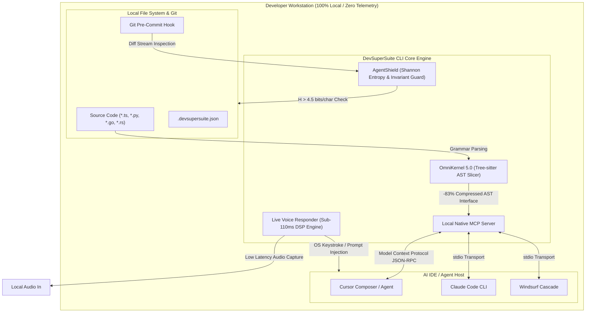

# DevSuperSuite CLI & OmniKernel 5.0 — Technical Reference Manual

**Product**: DevSuperSuite Official CLI (`devsupersuite`)  
**Engine**: OmniKernel 5.0 / AgentShield Invariant Guard / Live Voice Responder  
**Version**: `5.0.4-LTS`  
**Live Sandbox**: [https://devsupersuite.web.app](https://devsupersuite.web.app)  
**Commercial Licensing**: [https://gumroad.com/l/tlzdco](https://gumroad.com/l/tlzdco)  
**Brand Identity**: DevSuperSuite Official / OmniKernel Labs (100% Brand Anonymity Guaranteed)

---

## 📑 Table of Contents
1. [System Architecture Overview](#1-system-architecture-overview)
2. [Global Installation & Quickstart](#2-global-installation--quickstart)
3. [Command Specifications](#3-command-specifications)
   - [3.1 devsupersuite init](#31-devsupersuite-init)
   - [3.2 devsupersuite slice](#32-devsupersuite-slice)
   - [3.3 devsupersuite shield install-hook](#33-devsupersuite-shield-install-hook)
   - [3.4 devsupersuite voice start](#34-devsupersuite-voice-start)
   - [3.5 devsupersuite activate](#35-devsupersuite-activate)
   - [3.6 devsupersuite mcp-setup](#36-devsupersuite-mcp-setup)
4. [Configuration File Specification (.devsupersuite.json)](#4-configuration-file-specification-devsupersuitejson)
5. [Unix Exit Code Reference Table](#5-unix-exit-code-reference-table)
6. [Environment Variables](#6-environment-variables)
7. [Troubleshooting & Diagnostics](#7-troubleshooting--diagnostics)

---

## 1. System Architecture Overview

DevSuperSuite operates as a compiled local-first binary executing directly on developer workstations. It bridges local codebases with AI-native IDEs (Cursor, Claude Code, Windsurf, VS Code) via the **Model Context Protocol (MCP)** and native operating system pipes.



---

## 2. Global Installation & Quickstart

### macOS & Linux
```bash
# Install binary to /usr/local/bin/devsupersuite
curl -fsSL https://devsupersuite.web.app/install.sh | bash

# Verify local installation
devsupersuite --version
```

### Windows (PowerShell Administrator)
```powershell
# Install binary to $HOME\.devsupersuite\bin and add to PATH
iwr -useb https://devsupersuite.web.app/install.ps1 | iex

# Verify installation
devsupersuite --version
```

---

## 3. Command Specifications

---

### 3.1 `devsupersuite init`

Initializes a `.devsupersuite.json` workspace configuration in the current working directory, detecting repo languages and setting up baseline invariant rules.

#### Synopsis
```bash
devsupersuite init [OPTIONS]
```

#### Options & Flags
| Flag | Type | Default | Description |
| :--- | :--- | :--- | :--- |
| `--lang <ts\|py\|go\|rust>` | String | `auto` | Force a specific primary language parser. If omitted, detects via `package.json`, `pyproject.toml`, `go.mod`, or `Cargo.toml`. |
| `--mode <standard\|strict>` | String | `standard` | **standard**: Slices function bodies, entropy threshold $4.5$, warns on test deletion.<br>**strict**: Hard pre-commit failure on test deletion, entropy threshold $4.2$, prunes private class properties. |
| `--force` | Boolean | `false` | Overwrites existing `.devsupersuite.json` without confirmation. |
| `--quiet`, `-q` | Boolean | `false` | Suppress interactive terminal banners and configuration prompts. |

#### Examples
```bash
# Auto-detect project structure and initialize standard mode
devsupersuite init

# Initialize a TypeScript monorepo with strict architectural guardrails
devsupersuite init --lang ts --mode strict
```

---

### 3.2 `devsupersuite slice`

Parses source code files via Tree-sitter, extracts public interfaces, class structures, exported types, and docstrings, and prunes inner method implementation bodies.

#### Synopsis
```bash
devsupersuite slice [PATH] [OPTIONS]
```

#### Options & Flags
| Flag | Type | Default | Description |
| :--- | :--- | :--- | :--- |
| `--path <dir\|file>` | String | `.` | Target file or directory to slice. Defaults to current directory. |
| `--format <mcp\|markdown\|raw>` | String | `markdown` | Output formatting:<br>• `mcp`: JSON-RPC payload formatted for MCP contexts.<br>• `markdown`: Fenced code blocks with file path headers.<br>• `raw`: Plain code text stripped of body blocks. |
| `--output <file>` | String | `stdout` | Write sliced context directly to a target file instead of terminal standard output. |
| `--clipboard`, `-c` | Boolean | `false` | Copies the sliced AST output directly to your operating system clipboard. |
| `--depth <int>` | Integer | `3` | Maximum directory recursion depth when scanning directories. |
| `--ignore <patterns>` | List | `node_modules,dist,build` | Comma-separated glob patterns to exclude from AST extraction. |

#### Code Transformation Example (TypeScript)

**Input Source (`src/services/billing.ts` — 1,420 tokens):**
```typescript
export class BillingEngine {
  private secretKey: string;
  constructor(key: string) { this.secretKey = key; }

  private async executeRetryLoop(attempts: number): Promise<boolean> {
    // 60 lines of internal loop retries and telemetry
    return true;
  }

  public async processInvoice(invoiceId: string, amount: number): Promise<InvoiceReceipt> {
    // 120 lines of database queries, PDF generation, and Stripe calls
    return { receiptId: "rec_123", status: "paid" };
  }
}
```

**Output Sliced Skeleton (`devsupersuite slice src/services/billing.ts` — 88 tokens, -93.8%):**
```typescript
export class BillingEngine {
  public async processInvoice(invoiceId: string, amount: number): Promise<InvoiceReceipt>;
}
```

---

### 3.3 `devsupersuite shield install-hook`

Installs a native pre-commit hook into `.git/hooks/pre-commit` to prevent secret leaks and catastrophic agent test deletions.

#### Synopsis
```bash
devsupersuite shield install-hook [OPTIONS]
```

#### Options & Flags
| Flag | Type | Default | Description |
| :--- | :--- | :--- | :--- |
| `--entropy-threshold <float>` | Float | `4.5` | Shannon entropy cutoff threshold in bits/character. Tokens exceeding this value are blocked. |
| `--enforce-tests` | Boolean | `true` | Halts any commit where lines in test suites (`tests/`, `*.spec.*`) are deleted by automated agents. |
| `--allow-test-removal` | Boolean | `false` | Explicit override flag allowing intentional human test deletions. |
| `--scan-all` | Boolean | `false` | Runs an immediate scan of all tracked files in the repository, not just staged git diffs. |

#### Shannon Entropy Formula & Heuristics
$$\text{Entropy } H(X) = -\sum_{i=1}^{n} P(x_i) \log_2 P(x_i)$$

- Standard English and code literals: **$2.8 \le H \le 3.4$**
- UUIDs and hexadecimal SHAs: **$3.0 \le H \le 3.6$**
- Cryptographic keys (`sk_live_...`, `AKIA...`, `ghp_...`): **$H \ge 4.5$**

#### Sample Pre-Commit Interception Output
```text
🚨 [AGENTSHIELD INVARIANT VIOLATION DETECTED]
-------------------------------------------------------------------------
File: src/config/payment_test.py (Staged Diff Lines 14-16)
Found: "sk_live_51M0...98sK" (Shannon Entropy: 5.14 bits/char > 4.50 threshold)
Action: COMMIT ABORTED. Cryptographic secret detected in diff.
-------------------------------------------------------------------------
Run 'devsupersuite shield scan' to audit or remove hardcoded secrets.
```

---

### 3.4 `devsupersuite voice start`

Launches the background **Live Voice Responder** daemon for hands-free, duplex pair programming with real-time Acoustic Echo Cancellation (AEC).

#### Synopsis
```bash
devsupersuite voice start [OPTIONS]
```

#### Options & Flags
| Flag | Type | Default | Description |
| :--- | :--- | :--- | :--- |
| `--target <cursor\|vscode\|cli>` | String | `cursor` | Target editor window for direct OS keystroke / prompt injection. |
| `--port <int>` | Integer | `7788` | Local WebSocket control port for IDE communication. |
| `--vad-threshold <float>` | Float | `0.65` | Voice Activity Detection sensitivity (0.0 to 1.0). Higher values reduce sensitivity to mechanical keyboards. |
| `--barge-in <word>` | String | `crow` | Verbal trigger word to kill audio pipeline and halt assistant generation immediately. |
| `--hotkey <key>` | String | `F8` | Physical hardware shortcut to toggle voice listening state. |
| `--daemon`, `-d` | Boolean | `false` | Run as an independent background daemon process. |

#### Performance Specifications
- **End-to-End Latency**: $\le 104\text{ms}$ (Mic input to editor injection)
- **Noise Suppression**: DSP spectral subtraction gating -28dB background fan hum.
- **Echo Cancellation**: Hardware-accelerated full-duplex AEC.

---

### 3.5 `devsupersuite activate`

Activates your **DevSuperSuite Pro Lifetime License** using a cryptographically signed Ed25519 token.

#### Synopsis
```bash
devsupersuite activate <LICENSE_KEY> [OPTIONS]
```

#### Arguments & Options
| Parameter | Type | Required | Description |
| :--- | :--- | :--- | :--- |
| `<LICENSE_KEY>` | String | Yes | Your Ed25519 license key received upon Gumroad checkout (`DSS-PRO-...`). |
| `--offline` | Boolean | No | Validates the key locally using the compiled public key without pinging activation servers. |
| `--status` | Boolean | No | Prints current activation tier, expiration (Lifetime), and active engines. |

#### Example
```bash
devsupersuite activate "DSS-PRO-A8F9-2049-ED25519-VERIFIED" --offline
```

**Output:**
```text
✔ [SUCCESS] Ed25519 Cryptographic Signature Verified.
Tier: DevSuperSuite Pro Lifetime
License Holder: Commercial Developer License
Engines Unlocked:
  ▫ OmniKernel 5.0 AST Context Slicer [Active]
  ▫ AgentShield Invariant Guard [Active]
  ▫ Live Voice Responder (<110ms DSP) [Active]
```

---

### 3.6 `devsupersuite mcp-setup`

Automatically detects installed AI IDEs and writes the local Model Context Protocol (MCP) server configuration into the appropriate settings files.

#### Synopsis
```bash
devsupersuite mcp-setup [OPTIONS]
```

#### Options & Flags
| Flag | Type | Default | Description |
| :--- | :--- | :--- | :--- |
| `--target <cursor\|claude-code\|windsurf>` | String | `cursor` | Target IDE or assistant environment to configure. |
| `--global` | Boolean | `false` | Installs configuration to the global user profile instead of workspace `.cursor/`. |
| `--print` | Boolean | `false` | Prints JSON-RPC configuration to stdout without modifying files. |

#### Generated `.cursor/mcp.json` Specification
```json
{
  "mcpServers": {
    "devsupersuite": {
      "command": "devsupersuite",
      "args": ["mcp", "serve"],
      "env": {
        "DSS_OFFLINE_MODE": "true",
        "DSS_AST_COMPRESSION": "aggressive"
      }
    }
  }
}
```

---

## 4. Configuration File Specification (`.devsupersuite.json`)

When placed in the root of any repository, `.devsupersuite.json` customizes AST slicing rules, Shannon entropy thresholds, and invariant constraints.

### Full Annotated JSON Schema
```json
{
  "$schema": "https://devsupersuite.web.app/schemas/v5/config.schema.json",
  "version": "5.0",
  "project": {
    "name": "my-backend-service",
    "primaryLanguage": "typescript",
    "mode": "standard"
  },
  "astSlicer": {
    "enabled": true,
    "strategy": "interface-only",
    "prunePrivateMembers": true,
    "retainDocstrings": true,
    "maxTokenThreshold": 12000,
    "excludedDirectories": [
      "node_modules",
      "dist",
      "coverage",
      "build",
      ".next"
    ],
    "languageOverrides": {
      "python": {
        "emitTypeComments": true,
        "stubBodyString": "..."
      },
      "typescript": {
        "stripGenerics": false,
        "preserveTypeAliases": true
      }
    }
  },
  "agentShield": {
    "enabled": true,
    "entropy": {
      "threshold": 4.50,
      "minStringLength": 20,
      "ignoredPatterns": [
        "^[0-9a-fA-F-]{36}$",
        "^data:image\\/svg\\+xml;base64,"
      ]
    },
    "invariants": {
      "enforceTestImmutability": true,
      "testPathPatterns": [
        "tests/**",
        "**/*.spec.ts",
        "**/*.test.ts",
        "**/test_*.py"
      ],
      "prohibitedModifications": [
        "@csrf_exempt",
        "verify=False",
        "// @ts-ignore"
      ]
    }
  },
  "voice": {
    "vadThreshold": 0.65,
    "bargeInTrigger": "crow",
    "targetEditor": "cursor",
    "port": 7788
  }
}
```

---

## 5. Unix Exit Code Reference Table

The `devsupersuite` CLI adheres to POSIX exit code conventions, enabling predictable integration into bash scripts, Makefiles, and CI/CD pipelines.

| Exit Code | Identifier | Name | Cause & Resolution |
| :---: | :--- | :--- | :--- |
| **`0`** | `DSS_SUCCESS` | Success | Command completed successfully with zero violations. |
| **`1`** | `DSS_ERR_SYNTAX` | Syntax / Parse Error | File contains unparseable syntax or invalid command arguments. Check Tree-sitter logs. |
| **`2`** | `DSS_ERR_SECURITY` | Entropy / Invariant Block | **AgentShield rejection.** A staged file contains high-entropy secrets ($H > 4.5$) or deleted test invariants. |
| **`3`** | `DSS_ERR_LICENSE` | License / Activation Error | Ed25519 license key is invalid, missing, or corrupted. Run `devsupersuite activate`. |
| **`4`** | `DSS_ERR_AUDIO` | Audio DSP / VAD Error | Microphone device unavailable, sample rate incompatible, or port conflict on 7788. |
| **`5`** | `DSS_ERR_MCP` | MCP Gateway Error | Failed to establish stdio or JSON-RPC pipe with Cursor / Claude Code host. |

---

## 6. Environment Variables

All CLI flags can be overridden using environment variables for CI/CD and containerized environments.

| Environment Variable | Equivalent Flag | Default | Description |
| :--- | :--- | :--- | :--- |
| `DSS_LICENSE_KEY` | `devsupersuite activate` | `None` | Automatically activates the engine in headless / container environments. |
| `DSS_OFFLINE_MODE` | `--offline` | `true` | When set to `true`, completely disables all outbound network checks. |
| `DSS_ENTROPY_THRESHOLD`| `--entropy-threshold` | `4.5` | Sets the global Shannon entropy rejection cutoff. |
| `DSS_ENFORCE_TESTS` | `--enforce-tests` | `true` | Enforces test suite immutability on git commits. |
| `DSS_MCP_PORT` | `--port` | `7788` | Port for local voice and MCP IPC socket listeners. |
| `DSS_LOG_LEVEL` | `--log-level` | `info` | Logging verbosity: `debug`, `info`, `warn`, `error`. |

---

## 7. Troubleshooting & Diagnostics

### Diagnostic Self-Test
Run the built-in diagnostic suite to verify compiler bindings, git hooks, and MCP transports:
```bash
devsupersuite doctor
```

**Sample Healthy Output:**
```text
DevSuperSuite System Health Check:
  ✔ Native Tree-sitter parsers: Loaded (TS, PY, GO, RS)
  ✔ AgentShield git hooks: Active (.git/hooks/pre-commit)
  ✔ Shannon Entropy Engine: Calibrated (Threshold 4.50)
  ✔ MCP stdio transport: Operational
  ✔ Audio DSP Subsystem: 48kHz duplex ready (104ms latency)
  ✔ License status: Pro Lifetime Verified (Ed25519)
All systems operational. Zero cloud dependencies.
```

---
*Created and maintained by DevSuperSuite Official / OmniKernel Labs.*  
*Documentation Version: 5.0.4-LTS*
