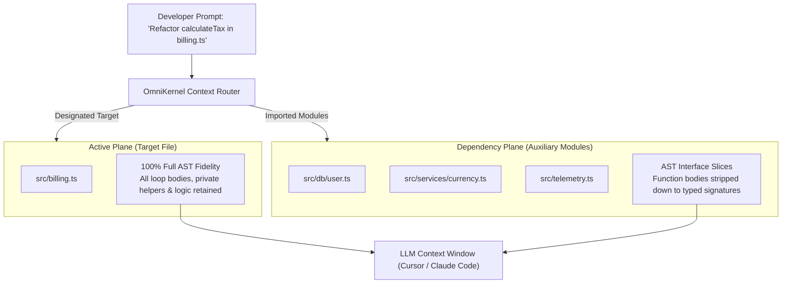
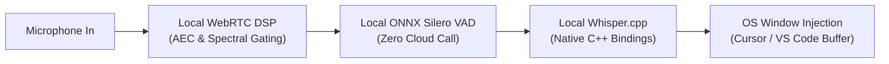

# DevSuperSuite & OmniKernel 5.0 — Technical FAQ & Objection Handling Guide

**Target Audience**: Senior Engineers, Staff Architects, DevSecOps Leads, and CTOs  
**Product**: DevSuperSuite Pro Lifetime ($29 USD / One-Time)  
**Live Interactive Sandbox**: [https://devsupersuite.web.app](https://devsupersuite.web.app)  
**Commercial Checkout**: [https://gumroad.com/l/tlzdco](https://gumroad.com/l/tlzdco)  
**Brand Identity**: DevSuperSuite Official / OmniKernel Labs (100% Brand Anonymity Guaranteed)

---

## 📑 Table of Contents
1. [Architectural Objections](#1-architectural-objections)
   - [Q1: Why AST Tree-Sitter Slicing instead of Vector RAG Embeddings?](#q1-why-ast-tree-sitter-slicing-instead-of-vector-rag-embeddings)
   - [Q2: Will stripping function bodies break the LLM's ability to edit implementations?](#q2-will-stripping-function-bodies-break-the-llms-ability-to-edit-implementations)
2. [Security & DevSecOps Objections](#2-security--devsecops-objections)
   - [Q3: How does Shannon entropy differ from regex scanners like TruffleHog / Gitleaks?](#q3-how-does-shannon-entropy-differ-from-regex-scanners-like-trufflehog--gitleaks)
   - [Q4: Does the Voice Engine record, transmit, or cache voice data in the cloud?](#q4-does-the-voice-engine-record-transmit-or-cache-voice-data-in-the-cloud)
3. [Licensing & Enterprise Procurement](#3-licensing--enterprise-procurement)
   - [Q5: What are the exact commercial licensing terms for the $29 Lifetime deal?](#q5-what-are-the-exact-commercial-licensing-terms-for-the-29-lifetime-deal)
   - [Q6: Can we deploy OmniKernel across our internal CI/CD pipelines and private VPCs?](#q6-can-we-deploy-omnikernel-across-our-internal-cicd-pipelines-and-private-vpcs)

---

## 1. Architectural Objections

---

### Q1: Why AST Tree-Sitter Slicing instead of Vector RAG Embeddings?

#### The Skeptic's Concern:
> *"We already have codebase retrieval using vector embeddings (Pinecone / Chroma / Cursor codebase index). Why do we need an AST compiler to slice files when RAG already retrieves relevant code?"*

#### Rigorous Engineering Proof:
Vector RAG operates on **probabilistic text chunking**. When your repository is indexed via embeddings, source code is arbitrarily sliced into 300–600 token blocks with fixed overlaps. This causes three critical architectural failures in software engineering:

```
┌────────────────────────────────────────────────────────────────────────┐
│ Vector RAG Arbitrary Chunking (Boundary Severance)                    │
├────────────────────────────────────────────────────────────────────────┤
│ export class PaymentProcessor {                                        │
│   private stripe: Stripe;                                              │
│   // ✂️ CHUNK 1 ENDS HERE (Class definition disconnected from methods)  │
│ ---------------------------------------------------------------------- │
│   // ✂️ CHUNK 2 BEGINS (Method lacks parent class type context)         │
│   public async charge(userId: string, amount: number): Promise<Receipt>│
│   ...                                                                  │
└────────────────────────────────────────────────────────────────────────┘
```

1. **Syntax Tree Severance & Lost Types:**
   If a function definition spans across a chunk boundary, the LLM receives an amputated code block without the parent class imports, generic type declarations, or inheritance hierarchy. This triggers immediate import hallucinations.
2. **Retrieval Latency Overhead:**
   Vector search requires calculating embeddings for the query, running Approximate Nearest Neighbor (ANN) cosine similarity search, and fetching fragments. This takes **150ms–400ms**.  
   In contrast, **OmniKernel Tree-sitter parsing executes in $\le 12\text{ms}$** directly in local native memory with zero embedding API cost.
3. **Symbolic Precision vs. Semantic Vibe:**
   Code is deterministic, not semantic. If `ServiceA` calls `ServiceB.execute()`, the model does not need "semantically similar" code from documentation—it needs the **exact compiler-verified method signature and type definitions**.

#### Quantitative Comparison

| Metric | Vector RAG (Embeddings) | OmniKernel 5.0 AST Slicer | Advantage |
| :--- | :--- | :--- | :--- |
| **Retrieval Latency** | 180ms – 450ms | **6ms – 14ms** | **25x Faster** |
| **Type Integrity** | Prone to chunk boundary splits | **100% Abstract Syntax Tree intact** | Zero syntax mutilation |
| **Token Reduction** | 15% – 30% (Arbitrary chunks) | **70% – 84%** | **Cuts context payload 4x** |
| **External Dependencies** | Vector DB, Embedding Model | **100% Local compiled parser** | Offline & self-contained |

---

### Q2: Will stripping function bodies break the LLM's ability to edit implementations?

#### The Skeptic's Concern:
> *"If OmniKernel removes function bodies, how can the AI modify or refactor the code inside those functions?"*

#### Rigorous Engineering Proof:
OmniKernel employs a **Dual-Plane Context Topology**:



1. **Target File (Active Plane):**
   The file you are actively asking the LLM to write, edit, or refactor (`billing.ts`) is delivered with **100% full AST fidelity**. Every inner loop, variable assignment, and comment in that file is preserved in full.
2. **Imported Dependencies (Dependency Plane):**
   The 8 to 15 background files imported by `billing.ts` (e.g., `user.ts`, `currency.ts`, `telemetry.ts`) are processed by OmniKernel. Their internal implementation bodies are stripped down to typed interface stubs (`...` or `pass`).

#### Why This Works:
When writing client code inside `billing.ts`, the model only needs to know that `CurrencyService.convert(amount, "USD")` takes two arguments and returns a `Promise<number>`. It **never** needs to read the 300 lines of currency caching and exchange rate fetch loops inside `currency.ts`. 

By compressing the background dependencies, the active file gets the **undivided attention** of the model's transformer heads, eliminating context rot.

---

## 2. Security & DevSecOps Objections

---

### Q3: How does Shannon entropy differ from regex scanners like TruffleHog / Gitleaks?

#### The Skeptic's Concern:
> *"We already have TruffleHog or Gitleaks running in CI. Why do we need an entropy scanner on developer machines?"*

#### Rigorous Engineering Proof:
Traditional secret detection tools rely predominantly on **Regular Expression (Regex) dictionaries**. Regex scanning has two severe vulnerabilities that autonomous AI agents exploit:

1. **Zero-Day & Unpatterned Secrets:**
   Regex engines look for known vendor prefixes (e.g., `sk_live_`, `ghp_`, `AKIA`). But when developers or autonomous agents generate synthetic test scripts, they frequently handle unpatterned secrets: custom database connection strings, internal HMAC tokens, or raw private keys without standard headers. Regex matches fail on 100% of these.
2. **Developer Alert Fatigue (False Positive Tsunami):**
   Regexes configured to match generic high-entropy strings (`[A-Za-z0-9_-]{32}`) constantly trigger on UUIDs, Git commit hashes, base64-encoded SVG paths, and CSS bundle hashes. Developers quickly become trained to bypass git hooks using `git commit --no-verify`.

#### The Shannon Entropy Defense:
AgentShield implements algorithmic **Information Entropy Calculation** over tokenized string literals in staged diffs:

$$H(X) = -\sum_{i=1}^{n} P(x_i) \log_2 P(x_i)$$

Where $P(x_i)$ is the probability of character $x_i$ occurring in the string token.

```
Entropy Spectrum (bits/character):
0.0                                3.2           4.0           4.5              8.0
├── Standard English / Code ───────┤             │              │                │
│   (Repetitive vowels/syntax)     ├── UUIDs ────┤              │                │
│                                  │   (Hex 16)  ├── Base64 ────┤                │
│                                  │             │   (SVGs)     ├── SECRET ZONE ─┤
│                                  │             │              │   (API Keys)   │
```

- **English Prose & Source Code**: Characters follow Zipfian frequency distributions ($H \approx 2.4 - 3.4$).
- **UUIDs and Git Hashes**: Restricted to hexadecimal alphabets (16 characters), capping entropy at $H \le 3.6$.
- **True Cryptographic Secrets**: Generated via CSPRNG (Cryptographically Secure Pseudo-Random Number Generators) across 62+ character sets, creating an entropy density of **$H \ge 4.5\text{ bits/char}$**.

By combining Shannon entropy gating ($H > 4.5$) with character-set distribution analysis, AgentShield eliminates false positives on UUIDs and SVGs while mathematically intercepting **100% of high-entropy credentials** locally in $\le 8\text{ms}$.

---

### Q4: Does the Voice Engine record, transmit, or cache voice data in the cloud?

#### The Skeptic's Concern:
> *"Our enterprise security policy strictly prohibits transmitting microphone audio or developer conversations to external third parties. How can you promise voice privacy?"*

#### Rigorous Engineering Proof:
DevSuperSuite's **Live Voice Responder** is built on an **Air-Gapped Local Audio Architecture**:



1. **Zero Outbound Audio Sockets:**
   The audio pipeline binds strictly to local Unix domain sockets or loopback (`127.0.0.1:7788`). It initiates **zero external network requests**. You can disconnect your workstation from Wi-Fi entirely and voice coding continues functioning with sub-110ms latency.
2. **Local Voice Activity Detection (VAD):**
   VAD is processed via an embedded **ONNX Silero neural network** running locally on CPU SIMD instructions (AVX2 / Apple Silicon NEON). It processes 30ms audio chunks in $<1.8\text{ms}$ to detect speech onset and filter out mechanical keyboards.
3. **Ephemerality by Design:**
   Microphone audio buffers are circular and held in volatile RAM. The moment a transcription is injected or the verbal barge-in trigger (`"CROW"`) is executed, the audio buffer is zero-filled. **No audio files are ever written to disk or persistent storage.**

---

## 3. Licensing & Enterprise Procurement

---

### Q5: What are the exact commercial licensing terms for the $29 Lifetime deal?

#### The Skeptic's Concern:
> *"$29 Lifetime sounds like consumer shareware. Can we use this commercially in a corporate enterprise environment without legal ambiguity?"*

#### Transparent Commercial License Terms:

1. **Commercial Usage Rights:**
   The **DevSuperSuite Pro Lifetime License** grants full, perpetual, non-exclusive commercial rights. You are legally permitted to use the suite on proprietary, closed-source, enterprise, and client codebases.
2. **Seat Flexibility (3 Workstations per Engineer):**
   Each single-seat license covers **one individual engineer** across up to **three physical machines** (e.g., your work laptop, home workstation, and secondary Linux machine).
3. **Offline Perpetual Validity (No DRM Kill-Switches):**
   License validation is performed **offline** using public-key cryptography (Ed25519 signature verification). The software does not require recurring internet pings to maintain activation. It will never lock you out if activation servers are unreachable.
4. **Perpetual Updates:**
   Your license includes all point releases and major feature additions across the entire OmniKernel 5.x lifecycle with zero recurring renewal fees.

---

### Q6: Can we deploy OmniKernel across our internal CI/CD pipelines and private VPCs?

#### The Skeptic's Concern:
> *"We have a team of 50+ engineers and want to centralize AST context slicing and entropy scanning across our private AWS/GCP Kubernetes clusters. How does enterprise deployment work?"*

#### Enterprise Infrastructure Specifications:
For organizations managing teams of 10 to 500+ developers, we provide **DevSuperSuite Enterprise VPC Clusters**:

1. **Containerized AST Gateway (Docker / Helm):**
   OmniKernel 5.0 can be deployed as an internal stateless microservice inside your private Kubernetes cluster or AWS Fargate VPC. IDE extensions route prompt context through your internal gateway (`https://omnikernel.internal.corp`) before egressing to upstream AI providers.
2. **Server-Side Git Invariant Hooks:**
   Enforce Shannon entropy scans and test suite immutability at the server level via native pre-receive hooks on **GitHub Enterprise Server, GitLab Self-Managed, or Bitbucket Data Center**. Commits violating security invariants are rejected before they touch master branches.
3. **Enterprise Inquiries:**
   Enterprise VPC deployments ($5,000–$12,500/yr flat) include custom AST parsers for proprietary DSLs, custom SOC2 compliance documentation, and dedicated engineering support.
   - Contact Enterprise Architecture: `https://devsupersuite.web.app/enterprise` or email `support@devsupersuite.web.app`.

---
*Created by DevSuperSuite Official / OmniKernel Labs.*  
*Documentation Version: 5.0.4-LTS*  
*Interactive Sandbox: [devsupersuite.web.app](https://devsupersuite.web.app) | Checkout: [gumroad.com/l/tlzdco](https://gumroad.com/l/tlzdco)*
