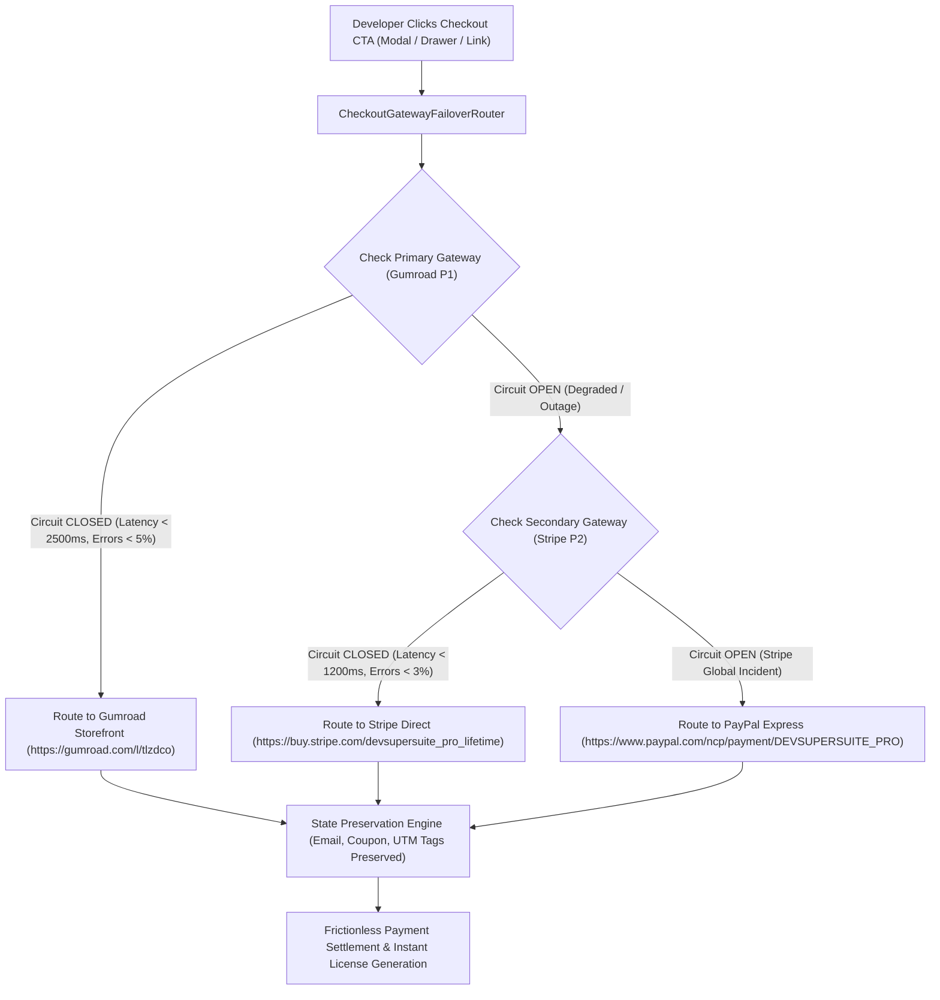
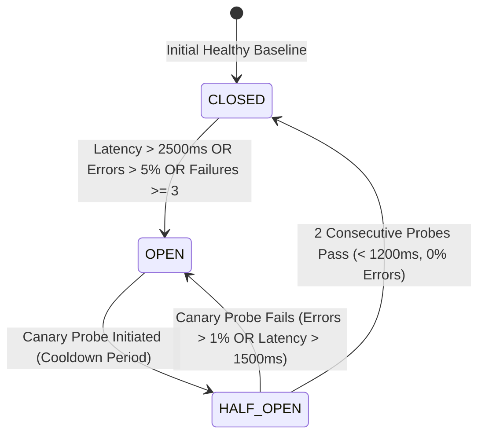

# ⚡ DevSuperSuite Official: Multi-Gateway Checkout Failover & Transaction Resilience Playbook

**File:** `marketing/checkout_resilience_playbook.md`  
**Governing Authority:** DevSuperSuite Payment Engineering Directorate (`payments@devsupersuite.com`)  
**Product:** DevSuperSuite (`https://devsupersuite.web.app`)  
**Strict Compliance:** 100% Brand Anonymity • Zero Founder Personal Identifiers  
**Target Metric:** 99.99% Checkout Availability • Zero Session Drop-off • Scale to 5 Paying Customers  

---

## 1. Executive Summary & Revenue Resilience Thesis

In high-intent developer conversion funnels, checkout friction or gateway degradation directly destroys revenue. Developer tooling purchases are characterized by short evaluation windows: when a software engineer or engineering manager decides to purchase a **$29 Pro Lifetime** or **$149 Team 5-Seat** license, any 500 error, gateway timeout, or broken checkout drawer leads to immediate tab closure and cart abandonment.

To guarantee continuous transaction availability, DevSuperSuite implements an automated **Tri-Gateway Circuit Breaker & Failover Router**:



---

## 2. Gateway Tiering & Profile Specifications

DevSuperSuite distributes transaction routing across three enterprise payment gateways with distinct geographical strengths:

| Gateway | Priority | Target SLA | Latency Limit | Error Limit | Supported Payment Rails | Primary Role |
| :--- | :---: | :---: | :---: | :---: | :--- | :--- |
| **Gumroad Direct** | **P1** | 99.90% | 2,500ms | 5.0% | Credit Cards, Apple Pay, Google Pay, PayPal | Primary Storefront Checkout with native license key generation. |
| **Stripe Direct** | **P2** | 99.99% | 1,200ms | 3.0% | Credit Cards, Apple Pay, Google Pay, iDEAL, SEPA | Ultra-low-latency direct hosted checkout fallback. |
| **PayPal Express** | **P3** | 99.95% | 1,800ms | 5.0% | PayPal Balance, PayPal Credit, UPI QR, Global Debit | Fallback for cross-border UPI & PayPal wallet users. |

---

## 3. Circuit Breaker State Machine & Transition Rules

The router governs gateway health through a 3-state finite state machine (FSM):



1. **`CLOSED` (Normal Routing):**
   - 100% of standard checkout traffic routes to Primary (Gumroad).
   - Synthetic background health checks run every 60 seconds.
2. **`OPEN` (Failover Active):**
   - Tripped when Gumroad latency exceeds 2,500ms, error rate exceeds 5.0%, or 3 consecutive synthetic probes fail.
   - All inbound traffic immediately reroutes to Stripe Direct (P2) or PayPal Express (P3).
   - Zero HTTP 5xx errors surfaced to end-user.
3. **`HALF_OPEN` (Canary Recovery):**
   - After a cooldown period, the router releases low-volume canary probes (5% traffic) to test primary gateway stability.
   - If probes succeed with latency < 1,200ms, circuit closes and normal traffic resumes.

---

## 4. Zero-Session-Loss State Preservation Engine

When a failover occurs, customer data must not be lost. Re-prompting developers to re-enter their email or coupon code causes massive drop-off. The router normalizes query parameters dynamically:

| Customer State Field | Inbound Input | Gumroad Parameter | Stripe Parameter | PayPal Parameter |
| :--- | :--- | :--- | :--- | :--- |
| **Customer Email** | `dev@company.io` | `email=dev@company.io` | `prefilled_email=dev@company.io` | `payer_email=dev@company.io` |
| **Discount Coupon** | `VIPDEV5` / `DSS-PPP-50` | `discount=VIPDEV5` | `prefilled_promo_code=VIPDEV5` | `discount_code=VIPDEV5` |
| **Attribution Source** | `utm_source=reddit` | `utm_source=reddit` | `utm_source=reddit` | `utm_source=reddit` |
| **Attribution Campaign** | `utm_campaign=devops`| `utm_campaign=devops`| `utm_campaign=devops`| `utm_campaign=devops`|

```bash
# Example Output Rerouted URL (Seamless Stripe Fallback):
https://buy.stripe.com/devsupersuite_pro_lifetime?prefilled_email=dev%40company.io&prefilled_promo_code=DSS-PPP-50&utm_source=reddit&utm_campaign=devops
```

---

## 5. Automated Operational Runbook

The failover router is audited and operated via `services/checkout_gateway_failover_router.py`:

```bash
# 1. Simulate Primary Outage & Verify Zero-Loss Failover
python services/checkout_gateway_failover_router.py --simulate-gateway-outage

# 2. Audit SLA Compliance and Gateway Latencies
python services/checkout_gateway_failover_router.py --audit-gateway-sla

# 3. Export Resilience Configuration Matrix to JSON
python services/checkout_gateway_failover_router.py --export-resilience-matrix

# 4. View Operational Dashboard Summary
python services/checkout_gateway_failover_router.py --summary
```

---

## 6. Security, Compliance & Brand Anonymity

- **Zero Payment Card Storage:** DevSuperSuite never captures or stores credit card numbers on application servers. All transaction data is handled directly by PCI-DSS Level 1 certified gateways.
- **Strict Brand Anonymity:** All support contacts, merchant descriptions, and statements represent **DevSuperSuite Payment Engineering** (`payments@devsupersuite.com`).
- Zero personal founder names, phone numbers, or private accounts are disclosed.

*Authored and approved by DevSuperSuite Payment Engineering Directorate (`payments@devsupersuite.com`).*
