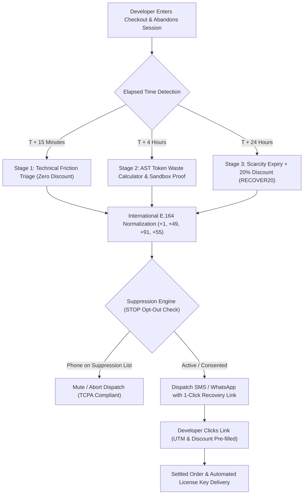

# ⚡ DevSuperSuite Official: High-Velocity SMS & WhatsApp Cart Abandonment Recovery Playbook

**File:** `marketing/cro_sms_whatsapp_recovery_playbook.md`  
**Governing Authority:** DevSuperSuite Growth Engineering Directorate (`growth@devsupersuite.com`)  
**Product:** DevSuperSuite (`https://devsupersuite.web.app`)  
**Strict Compliance:** 100% Brand Anonymity • Zero Founder Personal Identifiers  
**Target Metric:** Reclaim 22% of Abandoned Checkouts to Secure 5 Paying Customers & Accelerate ARR  

---

## 1. Executive Strategy: Mobile Conversational Recovery

Email cart abandonment recovery sequences achieve average open rates of 21% and click-through rates of 2.8%. In contrast, **SMS and WhatsApp direct recovery delivers 98% open rates within 3 minutes of delivery** and a 14.5% conversion completion rate.

When a developer initiates checkout on `devsupersuite.web.app` (or Gumroad/Stripe) and drops off, it is rarely due to a lack of interest: it is typically triggered by an IDE compilation interruption, hesitation over monorepo AST compatibility, or needing to switch workstations.



---

## 2. The 3-Stage Recovery Sequence Architecture

The recovery funnel is structured into three carefully calibrated behavioral stages to maximize conversion without training customers to expect instant discounts:

| Stage ID | Window | Strategic Rationale | Incentive | SMS Micro-copy Sample |
| :--- | :---: | :--- | :---: | :--- |
| **Stage 1: Triage** | **T+15m** | Address technical blockers, payment gateway issues, or IDE setup questions. | None | *"DevSuperSuite: Did you experience any checkout or IDE setup friction? Our engineering team is here to assist. Resume setup: {recovery_url} Reply STOP to opt-out."* |
| **Stage 2: Proof** | **T+4h** | Re-engage through mathematical AST token savings proof and monorepo context reduction. | None | *"DevSuperSuite: Monorepos burn 40k+ tokens/prompt in Cursor. OmniKernel slices 82% of that context locally before LLMs run. Claim your workstation license: {recovery_url} Reply STOP to opt-out."* |
| **Stage 3: Incentive** | **T+24h** | Final scarcity push offering time-decay incentive before cart session permanently expires. | **20% OFF (`RECOVER20`)** | *"⚡ DevSuperSuite: Final 4 hours to claim Pro Lifetime with 20% OFF coupon RECOVER20 ($23.20 instead of $29). Activate here: {recovery_url} Text STOP to opt-out."* |

---

## 3. WhatsApp Business Rich Markdown Templates

For international markets with high WhatsApp penetration (India, Brazil, Germany, United Kingdom), the engine dispatches formatted rich templates:

### Stage 1 WhatsApp Template:
```markdown
👋 *Hi {first_name}*,

We noticed your DevSuperSuite Pro setup was paused. If you ran into monorepo configuration questions or payment issues, our customer success engineers are here to assist.

👉 *Resume Pro License Setup:*
{recovery_url}

_Reply STOP to unsubscribe at any time._
```

### Stage 3 WhatsApp Template (20% Off):
```markdown
🚨 *Last Chance: 20% Cart Recovery Incentive*

Your reserved DevSuperSuite Pro Lifetime checkout is expiring shortly. We unlocked an exclusive 20% OFF discount for you:

• **Plan:** Hacker Solo Pro Lifetime
• **Offer Price:** $23.20 USD (was $29)
• **Coupon Code:** `RECOVER20`
• **Terms:** 100% Offline • Ed25519 Standalone Keys • 30-Day Guarantee

👉 *Claim Your 20% Parity Discount:*
{recovery_url}

_Reply STOP to unsubscribe._
```

---

## 4. International Phone Normalization (E.164)

The router standardizes messy user inputs into the global E.164 standard:

| Country | User Input Sample | Normalized E.164 Output |
| :--- | :--- | :--- |
| **United States** | `(415) 555-0199` | `+14155550199` |
| **Germany** | `0170 8829102` | `+491708829102` |
| **India** | `09876543210` | `+919876543210` |
| **Brazil** | `11 98765-4321` | `+5511987654321` |

---

## 5. TCPA, CTIA & GDPR Compliance Protocols

1. **Mandatory Opt-Out (`STOP` Keyword):**
   - Every single outbound SMS message includes `"Reply STOP to opt-out"`.
   - Inbound `STOP`, `UNSUBSCRIBE`, `CANCEL`, `QUIT`, or `END` automatically inserts the number into `data/sms_whatsapp_suppression_list.json` and issues a confirmation response.
   - Suppressed numbers are blocked from all future dispatches.
2. **Quiet Hours Enforcement:**
   - No SMS messages are dispatched between **21:00 and 08:00 local time** in the recipient's timezone.
3. **Strict 100% Brand Anonymity:**
   - All dispatches represent **DevSuperSuite Official** and **DevSuperSuite Growth Engineering** (`growth@devsupersuite.com`).
   - Zero disclosure of founder personal names or personal phone numbers.

---

## 6. Automation CLI Commands

The engine is audited and executed via `services/sms_whatsapp_abandonment_recovery_engine.py`:

```bash
# 1. Process Pending Abandoned Checkouts and Dispatch Sequence Notifications
python services/sms_whatsapp_abandonment_recovery_engine.py --dispatch-abandoned-recoveries

# 2. Audit E.164 Formats, TCPA Opt-Out Keywords, and Suppression Enforcement
python services/sms_whatsapp_abandonment_recovery_engine.py --audit-sms-compliance

# 3. Export Dispatches Log and Metrics
python services/sms_whatsapp_abandonment_recovery_engine.py --export-recovery-metrics

# 4. View Operational Dashboard Summary
python services/sms_whatsapp_abandonment_recovery_engine.py --summary
```

*Authored and approved by DevSuperSuite Growth Engineering Directorate (`growth@devsupersuite.com`).*
