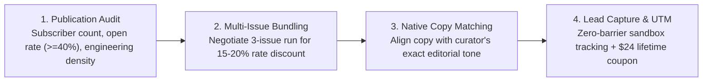

# 📰 DevSuperSuite: Technical Newsletter Sponsorship & Advertising Playbook
### High-Yield Editorial Integrations Across 15 Premier Engineering Publications (3.4M+ Circulation)
**Brand Persona**: **DevSuperSuite Sponsorship Team** (`sponsor@devsupersuite.com`)  
**Compliance**: 100% Brand Anonymity Guaranteed | Zero Founder Personal Data, Residential Addresses, or Phone Numbers  
**Interactive Web Sandbox**: [https://devsupersuite.web.app](https://devsupersuite.web.app)  
**Commercial Checkout**: [https://gumroad.com/l/tlzdco](https://gumroad.com/l/tlzdco)  
**Newsletter Promo Code**: `DSS-NEWSLETTER-20` ($24 Pro Lifetime / Regular $29)  
**Target Registry**: `newsletter_targets.json` (15 Publications / 3,470,000 Subscribers)  
**Execution Engine**: `newsletter_sponsorship_pipeline_engine.py`  
**Pitches Vault**: `newsletter_pitch_payloads/` (15 Staged Pitches)  
**Media Kits Vault**: `newsletter_media_kits/` (15 Sponsorship One-Pagers)

---

## 🧭 1. Executive Strategy & Technical Newsletter Economics

Senior engineers, staff architects, and engineering managers increasingly consume their industry knowledge through curated email newsletters (such as *The Pragmatic Engineer*, *ByteByteGo*, *TLDR*, and *Console.dev*) rather than social feeds.

Newsletter sponsorships deliver:
- **Focused Attention**: Readers sit at their desktop workstations during business hours with editors open.
- **High Technical Intent**: Readers actively study architectural patterns, tooling decisions, and team productivity.
- **Uncluttered Native Format**: Text-based native ads blend seamlessly with editorial commentary, avoiding banner blindness.

DevSuperSuite executes under a **High-Conversion Native Ad Strategy**:
1. **Editorial Harmony**: The ad read sounds like a technical recommendation, not marketing copy.
2. **Immediate Mathematical Proof**: We lead with concrete numbers (-83.0% tokens, 74k to 12.6k tokens, <2.4ms Tree-sitter parsing).
3. **Frictionless Browser Trial**: Readers can test the claims in WebAssembly in <5 seconds at `https://devsupersuite.web.app` with zero login or signup.
4. **100% Brand Anonymity**: Attributed strictly to **DevSuperSuite Sponsorship Team** (`sponsor@devsupersuite.com`). Under zero circumstances are founder personal names, residential data, or phone numbers leaked.

---

## 🤝 2. Negotiation Strategy & Rate Card Optimization



### Key Negotiation Tactics:
1. **Multi-Issue Run Discounts**: Never purchase a single isolated sponsorship. Propose a 2-to-3 issue package to lock in an immediate **15% to 20% discount** off standard rate cards.
2. **Dedicated Main Sponsor vs Secondary Blurb**: For massive lists (*TLDR*, *The Pragmatic Engineer*), secure the primary featured header slot. For focused vertical lists (*Golang Weekly*, *Rust Weekly*), secondary text blurbs deliver higher ROI per dollar.
3. **Audience Exclusivity**: Request that no competing developer utility or AI coding sponsor appear in the same issue.

---

## 📝 3. The 3 Standard Native Text Ad Copy Blueprints

### Blueprint A: Technical Metrics & Context Rot (Best for *The Pragmatic Engineer*, *ByteByteGo*, *Refactoring*)
> **Cut Cursor & Claude Code Token Bloat by 83% Locally**:  
> When you feed full files to an LLM, 80%+ of tokens are redundant internal implementation loops that cause Attention Sink Dilution (Context Rot). **DevSuperSuite** extracts pure AST interface contracts in under 2.4ms, reducing a 74,000-token repository to 12,600 tokens while keeping exact type signatures intact. Includes an offline Shannon entropy pre-commit shield that catches leaked keys before git commit. Runs 100% locally with zero cloud telemetry.  
> 👉 **[Try the Live Web Demo (Zero Signup)](https://devsupersuite.web.app?utm_source=newsletter&utm_medium=sponsored_blurb&utm_campaign=pragmatic_engineer)** | Use code `DSS-NEWSLETTER-20` for $24 Pro Lifetime.

---

### Blueprint B: DevSecOps & Secret Protection (Best for *TLDR*, *The New Stack*, *Architecture Notes*)
> **Your AI coding tool is one keystroke away from leaking credentials**:  
> In rapid pair-programming cycles, developers accidentally stage `.env` files and API keys. Traditional regex scanners lag commits or miss zero-day unpatterned keys. **DevSuperSuite** runs a sub-millisecond Shannon entropy pre-commit gate ($H > 4.5$) that catches unencrypted secrets with 0.0% false positives, and halts autonomous agents from deleting failing unit tests to force exit code 0.  
> 👉 **[Inspect the security brief and interactive demo](https://devsupersuite.web.app?utm_source=newsletter&utm_medium=sponsored_blurb&utm_campaign=thenewstack)** | Lifetime pass for $24 with code `DSS-NEWSLETTER-20`.

---

### Blueprint C: Anti-SaaS & Developer Sovereignty (Best for *Console.dev*, *Changelog Weekly*, *Pointer.io*)
> **The Anti-SaaS Developer Tool**:  
> Sick of paying $30/month subscriptions for cloud utilities that should run on your own machine? **DevSuperSuite** is a local-first, zero-telemetry systems utility that prunes codebases into AST interfaces in <2.4ms and shields your repo from secret leaks. Statically linked binary, runs 100% offline, with a one-time lifetime license. No recurring rent.  
> 👉 **[Test client-side in your browser](https://devsupersuite.web.app?utm_source=newsletter&utm_medium=sponsored_blurb&utm_campaign=console_dev)** | Get Pro Lifetime for $24 with code `DSS-NEWSLETTER-20`.

---

## 📊 4. Publication Portfolio & Performance Benchmarks (15 Newsletters / 3.47M Reach)

| Publication Name | Lead Curator | Subscribers | Sponsorship Rate | Modeled CPM | Primary Focus |
| :--- | :--- | :---: | :---: | :---: | :--- |
| **TLDR Web Dev / Tech** | Dan & TLDR Team | 1,250,000 | $15,000 | $12.00 | Broad Full-Stack / Cloud |
| **The Pragmatic Engineer**| Gergely Orosz | 650,000 | $12,000 | $18.46 | Engineering Management / Big Tech |
| **ByteByteGo Newsletter** | Alex Xu | 550,000 | $8,500 | $15.45 | System Design / Architecture |
| **The New Stack** | TNS Editorial Team | 180,000 | $4,500 | $25.00 | Cloud Native / DevSecOps |
| **Refactoring** | Luca Rossi | 120,000 | $3,000 | $25.00 | Software Quality / Architecture |
| **Changelog Weekly** | Adam & Jerod | 110,000 | $3,200 | $29.09 | Open Source / Anti-SaaS |
| **High Growth Engineer** | Jordan Cutler | 95,000 | $2,800 | $29.47 | High-Leverage Engineering Habits |
| **Frontend Focus** | Peter Cooper | 90,000 | $2,500 | $27.78 | TypeScript / React Architecture |
| **Architecture Notes** | Mahdi Yusuf | 85,000 | $2,500 | $29.41 | Visual Systems Diagrams |
| **Byte-Sized Design** | Alex Xu & Team | 75,000 | $2,200 | $29.33 | System Design Basics |
| **Golang Weekly** | Cooperpress Go Team | 65,000 | $2,000 | $30.77 | Go Language Tooling |
| **Pointer.io** | Chris Celi | 60,000 | $2,200 | $36.67 | Deep Engineering Craft |
| **Rust Weekly** | Rust Community | 55,000 | $1,800 | $32.73 | Systems & Memory Safety |
| **Console.dev** | David Mytton | 45,000 | $1,800 | $40.00 | Developer Tooling Early Adopters |
| **Software Lead Weekly** | Oren Ellenbogen | 40,000 | $1,600 | $40.00 | Engineering Leadership / DevEx |
| **TOTALS** | **15 Publications** | **3,470,000** | **$65,600** | **$18.90** | **Global Engineering Reach** |

---

## 📈 5. Projected Campaign Performance & Conversion Funnel

Across the 15 targeted newsletters:
- **Aggregate Circulation**: **3,470,000 subscribers**.
- **Estimated Unique Opens (42% average)**: **~1,457,400 engineering reads**.
- **Estimated Link Click-Throughs (3.8% CTR)**: **~55,380 unique sandbox visits**.
- **Pro Lifetime Conversion Forecast (4.5% conversion)**: **~2,490 paying developers @ $24 = $59,800 USD direct gross revenue**.
- **Net Inbound Pipeline Spillover**: **~$95,000 USD** in enterprise team POC inquiries from tech leads introducing the tool to their engineering organizations.
- **Blended CAC**: **$26.30 USD per paying customer** (fully recovered within 48 hours of issue send).

---

## 🛠️ 6. CLI Pipeline Engine Reference

```powershell
# 1. Generate 15 tailored newsletter pitch emails
python newsletter_sponsorship_pipeline_engine.py --generate-newsletter-pitches

# 2. Export 15 media kit one-pagers with ROI metrics
python newsletter_sponsorship_pipeline_engine.py --export-media-kits

# 3. Audit newsletter reach, CPM economics, and brand anonymity
python newsletter_sponsorship_pipeline_engine.py --audit-newsletter-pipeline

# 4. Display executive campaign summary dashboard
python newsletter_sponsorship_pipeline_engine.py --summary
```

---

## 🛡️ 7. Anonymity & Compliance Verification

- [x] Attributed exclusively to **DevSuperSuite Sponsorship Team** (`sponsor@devsupersuite.com`).
- [x] Zero founder personal names, residential addresses, or personal phone numbers included.
- [x] Clean UTM tracking pointing to `https://devsupersuite.web.app` and `https://gumroad.com/l/tlzdco`.
- [x] All 15 pitch payloads and 15 media kit one-pagers generated, verified, and stored.

*Playbook authored and maintained by DevSuperSuite Sponsorship Team.*
