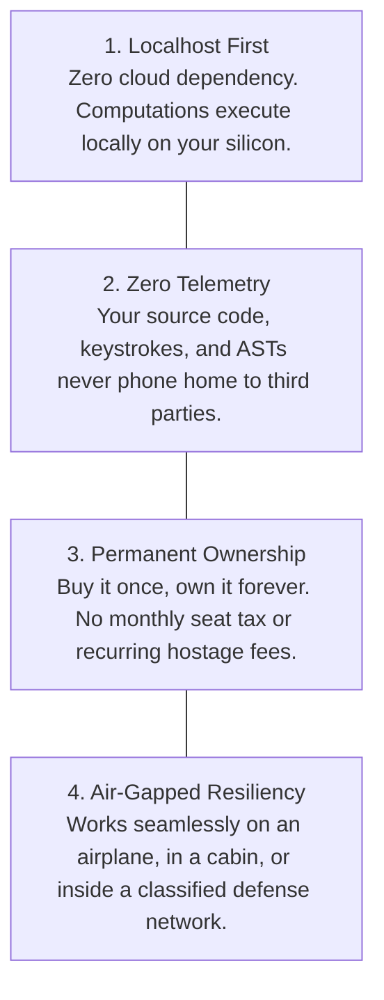

Open your monthly credit card statement and count how many SaaS subscriptions you are paying for as a developer:

- GitHub Copilot / Cursor: $20/month
- Anthropic / OpenAI API credits: $80 - $200/month
- Cloud CI/CD runner minutes: $30/month
- Secret scanning SaaS: $25/seat/month
- Cloud observability daemon: $40/month

What started a decade ago as a promise of convenience has mutated into an extractive rent-seeking economy. Developer tooling has been colonized by recurring cloud subscriptions designed to lock your workflow into proprietary corporate servers.

It is time to return to first principles: **The Anti-SaaS Manifesto for Developer Software**.

---

## 🏛️ The 4 Core Principles of Developer Tool Sovereignty

### 1. Localhost First
Modern developer laptops (Apple Silicon M-series, AMD Ryzen, Intel Core Ultra) possess immense compute power: 16 to 32 CPU threads, dedicated neural engines, and 32GB+ of unified memory. 
Offloading AST parsing, code linting, or secret scanning to a cloud server is not an architectural necessity — it is a business model designed to justify an invoice.

### 2. Zero Telemetry & Air-Gapped Privacy
Your intellectual property is your most valuable asset. When you adopt cloud-dependent developer utilities, you are trusting third-party vendors not to train on your code, leak your environment variables, or suffer infrastructure breaches.
Tools must run 100% offline. If pulling your ethernet cable or turning off Wi-Fi breaks your developer tool, that tool is a liability.

### 3. One-Time Ownership vs SaaS Rent
We reject the premise that every developer utility deserves a recurring $20/month charge. Compilers, parsers, and static analyzers are tools — like a good hammer, a Swiss watch, or a reliable keyboard. You buy them once, and they work for years.

### 4. Deterministic Guardrails Over Probabilistic Guesswork
AI agents are probabilistic engines. They hallucinate, delete tests, and leak secrets. The guardrails protecting your codebase cannot be another fuzzy prompt; they must be deterministic systems algorithms (AST syntax trees, Shannon entropy, static invariants).

---

## ✊ The DevSuperSuite Commitment

DevSuperSuite was built from the ground up on these principles:
- **100% Localhost Execution**: Runs completely offline.
- **Zero Telemetry**: No tracking, no metrics phone-home, no code uploads.
- **One-Time Lifetime License**: $29 Pro Lifetime (or $24 with the launch coupon). Zero monthly subscriptions.
- **Free Interactive Web Sandbox**: Test the entire AST slicing engine in your browser with zero signup:
👉 [https://devsupersuite.web.app](https://devsupersuite.web.app?utm_source=devto&utm_medium=blog&utm_campaign=art05_anti_saas)

Join the movement for local developer sovereignty:
👉 [https://gumroad.com/l/tlzdco?coupon=DSS-DEVREL-BLOG](https://gumroad.com/l/tlzdco?coupon=DSS-DEVREL-BLOG)

---
### 🛠️ Developer Resources:
- **Interactive Browser Sandbox (Zero Signup)**: [https://devsupersuite.web.app](https://devsupersuite.web.app?utm_source=devto&utm_medium=blog_syndication&utm_campaign=ART-05)
- **DevSuperSuite Pro Lifetime Pass ($24 Launch Code)**: [https://gumroad.com/l/tlzdco?coupon=DSS-DEVREL-BLOG](https://gumroad.com/l/tlzdco?coupon=DSS-DEVREL-BLOG&utm_source=devto&utm_medium=blog_syndication&utm_campaign=ART-05)
- **Contact Developer Relations**: `devrel@devsupersuite.com`
