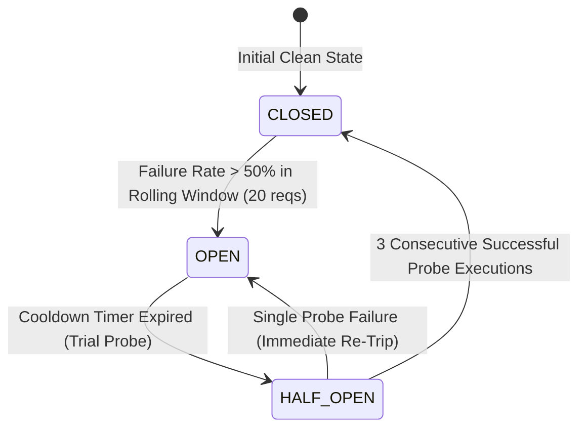

# DevSuperSuite Enterprise API Rate Limiting, DDoS Mitigation & Circuit Breaker Policy

**Document Reference**: DSS-POL-RESILIENCE-CB-2026-V1  
**Classification**: Enterprise Sovereign Security Policy & API Fault Tolerance Standard (Restricted)  
**Governing Authority**: Office of the Chief Security Compliance Officer (CSCO) & Directorate of QA Automation  
**Official Inquiries**: DevSuperSuite Information Security ([infosec@devsupersuite.com](mailto:infosec@devsupersuite.com))  
**Regulatory Baseline**: NIST SP 800-53 Rev 5 SC-5 (Denial of Service Protection), SOC 2 Availability Criteria, ISO/IEC 27001:2022 A.8.6

---

## 1. Executive Purpose & Scope

This enterprise resilience policy establishes mandatory technical controls governing dynamic API rate limiting, DDoS burst protection, and circuit breaker fault isolation across the `agent-commerce` autonomous commerce platform. All public API endpoints, internal microservice RPC gateways, and downstream integrations (such as LLM inference APIs and payment processors) must implement automated fault-containment mechanisms to eliminate cascading service outages.

---

## 2. Token Bucket Dynamic Rate Limiting Standard

All external and inter-service API traffic is throttled using the mathematically deterministic **Token Bucket Algorithm**:

$$\text{Current Tokens } T_t = \min\left(C, T_{t-\Delta t} + \Delta t \times r\right)$$

Where:
- $C$ = Bucket Capacity (maximum allowable instantaneous burst).
- $r$ = Token Refill Rate (sustained requests per second).
- $\Delta t$ = Elapsed time since prior consumption.

### Standardized Tier Configurations

| Service Tier | Maximum Burst Capacity ($C$) | Sustained Refill Rate ($r$) | Allowed Throughput | Throttling Action |
| :--- | :--- | :--- | :--- | :--- |
| **Standard Commerce Tier** | **100 tokens** | 1.6667 tokens/sec | **100 requests / minute** | HTTP 429 Too Many Requests |
| **Enterprise Sovereign Tier** | **1,000 tokens** | 16.6667 tokens/sec | **1,000 requests / minute** | HTTP 429 Too Many Requests |

### HTTP 429 Throttling Headers
When request volume exceeds token capacity, the gateway returns HTTP 429 with standard rate limiting headers:
- `Retry-After: <seconds_until_refill>`
- `X-RateLimit-Limit: <tier_capacity>`
- `X-RateLimit-Remaining: 0`
- `X-RateLimit-Reset: <epoch_timestamp>`

---

## 3. Three-State Sliding-Window Circuit Breaker Standard

To prevent thread exhaustion and cascading failures when third-party services degrade:



### State Definitions & Behavioral Rules
1. **CLOSED (Normal State)**:
   - All inbound traffic flows downstream to the target service.
   - Outcomes are recorded in a rolling sliding-window of **20 requests**.
   - If the window contains $\ge 5$ requests and the failure rate exceeds **50.0%**, the circuit trips immediately to **OPEN**.
2. **OPEN (Tripped / Fail-Fast State)**:
   - 100% of outbound socket calls are frozen at the gateway.
   - The engine fails fast without invoking the downstream service:
     $$\text{Error Response: } \textbf{CIRCUIT\_BREAKER\_OPEN\_FAIL\_FAST}$$
   - Downstream infrastructure is protected from retry storms.
3. **HALF-OPEN (Trial Recovery Probe State)**:
   - Triggered automatically after the cooldown timer expires.
   - Admits a controlled trial probe request.
   - If **3 consecutive requests** succeed, the circuit resets to **CLOSED**.
   - If any probe fails, the circuit immediately reverts to **OPEN** and resets the cooldown timer.

---

## 4. Exponential Backoff with Full Jitter Formulation

Distributed clients and microservices must decorrelate retries to prevent synchronized thundering herds:

$$t_{\text{sleep}} = \text{Uniform}\left(0, \min(t_{\text{max}}, t_{\text{base}} \times 2^{\text{attempt}})\right)$$

- **Base Backoff ($t_{\text{base}}$)**: `100 milliseconds`
- **Maximum Ceiling ($t_{\text{max}}$)**: `10,000 milliseconds` (10 seconds)
- **Full Jitter Guarantee**: Randomizing the sleep duration across $[0, \text{Ceiling}]$ flattens aggregate request spikes into an evenly distributed queue.

---

## 5. Operational Runbook & CLI Usage

### 5.1 Command Line Verification
The resilience engine CLI is located at [`services/rate_limiting_circuit_breaker_engine.py`](file:///C:/Users/atpad/.gemini/antigravity/scratch/agent-commerce/services/rate_limiting_circuit_breaker_engine.py):

```bash
# Execute complete rate limiting and circuit breaker audit
python services/rate_limiting_circuit_breaker_engine.py --audit-rate-limits --summary

# Simulate high-velocity burst traffic against token bucket
python services/rate_limiting_circuit_breaker_engine.py --simulate-traffic-load

# Inject simulated downstream failures to verify circuit breaker tripping
python services/rate_limiting_circuit_breaker_engine.py --test-circuit-breaker

# Run test verification suite
pytest tests/test_rate_limiting_circuit_breaker.py -v
```

### 5.2 Circuit Breaker Trip Incident Remediation
When an alert indicates `CIRCUIT_BREAKER_OPEN_FAIL_FAST`:
1. **Identify Target Dependency**: Inspect the report at [`services/reports/api_resilience_circuit_breaker_report.md`](file:///C:/Users/atpad/.gemini/antigravity/scratch/agent-commerce/services/reports/api_resilience_circuit_breaker_report.md) for the failing service.
2. **Examine Upstream Health**: Check health dashboard of the downstream LLM or payment provider.
3. **Graceful Fallback**: The client receives fallback cached responses or asynchronous queue acknowledgement.
4. **Automated Recovery**: Zero operator intervention required; the circuit autonomously tests recovery via `HALF-OPEN` trial probes.

---

## 6. Compliance Crosswalk

| Framework / Standard | Control Reference | Demonstrated Implementation |
| :--- | :--- | :--- |
| **NIST SP 800-53 Rev 5** | SC-5: Denial of Service Protection | Token bucket rate limiting (100 / 1,000 req/min) preventing capacity saturation. |
| **SOC 2 Type II** | A1.2: System Availability | Circuit breaker isolating downstream outages and preventing system-wide degradation. |
| **ISO/IEC 27001:2022** | A.8.6: Capacity Management | Dynamic token replenishment preventing uncontained resource consumption. |
| **PCI-DSS v4.0** | Req 11.4: Intrusion & DDoS Mitigation | Automated rate throttling and circuit-tripping protecting payment ledgers. |

---

## 7. Official Attestation & Digital Seal

```
══════════════════════════════════════════════════════════════════════════════
OFFICIAL API RESILIENCE & CIRCUIT BREAKER ATTESTATION SEAL
SPECIFICATION: DSS-POL-RESILIENCE-CB-2026-V1
CONTACT: infosec@devsupersuite.com
GOVERNING AUTHORITY: Office of the CSCO & Directorate of QA Automation
STATUS: MANDATORY PRODUCTION ENFORCEMENT ACTIVE ACROSS ALL GATEWAYS
══════════════════════════════════════════════════════════════════════════════
```

