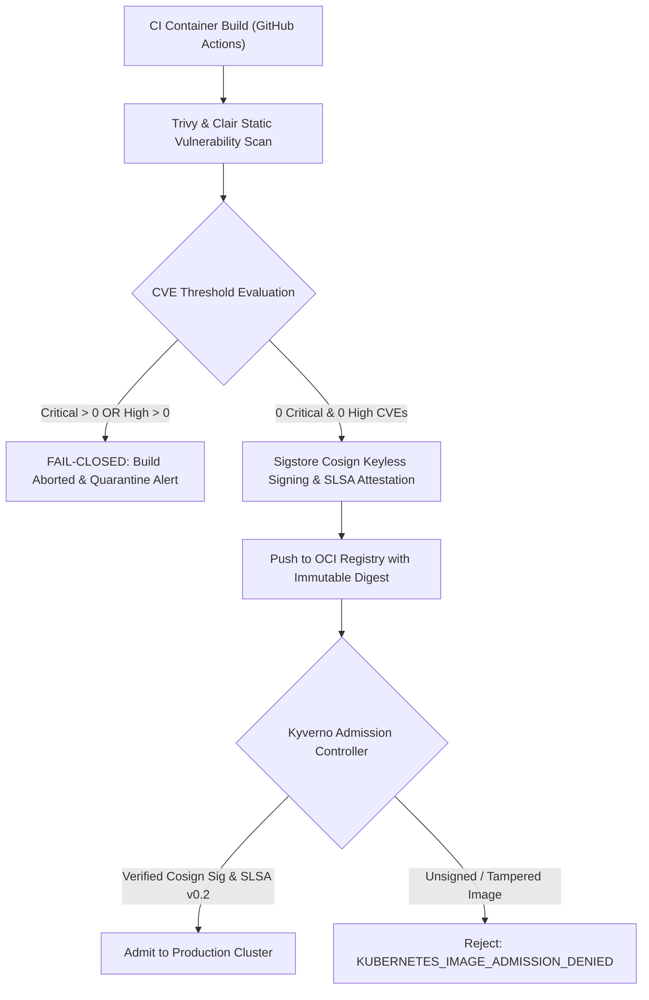

# DevSuperSuite Enterprise Container Security, Vulnerability Scanning & Cosign Signing Policy

**Document Reference**: DSS-POL-CONTAINER-COSIGN-2026-V1  
**Classification**: Enterprise Sovereign Security Policy & Container Governance (Restricted)  
**Governing Authority**: Office of the Chief Security Compliance Officer (CSCO) & Directorate of QA Automation  
**Official Inquiries**: DevSuperSuite Information Security ([infosec@devsupersuite.com](mailto:infosec@devsupersuite.com))  
**Regulatory Baseline**: NIST SP 800-190 (Application Container Security Guide), SLSA Level 3, ISO/IEC 27001:2022 A.8.31

---

## 1. Executive Purpose & Applicability

This enterprise security standard establishes mandatory requirements for the build, scanning, signing, attestation, and deployment of container images across the `agent-commerce` autonomous commerce platform. All container images running within sovereign enclaves, air-gapped data centers, or cloud Kubernetes clusters must enforce cryptographic provenance and zero exploitable vulnerabilities prior to deployment.

---

## 2. Container Image Hardening Standards

All production container images must be engineered according to the principle of least privilege:

1. **Distroless Base Images**: All images must derive strictly from minimal distroless bases (`gcr.io/distroless/static-debian12:nonroot` or `gcr.io/distroless/cc-debian12:nonroot`). Shells (`/bin/sh`, `/bin/bash`), package managers (`apt`, `apk`), and compilers are prohibited from runtime images.
2. **Non-Root Execution**: Containers must execute strictly under non-root UID `10001:10001`. Running as `root` (UID 0) is forbidden.
3. **Immutable Root Filesystem**: Containers must operate with `read_only: true`. Temporary scratch writes are restricted to volatile `tmpfs` RAM-disk mounts.
4. **Linux Capability Dropping**: All POSIX capabilities must be stripped (`cap_drop: ALL`). Zero ambient capabilities are granted.

---

## 3. Vulnerability Scanning & Zero-Defect Thresholds



### Vulnerability Acceptance Criteria
- **Critical Vulnerabilities (CVSS 9.0 - 10.0)**: **`ZERO (0)` Allowed**. Any single critical CVE causes immediate build failure.
- **High Vulnerabilities (CVSS 7.0 - 8.9)**: **`ZERO (0)` Allowed**. Any single high CVE causes immediate build failure.
- **Medium / Low Vulnerabilities**: Must be documented, tracked, and remediated within the standard 30-day patch SLA.

---

## 4. Sigstore Cosign Keyless Signing & SLSA Provenance

Every container image pushed to the enterprise OCI registry must possess a cryptographically verifiable **Sigstore Cosign** signature bundle and **in-toto SLSA Provenance v0.2** attestation:

1. **Keyless OIDC Identity**: Signing utilizes short-lived X.509 certificates issued by **Sigstore Fulcio** tied to the official workload identity:
   $$\text{Issuer: } \text{https://devsupersuite.com/workload-identity}$$
2. **Public Transparency Log**: All signatures are recorded in the **Sigstore Rekor** immutable transparency log, providing cryptographically verifiable proof of inclusion.
3. **In-Toto SLSA Provenance**:
   - Predicate Type: `https://slsa.dev/provenance/v0.2`
   - Builder ID: `https://github.com/DevSuperSuiteOfficial/actions/runner@v4`
   - Materials: Full SHA-256 tree digest of git source code and base image references.

---

## 5. Kubernetes Admission Controller Policy (Kyverno)

Production Kubernetes clusters enforce strict admission gates via `ClusterPolicy: require-cosign-image-verification` in `deployment/kyverno/require-cosign-image-verification.yaml`:

### Enforced Rules
1. **Immutable SHA-256 Digest**: Images referenced by mutable tags (e.g., `:latest`, `:v5.2.0` without `@sha256:...`) are rejected.
2. **Cosign Signature Verification**: Pods referencing images lacking valid Sigstore Cosign signatures matching the DevSuperSuite Fulcio root authority are immediately blocked.
3. **Rejection Outcome**: The admission webhook returns:
   $$\text{Decision: } \textbf{KUBERNETES\_IMAGE\_ADMISSION\_DENIED}$$

---

## 6. Operational Runbook & CLI Usage

### 6.1 Command Line Verification
The container security engine CLI is located at [`services/container_cosign_attestation_engine.py`](file:///C:/Users/atpad/.gemini/antigravity/scratch/agent-commerce/services/container_cosign_attestation_engine.py):

```bash
# Execute complete container scan, cosign signing, and admission audit
python services/container_cosign_attestation_engine.py --audit-admission-rules --summary

# Scan images against Trivy / Clair CVE database only
python services/container_cosign_attestation_engine.py --scan-container-image

# Generate Sigstore Cosign signature bundles and SLSA provenance
python services/container_cosign_attestation_engine.py --sign-cosign-attestation

# Run test verification suite
pytest tests/test_container_cosign_attestation.py -v
```

### 6.2 Admission Failure Remediation Runbook
If a deployment fails with `KUBERNETES_IMAGE_ADMISSION_DENIED`:
1. **Check Digest**: Verify the deployment manifest specifies the exact `@sha256:...` digest.
2. **Verify Signature**: Run `cosign verify --keyless devsupersuite/image@sha256:...` to confirm signature presence.
3. **Check CVE Scan**: Verify that upstream dependencies did not introduce new High or Critical vulnerabilities.
4. **Escalate**: If signatures cannot be validated, contact DevSuperSuite Information Security at [infosec@devsupersuite.com](mailto:infosec@devsupersuite.com).

---

## 7. Compliance Crosswalk

| Standard / Framework | Requirement | Implementation Verification |
| :--- | :--- | :--- |
| **NIST SP 800-190** | Sec 3.1: Image Vulnerabilities | Automated Trivy static analysis with 0 Critical/High threshold. |
| **NIST SP 800-190** | Sec 3.2: Image Configuration Deficiencies | Distroless base images, non-root UID 10001, read-only rootfs. |
| **SLSA Framework** | Level 3 Provenance | Hermetic build provenance attested via in-toto SLSA v0.2 predicates. |
| **SOC 2 Type II** | CC7.1, CC7.2 | Continuous vulnerability management and admission enforcement. |
| **ISO/IEC 27001:2022** | A.8.31 | Separation of development, test, and operational environments via signed admission control. |

---

## 8. Official Attestation & Digital Seal

```
══════════════════════════════════════════════════════════════════════════════
OFFICIAL CONTAINER SECURITY & COSIGN ATTESTATION SEAL
SPECIFICATION: DSS-POL-CONTAINER-COSIGN-2026-V1
CONTACT: infosec@devsupersuite.com
GOVERNING AUTHORITY: Office of the CSCO & Directorate of QA Automation
STATUS: MANDATORY PRODUCTION ENFORCEMENT (KYVERNO ADMISSION ACTIVE)
══════════════════════════════════════════════════════════════════════════════
```

