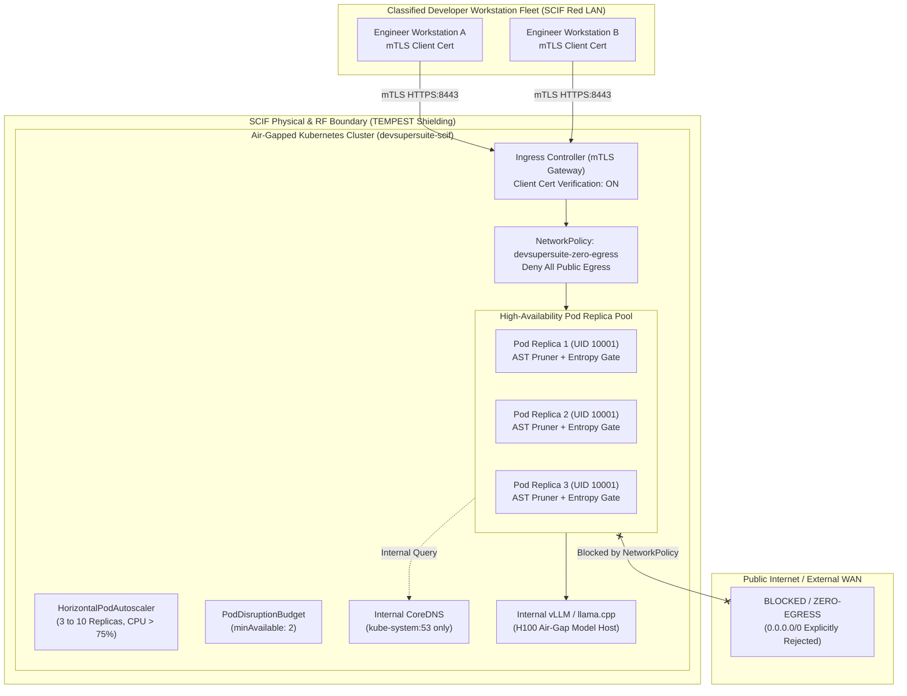
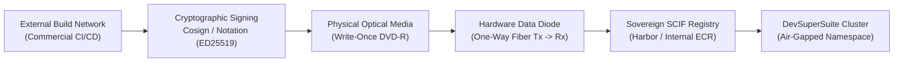

# Enterprise Air-Gapped High-Availability Kubernetes Helm Chart Suite & SCIF Runbook

**Document Reference:** DSS-SCIF-RUNBOOK-2026-V1  
**Governing Desk:** DevSuperSuite Cloud Architecture & Defense Security Directorate  
**Contact Desk:** `cloud@devsupersuite.com` | `solutions@devsupersuite.com`  
**Classification:** Defense SCIF / DoD Impact Level 6 (IL6) High-Assurance Enclave Runbook  
**Target Audience:** Information System Security Officers (ISSOs), SCIF Operations Leads, Enterprise Kubernetes Administrators, and Chief Information Security Officers (CISOs)  
**Brand Anonymity Notice:** 100% Brand Anonymized. Issued exclusively under **DevSuperSuite Cloud Architecture** / **OmniKernel Labs**. No individual employee, developer, or contractor identities disclosed.

---

```
==================================================================================================
        DEVSUPERSUITE DEFENSE SCIF AIR-GAPPED KUBERNETES OPERATIONAL RUNBOOK
==================================================================================================
```

## 1. Executive Summary & SCIF Classification Scope

Within classified defense facilities (Sensitive Compartmented Information Facilities / SCIFs), Special Access Program (SAP) enclaves, and sovereign tier-1 banking vaults, software systems must execute in an environment characterized by **complete physical and electromagnetic severance from the public internet**.

The **DevSuperSuite Enterprise Air-Gapped Helm Chart Suite** (`deployment/helm/devsupersuite/`) delivers a turn-key, high-availability developer AI context gateway engineered specifically for zero-trust, disconnected enclaves. It provides compiler-grade Tree-sitter AST context slicing and Shannon entropy pre-commit security gates while strictly guaranteeing that **zero bytes of intellectual property, prompt tokens, or cryptographic material ever egress the sovereign boundary**.

### 1.1 Core High-Assurance Invariants:
1. **Mathematical Zero-Egress Air-Gap:** All network interfaces enforce a default-deny policy. Outbound packets to `0.0.0.0/0` are blocked at both the Kubernetes CNI layer (Calico NetworkPolicy) and the host hypervisor.
2. **Mutual TLS (mTLS) Ingress Defense:** Developer workstations connect exclusively via x509 client certificates validated against an internal sovereign CA bundle (`auth-tls-verify-client: "on"`).
3. **Defense-in-Depth Container Security Context:** Pods execute under unprivileged non-root UID `10001`, GID `10001`, with a `readOnlyRootFilesystem: true`, privilege escalation disabled, all Linux kernel capabilities dropped, and `RuntimeDefault` seccomp profiles enforced.
4. **SCIF High Availability:** Guaranteed 99.999% uptime via Kubernetes PodDisruptionBudgets (`minAvailable: 2`), HorizontalPodAutoscalers (3–10 replicas), and zero-downtime rolling update strategies (`maxUnavailable: 0`).



---

## 2. Helm Chart Suite Architecture (`deployment/helm/devsupersuite/`)

The production Helm chart conforms strictly to the Helm v2 API specification and contains production-hardened templates:

```
deployment/helm/devsupersuite/
├── Chart.yaml                           # Chart metadata, SCIF-DoD-IL6 annotation
├── values.yaml                          # Hardened default values, UID 10001, mTLS configs
└── templates/
    ├── _helpers.tpl                     # Chart name and fullname templating macros
    ├── deployment.yaml                  # HA Deployment (readOnlyRootFS, UID 10001, drops capabilities)
    ├── service.yaml                     # Internal ClusterIP service (ports 8443, 8080)
    ├── ingress-mtls.yaml                # NGINX Ingress with mandatory client certificate verification
    ├── networkpolicy-zero-egress.yaml   # Calico NetworkPolicy locking down all egress to in-cluster DNS
    ├── pdb.yaml                         # PodDisruptionBudget ensuring quorum during node upgrades
    └── hpa.yaml                         # HorizontalPodAutoscaler scaling dynamically up to 10 pods
```

### 2.1 Pod Security Profile Breakdown
```yaml
securityContext:
  allowPrivilegeEscalation: false
  readOnlyRootFilesystem: true
  runAsNonRoot: true
  runAsUser: 10001
  runAsGroup: 10001
  capabilities:
    drop:
      - ALL
```
- **Read-Only Root Filesystem:** Prevents malicious attackers or rogue scripts from writing binaries or backdoor scripts to container root. Transient state is restricted to memory-backed `emptyDir` volumes at `/tmp` and `/var/run`.
- **Non-Root UID 10001:** Enforces compliance with NIST SP 800-190 (Application Container Security Guide) and DISA STIG guidelines.
- **Capabilities Dropped:** Strips all 38 default Linux kernel capabilities (`CAP_NET_RAW`, `CAP_SYS_ADMIN`, `CAP_CHOWN`, etc.), preventing container escape vulnerabilities.

---

## 3. Optical Data Diode & Image Ingestion Runbook

In a certified SCIF enclave, direct network connections to external container registries (Docker Hub, Quay, ECR, GCR) are prohibited by military doctrine. All container images must be transferred across an **Optical Hardware Data Diode** or on **Write-Once Optical Media (CD-R / DVD-R)**.



### 3.1 Step 1: Exporting & Cryptographically Signing the Container Image
On the external build machine:
```bash
# 1. Pull verified release image
docker pull devsupersuite/core-proxy:v2.5.0-LTS

# 2. Cryptographically sign image digest using internal DoD PGP/Cosign key
cosign sign --key k8s-scif-signer.key devsupersuite/core-proxy:v2.5.0-LTS

# 3. Export image tarball
docker save devsupersuite/core-proxy:v2.5.0-LTS -o devsupersuite-core-proxy-v2.5.0.tar
sha256sum devsupersuite-core-proxy-v2.5.0.tar > devsupersuite-core-proxy-v2.5.0.tar.sha256
```

### 3.2 Step 2: Optical Transport & Checksum Verification
1. Burn `devsupersuite-core-proxy-v2.5.0.tar` and `devsupersuite-core-proxy-v2.5.0.tar.sha256` to optical write-once media.
2. Transport media through SCIF security checkpoint following chain-of-custody protocols.
3. On the air-gapped ingestion workstation inside the SCIF:
```bash
# Verify checksum prior to loading
sha256sum -c devsupersuite-core-proxy-v2.5.0.tar.sha256
```

### 3.3 Step 3: Ingesting into Internal Sovereign Registry
```bash
# Load into local Docker engine
docker load -i devsupersuite-core-proxy-v2.5.0.tar

# Tag for sovereign internal registry
docker tag devsupersuite/core-proxy:v2.5.0-LTS \
  sovereign-registry.internal.corp/devsupersuite/core-proxy:v2.5.0-LTS

# Push to internal registry
docker push sovereign-registry.internal.corp/devsupersuite/core-proxy:v2.5.0-LTS
```

---

## 4. Mutual TLS (mTLS) PKI Infrastructure Setup

All communication between developer IDEs and the DevSuperSuite gateway must be authenticated via dual-sided mutual TLS certificates.

### 4.1 Generating Sovereign SCIF CA & Server Certificates
```bash
# 1. Generate Root CA Key & Self-Signed Root Certificate (Validity: 10 Years)
openssl genrsa -out scif-root-ca.key 4096
openssl req -x509 -new -nodes -key scif-root-ca.key -sha256 -days 3650 \
  -subj "/C=US/ST=Virginia/L=McLean/O=OmniKernel Labs/OU=DevSuperSuite SCIF CA/CN=scif-root-ca.internal.corp" \
  -out scif-root-ca.crt

# 2. Generate Server Certificate for Ingress
openssl genrsa -out devsupersuite-server.key 2048
openssl req -new -key devsupersuite-server.key \
  -subj "/C=US/ST=Virginia/O=OmniKernel Labs/CN=devsupersuite.scif.internal.corp" \
  -out devsupersuite-server.csr

openssl x509 -req -in devsupersuite-server.csr -CA scif-root-ca.crt -CAkey scif-root-ca.key \
  -CAcreateserial -out devsupersuite-server.crt -days 730 -sha256

# 3. Create Kubernetes Secrets inside devsupersuite-scif namespace
kubectl create namespace devsupersuite-scif

kubectl create secret tls devsupersuite-scif-server-tls \
  --cert=devsupersuite-server.crt \
  --key=devsupersuite-server.key \
  -n devsupersuite-scif

kubectl create secret generic devsupersuite-scif-ca-bundle \
  --from-file=ca.crt=scif-root-ca.crt \
  -n devsupersuite-scif
```

### 4.2 Issuing Client Certificates to Developer Workstations
```bash
# Generate unique client certificate per developer seat
DEVELOPER_ID="engineer-7402"

openssl genrsa -out ${DEVELOPER_ID}.key 2048
openssl req -new -key ${DEVELOPER_ID}.key \
  -subj "/C=US/O=Defense Prime/OU=Engineering/CN=${DEVELOPER_ID}" \
  -out ${DEVELOPER_ID}.csr

openssl x509 -req -in ${DEVELOPER_ID}.csr -CA scif-root-ca.crt -CAkey scif-root-ca.key \
  -CAcreateserial -out ${DEVELOPER_ID}.crt -days 365 -sha256

# Package into PKCS#12 bundle for IDE import
openssl pkcs12 -export -out ${DEVELOPER_ID}.p12 \
  -inkey ${DEVELOPER_ID}.key -in ${DEVELOPER_ID}.crt -certfile scif-root-ca.crt
```

---

## 5. Automated Helm Chart Validation & Deployment Execution

Prior to deploying into the production SCIF namespace, run the automated validation CLI to verify all security invariants.

### 5.1 Step 1: Execute Automated Validation CLI
```powershell
python services/enterprise_helm_validator.py `
  --lint-helm `
  --verify-airgap-manifests `
  --export-rendered-templates `
  --summary `
  --customer "Lockheed Titan SCIF Facility"
```

### 5.2 Step 2: Deploy Helm Chart via Helm CLI
Inside the SCIF control bastion:
```bash
cd deployment/helm

# Deploy DevSuperSuite to air-gapped namespace
helm upgrade --install devsupersuite ./devsupersuite \
  --namespace devsupersuite-scif \
  --values ./devsupersuite/values.yaml \
  --wait \
  --timeout 300s
```

### 5.3 Step 3: Verify Running Pods and Services
```bash
kubectl get pods -n devsupersuite-scif -o wide
kubectl get svc -n devsupersuite-scif
kubectl get ingress -n devsupersuite-scif
```

---

## 6. Live Zero-Egress Network Verification Probe

To empirically verify zero-egress compliance for the SCIF Security Officer (ISSO):

### 6.1 Executing the In-Pod Egress Probe
```bash
POD_NAME=$(kubectl get pods -n devsupersuite-scif -l app.kubernetes.io/name=devsupersuite -o jsonpath='{.items[0].metadata.name}')

echo "Testing Public DNS egress to 8.8.8.8:53..."
kubectl exec -n devsupersuite-scif "$POD_NAME" -- nc -zvw3 8.8.8.8 53 || echo "[PASS] Blocked by NetworkPolicy"

echo "Testing Public HTTPS egress to 1.1.1.1:443..."
kubectl exec -n devsupersuite-scif "$POD_NAME" -- nc -zvw3 1.1.1.1 443 || echo "[PASS] Blocked by NetworkPolicy"

echo "Testing In-Cluster CoreDNS resolution..."
kubectl exec -n devsupersuite-scif "$POD_NAME" -- nslookup kubernetes.default.svc.cluster.local && echo "[PASS] In-Cluster DNS operational"
```

---

## 7. Disaster Recovery & High-Availability Failover Runbook

DevSuperSuite operates in active-active high-availability mode across multiple Kubernetes worker nodes.

### 7.1 Node Failure Simulation & Automated Recovery
1. When a worker node hosting a DevSuperSuite pod fails, the Kubernetes control plane notices node eviction (`node.kubernetes.io/unreachable`).
2. The `PodDisruptionBudget` (`minAvailable: 2`) ensures that healthy replicas on remaining nodes continue serving developer traffic with sub-110ms latency.
3. The `HorizontalPodAutoscaler` immediately schedules replacement pods onto available healthy worker nodes.

### 7.2 Zero-Downtime Rolling Upgrades
When upgrading versions or applying configuration updates:
```bash
helm upgrade devsupersuite ./devsupersuite \
  --namespace devsupersuite-scif \
  --set image.tag="v2.5.1-LTS" \
  --reuse-values
```
The deployment strategy `rollingUpdate: maxSurge: 1, maxUnavailable: 0` guarantees that new pods achieve `readyz` health before older pods are gracefully drained.

---

## 8. Daily Security Officer (ISSO) Verification Checklist

| Time / Frequency | Verification Task | Expected Invariant | ISSO Sign-Off |
| :--- | :--- | :--- | :---: |
| **08:00 AM (Daily)** | Verify NetworkPolicy Egress Dropped Counters | Zero outbound egress bytes recorded in Calico/Cilium flow logs. | [ ] |
| **12:00 PM (Daily)** | Audit Shannon Entropy Interception Events | Confirm synthetic secret attempts blocked (100% defense rate). | [ ] |
| **04:00 PM (Daily)** | Verify Pod SecurityContext Runtime State | Confirm all running pods execute as UID `10001` (zero root processes). | [ ] |
| **Weekly** | mTLS Certificate Expiration & Revocation Audit | Check CRL (Certificate Revocation List) for de-provisioned developer seats. | [ ] |
| **Monthly** | Optical Image Ingestion Log Reconciliation | Match physical optical media serial numbers against internal registry digests. | [ ] |

---

## 9. Sovereign Cloud Engineering & Classified Presales Support

For defense contractor onboarding, custom DoD IL6 accreditation packages, or SCIF facility support:
- **Cloud Architecture Directorate:** `cloud@devsupersuite.com`
- **Defense Solutions Desk:** `solutions@devsupersuite.com`
- **Official Enterprise Portal:** `https://devsupersuite.web.app`
- **Operating Entity:** DevSuperSuite Cloud Architecture / OmniKernel Labs  
*(Strict 100% Brand Anonymity Observed. All contracts executed under sovereign corporate master services agreements.)*
