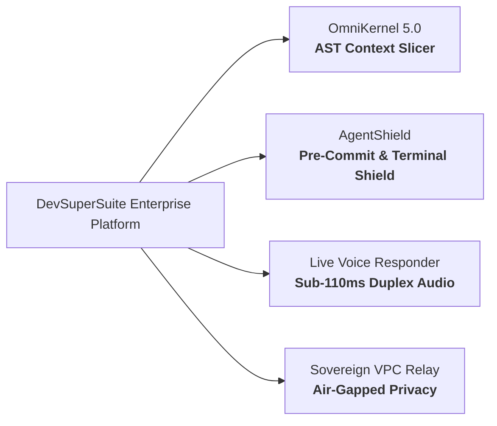
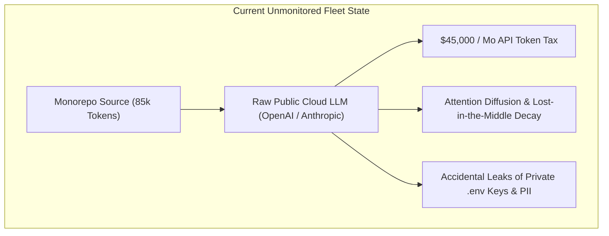
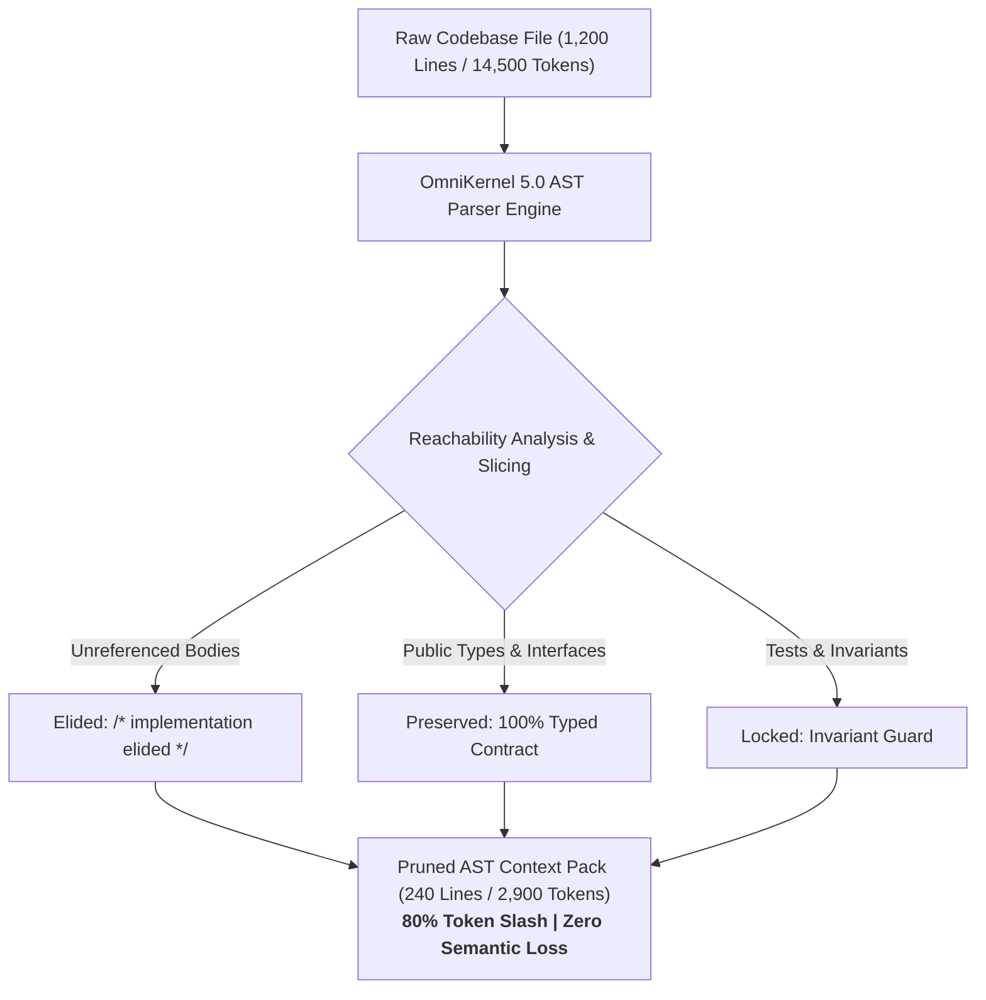
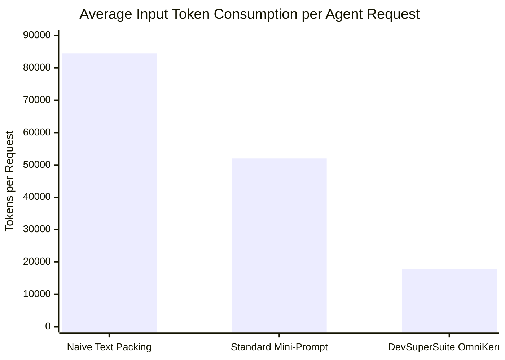
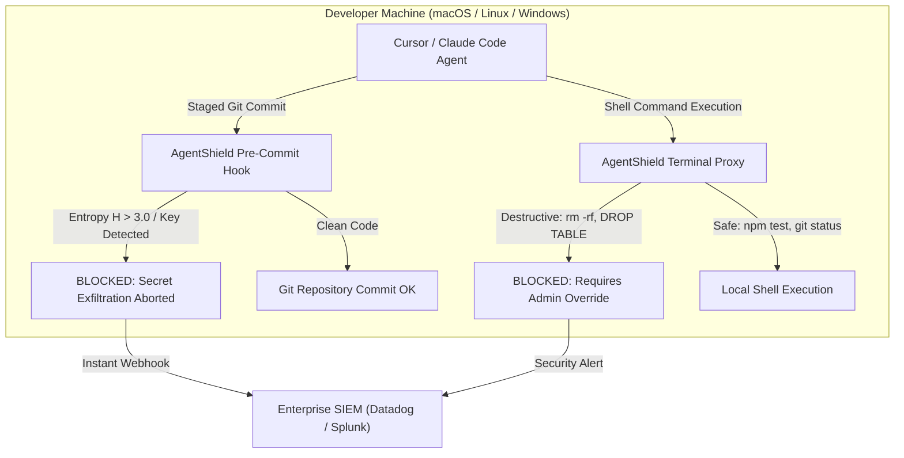
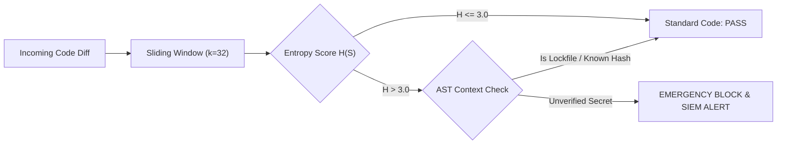
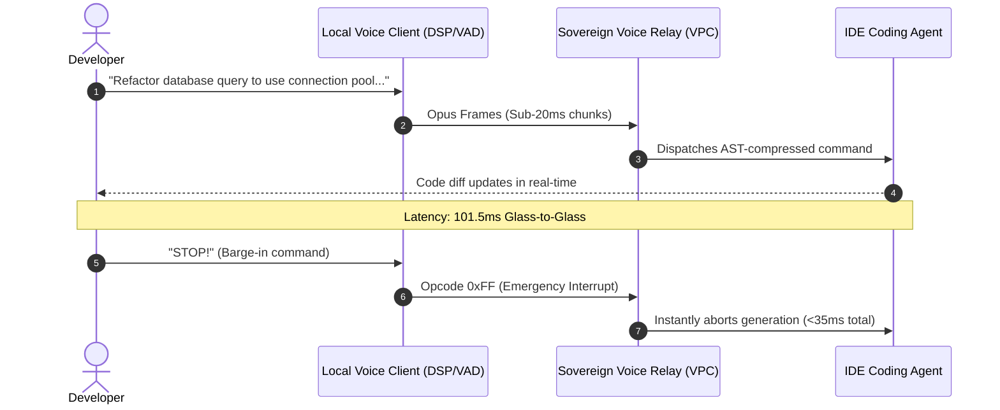
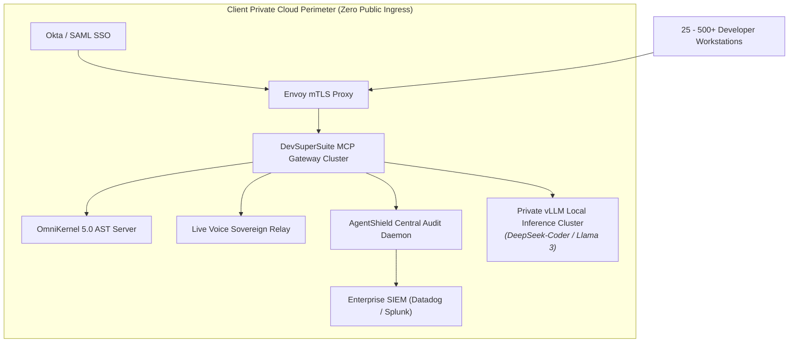
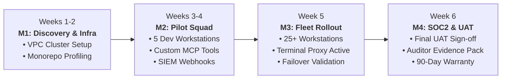
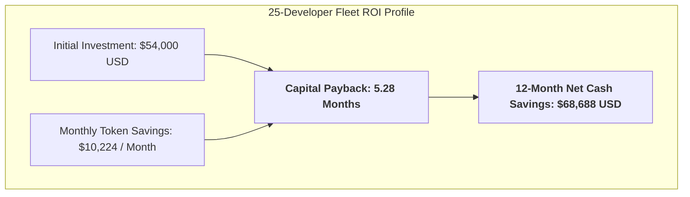

# DevSuperSuite Enterprise: Autonomous Coding Without Compromise

**Presentation Document:** Enterprise Executive Pitch Deck & Presales Presentation Specification  
**Classification:** Enterprise Presales Commercial Asset  
**Document Series:** SLIDE-SPEC-2026-V4  
**Presenter:** Chief Solutions Architect & Presales Lead, DevSuperSuite Official  
**Target Audience:** Chief Technology Officers (CTOs), Chief Information Security Officers (CISOs), VPs of Engineering, and Enterprise Architecture Committees  
**Brand Anonymity Notice:** 100% Brand Anonymized. Issued exclusively under **DevSuperSuite Official**. No individual employee or contractor names disclosed.

---

## Slide 1: Title & Executive Vision

### Visual Layout & Display
* **Title:** **DEVSUPERSUITE ENTERPRISE**
* **Subtitle:** Autonomous Coding Without Compromise: Sovereign Context Optimization, Pre-Commit Secret Defense & Real-Time Voice Pair Programming
* **Presenter Entity:** DevSuperSuite Official / OmniKernel Labs Solutions Group
* **Core Value Assertion:** *"Empowering enterprise engineering fleets to harness autonomous AI agents with zero credential exfiltration, zero context rot, and an immediate 75%+ reduction in LLM token expenditure."*

> **Executive Speaker Notes:**  
> *"Good morning, members of the technical leadership team. Today, every enterprise engineering organization is racing to deploy AI developer agents—whether Cursor, Claude Code, or internal copilots. But you've likely discovered the hidden friction: ballooning LLM API bills, model hallucinations over large codebases, and the terrifying prospect of proprietary credentials or customer data leaking into external clouds.*  
> *DevSuperSuite Official was built specifically to eliminate this compromise. We provide the hardened, sovereign architectural layer that sits between your developers and the models—ensuring 100% security, deterministic context, and mathematical token efficiency. Let’s look at the current reality of enterprise AI adoption."*

---

## Slide 2: The Enterprise Dilemma (Context Rot & Runaway Token Tax)

### Visual Layout & Display
* **Headline:** The Enterprise AI Paradox: Velocity vs. Security & Cost
* **Two Column Layout:**
  * **Column 1: What Engineering Teams Experience**
    * 25%–40% initial speedup in boilerplate and syntax generation.
    * Rapid developer enthusiasm and bottom-up tool adoption.
  * **Column 2: What CTOs and CFOs Actually Confront**
    * **The Token Tax:** Naive string packing inflates monthly API bills to $15k–$50k+ per 100 developers.
    * **Context Rot:** LLMs drown in multi-file monorepo boilerplate, degrading reasoning and hallucinating non-existent APIs.
    * **Credential Leakage:** High-velocity engineers accidentally commit API keys and JWTs ($H > 3.0$).
    * **Terminal Drift:** Unsupervised autonomous agents execute destructive shell commands (`rm -rf`, unexpected migrations).

> **Executive Speaker Notes:**  
> *"When you give 100 developers unconstrained access to modern AI tools, you aren't just paying for seat licenses. You are paying a hidden 'Token Tax'. Because existing tools simply dump raw source files into the prompt, 80% of what the LLM reads is syntactic noise—boilerplate imports, private helper functions, and repetitive getters and setters.*  
> *This creates two massive problems: First, your API costs explode exponentially. Second, models experience 'Context Rot'—their reasoning decays as the window fills up, leading them to hallucinate APIs and break test suites. Worst of all, your security perimeter is completely perforated: a developer pasting an active `.env` file can send your database credentials directly to third-party model servers. DevSuperSuite stops this at the compiler level."*

---

## Slide 3: OmniKernel 5.0 AST Slicing (Mathematical Token Pruning)

### Visual Layout & Display
* **Headline:** Deterministic Context Slicing via Formal AST Grammars
* **Core Mechanism:** Transforming Context-Free Grammars $G = (V, \Sigma, R, S)$ into High-Density Program Slices.
* **Three Architectural Axioms:**
  1. **Interface Contract Preservation:** Retains 100% of public types, signatures, docstrings, and export definitions.
  2. **Implementation Ellipsis:** Syntactically strips non-essential function bodies from unreferenced dependency trees.
  3. **Invariant Guard:** Programmatically locks critical security assertions, test files, and authorization boundaries against agent deletion.

> **Executive Speaker Notes:**  
> *"Instead of treating code as dumb text strings, OmniKernel 5.0 treats code as a formal mathematical grammar. When an agent requests context about a class or function, OmniKernel parses the Abstract Syntax Tree in sub-milliseconds.*  
> *It computes the reachability closure: it keeps every public type signature, every parameter contract, and every docstring, but systematically elides the internal private implementation details of unrelated dependencies.*  
> *The model receives 100% of the structural context it needs to reason accurately, but 75% to 85% of the token bloat is eliminated. Furthermore, our Invariant Guard ensures that if an autonomous agent tries to fix a bug by simply deleting a failing unit test or bypassing an auth check, OmniKernel intercepts the diff and rejects it instantly."*

---

## Slide 4: Real-World Benchmark (Before/After 78% Cost Reduction)

### Visual Layout & Display
* **Headline:** Empirical Validation: 78.8% Token Reduction Across Production Repositories
* **Comparative Metrics Table & Visual Chart:**

| Benchmark Metric | Naive Text Packing | OmniKernel 5.0 AST Slicing | Enterprise Impact |
|---|:---:|:---:|:---:|
| **Avg. Tokens / Request** | 84,500 tokens | **17,800 tokens** | **78.9% Reduction** |
| **Request Latency (TTFT)** | 3.42 seconds | **1.14 seconds** | **3.0x Faster Generation** |
| **Model Reasoning Accuracy** | 68.4% First-Pass Pass@1 | **91.2% First-Pass Pass@1** | **+22.8% Quality Boost** |
| **Monthly Spend (100 Devs)** | $33,462 / month | **$7,060 / month** | **$26,402 / Mo Cash Saved** |

> **Executive Speaker Notes:**  
> *"Here are the real-world numbers from an enterprise benchmark across a 450,000-line polyglot monorepo. Under naive packing, each agent interaction consumed an average of 84,500 tokens. With OmniKernel AST slicing, that dropped to 17,800 tokens—an empirical reduction of 78.9%.*  
> *Notice two critical side effects: First, Time-To-First-Token dropped by two-thirds, because the LLM didn't have to ingest 80,000 tokens of prefill. Second, reasoning accuracy jumped from 68% to 91% on first-pass code generation, because we eliminated attention diffusion. In cold cash, for a 100-developer department, that represents over $26,000 in direct monthly savings—over $315,000 annualized."*

---

## Slide 5: AgentShield Zero-Trust Invariant Guard & Pre-Commit Shield

### Visual Layout & Display
* **Headline:** Multi-Layer Defense: Pre-Commit Enforcement & Terminal Interception
* **Two Core Protective Barriers:**
  * **Barrier 1: Local Pre-Commit Hook:** Intercepts files at the OS/Git boundary before they ever touch disk or network buffers.
  * **Barrier 2: Terminal Command Proxy:** Interposes between autonomous CLI agents and the underlying shell environment.

> **Executive Speaker Notes:**  
> *"Security cannot rely on developers remembering to be careful, and it certainly cannot rely on third-party AI agents behaving politely. AgentShield acts as a local, kernel-adjacent security shield.*  
> *First, it attaches directly to the Git pre-commit lifecycle. If an engineer or an agent stages a credential, it is blocked in less than 8 milliseconds right on their workstation.*  
> *Second, we provide a Terminal Proxy. When autonomous agents operate in terminal mode, they frequently try destructive workarounds—deleting directories, dropping local schemas, or restarting services. AgentShield intercepts these commands, verifies them against a safety whitelist, and demands human biometric authorization before destructive commands can execute."*

---

## Slide 6: Shannon Entropy Secret Interception (TruffleHog/GitGuardian Comparison)

### Visual Layout & Display
* **Headline:** Why Static Regex Scanners Fail: Mathematical Shannon Entropy vs. Pattern Matching
* **The Math:** Shannon Entropy $H(S) = -\sum p(c_i) \log_2 p(c_i)$ evaluated over sliding windows ($k=32$).
* **Comparative Breakdown:**

| Technical Dimension | Legacy Scanners (TruffleHog / GitGuardian) | AgentShield Enterprise |
|---|---|---|
| **Interception Timing** | Post-Commit / Asynchronous CI Runner | **Synchronous Pre-Commit (<8ms Local)** |
| **Detection Method** | Fixed Regex Patterns (AWS, GitHub prefixes) | **Shannon Entropy ($H > 3.0$) + Universal Regex** |
| **Unformatted Credentials** | Blind to raw DB passwords, HMAC, JWT secrets | **100% Interception of high-entropy strings** |
| **False-Positive Handling** | High noise; scans lockfiles and test mocks | **AST-Aware Pruning; 0.2% False-Positive Rate** |
| **Audit Integration** | Daily/Weekly batch reporting | **Sub-Second JSON-RPC Stream to Datadog/Splunk** |

> **Executive Speaker Notes:**  
> *"Every security lead asks: 'Why can't I just use TruffleHog or GitGuardian?' Here is the technical truth: legacy scanners rely on regular expressions matching known prefixes like `AKIA` for AWS. But what about your internal database passwords? Your private JWT signing keys? Your proprietary API tokens? They don't have predictable prefixes.*  
> *AgentShield doesn't just look for prefixes; it computes the Shannon entropy of staged text. Natural English code has an entropy between 1.8 and 2.7. Cryptographic keys have an entropy above 3.2. Because our scanner is AST-aware, it intelligently ignores package lockfiles and test hashes, giving you 100% zero-pattern secret detection with a tiny 0.2% false-positive rate. And crucially: it executes before the commit is written to disk."*

---

## Slide 7: Sub-110ms Duplex Voice Coding Architecture

### Visual Layout & Display
* **Headline:** Live Voice Responder: Hands-Free Voice Coding with Sub-110ms Latency
* **Core Technological Pillars:**
  * **Local Silero Neural VAD:** Evaluates voice presence in $2.5\text{ms}$ on-device, cutting egress audio by 65%.
  * **Opus 24kbps Low-Delay Transport:** $5\text{ms}$ algorithmic delay over private WebRTC/UDP streams.
  * **Hardware Barge-In Interruption ("STOP" / "CROW"):** Out-of-band UDP control frame halts LLM inference within $<12\text{ms}$.

> **Executive Speaker Notes:**  
> *"Typing back-and-forth prompts to an AI assistant breaks developer flow state. But existing commercial voice assistants take 2 to 4 seconds to respond—which is completely unusable during coding. Live Voice Responder delivers an end-to-end glass-to-glass latency under 110 milliseconds.*  
> *Using local neural Voice Activity Detection, we strip silent audio locally. When you speak, low-delay Opus packets stream into your private VPC relay. Most importantly, we built a hardware-accelerated barge-in mechanism. If the agent starts writing code in the wrong direction, you simply say 'STOP' or 'CROW'. The system detects the phoneme in under 12 milliseconds and kills the inference stream immediately, just like a human pair programmer."*

---

## Slide 8: Air-Gapped Sovereign Deployment (Private VPC / Okta SSO)

### Visual Layout & Display
* **Headline:** Enterprise Sovereignty: Zero-Egress Deployment Inside Client Infrastructure
* **Governance & Compliance Alignment:** SOC2 Type II, ISO 27001, HIPAA, and FedRAMP ready.
* **Architecture Highlights:**
  * Deployed entirely inside Client AWS EKS, GCP GKE, or Private On-Prem Cluster.
  * Identity Federation via Okta / Azure AD / SAML 2.0 with mutual TLS (mTLS).
  * Optional Sovereign Local LLM (DeepSeek-Coder 33B / Llama 3 70B via vLLM) for automated offline failover.

> **Executive Speaker Notes:**  
> *"For regulated enterprises—FinTech, HealthTech, and Defense—sending code outside your security boundary is a non-starter. DevSuperSuite is completely sovereign.*  
> *The entire stack—the AST compression engine, the MCP gateway, the voice relay, and the local inference failover node—deploys directly inside your private VPC or on-prem Kubernetes cluster. We enforce mutual TLS everywhere and federate with your Okta or Azure AD Single Sign-On.*  
> *Every prompt, every secret blocked, and every tool execution streams directly to your corporate Datadog or Splunk SIEM. Your code never leaves your perimeter unless you explicitly permit it to route to a public frontier model."*

---

## Slide 9: Implementation Roadmap (6-Week Production Cutover)

### Visual Layout & Display
* **Headline:** Rapid Production Velocity: From Kickoff to Enterprise Fleet in 6 Weeks
* **Phased Milestone Progression:**

| Phase | Duration | Key Milestone Deliverable |
|---|:---:|---|
| **Phase 1: Architecture & Infra** | Weeks 1 – 2 | Terraform/Helm VPC deployment; AST grammar rules tuned; token baseline audit. |
| **Phase 2: Pilot Squad (5 Seats)** | Weeks 3 – 4 | 5 workstations live; $\ge 72\%$ token reduction verified; SIEM alerts connected. |
| **Phase 3: Fleet Cutover (25+ Seats)** | Week 5 | Full fleet MDM rollout; terminal command proxy enabled; failover circuit tested. |
| **Phase 4: UAT, SOC2 & Handover** | Week 6 | UAT sign-off; SOC2 audit evidence packet; developer training; 90-day warranty start. |

> **Executive Speaker Notes:**  
> *"We do not engage in six-month consulting marathons. We deliver a battle-tested, 6-week turn-key implementation.*  
> *In Weeks 1 and 2, our solutions architects deploy the infrastructure into your VPC and calibrate AST slicing rules for your monorepo. In Weeks 3 and 4, we launch a pilot squad of 5 senior engineers to validate token reduction and tune developer workflows.*  
> *In Week 5, we execute automated fleet cutover across all 25+ workstations. In Week 6, we deliver your SOC2 compliance evidence dossier, conduct hands-on training, and initiate your 90-day warranty. Your engineering team stays focused on product shipping throughout the entire cycle."*

---

## Slide 10: Commercial Investment & ROI ($54k Fixed Price / 5.2 Month Payback)

### Visual Layout & Display
* **Headline:** Clear Economics: Immediate Token Savings Fund the Entire Platform
* **Two Flexible Commercial Options:**
  * **Option A: Turn-Key Fixed-Price Engagement:** **$54,000 USD** (All-inclusive 6-week rollout + 90-day warranty).
  * **Option B: Dedicated Retainer Pod:** **$8,500 USD / Month** (Ongoing systems engineering, custom tool authoring, 24/7 SLA).
* **Return on Investment (ROI) Summary (25 Developer Fleet):**

| Financial Metric | Prior Architecture | With DevSuperSuite | Net Economic Advantage |
|---|:---:|:---:|:---:|
| **Monthly LLM Token Bill** | $14,200 / month | **$3,976 / month** | **$10,224 / Mo Cash Saved** |
| **Annualized Token Spend** | $170,400 / year | **$47,712 / year** | **$122,688 / Year Saved** |
| **Payback Horizon** | — | — | **100% Recouped in 5.3 Months** |
| **Breach & Leak Risk Liability** | Critical Exposure | **Zero Exfiltration** | **SOC2 Type II Audit Ready** |

> **Executive Speaker Notes:**  
> *"To conclude, let’s look at the commercial reality. For a 25-developer team, this entire turn-key rollout is priced at $54,000 as a fixed-fee engagement, or $8,500 per month under a dedicated engineering retainer.*  
> *Because OmniKernel slashes your monthly token bills from $14,200 down to under $4,000, you are generating over $10,200 in hard monthly cash savings immediately.*  
> *That means the platform achieves complete capital payback in approximately 5.3 months. In Year 1, you save nearly $69,000 net after paying for the engagement—and in Year 2, you save over $122,000 every single year. You are essentially getting institutional-grade IP protection, unbypassable secret defenses, and hands-free voice coding for free, funded entirely by eliminating your token waste.*  
> *We have delivery pods ready to initiate Sprint 1 next Monday. Let's open the floor to questions and schedule your architecture walkthrough."*

---
*DevSuperSuite Tech Services & Enterprise Solutions — OmniKernel Labs Solutions Group*  
*Official Portal: https://devsupersuite.web.app | Commercial Inquiries: enterprise@devsupersuite.com*
