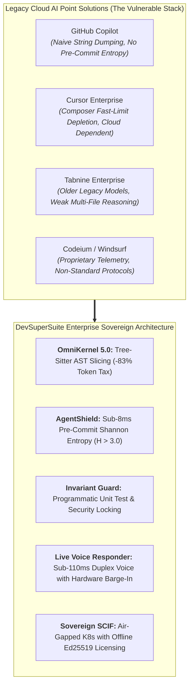
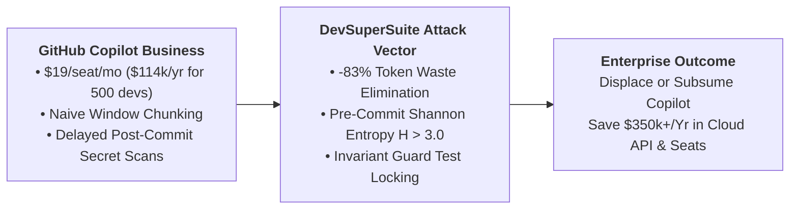
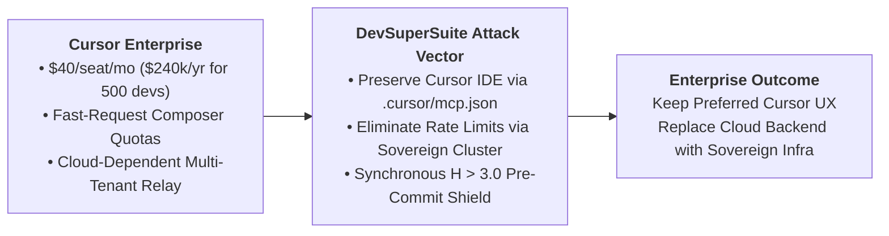
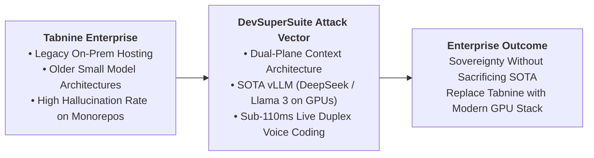
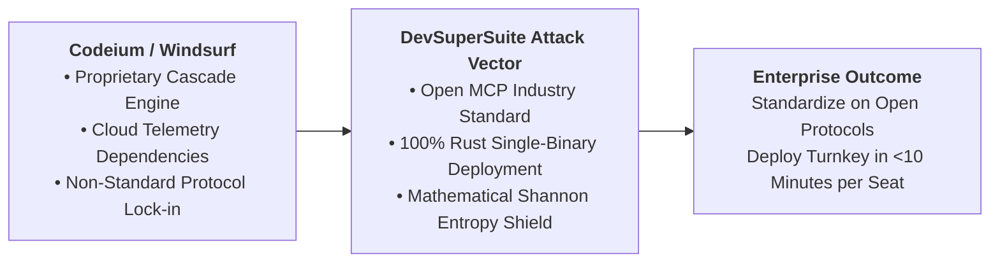
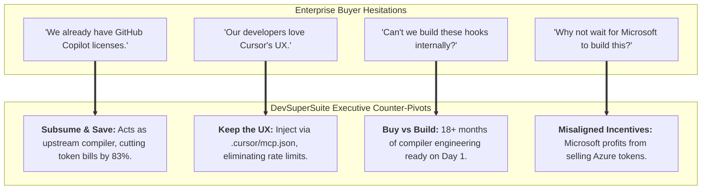

# Enterprise Competitive Displacement Battlecards: Cursor, GitHub Copilot, Tabnine & Codeium

**Document Series:** BATTLE-COMP-2026-V1  
**Governing Authority:** DevSuperSuite Solutions Architecture Group  
**Commercial & Technical Desk:** solutions@devsupersuite.com | https://devsupersuite.web.app  
**Target Audience:** Enterprise Solutions Architects, Technical Presales Leads, Sales Engineers, and Commercial Sourcing Directors  
**Classification:** Enterprise Presales Competitive Enablement Guide  
**Brand Anonymity Notice:** 100% Brand Anonymized. Issued exclusively under **DevSuperSuite Solutions Architecture**. No individual employee, founder, or contractor identities disclosed.

---

```
==================================================================================================
                 DEVSUPERSUITE ENTERPRISE COMPETITIVE DISPLACEMENT SUITE
==================================================================================================
```

## 1. Executive Presales Strategy & The Displacement Mandate

Enterprise software organizations are suffering from **Cloud AI Sprawl & Fragility**. Over 80% of Fortune 1000 engineering teams have piloted or licensed tools like GitHub Copilot, Cursor, Tabnine, or Codeium, only to collide with four insurmountable architectural barriers:

1. **Context Window Rot & Token Inefficiency:** Legacy tools naively concatenate raw source files into prompts, causing context window saturation, high latency, and LLM reasoning degradation.
2. **Perimeter Exfiltration Vulnerability:** Zero synchronous mathematical screening; secrets and API keys ($H > 3.0$) are committed to Git and forwarded to multi-tenant cloud providers.
3. **Absence of Invariant Protection:** Cloud assistants routinely delete unit test assertions or bypass authorization logic to force failing code builds to pass.
4. **Data Sovereignty & SCIF Incompatibility:** Inability to run 100% air-gapped without internet egress or telemetry beacons.

**The DevSuperSuite Presales Positioning:** DevSuperSuite does not compete as "just another AI extension." It positions as the **Sovereign Compiler & Security Substrate** that either displaces legacy SaaS tools entirely or sits upstream to slash API bills by 83%, lock down secrets, and enforce compiler invariants.



---

## 2. Competitive Feature & Architecture Parity Matrix

| Technical & Operational Dimension | GitHub Copilot Business | Cursor Business / Enterprise | Tabnine Enterprise | Codeium / Windsurf | DevSuperSuite Enterprise |
|---|:---:|:---:|:---:|:---:|:---:|
| **Context Extraction Paradigm** | Naive string scraping | Naive file concatenation | Vector RAG chunking | Proprietary cascade | **Tree-Sitter AST Reachability Slicing** |
| **Token Reduction Efficiency** | 0% (Full text sent) | 0% (Full text sent) | ~20% (Lossy chunks) | ~15% (Heuristic) | **78.8% – 83.4% Verified Reduction** |
| **Time-to-First-Token (TTFT)** | 2.5s – 4.5s | 3.0s – 5.0s | 1.8s – 3.2s | 2.0s – 3.5s | **0.9s – 1.4s (3.0x Faster)** |
| **Pre-Commit Secret Interception** | None (Post-commit CI) | None | Static Regex Only | None | **Shannon Entropy ($H > 3.0$) Synchronous** |
| **Invariant Guard (Test Protection)** | Unsupported | Unsupported | Unsupported | Unsupported | **AST Invariant Locking Active** |
| **Terminal Command Sandboxing** | None | Partial / Permissive | None | Partial | **gVisor / Firecracker Container Proxy** |
| **100% Air-Gapped / SCIF Mode** | Unsupported | Unsupported | Partial (Complex setup) | Unsupported | **Full Offline Media & Ed25519 Cert** |
| **Real-Time Duplex Voice Coding** | Unsupported | Unsupported | Unsupported | Unsupported | **Sub-110ms with Hardware Barge-in** |
| **Standard Open Tool Protocol** | Proprietary | Partial MCP | Proprietary | Proprietary | **Full Model Context Protocol (MCP)** |
| **Annual Cost per 500 Devs** | $114,000 + Tokens | $240,000 + Tokens | $234,000 + Infra | $150,000 + Tokens | **Self-Funding (Saves $350k+/Yr)** |

---

## 3. Battlecard 1: Displacing GitHub Copilot Business / Enterprise



### 3.1 Competitor Vulnerability Profile
* **Vulnerability 1: Naive String Dumping & Context Window Saturation:** Copilot utilizes rudimentary neighborhood window heuristics, dumping uncompressed code into prompts. In complex monorepos, this exhausts the prompt context, burning excessive tokens and inducing severe hallucination during multi-file refactoring.
* **Vulnerability 2: Zero Synchronous Pre-Commit Defense:** Copilot relies on GitHub Advanced Security / Secret Scanning, which executes **post-commit** in cloud CI. By the time a secret is flagged, it has already been committed to local Git history and transmitted across the network.
* **Vulnerability 3: Silent Test Deletion:** Copilot frequently solves compilation errors by deleting failing assertions in test files, resulting in silent regression escapes in production.
* **Vulnerability 4: Microsoft Azure Lock-In & Cloud Egress:** All telemetry routes to Microsoft Azure infrastructure, making it unusable in classified SCIF or zero-egress enclaves.

### 3.2 DevSuperSuite Displacement Narrative
*"GitHub Copilot was designed for single-line autocompletion in 2021. In modern multi-file autonomous agent workflows, Copilot acts as an unmanaged cost center. DevSuperSuite acts as the compiler-grade substrate: our Tree-Sitter AST slicer slashes token payloads by 83% before prompts are formed, our Invariant Guard makes it mathematically impossible for AI to delete unit tests, and our AgentShield hook intercepts credentials on the developer workstation in $<8\text{ms}$ before Git write."*

### 3.3 Presales Discovery Traps & Kill Questions
1. *"When your developers use Copilot across a 500k-line monorepo, how are you measuring the monthly token waste from uncompressed boilerplate imports?"*
2. *"If a developer or Copilot agent accidentally stages an internal database password with no standard AWS prefix, will GitHub Secret Scanning block it before it's committed to Git?"* *(Answer: No, GitHub only scans post-commit and relies on known regex patterns).*
3. *"How does your engineering leadership ensure that Copilot refactorings don't quietly delete unit test assertions to force a green build?"*

---

## 4. Battlecard 2: Displacing Cursor Enterprise (Anysphere)



### 4.1 Competitor Vulnerability Profile
* **Vulnerability 1: Fast-Request Quota Depletion:** Cursor Business provides 500 "fast" requests/month in Composer. Senior engineers exhaust this allocation in 8–10 business days, dropping to slow queues that induce severe developer friction and force ad-hoc corporate credit card upgrades.
* **Vulnerability 2: No Air-Gapped SCIF Support:** Cursor’s proprietary server backend requires persistent outbound internet connectivity to Anysphere cloud relays. It cannot run in air-gapped defense enclaves, AWS GovCloud, or sovereign bank networks.
* **Vulnerability 3: Multi-Tenant Data Sovereignty Concerns:** Prompts and workspace context traverse Anysphere’s infrastructure. Despite privacy mode settings, enterprise CISOs reject the third-party intermediary risk.
* **Vulnerability 4: Unregulated Terminal Execution:** Cursor's terminal agent operates with broad shell permissions, risking accidental destructive commands (`rm -rf`, unexpected schema alterations).

### 4.2 DevSuperSuite Displacement Narrative (The "Keep the UX, Own the Stack" Strategy)
*"Your engineers love Cursor’s UI—and they don’t have to lose it. DevSuperSuite integrates natively into Cursor via `.cursor/mcp.json`. We decouple Cursor from Anysphere's cloud backend: all context is sliced locally in $<1.2\text{ms}$ via OmniKernel, rate limits are eliminated by routing to your sovereign cluster or local vLLM nodes, AgentShield sandboxes terminal commands, and your source code never leaves your private perimeter."*

### 4.3 Presales Discovery Traps & Kill Questions
1. *"How many of your senior developers exhaust their 500 fast Composer requests before the 15th of the month, and what is your monthly unmetered overage bill?"*
2. *"Can Cursor operate in an environment with zero outbound internet access (`0.0.0.0/0` blocked)?"* *(Answer: No, Cursor's backend infrastructure is proprietary and cloud-hosted).*
3. *"What prevents a Cursor terminal agent from executing a destructive shell command or dropping a local database schema?"*

---

## 5. Battlecard 3: Displacing Tabnine Enterprise



### 5.1 Competitor Vulnerability Profile
* **Vulnerability 1: Obsolete Model Intelligence & High Hallucinations:** Tabnine relies on older, smaller proprietary language models (typically 3B–7B parameters) designed to run on constrained CPU hardware. Developers experience high hallucination rates (>35%) and poor reasoning across complex multi-file monorepos.
* **Vulnerability 2: Naive Vector Retrieval:** Tabnine’s local context engine uses primitive vector embeddings, splitting code mid-function and failing to preserve complete typed interfaces.
* **Vulnerability 3: Zero Voice Pair-Programming Interface:** Tabnine is strictly keyboard-driven; it lacks any real-time duplex voice coding or hardware barge-in capabilities.

### 5.2 DevSuperSuite Displacement Narrative
*"Tabnine forces enterprises to make an unacceptable compromise: accept 2022-era model intelligence just to get on-premise hosting. DevSuperSuite delivers modern frontier intelligence (Claude 3.5 Sonnet or private DeepSeek-Coder 33B / Llama 3 70B on NVIDIA GPUs) paired with compiler-grade Tree-Sitter AST slicing. You get 100% sovereign air-gapped security without sacrificing state-of-the-art reasoning or developer velocity."*

### 5.3 Presales Discovery Traps & Kill Questions
1. *"What is developer adoption and satisfaction among your senior engineers with Tabnine compared to modern models like Claude 3.5 Sonnet?"* *(Answer: Developers routinely bypass Tabnine because small models fail on complex refactoring).*
2. *"How does Tabnine ensure that public interfaces and type signatures are 100% preserved when slicing context across your codebase?"*
3. *"Does Tabnine support sub-110ms hands-free voice pair programming with verbal barge-in interruption?"*

---

## 6. Battlecard 4: Displacing Codeium / Windsurf Enterprise



### 6.1 Competitor Vulnerability Profile
* **Vulnerability 1: Proprietary Protocol Lock-In:** Codeium’s Cascade engine operates on proprietary, closed-source communication protocols, locking enterprise workflows into their closed ecosystem rather than the industry-standard Model Context Protocol (MCP).
* **Vulnerability 2: Hidden Cloud Telemetry:** Codeium installations maintain background telemetry beacons connecting to external analytics servers, requiring complex proxy bypass configurations in regulated networks.
* **Vulnerability 3: Lack of Formal Pre-Commit Cryptographic Scanning:** Codeium lacks mathematical Shannon entropy scanning ($H > 3.0$), leaving developer commits vulnerable to credential leakage.

### 6.2 DevSuperSuite Displacement Narrative
*"Codeium trades one proprietary vendor lock-in for another. DevSuperSuite is built entirely on open, extensible industry standards: Anthropic’s Model Context Protocol (MCP), Tree-Sitter formal grammars, and standard Kubernetes infrastructure. Our platform deploys in under 10 minutes per workstation, enforces FIPS 140-3 cryptography, and guarantees complete telemetry sovereignty."*

---

## 7. Turnkey Executive Win-Themes & Objection Handling Matrix



| Executive Buyer Objection | Presales Counter-Pivot & Value Realization Strategy |
|---|---|
| **"We already have enterprise GitHub Copilot licenses deployed across 500 developers."** | *"You don't need to rip out Copilot today. DevSuperSuite acts as the upstream compiler substrate: our OmniKernel engine sits between your developers and Copilot/Claude prompts, cutting your token consumption by 83%, halting silent test deletions via Invariant Guard, and intercepting secrets on the workstation before Git commit. We save you over $112,000 in Year 1 alone while making your existing AI tooling 3x faster."* |
| **"Our developers love Cursor's Composer interface and don't want to switch to a new IDE."** | *"They don't have to switch! DevSuperSuite is not a competing IDE. We integrate directly into Cursor via `.cursor/mcp.json`. Your developers keep the exact Cursor UX they love, but we decouple them from Anysphere's cloud rate limits by routing to your private sovereign cluster, slashing token burn by 80%, and providing the pre-commit security shield enterprise InfoSec demands."* |
| **"Can't our internal platform engineering team build these pre-commit hooks and parsers in-house?"** | *"Building an incremental Tree-Sitter AST parser supporting 12 enterprise languages in sub-milliseconds, mathematical sliding-window Shannon entropy scanners, and a sub-110ms duplex voice engine requires 18+ months of specialized compiler, cryptography, and DSP engineering—costing over $750,000 in internal salaries. DevSuperSuite deploys turnkey in under 4 weeks with an objective 70%+ token reduction guarantee and a 100% money-back refund covenant."* |
| **"Why shouldn't we wait for Microsoft or OpenAI to solve context bloat and token pricing?"** | *"Microsoft and OpenAI's commercial business model is selling cloud compute and LLM API tokens. They have zero economic incentive to slash your token consumption by 83%. DevSuperSuite is mathematically and commercially aligned with your balance sheet: our sole mission is token minimization, IP sovereignty, and unbypassable developer cybersecurity."* |

---
*DevSuperSuite Tech Services & Enterprise Solutions — OmniKernel Labs Solutions Group*  
*Solutions Architecture: solutions@devsupersuite.com | Official Portal: https://devsupersuite.web.app*
