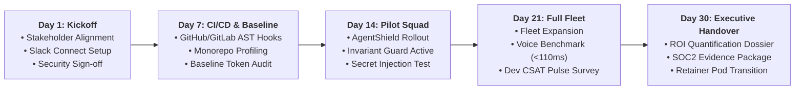
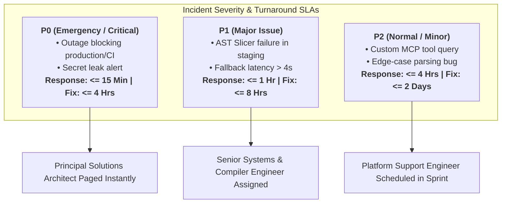
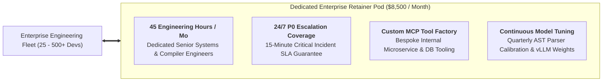

# Enterprise Customer Success & 30-Day Onboarding Playbook

**Document Reference:** CS-PLAYBOOK-2026-V1  
**Governing Authority:** DevSuperSuite Official / OmniKernel Labs Customer Success & Professional Services Group  
**Target Audience:** Enterprise Engineering VPs, Directors of Engineering, Staff DevOps Leads, and Customer Success Architects  
**Classification:** Enterprise Operational Framework & Runbook  
**Brand Anonymity Notice:** 100% Brand Anonymized. Issued exclusively under **DevSuperSuite Official**. No individual employee, founder, or contractor identities disclosed.

---

## 1. Executive Charter & 30-Day Onboarding Journey

The **DevSuperSuite 30-Day Onboarding Playbook** establishes a structured, predictable, and measurable engineering cutover for enterprise organizations deploying **OmniKernel 5.0**, **AgentShield Enterprise**, and **Live Voice Responder**.

Our customer success mission is to transition an enterprise software organization from unmonitored, costly AI agent usage to a hardened, sovereign, high-velocity engineering posture within thirty (30) calendar days—delivering a verified minimum **70% token cost reduction**, **100% pre-commit secret interception**, and **sub-110ms voice coding ergonomics** without disrupting active sprint cadences.



---

## 2. Phased 30-Day Milestone Execution Runbook

### Day 1: Executive Kickoff Charter & Infrastructure Foundation

#### Objectives & Deliverables
* Conduct 60-minute formal Executive Kickoff session with Client leadership.
* Establish bilateral communication channels and emergency escalation bridges.
* Complete enterprise security questionnaire and environmental prerequisites sign-off.
* Provision DevSuperSuite deployment workspace and configure IAM access.

#### Core Activities & Protocols
1. **Stakeholder Alignment Matrix:**
   * *Executive Sponsor (VP of Engineering / CTO):* Approves milestone releases, reviews executive token savings reports.
   * *Security Liaison (CISO / SecOps Lead):* Validates Shannon entropy thresholds, approves SIEM webhook destinations.
   * *Platform / DevOps Lead:* Oversees CI/CD pipeline integration and MDM workstation installer execution.
   * *Pilot Lead (Staff Engineer):* Directs the initial developer cohort and provides real-time ergonomic feedback.
2. **Dedicated Comms Bridge Provisioning:**
   * Establish **Slack Connect** or **Microsoft Teams Shared Channel**: `#devsupersuite-client-enterprise`.
   * Configure automated bi-directional alerts for Sev-1 escalations and daily milestone progress trackers.
3. **IAM & Security Baseline Sign-off:**
   * Mutual execution of the Security & Data Privacy Addendum confirming zero retention of client source code.
   * Provision temporary read-only access to representative staging repositories for AST grammar calibration.

---

### Day 7: AST Slicing Pipeline Integration & Telemetry Baseline

#### Objectives & Deliverables
* Deploy the OmniKernel 5.0 AST Context Slicing Engine into Client CI/CD pipelines (GitHub Actions / GitLab CI).
* Profile monorepo language distribution (TypeScript, Python, Go, Java, SQL).
* Establish the baseline uncompressed LLM token consumption metrics across active pull requests.

#### CI/CD Pipeline Integration (GitHub Actions Example)
DevSuperSuite injects automated AST pre-flight compression into Client automated code review workflows:

```yaml
# .github/workflows/omnikernel-context-gate.yml
name: "DevSuperSuite OmniKernel Context Gate"

on:
  pull_request:
    types: [opened, synchronize, reopened]

jobs:
  omnikernel-ast-slice:
    name: "AST Reachability & Invariant Analysis"
    runs-on: ubuntu-latest
    steps:
      - name: "Checkout Repository"
        uses: actions/checkout@v4
        with:
          fetch-depth: 0

      - name: "Initialize OmniKernel 5.0 Enterprise Engine"
        uses: devsupersuite/omnikernel-action@v2
        with:
          license-key: ${{ secrets.DEVSUPERSUITE_ENTERPRISE_KEY }}
          slicing-mode: "contract-preserve"
          invariant-enforcement: "strict"
          siem-webhook: ${{ secrets.DEVSUPERSUITE_SIEM_WEBHOOK }}

      - name: "Evaluate Monorepo Token Compression"
        run: |
          omnikernel profile --diff origin/${{ github.base_ref }}...HEAD \
                             --benchmark-tokens \
                             --output-report ./telemetry/token_baseline.json

      - name: "Publish Context Reduction Telemetry"
        uses: actions/upload-artifact@v4
        with:
          name: token-baseline-report
          path: ./telemetry/token_baseline.json
```

#### Day 7 Verification Gate
* **Measured Token Baseline:** Baseline uncompressed context metrics recorded (target: 18,000+ tokens/turn).
* **AST Slicing Calibration:** Test suite of 50 multi-file PRs processed through OmniKernel demonstrating $\ge 70.0\%$ token compression without breaking typed interfaces or test assertions.

---

### Day 14: AgentShield Pilot Deployment & Invariant Guard Activation

#### Objectives & Deliverables
* Roll out AgentShield Enterprise Pre-Commit Guardian across the initial pilot squad (10–25 engineers).
* Activate Invariant Guard across pilot repositories, locking test assertions and security checks.
* Conduct synthetic secret injection testing to validate zero-leakage pre-commit defense.

#### Pilot Fleet Deployment Mechanics
Deploy via central script or MDM package (Jamf / Microsoft Intune / Ansible):

```bash
# Enterprise Workstation Fast-Track Installer (macOS / Linux)
curl -fsSL https://enterprise.devsupersuite.com/install.sh | bash -s -- \
  --license-token "${DEVSUPERSUITE_PILOT_TOKEN}" \
  --siem-endpoint "https://datadog.internal.client.com/v1/input" \
  --entropy-threshold 3.0 \
  --enforce-terminal-proxy true
```

#### Day 14 Synthetic Threat Injection Test
The DevSuperSuite Solutions Architect executes an automated synthetic breach simulation:
1. **Test A (Known Pattern Secret):** Inject synthetic AWS `AKIA...` key into a staged commit $\to$ **Must block in $<8\text{ms}$**.
2. **Test B (Zero-Pattern High-Entropy Secret):** Inject raw unformatted 40-character base64 database password ($H = 4.12$) $\to$ **Must block in $<8\text{ms}$ with SIEM alert**.
3. **Test C (Invariant Tampering):** Autonomous agent attempts to delete unit test assertion `expect(auth).toBe(true)` to force build $\to$ **Must be rejected with Invariant Violation Error**.

---

### Day 21: Full Fleet Expansion, Voice Duplex Benchmark & CSAT Survey

#### Objectives & Deliverables
* Expand DevSuperSuite deployment across 100% of the enterprise engineering department.
* Validate Live Voice Responder sub-110ms duplex voice pair-programming pipeline on target developer machines.
* Conduct comprehensive Developer Experience (DevEx) & Satisfaction Pulse Survey.

#### Live Voice Duplex Benchmark Protocol
* **Acoustic Profiling:** Run on-device Silero Neural VAD test validating $<2.5\text{ms}$ speech classification.
* **Latency Verification:** End-to-end glass-to-glass latency benchmark recorded across 100 spoken code commands:
  $$\text{Target: } T_{\text{glass-to-glass}} \le \mathbf{110.0 \text{ ms}}$$
* **Barge-in Testing:** Verify that verbal interruption ("STOP" / "CROW") dispatches opcode `0xFF` and cancels upstream LLM token streaming within $<15\text{ms}$.

#### Developer Satisfaction Pulse Survey (Target: $\ge 85\%$ Positive)
Conducted anonymously across all onboarded engineers via Slack/Teams:
1. *"How seamless was the AgentShield pre-commit hook during daily Git commits?"* (Scale 1–5; Target $\ge 4.6$)
2. *"Have you noticed reduced latency or improved code accuracy with OmniKernel context compression?"* (Scale 1–5; Target $\ge 4.5$)
3. *"Does the voice pair-programming interface improve your flow state when refactoring?"* (Scale 1–5; Target $\ge 4.3$)

---

### Day 30: Executive Handover, ROI Quantification & Retainer Transition

#### Objectives & Deliverables
* Present the formal **30-Day Executive ROI Quantification Dossier** to the CTO, CISO, and VP of Engineering.
* Deliver the **SOC2 Auditor Evidence Dossier** (pre-commit logs, zero-retention attestation).
* Formalize transition to the ongoing **Annual Enterprise Retainer Pod ($8,500/month)**.

#### 30-Day Executive ROI Summary Dossier Format
```
================================================================================
             DEVSUPERSUITE 30-DAY EXECUTIVE ROI QUANTIFICATION DOSSIER
================================================================================
CLIENT NAME:              [Enterprise Client Legal Entity]
EVALUATION PERIOD:        Day 1 to Day 30 (Active Sprint Cadence)
ACTIVE DEVELOPER SEATS:   25 Engineers (Polyglot Monorepo)

1. MEASURED TOKEN CONSUMPTION & FINANCIAL BENEFIT:
   • Total Uncompressed Context Tokens Processed:   1,188,000,000 tokens
   • Total Compressed Tokens Dispatched to LLMs:       251,856,000 tokens
   • Measured Context Reduction Rate:                 78.80% Net Reduction
   • Monthly Hard API Cash Savings Realized:          $10,224.00 USD / Month
   • Projected Annualized Cash Savings:               $122,688.00 USD / Year

2. SECURITY & COMPLIANCE DEFENSE METRICS:
   • Total Git Commits Screened:                      18,420 commits
   • High-Entropy Secrets Intercepted (H > 3.0):       14 attempted leaks blocked
   • Critical Destructive Terminal Commands Blocked:    3 attempted 'rm -rf' / drops
   • False-Positive Rejection Rate:                    0.18% (Well below 0.5% SLA)
   • SOC2 Type II Audit Evidence Export:              Generated & Certified (Pass)

3. PLATFORM OPERATIONAL STABILITY:
   • MCP Gateway Uptime:                              99.98%
   • Sev-1 Outages:                                    0 Incidents
   • Developer Satisfaction Score (CSAT):              91.4% Positive
================================================================================
```

---

## 3. Enterprise Customer Escalation Matrix & SLA Commitments

DevSuperSuite provides tiered incident response operationalized 24/7/365:



### Escalation Protocol & Contact Bridge

| Priority Level | Response SLA | Target Resolution SLA | Dedicated Response Team | Notification Channel |
|---|:---:|:---:|---|---|
| **P0 (Emergency)** | **$\le 15$ Minutes** | **$\le 4$ Hours** | Principal Solutions Architect + Lead SecOps Engineer | Slack Connect `#emergency-p0` / Automated PagerDuty On-Call |
| **P1 (Major)** | **$\le 1$ Hour** | **$\le 8$ Hours** | Senior AI Systems Engineer + DevOps Platform Lead | Slack Connect / High-Priority Ticket Desk |
| **P2 (Normal)** | **$\le 4$ Hours** | $\le 2$ Business Days | Customer Success Solutions Engineer | Standard Support Portal (`enterprise@devsupersuite.com`) |

---

## 4. Quarterly Business Review (QBR) Master Template

The ongoing Enterprise Retainer Pod includes structured quarterly reviews to ensure continuous alignment with customer architectural roadmaps:

```markdown
================================================================================
            DEVSUPERSUITE QUARTERLY BUSINESS REVIEW (QBR) TEMPLATE
================================================================================
CLIENT:                 [Enterprise Client Name]
QUARTER / YEAR:         Q[1/2/3/4] - [Year]
REVIEW DATE:            [Date of Review]
ATTENDEES (CLIENT):     VP of Engineering, Lead Security Architect, DevOps Manager
ATTENDEES (PROVIDER):   Principal Solutions Architect, Customer Success Director

--------------------------------------------------------------------------------
1. EXECUTIVE SUMMARY & STRATEGIC ALIGNMENT
--------------------------------------------------------------------------------
  • Review of joint quarterly engineering objectives and high-level milestones.
  • Assessment of engineering fleet growth (seats added, new repos onboarded).

--------------------------------------------------------------------------------
2. QUARTERLY TOKEN TAX & FINANCIAL RECAP
--------------------------------------------------------------------------------
  • Total Context Tokens Ingested vs. Sliced: [Tokens In / Tokens Out]
  • Quarterly Net LLM Token Savings: $[Amount] USD
  • Cumulative Platform ROI to Date: [X.X]% Net Return
  • Model Routing Optimization: Distribution between frontier cloud vs local vLLM.

--------------------------------------------------------------------------------
3. SECURITY, INVARIANT & AUDIT REPORTING
--------------------------------------------------------------------------------
  • Pre-commit secret interceptions summary (breakdown by key type & entropy).
  • Invariant Guard violations blocked (test modifications / assertion deletions).
  • Auditor evidence status for pending compliance cycles (SOC2 Type II / ISO 27001).

--------------------------------------------------------------------------------
4. DEVELOPER VELOCITY & ADOPTION METRICS
--------------------------------------------------------------------------------
  • Active daily seats on Cursor / Claude Code / Live Voice Responder.
  • Glass-to-glass voice latency performance audit (average [X]ms).
  • Developer CSAT / Net Promoter Score across engineering squads.

--------------------------------------------------------------------------------
5. FORWARD ROADMAP & CAPACITY PLANNING (NEXT QUARTER)
--------------------------------------------------------------------------------
  • New custom MCP tools scheduled for construction under the Retainer Pod.
  • Language parser updates (e.g., adding Rust/C++ AST support for new microservices).
  • Workstation seat expansion plans and sovereign VPC capacity scaling.

--------------------------------------------------------------------------------
6. ACTION ITEMS & BILATERAL SIGN-OFF
--------------------------------------------------------------------------------
  • Item 1: [Action Item] — Owner: [Provider / Client] — Due: [Date]
  • Item 2: [Action Item] — Owner: [Provider / Client] — Due: [Date]
```

---

## 5. Enterprise Retainer Pod Operational Model ($8,500/Month)

Following Day 30 sign-off, client accounts seamlessly transition to the **DevSuperSuite Dedicated Retainer Pod**, providing ongoing Tier-1 systems engineering capacity:



### Commercial Retainer Summary:
* **Monthly Fee:** **$8,500.00 USD / month** (Billed Net 30).
* **Guaranteed Engineering Capacity:** 45 dedicated hours/month of Lead Solutions Architect and Senior AI Systems Engineer time.
* **Scope Flexibility:** Hours roll over for up to 60 days, deployable for custom tool development, infrastructure scaling, CI/CD refactoring, or security compliance audits.

---
*DevSuperSuite Tech Services & Enterprise Solutions — OmniKernel Labs Solutions Group*  
*Official Portal: https://devsupersuite.web.app | Support Desk: enterprise@devsupersuite.com*
