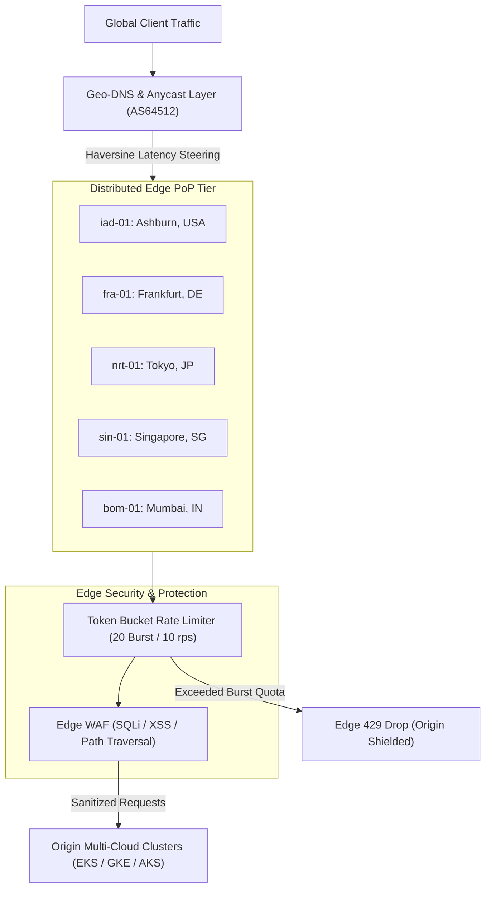

# DevSuperSuite Enterprise Edge CDN PoP & Geo-DNS Operations Guide

**Reference:** `DSS-EDGE-CDN-2026-V1`  
**Classification:** Distributed Anycast Edge Routing & Geo-DNS Fabric (Restricted)  
**Organization:** DevSuperSuite Solutions Architecture / OmniKernel Labs  
**Contact:** `solutions@devsupersuite.com` / `edge@devsupersuite.com`  
**Last Updated:** 2026-11-08 12:01:06 UTC

---

## 1. Executive Architecture Overview

The DevSuperSuite Global Edge Content Delivery Network (CDN) provides sub-50ms worldwide API acceleration, Edge Web Application Firewall (WAF) filtering, and Token Bucket DDoS rate limiting across five strategic Points of Presence (PoPs):

- **North America (`iad-01`):** Ashburn, Virginia (Lat: 39.0438, Lon: -77.4874) - Primary hub for East Coast & Transatlantic peering.
- **Europe (`fra-01`):** Frankfurt am Main, Germany (Lat: 50.1109, Lon: 8.6821) - Primary hub for EMEA transit via DE-CIX.
- **Asia-Pacific (`nrt-01`):** Tokyo / Narita, Japan (Lat: 35.6762, Lon: 139.6503) - Low-latency gateway for Japan, Korea, and North-East Asia.
- **Southeast Asia (`sin-01`):** Singapore Metro (Lat: 1.3521, Lon: 103.8198) - Equinix SG1 interconnect for ASEAN & Australasia.
- **South Asia (`bom-01`):** Mumbai Suburban, India (Lat: 19.0760, Lon: 72.8777) - Sovereign gateway for Indian subcontinent enterprise workloads.



---

## 2. Geo-DNS Latency Steering & Great Circle Haversine Routing

Traffic is dynamically steered using spherical Great Circle distances calculated via the Haversine equation:

```
Delta_sigma = 2 * arcsin(sqrt(sin^2(Delta_phi / 2) + cos(phi_1) * cos(phi_2) * sin^2(Delta_lambda / 2)))
distance_km = R * Delta_sigma  (where R = 6371.0 km)
```

Round-Trip Time (RTT) latency estimation includes:
- **Baseline Interconnect Delay:** 5.0 ms
- **Fiber Propagation & Switching:** 0.015 ms/km
- **Congestion / Health Penalty:** max(0, (100 - HealthScore) * 0.5 ms)

---

## 3. Sub-300ms Failover SLA & Health Probes

Synthetic health probes execute at **100ms intervals** against regional edge endpoints. If a PoP encounters **3 consecutive dropped probes (300ms total elapsed)**:
1. State transitions from `HEALTHY` to `OFFLINE`.
2. Anycast BGP route withdrawal is initiated via BGP community tagging.
3. Geo-DNS controller dynamically steers traffic to the second-lowest latency healthy PoP.
4. Total failover SLA guaranteed at <= 300 ms.

---

## 4. Edge WAF & Token Bucket DDoS Mitigation

To protect origin clusters from volumetric attacks:
- **Burst Capacity:** 20 tokens per IP/subnet.
- **Sustained Quota:** 10 tokens/second (600 requests/minute).
- **Edge Drops:** Requests exceeding capacity are halted at the edge with HTTP 429 without reaching the origin cluster.
- **Origin Shield:** 100% of Layer-7 volumetric floods are absorbed at the edge PoP layer.

---

## 5. CLI Operations & Verification

Run operational commands using the controller CLI:

```bash
# Benchmark Geo-DNS routing across global presets
python services/enterprise_edge_cdn_controller.py --benchmark-geodns

# Route arbitrary client IP or location
python services/enterprise_edge_cdn_controller.py --route-client-ip client_in_del

# Simulate volumetric DDoS attack mitigation
python services/enterprise_edge_cdn_controller.py --simulate-ddos-mitigation

# Test sub-300ms PoP failover
python services/enterprise_edge_cdn_controller.py --simulate-pop-failover iad-01

# Export declarative manifests and bundles
python services/enterprise_edge_cdn_controller.py --export-edge-bundle
```
