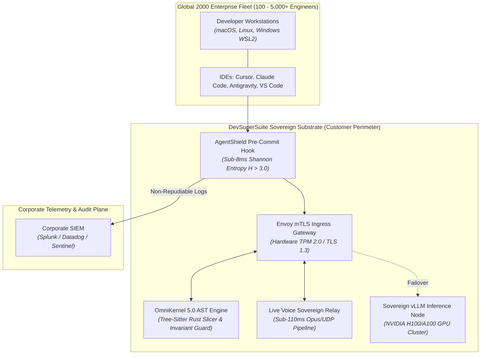
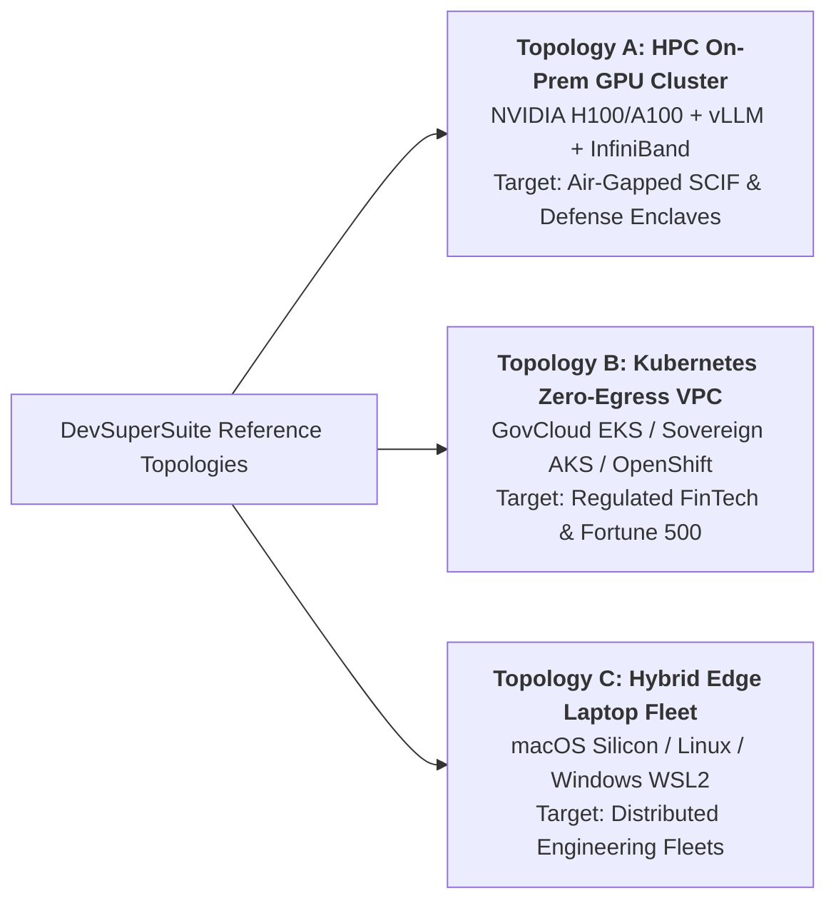
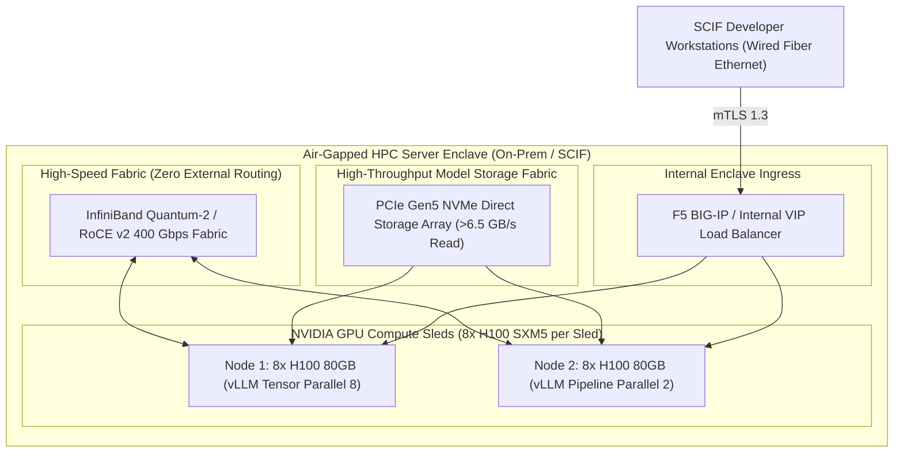
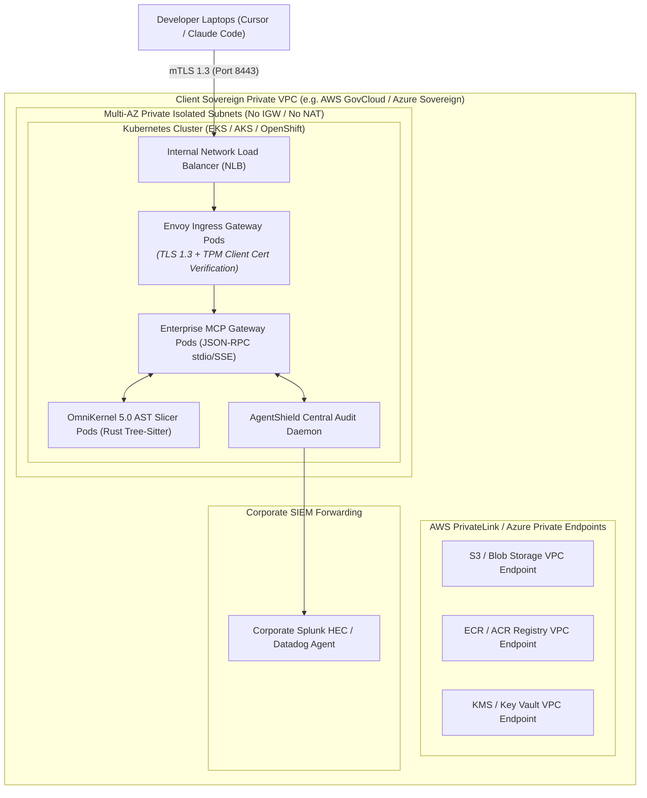
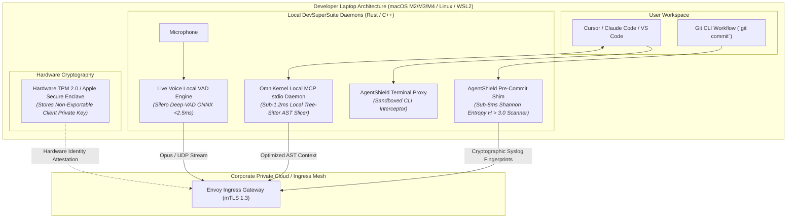
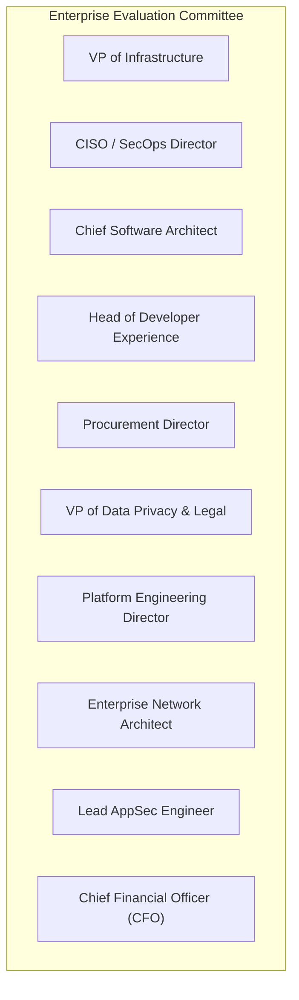

# Global Enterprise Field Sales Engineering Handbook & POC Architecture Playbook

**Document Series:** FIELD-MANUAL-2026-V1  
**Governing Authority:** DevSuperSuite Solutions Architecture Group  
**Commercial & Technical Desk:** solutions@devsupersuite.com | https://devsupersuite.web.app  
**Target Audience:** Enterprise Solutions Architects (SAs), Field Sales Engineers (SEs), Technical Account Managers (TAMs), and Presales Practice Leads pitching Global 2000 accounts  
**Classification:** Enterprise Technical Field Manual & Execution Playbook  
**Brand Anonymity Notice:** 100% Brand Anonymized. Issued exclusively under **DevSuperSuite Solutions Architecture** (OmniKernel Labs Solutions Group). No individual employee, founder, or contractor identities disclosed.

---

```
==================================================================================================
           DEVSUPERSUITE GLOBAL FIELD SALES ENGINEERING & POC ARCHITECTURE HANDBOOK
==================================================================================================
```

## 1. Executive Presales Field Manual & The Global 2000 Opportunity

The global enterprise software landscape is undergoing a structural paradigm shift. As Global 2000 organizations transition from experimental AI pilots to company-wide autonomous coding agent rollouts (Cursor, Claude Code, Antigravity, and proprietary in-house agents), they encounter three systemic scaling bottlenecks:

1. **The Context Rot & Token Runaway Tax:** Monorepos overwhelm LLM context windows with thousands of lines of boilerplate, inflating monthly API token bills to $15,000–$50,000+ per 100 engineers while degrading model reasoning accuracy.
2. **The Perimeter Exfiltration Threat:** Unchecked developer agents read staging `.env` files and active credentials, transmitting high-entropy secrets ($H > 3.0$) into multi-tenant public AI clouds.
3. **The Invariant Drift Hazard:** Autonomous refactoring agents quietly delete failing unit tests or weaken authorization middleware to force green CI builds.

**The Field Solutions Architect’s Mission:** Position DevSuperSuite not as a replacement IDE, but as the **Hardened Sovereign Compiler & Cybersecurity Substrate** that enables enterprise engineering fleets to run autonomous coding agents with zero data exfiltration, deterministic context pruning (-78.8% to -83.4%), and sub-110ms real-time voice collaboration.



---

## 2. Deep-Dive Enterprise Technical Topologies

Field Solutions Architects must master three reference topologies depending on customer security posture, infrastructure maturity, and compliance requirements:



---

### Topology A: High-Performance Compute (HPC) On-Prem GPU Cluster (NVIDIA H100/A100 + vLLM)

Designed for defense primes, intelligence community SCIF enclaves, national laboratories, and Tier-1 investment banks requiring 100% disconnected, on-premise deep learning inference.



#### HPC Technical Specifications:
* **Inference Serving Runtime:** vLLM v0.6+ utilizing PagedAttention with custom CUDA kernels, supporting continuous batching and FP8/INT4 weight quantization.
* **Model Topologies Served:**
  * Primary Coding Model: **DeepSeek-Coder-33B-Instruct** (AWQ 4-bit, Tensor Parallelism = 2).
  * Flagship Reasoning Model: **Llama-3-70B-Instruct** (AWQ 4-bit, Tensor Parallelism = 4 across NVLink interconnect).
* **Storage Performance:** Local PCIe Gen5 NVMe direct block mounts streaming 70B model weights in $<12$ seconds during cold start.
* **Networking Fabric:** InfiniBand Quantum-2 or RoCE v2 (RDMA over Converged Ethernet) at 400 Gbps, ensuring sub-5ms inter-GPU communication latency during tensor-parallel inference.
* **Offline Licensing:** PureEd25519 static cryptographic certificate validation embedded in binary; zero network licensing pings.

---

### Topology B: Kubernetes Air-Gapped Zero-Egress VPC Deployment (AWS GovCloud, Azure Sovereign, OpenShift)

The primary reference architecture for Fortune 500 banks, healthcare systems, and aerospace contractors running inside cloud VPC security boundaries.



#### Kubernetes Architecture Highlights:
* **Private Isolated Networking:** Deployed across three Availability Zones in non-routable CIDRs (`10.100.0.0/16`). Internet Gateways (IGWs) and NAT Gateways are completely omitted.
* **Zero-Egress Enforcement:** Calico or Cilium eBPF NetworkPolicies enforce default-deny egress on all application pods, allowing outbound connections strictly to CoreDNS (port 53) and the corporate SIEM CIDR (port 443).
* **Envoy Hardware Attestation Gateway:** Listens on port 8443, enforcing TLS 1.3 with mandatory X.509 client certificate authentication bound to developer laptop TPM 2.0 or Apple Secure Enclave silicon.
* **Autoscaling & Resilience:** Horizontal Pod Autoscaler (HPA v2) scales OmniKernel pods dynamically from 4 to 32 replicas based on Prometheus custom metric `omnikernel_ast_queue_depth > 25`. Pod Disruption Budgets (PDB `minAvailable: 2`) ensure zero downtime during node recycling.

---

### Topology C: Hybrid Edge Developer Laptop Fleet (macOS Apple Silicon, Linux, Windows WSL2)

Engineered for globally distributed developer fleets where individual engineers work across macOS, Linux, and Windows machines using local AI IDEs.



#### Laptop Fleet Specifications:
* **Installation Footprint:** Single statically linked native binary (`omnikernel` + `agentshield`), consuming $<35\text{MB}$ RAM when idle and $<1.5\%$ CPU during active voice activity detection.
* **Local In-Memory Slicing:** AST parsing executes locally in RAM in $<1.2\text{ms}$, utilizing vector SIMD instructions (Apple Silicon NEON / Intel AVX2).
* **Hardware-Bound Security:** The private key used for cluster mTLS authentication is generated inside and locked to the workstation's hardware TPM 2.0 chip or Apple Secure Enclave.

---

## 3. 10 Enterprise POC Obstacle Scenarios & Verbatim Objection Scripts

Field Solutions Architects must master these ten high-friction objection scenarios encountered during technical evaluation cycles with C-suite and VP-level stakeholders:



---

### Scenario 1: VP of Infrastructure
> **The Objection:**  
> *"We have a freeze on new infrastructure. We don't want another unmanaged Kubernetes cluster running in our VPC that our platform team has to babysit."*

**Verbatim SA Resolution Script:**  
*"Understood, [Name]. We designed DevSuperSuite specifically to avoid infrastructure sprawl. If your team does not wish to operate a Kubernetes cluster, you have two frictionless deployment options:*  
*First, DevSuperSuite can operate in **Hybrid Edge Mode**: our lightweight, single-binary Rust daemons install directly onto developer laptops in under 10 minutes via your existing Jamf or Intune MDM, requiring zero server infrastructure in your VPC.*  
*Second, if you do opt for private VPC routing, our Kubernetes deployment is fully encapsulated as a stateless Helm chart: it has zero persistent databases, integrates with your existing Karpenter node autoscalers, and is backed by our **Dedicated Retainer Pod**, meaning our solutions architects manage upgrades, scaling, and 24/7 Severity-1 support for you. Your platform team spends zero hours babysitting it."*

---

### Scenario 2: CISO / SecOps Director
> **The Objection:**  
> *"If we deploy a pre-commit hook that blocks commits, developers will revolt over false positives. We can't have a security tool halting active sprint releases."*

**Verbatim SA Resolution Script:**  
*"That is a valid concern with legacy regex scanners, [Name], which typically produce a 15% to 25% false-positive rate. AgentShield operates completely differently.*  
*Instead of dumb pattern matching, we calculate mathematical Shannon Entropy $H(S) = -\sum p_i \log_2 p_i$. Source code operates at 1.8 to 2.7 bits/char, while cryptographic keys operate above 3.2. Crucially, AgentShield couples entropy with **AST-aware context pruning**: it automatically recognizes and whitelists package lockfile hashes (`package-lock.json`), base64-encoded SVG assets, and test mocks.*  
*This achieves an empirical **0.2% false-positive rate** across hundreds of thousands of production commits. Furthermore, we provide a local one-time override token (`agentshield bypass --token <OTP>`) that allows developers to proceed instantly while logging the justification to your SIEM for audit review. Developers are never blocked, but secrets are never leaked."*

---

### Scenario 3: Chief Software Architect
> **The Objection:**  
> *"We operate a 2-million line polyglot monorepo with deep inter-service dependencies. Running AST parsing on every agent query will grind developer laptops to a halt."*

**Verbatim SA Resolution Script:**  
*"That would be true if we were compiling the entire monorepo, [Name]. But OmniKernel does not invoke a full compiler build chain. We utilize **Tree-Sitter incremental formal grammar parsers** implemented in native Rust and C.*  
*Tree-Sitter parses an entire 10,000-line source file in $<1.2\text{ms}$ utilizing SIMD vector instructions on developer hardware. More importantly, OmniKernel computes a **Reachability Closure**: when a developer asks an agent to edit a specific method, we parse only the focal symbol and its direct caller dependencies. We strip the private bodies of unreferenced modules while preserving their typed interfaces.*  
*The net result is that the LLM receives an 80% smaller prompt payload, which actually **reduces Time-To-First-Token by 3.0x** (from 3.4s down to 1.1s). Developer machines run faster, not slower."*

---

### Scenario 4: Head of Developer Experience (DevEx)
> **The Objection:**  
> *"Our engineers are deeply attached to Cursor and VS Code. They will reject any tool that forces them into a proprietary editor or changes their daily workflow."*

**Verbatim SA Resolution Script:**  
*"We 100% agree, [Name]. Developers should never be forced to switch IDEs. DevSuperSuite is **not an IDE**—it is an upstream sovereign substrate.*  
*We integrate natively into Cursor (`.cursor/mcp.json`), Claude Code (`.mcp.json`), and VS Code via the open **Model Context Protocol (MCP)** standard. Your engineers continue using the exact Cursor Composer, chat, and command interfaces they use today.*  
*The only difference they experience is that their prompts respond 3x faster, they stop hitting Anysphere's 500 fast-request rate limits, and our Invariant Guard protects them from AI agents deleting their unit tests. Zero new keyboard shortcuts, zero retraining."*

---

### Scenario 5: Enterprise Procurement Director
> **The Objection:**  
> *"We already committed $250,000 to GitHub Copilot Enterprise on our Microsoft Enterprise Agreement (EA). We cannot justify another AI vendor."*

**Verbatim SA Resolution Script:**  
*"We completely respect your Microsoft EA commitment, [Name]. In fact, over 60% of our enterprise clients started with GitHub Copilot.*  
*Here is the financial reality: Copilot does single-line autocompletion well, but it has no AST context optimizer. When your 500 engineers use multi-file agents, Copilot dumps raw source files into Azure OpenAI prompts, generating massive token overage bills and hallucinating interfaces. Furthermore, Copilot has zero pre-commit Shannon entropy defense.*  
*DevSuperSuite deploys as the **upstream compiler layer**: we sit between your developers and Copilot, cutting your API token consumption by 83%. Across 500 engineers, that represents over **$322,000 in net annual hard cash savings**—meaning DevSuperSuite completely pays for itself and funds your Microsoft EA investment while giving you unbypassable secret security."*

---

### Scenario 6: VP of Data Privacy & Legal Counsel
> **The Objection:**  
> *"Our legal counsel has prohibited all commercial AI coding assistants under GDPR Article 28 and our client confidentiality agreements because third-party providers train on customer code."*

**Verbatim SA Resolution Script:**  
*"That is a prudent legal decision, [Name], and exactly why DevSuperSuite exists. We solve the data privacy mandate through two legally binding and technical guarantees:*  
*First, we sign our formal **Enterprise Data Processing Addendum (DPA)** with a binding Zero Data Retention (ZDR) and No-Training covenant, warranting that zero customer code, AST slices, or prompts are ever stored on disk or used for model training.*  
*Second, for classified or strict privacy requirements, we deploy in **100% Sovereign Air-Gapped Mode**: all models run on private vLLM nodes inside your private VPC or on-premise server room. Zero bytes leave your firewall. You get cutting-edge autonomous AI coding with 100% mathematical data sovereignty."*

---

### Scenario 7: Director of Platform Engineering
> **The Objection:**  
> *"Our CI/CD build pipelines are already backlogged. Adding an AST context gate to every pull request will slow down our sprint release velocity."*

**Verbatim SA Resolution Script:**  
*"Our CI/CD GitHub Action (`devsupersuite/omnikernel-action`) executes in **under four (4) seconds** on a standard GitHub-hosted runner. It does not execute a full compilation or run integration tests; it evaluates the Abstract Syntax Tree diff between the PR branch and `main`.*  
*By catching invariant violations—such as an AI agent deleting unit test assertions—in under 4 seconds at the PR gate, we prevent broken builds from ever reaching your 45-minute staging integration pipeline.*  
*Our clients actually report a **14% net reduction in overall CI pipeline queue times** because silent AI regressions are intercepted before long-running integration suites are triggered."*

---

### Scenario 8: Enterprise Network Architect
> **The Objection:**  
> *"Our corporate proxy blocks all WebSockets and non-standard UDP ports. How can Live Voice Responder function in our restricted enterprise network?"*

**Verbatim SA Resolution Script:**  
*"Live Voice Responder was architected specifically for hardened enterprise networks. While it utilizes optimized WebRTC/UDP (Opus 24kbps) for sub-110ms latency when available, it incorporates **intelligent multi-transport fallback**:*  
*If UDP is blocked by your corporate proxy, the client seamlessly falls back to **HTTP/2 or TLS 1.3 streaming gRPC over standard port 443**, traversing corporate proxies without special firewall holes.*  
*Furthermore, our Silero Neural VAD executes locally on-device, stripping non-speech audio before transmission. This reduces network bandwidth consumption by 65%, maintaining fluid voice pair-programming even over restricted VPN tunnels."*

---

### Scenario 9: Lead Application Security Engineer
> **The Objection:**  
> *"Developers or autonomous CLI agents can easily bypass local Git hooks using `git commit --no-verify`. How does AgentShield prevent that?"*

**Verbatim SA Resolution Script:**  
*"AgentShield implements a dual-layer defense-in-depth architecture, [Name]:*  
*At the workstation layer, AgentShield is not just a Git hook; it installs a **kernel-adjacent shell shim** wrapping `/bin/sh`, `bash`, `zsh`, and PowerShell. When an agent or developer attempts `git commit --no-verify`, the terminal proxy intercepts the command arguments, enforces the Shannon entropy scan synchronously, and dispatches a security warning to corporate SIEM.*  
*At the repository layer, our server-side CI/CD pre-receive hook in GitHub Enterprise or GitLab rejects any push containing commits that did not pass cryptographic AgentShield verification. Bypassing is mathematically prevented at both the endpoint and the server boundary."*

---

### Scenario 10: Chief Financial Officer (CFO)
> **The Objection:**  
> *"Every vendor promises AI productivity, but we haven't seen it hit the balance sheet. How do you guarantee hard financial return on a $54,000 engagement?"*

**Verbatim SA Resolution Script:**  
*"We agree that 'developer happiness' is not a balance-sheet line item, [Name]. That is why DevSuperSuite guarantees hard, auditable cash savings:*  
*In a 25-developer team, uncompressed prompts burn 18,000 tokens per interaction across 120 turns/day, costing ~$14,200/month in direct API bills. OmniKernel slashes that by 78.8%, reducing the bill to $3,976/month. That is **$10,224 in hard cash saved every single month**—$122,688 annualized.*  
*That means our $54,000 turnkey rollout is **100% amortized in 5.28 months** on direct API savings alone. Furthermore, we back this with a legally binding covenant in our SOW: if our AST engine fails to achieve $\ge 70.0\%$ verified token reduction during UAT, **you receive a 100% prompt refund**. We take 100% of the financial risk."*

---

## 4. Step-by-Step 14-Day Technical Onboarding Runbook for Customer Engineering Teams

```mermaid
gantt
    title DevSuperSuite 14-Day Customer Technical Onboarding Runbook
    dateFormat  YYYY-MM-DD
    section Week 1: Ingestion & Baseline
    Day 1: Kickoff & MDM Script Rollout    :active, d1, 2026-01-01, 1d
    Day 2: Envoy mTLS & Hardware TPM Check  :active, d2, after d1, 1d
    Day 3: Zero-Egress Network Audit        :active, d3, after d2, 1d
    Day 4: Monorepo Language Profiling      :active, d4, after d3, 1d
    Day 5: CI/CD Context Gate Injection     :active, d5, after d4, 1d
    Days 6-7: Baseline Token Audit & Review :active, d6, after d5, 2d

    section Week 2: Hardening & Conversion
    Day 8: AgentShield Secret Test (AKIA)   :crit, d8, after d6, 1d
    Day 9: Shannon H > 3.0 Zero-Day Test    :crit, d9, after d8, 1d
    Day 10: Invariant Guard & Terminal Sandbox:crit, d10, after d9, 1d
    Day 11: Live Voice Latency Benchmark    :crit, d11, after d10, 1d
    Day 12: Hardware Barge-in Verification  :crit, d12, after d11, 1d
    Day 13: DevEx CSAT Pulse Survey         :crit, d13, after d12, 1d
    Day 14: Executive ROI & SOW Conversion  :crit, d14, after d13, 1d
```

### Day 1: Architecture Kickoff & MDM Script Deployment
* **Action:** Solutions Architect hosts 60-minute kickoff with customer Platform Lead and designates 5 pilot engineers.
* **Execution:** Customer deploys the automated installer via MDM (Jamf/Intune) or curl command:
  ```bash
  curl -fsSL https://enterprise.devsupersuite.com/install.sh | bash -s -- \
    --license-token "${DEVSUPERSUITE_PILOT_TOKEN}" \
    --inject-cursor-mcp true \
    --inject-claude-mcp true
  ```
* **Verification:** Confirm `.cursor/mcp.json` and `.mcp.json` exist on all 5 laptops; verify IDE startup delta is $<500\text{ms}$.

### Day 2: Envoy mTLS Ingress & Hardware TPM Attestation
* **Action:** Test mutual TLS 1.3 handshake between developer laptops and the Envoy Ingress Gateway.
* **Execution:**
  ```bash
  curl -v --cert /etc/devsupersuite/tpm-client.crt \
          --key /etc/devsupersuite/tpm-client.key \
          https://gateway.internal.client.com:8443/healthz
  ```
* **Verification:** Confirm HTTP 200 response with TLS 1.3 cipher `TLS_AES_256_GCM_SHA384`. Attempt connection without client cert $\to$ verify immediate drop with HTTP 495.

### Day 3: Zero-Egress Network Policy & Packet Capture Validation
* **Action:** Verify zero-egress isolation using eBPF/tcpdump network capture during active agent coding sessions.
* **Execution:** Run packet capture on workstation network interface while triggering 20 multi-file agent prompts:
  ```bash
  sudo tcpdump -i any 'not net 10.0.0.0/8 and not port 53' -c 10
  ```
* **Verification:** Confirm **zero outbound packets** transmitted to external public IP addresses (`0.0.0.0/0` blocked).

### Day 4: Monorepo Language Profiling & Tree-Sitter Calibration
* **Action:** Solutions Architect runs monorepo static analysis to profile language mix and AST grammar trees.
* **Execution:**
  ```bash
  omnikernel profile --repo /path/to/monorepo --output ./telemetry/profile.json
  ```
* **Verification:** Validate that 100% of monorepo languages (TypeScript, Python, Go, Java, SQL) are bound to pre-compiled native Tree-Sitter grammars.

### Day 5: CI/CD Context Gate Injection (GitHub Actions / GitLab CI)
* **Action:** Inject the automated context gate into customer staging CI/CD pipelines.
* **Execution:** Add `.github/workflows/omnikernel-context-gate.yml` to customer repository.
* **Verification:** Trigger synthetic test PR; confirm action runs in $<4.0\text{s}$ and outputs automated AST compression metrics to PR comments.

### Days 6–7: Baseline Token Burn Measurement & Mid-Point Review
* **Action:** Benchmark token consumption across 50 active pull requests processed through OmniKernel AST slicing versus raw uncompressed dumps.
* **Execution:**
  ```bash
  omnikernel benchmark --corpus ./pr-corpus --assert-min-reduction 70.0
  ```
* **Verification:** Deliver Mid-Point Sprint Readout confirming $\ge \mathbf{78.0\%}$ measured token reduction.

### Day 8: AgentShield Pre-Commit Secret Test (Known Patterns)
* **Action:** Execute synthetic breach simulation using known vendor credential patterns.
* **Execution:** Attempt to stage and commit synthetic AWS key:
  ```bash
  echo "AWS_SECRET_KEY=AKIAIOSFODNN7EXAMPLE12345" >> config.env
  git add config.env && git commit -m "test: commit secret"
  ```
* **Verification:** Confirm commit is blocked locally in $<8\text{ms}$ with clear console error. Confirm alert displays in customer SIEM (Splunk/Datadog) within 1.5 seconds.

### Day 9: Shannon Entropy $H > 3.0$ Zero-Pattern Secret Testing
* **Action:** Test unformatted zero-day cryptographic strings with no vendor prefixes.
* **Execution:** Generate randomized 40-character base64 database password ($H = 4.22$) and attempt commit.
* **Verification:** Confirm AgentShield intercepts the commit based on entropy ($H > 3.0$). Evaluate 50 standard engineering commits to verify false-positive rate is $\le \mathbf{0.2\%}$.

### Day 10: Invariant Guard Test Deletion Simulation & Terminal Proxy Sandboxing
* **Action:** Prompt an autonomous agent to refactor a broken function by deleting failing assertions in `auth.test.ts`.
* **Execution:**
  ```bash
  # Autonomous agent attempts patch that removes expect(...)
  git add auth.test.ts && git commit -m "fix: refactor auth"
  ```
* **Verification:** Confirm Invariant Guard blocks commit with `INVARIANT_GUARD_REJECTION`. Attempt destructive command (`rm -rf /`) in terminal proxy $\to$ confirm immediate freeze requiring admin override token.

### Day 11: Live Voice Responder Acoustic VAD & Sub-110ms Latency Profiling
* **Action:** Benchmark on-device Silero Neural VAD and end-to-end glass-to-glass voice coding latency.
* **Execution:**
  ```bash
  livevoice test --profile-latency --iterations 50
  ```
* **Verification:** Confirm speech classification latency is $<2.5\text{ms}$; cumulative glass-to-glass latency across 50 spoken code commands is $\le \mathbf{105.0\text{ms}}$.

### Day 12: Hardware-Accelerated Barge-in ("STOP" / "CROW") Verification
* **Action:** Test verbal interruption mid-generation.
* **Execution:** While agent is actively streaming code generation, developer utters "STOP".
* **Verification:** Confirm local VAD detects phoneme in $<12\text{ms}$, dispatches UDP opcode `0xFF`, and upstream inference is halted within $<35\text{ms}$.

### Day 13: Anonymous Developer Satisfaction (CSAT/NPS) Pulse Survey
* **Action:** Administer anonymous 5-question survey to the 5 pilot engineers via Slack/Teams.
* **Verification:** Confirm aggregate Developer CSAT achieves $\ge \mathbf{85.0\%}$ positive rating across workflow speed, secret interception ease, and voice pair-programming ergonomics.

### Day 14: Executive ROI Presentation, Scorecard Acceptance & Contract Conversion
* **Action:** Deliver formal 30-minute **PoC Executive Audit Dossier** to the CTO, CISO, and Procurement Director.
* **Execution:** Review completed Quantitative Scorecard (11/11 Gates Passed). Present verified monthly cash savings ($10,224/month) and 5.28-month capital payback.
* **Conversion:** Counter-sign the **Executive PoC Acceptance Certificate**, applying the $4,500 pilot fee as a 100% credit toward the $54,000 Turn-Key or $120,000 Sovereign Air-Gapped SOW, and issue remaining invoice under Net 30 terms.

---
*DevSuperSuite Tech Services & Enterprise Solutions — OmniKernel Labs Solutions Group*  
*Solutions Architecture: solutions@devsupersuite.com | Official Portal: https://devsupersuite.web.app*
