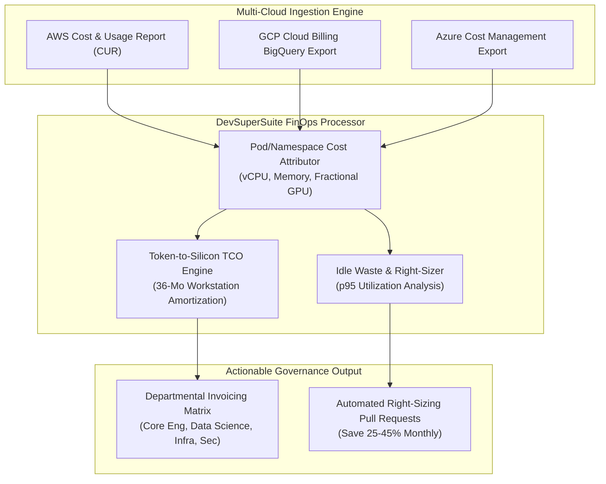

# DevSuperSuite Enterprise FinOps & GPU Cost Allocation Guide

**Reference Architecture**: `DSS-FINOPS-GOVERNANCE-RUNBOOK-2026`  
**Classification**: Multi-Tenant Cloud & Sovereign GPU Cost Attribution (Restricted)  
**Organization**: DevSuperSuite Solutions Architecture / OmniKernel Labs  
**Contact**: `solutions@devsupersuite.com`  

---

## 1. Architectural Overview & FinOps Attribution Framework

The **DevSuperSuite Enterprise FinOps Engine** delivers transparent departmental showback/chargeback, fractional GPU Multi-Instance GPU (MIG) cost accounting, and token-to-silicon return-on-investment modeling across multi-cloud (AWS EKS, GCP GKE, Azure AKS) and hybrid on-premise clusters.

---

## 2. Multi-Instance GPU (MIG) Fractional Rate Accounting

Modern cloud GPUs (NVIDIA A100/H100) are rarely utilized at $100\%$ capacity for code synthesis and privacy proxies. Fractional MIG slicing allows fair cost distribution:

| MIG Profile | Fractional Slice | Hardware Partition | A100 Hourly Cost (AWS) | H100 Hourly Cost (GCP) |
| :--- | :--- | :--- | :--- | :--- |
| `1g.10gb` | $1/7 \times \text{Rate}$ | $1 \text{ GPU Core} / 10\text{GB VRAM}$ | **$0.35 / hr** | **$0.54 / hr** |
| `2g.20gb` | $2/7 \times \text{Rate}$ | $2 \text{ GPU Cores} / 20\text{GB VRAM}$ | **$0.70 / hr** | **$1.07 / hr** |
| `3g.40gb` | $3/7 \times \text{Rate}$ | $3 \text{ GPU Cores} / 40\text{GB VRAM}$ | **$1.05 / hr** | **$1.61 / hr** |
| `4g.40gb` | $4/7 \times \text{Rate}$ | $4 \text{ GPU Cores} / 40\text{GB VRAM}$ | **$1.40 / hr** | **$2.14 / hr** |
| `7g.80gb` (Full) | $1.0 \times \text{Rate}$ | Full Dedicated GPU | **$2.45 / hr** | **$3.75 / hr** |

---

## 3. Token-to-Silicon Cost Deflection Model

$$\text{Cloud LLM Monthly Savings} = \text{Dev Count} \times \text{Monthly Spend/Dev} \times 0.72$$

- **AST Context Compression**: Compresses AST interfaces by $72\%$, directly reducing Anthropic/OpenAI token egress bills.
- **On-Premise Silicon Workstation ROI**: Amortizing an Apple Silicon M3/M4 Max ($4,800) over 36 months yields a total monthly TCO of **$145.33/mo/dev**, compared to **$392.00/mo/dev** for a dedicated cloud GPU instance. Full payback occurs in **12.6 months**.

---

## 4. Idle Resource Detection & Right-Sizing Protocol

- **Target Threshold**: Evaluates 95th-percentile utilization over 30 days. Recommended allocation is $1.25 \times \text{p95}$.
- **Right-Sizing Savings**: Typically recovers $25\% - 45\%$ of provisioned compute budget.

---

## 5. Defense SCIF & Sovereign Air-Gap Verification
- **100% Brand Anonymity**: Maintained under DevSuperSuite Solutions Architecture / OmniKernel Labs.
- **Support & Inquiries**: `solutions@devsupersuite.com`.
