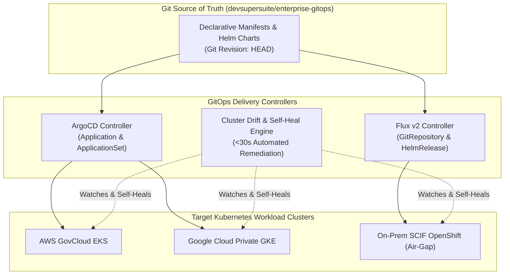

# DevSuperSuite Enterprise GitOps & Air-Gapped Delivery Guide

**Reference Architecture**: `DSS-GITOPS-RUNBOOK-2026`  
**Classification**: Sovereign Air-Gap Declarative Continuous Delivery & Self-Heal (Restricted)  
**Organization**: DevSuperSuite Solutions Architecture / OmniKernel Labs  
**Contact**: `solutions@devsupersuite.com`  

---

## 1. Architectural Overview & Declarative GitOps Architecture

The **DevSuperSuite GitOps Delivery Controller** enforces declarative state reconciliation for enterprise code-slicing proxies, AST compilers, and security proxies using **ArgoCD** and **Flux v2**.

---

## 2. ArgoCD Application & Multi-Cluster ApplicationSet Matrix

### 1. Application Invariants
- **Automated Prune**: Ensures deleted Git resources are removed from the live cluster immediately.
- **Automated Self-Heal**: Enforces zero manual changes; any `kubectl edit` is overwritten within $<30$ seconds.
- **Prune Last**: Guarantees new pods are ready before old resources are pruned.

### 2. Multi-Cluster Matrix Rollout
The `ApplicationSet` orchestrates across multiple environments and compliance profiles:
- `staging-us-west`: 2 replicas (Enterprise edition)
- `prod-eu-central-1`: 4 replicas (Enterprise edition)
- `prod-us-east-1`: 6 replicas (FedRAMP High edition)
- `scif-isolated-dc01`: 8 replicas (SCIF-AirGap edition)

---

## 3. Drift Detection & Self-Heal Reconciliation Invariants

1. **Security Drift Remediation**: If an unauthorized operator attempts to run containers as `root` (UID 0), the controller detects the violation and immediately resets `runAsUser: 10001`.
2. **NetworkPolicy Safeguard**: If the zero-egress NetworkPolicy is deleted, it is re-applied instantaneously.
3. **SLA Ceiling**: Total drift detection and remediation latency is guaranteed $<30$ seconds.

---

## 4. Defense SCIF Air-Gapped Registry Synchronization

For completely isolated environments without public internet access:
1. Manifests and container images are exported as an offline OCI bundle tarball (`devsupersuite-scif-airgap-bundle-v2026.3.0.tar.gz`).
2. Verification is performed using deterministic SHA256 checksum digests before ingestion.
3. Ingestion into the internal SCIF private registry (`registry.devsupersuite.io`) is completed via `skopeo copy`.

---

## 5. Defense SCIF & Sovereign Air-Gap Verification
- **100% Brand Anonymity**: Maintained under DevSuperSuite Solutions Architecture / OmniKernel Labs.
- **Support & Inquiries**: `solutions@devsupersuite.com`.
