# Enterprise Multi-Cloud Infrastructure as Code (IaC) Deployment Handbook

**Document Reference:** DSS-IAC-HANDBOOK-2026-V1  
**Governing Authority:** DevSuperSuite Cloud Architecture & Sovereign Infrastructure Directorate  
**Contact Desk:** `cloud@devsupersuite.com` | `solutions@devsupersuite.com`  
**Classification:** Enterprise Multi-Cloud IaC Reference Specification (Sovereign Air-Gap)  
**Target Audience:** Cloud Security Architects, Principal DevOps Engineers, Platform Infrastructure Leads, and Architecture Review Board (ARB) Members  
**Brand Anonymity Notice:** 100% Brand Anonymized. Issued exclusively under **DevSuperSuite Cloud Architecture** / **OmniKernel Labs**. No individual employee, developer, or contractor identities disclosed.

---

```
==================================================================================================
           DEVSUPERSUITE MULTI-CLOUD INFRASTRUCTURE AS CODE (IaC) BLUEPRINT
==================================================================================================
```

## 1. Executive Multi-Cloud Infrastructure Architecture Overview

Modern defense primes, sovereign global banks, and Tier-1 aerospace enterprises require complete infrastructure isolation when running AI-assisted developer gateways. DevSuperSuite delivers production-ready, standardized Infrastructure as Code (IaC) modules across the three primary hyperscalers:
- **AWS GovCloud (US) & Commercial EKS**
- **Google Cloud Platform (GCP) Private GKE**
- **Microsoft Azure Sovereign Government & Commercial AKS**

Every module is engineered to enforce three **non-negotiable sovereign architectural invariants**:
1. **Mathematical Zero-Egress Air-Gap Invariant:** Cloud firewalls, Network Security Groups (NSGs), and Kubernetes NetworkPolicies explicitly reject all outbound public internet egress (`0.0.0.0/0` blocked).
2. **Customer-Managed Key (CMK) Hardware Security Module (HSM) Encryption:** All Kubernetes secrets, etcd stores, and persistent disk volumes are encrypted with dedicated KMS keys with automated 90-day cryptographic rotation.
3. **Private Control Plane & Workload Identity Federation:** Zero public endpoints or internet load balancers. Access to the Kubernetes API is confined strictly to private VPC subnets and accessed via least-privilege Workload Identity / IRSA.

```mermaid
flowchart TD
    subgraph MultiCloud ["DevSuperSuite Multi-Cloud Sovereign Footprint"]
        subgraph AWS ["AWS GovCloud / Commercial EKS"]
            AWS_VPC["Private VPC (10.100.0.0/16)<br/>No Internet Gateway"]
            AWS_EKS["Private EKS Cluster<br/>Public Endpoint: FALSE"]
            AWS_KMS["AWS KMS CMK<br/>Auto-Rotation Active"]
            AWS_IRSA["IRSA Service Account<br/>WebIdentity Federation"]
            AWS_VPC --> AWS_EKS
            AWS_KMS -.->|Envelope Encryption| AWS_EKS
            AWS_EKS --> AWS_IRSA
        end

        subgraph GCP ["Google Cloud Private GKE"]
            GCP_VPC["Private VPC (10.200.0.0/20)<br/>Private Google Access"]
            GCP_GKE["Private GKE Cluster<br/>Calico NetworkPolicy"]
            GCP_KMS["Cloud KMS HSM<br/>Rotation: 90 Days"]
            GCP_WI["Workload Identity<br/>(svc.id.goog)"]
            GCP_VPC --> GCP_GKE
            GCP_KMS -.->|etcd Encryption| GCP_GKE
            GCP_GKE --> GCP_WI
        end

        subgraph Azure ["Azure Sovereign AKS"]
            AZ_VNET["Private VNet (10.150.0.0/16)<br/>Isolated Subnets"]
            AZ_AKS["Private AKS Cluster<br/>outboundType: userDefinedRouting"]
            AZ_KV["Azure Key Vault HSM<br/>Purge Protection: TRUE"]
            AZ_MSI["User-Assigned Identity<br/>Key Vault Secrets CSI"]
            AZ_VNET --> AZ_AKS
            AZ_KV -.->|CSI Secret Rotation| AZ_AKS
            AZ_AKS --> AZ_MSI
        end
    end

    Orchestrator["DevSuperSuite IaC Orchestrator CLI<br/>(enterprise_iac_orchestrator.py)"]
    Orchestrator -->|Validate Invariants| AWS
    Orchestrator -->|Validate Invariants| GCP
    Orchestrator -->|Validate Invariants| Azure
```



---

## 2. Cloud Provider Module Specifications

### 2.1 AWS GovCloud & Commercial EKS (`deployment/terraform/aws/`)

The AWS module provisions a hardened EKS cluster inside an isolated VPC without an Internet Gateway (IGW) or NAT Gateway:
- **Private VPC Architecture:** CIDR `10.100.0.0/16` across 3 Availability Zones. Zero external routing tables.
- **VPC Interface Endpoints:** Dedicated AWS PrivateLink endpoints for `ecr.api`, `ecr.dkr`, and `kms` ensure container pulls and cryptographic operations never traverse the public internet.
- **KMS Customer-Managed Key (CMK):** Dedicated symmetric key with continuous key rotation enabled and envelope encryption for Kubernetes `secrets`.
- **EKS Control Plane:** `endpoint_public_access = false`, `endpoint_private_access = true`. Accessible only from within the corporate transit gateway or bastion.
- **IAM Roles for Service Accounts (IRSA):** Uses OpenID Connect (OIDC) federation to assign temporary STS credentials to pods, eliminating static AWS access keys.
- **Security Groups:** Node and cluster security groups restrict all inbound and outbound traffic strictly to internal VPC CIDRs (`10.100.0.0/16`). Zero `0.0.0.0/0` rules exist.

#### Terraform File Manifest:
- `main.tf`: EKS cluster, isolated subnets, KMS key, VPC endpoints, and IRSA role.
- `variables.tf`: Configurable parameters (`aws_region`, `vpc_cidr`, `cluster_name`, `node_instance_types`).
- `security_groups.tf`: Strict intra-VPC security groups with mathematical zero-egress enforcement.
- `outputs.tf`: Exports cluster ID, private endpoint, and cryptographic KMS ARN.

---

### 2.2 Google Cloud Private GKE (`deployment/terraform/gcp/`)

The GCP module configures a sovereign Google Kubernetes Engine (GKE) environment with Calico NetworkPolicies and Cloud KMS:
- **VPC & Subnet Topology:** Custom subnet `10.200.0.0/20` with secondary ranges for Pods (`10.201.0.0/16`) and Services (`10.202.0.0/20`). `private_ip_google_access = true`.
- **Private GKE Cluster:** `enable_private_nodes = true`, `enable_private_endpoint = true`, control plane CIDR `172.16.0.0/28`. Public HTTP load balancer addon disabled.
- **Cloud KMS HSM Encryption:** Hardware Security Module (HSM) key ring with automated 90-day rotation (`7776000s`) protecting the etcd database.
- **Google Workload Identity:** Direct mapping of Kubernetes service accounts to GCP IAM service accounts using `${project_id}.svc.id.goog`.
- **Firewall Rules:** Priority 65534 egress firewall rule denying all traffic to `0.0.0.0/0`. Priority 1000 rule permitting strictly internal pod, service, and master CIDRs.

#### Terraform File Manifest:
- `main.tf`: Private GKE cluster, Cloud KMS HSM key, subnets with secondary ranges, node pool.
- `variables.tf`: Project ID, region, cluster name, CIDR definitions.
- `security.tf`: Priority 65534 deny-all egress firewall and intra-VPC ingress/egress rules.
- `outputs.tf`: Internal API endpoint, Cloud KMS key resource, Workload Identity federation pool.

---

### 2.3 Azure Sovereign AKS (`deployment/terraform/azure/`)

The Azure module builds an air-gapped Azure Kubernetes Service (AKS) cluster integrating Azure Key Vault and user-defined routing:
- **Virtual Network (VNet):** Address space `10.150.0.0/16` with dedicated AKS node subnet `10.150.1.0/24`.
- **Private AKS Cluster:** `private_cluster_enabled = true` with internal Azure private DNS zone (`System`). No public FQDN is allocated.
- **Outbound Type UserDefinedRouting:** `network_profile.outbound_type = "userDefinedRouting"` guarantees that AKS never provisions a public Standard Load Balancer for internet egress.
- **Azure Key Vault HSM:** Premium SKU with purge protection and soft-delete retention (90 days). Network ACL default action set to `Deny`.
- **Key Vault Secrets Provider (CSI Driver):** Automatically syncs secrets and certificates directly into memory-backed pod mounts with 2-minute rotation intervals.
- **Network Security Group (NSG):** Security rule Priority 4096 explicitly denies all outbound traffic to destination `Internet`. Rule Priority 100 permits internal `VirtualNetwork` routing.

#### Terraform File Manifest:
- `main.tf`: Private AKS cluster, Azure Key Vault, User-Assigned Managed Identity, CSI secrets provider.
- `variables.tf`: Resource group, location, cluster name, VM sizes, subnet CIDRs.
- `network_security.tf`: NSG denying all outbound internet routing and binding to node subnet.
- `outputs.tf`: Private FQDN, cluster resource ID, Key Vault resource ID.

---

## 3. IaC Orchestrator CLI Operational Guide

The Python CLI at `services/enterprise_iac_orchestrator.py` provides automated linting, structural invariant verification, security group auditing, and cryptographic deployment manifest generation.

### 3.1 CLI Command Reference
```powershell
python services/enterprise_iac_orchestrator.py [OPTIONS]

Options:
  --validate-iac                Verify structural invariants across all cloud modules
  --audit-security-rules        Inspect security groups and firewalls for zero-egress compliance
  --generate-deployment-manifest Generate unified cryptographic manifest with SHA-256 hashes
  --summary                     Print formatted executive terminal summary
  --provider {aws,gcp,azure,all} Target specific cloud provider (default: all)
  --terraform-dir PATH          Location of Terraform modules (default: deployment/terraform)
  --output PATH                 Manifest export path (default: services/reports/...)
  --customer "NAME"             Customer organization name
```

### 3.2 Running the Full Multi-Cloud Verification Suite
```powershell
python services/enterprise_iac_orchestrator.py `
  --validate-iac `
  --audit-security-rules `
  --generate-deployment-manifest `
  --summary `
  --customer "Lockheed Titan Aerospace"
```

### 3.3 Sample Terminal Output
```text
==============================================================================
 DEVSUPERSUITE IAC STRUCTURAL INVARIANT VALIDATION
==============================================================================
 Provider: AWS    -> [PASS]
   ✓ KMS Customer Managed Key with automated key rotation present
   ✓ EKS control plane strictly private (public endpoint disabled)
   ✓ EKS envelope encryption for Kubernetes secrets enabled
   ✓ IAM Roles for Service Accounts (IRSA) configured
   ✓ In-VPC interface endpoints provisioned (ECR, KMS)
 Provider: GCP    -> [PASS]
   ✓ Cloud KMS HSM CryptoKey with automated rotation present
   ✓ GKE private cluster enabled with private master endpoint (zero public IP)
   ✓ GKE etcd database encryption configured with Cloud KMS
   ✓ Google Workload Identity pool enabled
   ✓ Calico NetworkPolicy addon enabled
 Provider: AZURE  -> [PASS]
   ✓ Azure Key Vault with purge protection enabled
   ✓ Private AKS cluster enabled with internal DNS routing
   ✓ AKS outbound_type set to userDefinedRouting (zero public LB egress)
   ✓ AKS Azure Key Vault Secrets CSI driver with auto-rotation enabled
------------------------------------------------------------------------------
 Overall Status: VALID
==============================================================================

==============================================================================
 DEVSUPERSUITE ZERO-EGRESS AIR-GAP SECURITY RULES AUDIT
==============================================================================
 Provider: AWS    -> [PASS] ZERO-EGRESS ENFORCED
   ✓ Zero public internet egress (0.0.0.0/0 blocked). Air-gap certified.
 Provider: GCP    -> [PASS] ZERO-EGRESS ENFORCED
   ✓ Zero public internet egress (0.0.0.0/0 blocked). Air-gap certified.
 Provider: AZURE  -> [PASS] ZERO-EGRESS ENFORCED
   ✓ Zero public internet egress (0.0.0.0/0 blocked). Air-gap certified.
------------------------------------------------------------------------------
 Overall Compliance: COMPLIANT
==============================================================================

==============================================================================
 DEVSUPERSUITE MULTI-CLOUD IAC ORCHESTRATION SUMMARY
==============================================================================
 Customer:         Lockheed Titan Aerospace
 Manifest ID:      IAC-PLAN-2026-DC943B8C7B64
 Master Checksum:  dc943b8c7b642ffea894ff62d62c8722...
 Governing Desk:   DevSuperSuite Cloud Architecture / OmniKernel Labs
------------------------------------------------------------------------------
 • AWS    | Files: 4 | Checksum: 56b1f8e77edc5be30117c0c1... | Platform: AWS GovCloud (US) / Commercial EKS
 • GCP    | Files: 4 | Checksum: a807a2724e99824e413da039... | Platform: Google Cloud Private GKE / Cloud KMS
 • AZURE  | Files: 4 | Checksum: b88be5a4f51655988a8f848d... | Platform: Azure Sovereign AKS / Azure Key Vault
------------------------------------------------------------------------------
 Security Invariants: Zero-Egress Air-Gap [CERTIFIED] | KMS HSM [CERTIFIED]
==============================================================================
```

---

## 4. Step-by-Step Production Deployment Runbooks

### 4.1 AWS GovCloud / Commercial EKS Deployment
```bash
cd deployment/terraform/aws

# 1. Initialize Terraform plugins
terraform init

# 2. Generate execution plan and verify zero-egress invariants
terraform plan -out=tfplan.binary

# 3. Apply infrastructure
terraform apply tfplan.binary

# 4. Configure local kubeconfig via private AWS CLI bastion
aws eks update-kubeconfig \
  --region us-gov-west-1 \
  --name devsupersuite-sovereign-eks

# 5. Verify node readiness and zero-egress connectivity
kubectl get nodes -o wide
```

### 4.2 Google Cloud Private GKE Deployment
```bash
cd deployment/terraform/gcp

# 1. Set Google Cloud project
gcloud config set project devsupersuite-enterprise-sovereign

# 2. Initialize and validate Terraform
terraform init
terraform plan -out=tfplan.binary

# 3. Apply infrastructure
terraform apply tfplan.binary

# 4. Retrieve internal credentials (from within VPC bastion)
gcloud container clusters get-credentials devsupersuite-sovereign-gke \
  --region us-central1 \
  --internal-ip
```

### 4.3 Azure Sovereign AKS Deployment
```bash
cd deployment/terraform/azure

# 1. Login to Azure Government or Commercial tenant
az cloud set --name AzureUSGovernment # For GovCloud
az login

# 2. Initialize and plan
terraform init
terraform plan -out=tfplan.binary

# 3. Apply configuration
terraform apply tfplan.binary

# 4. Connect to private AKS cluster
az aks get-credentials \
  --resource-group rg-devsupersuite-sovereign-usgov \
  --name dss-sovereign-aks
```

---

## 5. Architecture Review Board (ARB) & Compliance Matrix

The Terraform modules map directly to institutional defense and enterprise compliance frameworks:

| Compliance Control | Requirement Description | DevSuperSuite Multi-Cloud IaC Implementation |
| :--- | :--- | :--- |
| **NIST SP 800-171 § 3.13.1** | Boundary Protection & Subnet Isolation | Private VPC subnets, zero internet gateways, private endpoint access only. |
| **NIST SP 800-171 § 3.13.8** | Cryptographic Protection of Data at Rest | KMS CMK, Cloud KMS HSM (90-day rotation), Azure Key Vault Premium HSM. |
| **CMMC 2.0 AC.L2-3.1.3** | Control Information Flow within Networks | Egress lockdown blocking `0.0.0.0/0` in AWS SG, GCP Firewall, and Azure NSG. |
| **FedRAMP High SC-7** | Boundary Protection & Egress Filtering | VPC interface endpoints (PrivateLink), UserDefinedRouting, Calico NetworkPolicies. |
| **ITAR 22 CFR § 120.54** | Sovereign Unclassified Defense Data Storage | FIPS 140-2/3 Level 3 hardware encryption, US GovCloud regional confinement. |
| **SOC 2 Type II CC6.6** | Logical Boundary & Endpoint Restrictions | Public Kubernetes API endpoints disabled; Workload Identity least privilege. |

---

## 6. Cryptographic Manifest Integrity & Tamper-Proof Audit

To ensure supply chain integrity, every deployment produces a cryptographically hashed manifest signed by the DevSuperSuite IaC Orchestrator:
- Each individual `.tf` file generates a SHA-256 digest.
- The module directory computes an aggregate chained SHA-256 hash.
- The master root plan computes a cumulative root SHA-256 hash across AWS, GCP, and Azure.
- The generated `enterprise_iac_deployment_manifest.json` is archived into the enterprise compliance vault for SOC 2 Type II and FedRAMP auditor review.

---

## 7. Cloud Engineering Support & Inquiries

For technical escalations, custom multi-cloud network topologies, or private peering integrations:
- **Cloud Architecture Directorate:** `cloud@devsupersuite.com`
- **Enterprise Solutions Desk:** `solutions@devsupersuite.com`
- **Official Enterprise Portal:** `https://devsupersuite.web.app`
- **Operating Entity:** DevSuperSuite Cloud Architecture / OmniKernel Labs  
*(Strict 100% Brand Anonymity Observed. No personal identities disclosed.)*
