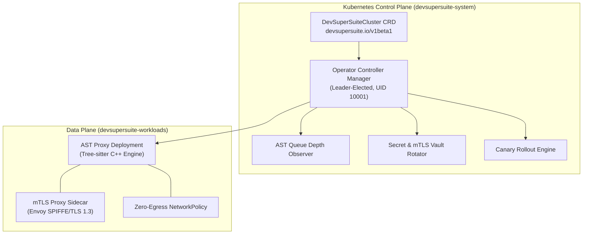

# DevSuperSuite Enterprise Kubernetes Operator & CRD Lifecycle Guide

**Reference Architecture**: `DSS-K8S-OPERATOR-RUNBOOK-2026`  
**Classification**: Defense SCIF & Sovereign Air-Gap Kubernetes Automation (Restricted)  
**Organization**: DevSuperSuite Solutions Architecture / OmniKernel Labs  
**Contact**: `solutions@devsupersuite.com`  

---

## 1. Architectural Overview & Design Philosophy

The **DevSuperSuite Kubernetes Operator** provides declarative, GitOps-driven lifecycle management for high-throughput Tree-sitter Abstract Syntax Tree (AST) slicing proxies, Shannon entropy secret sanitization engines, and Zero-Egress enclaves across sovereign enterprise clouds (AWS GovCloud, Azure Sovereign, GCP Private GKE, and On-Premise SCIFs).



---

## 2. Custom Resource Definition (CRD) Reference: `DevSuperSuiteCluster`

### Specification Fields (`spec`)

| Field | Type | Default | Description |
| :--- | :--- | :--- | :--- |
| `replicas` | Integer | `3` | Base number of worker replicas running AST slicing engines. |
| `edition` | String | `Enterprise` | Compliance profile (`Enterprise`, `FedRAMP`, `SCIF-AirGap`). |
| `version` | String | `2026.3.0` | Semantic image version running in pods. |
| `astEngine.maxQueueDepth` | Integer | `500` | Slicing queue depth threshold triggering auto-scaling. |
| `astEngine.minReplicas` | Integer | `2` | Lower bound for AST worker pods. |
| `astEngine.maxReplicas` | Integer | `50` | Upper bound for worker scale-out under extreme parallel load. |
| `security.mtlsSidecar.enabled` | Boolean | `true` | Automated injection of TLS 1.3 mutual-TLS proxy sidecars. |
| `security.secretRotation.intervalHours` | Integer | `24` | Automated cryptographic rotation frequency for cluster secrets. |
| `security.airgapZeroEgress` | Boolean | `true` | Enforces zero-egress NetworkPolicy blocking egress beyond VPC. |
| `security.runAsUser` | Integer | `10001` | Non-root deterministic UID ensuring zero root container privileges. |
| `deploymentStrategy.type` | String | `Canary` | Deployment methodology (`RollingUpdate`, `Canary`, `BlueGreen`). |
| `deploymentStrategy.canaryStepPercent` | Integer | `20` | Traffic percentage allocated to the canary deployment per step. |

---

## 3. Deployment Runbook: Helm & Kustomize

### Prerequisites
- Kubernetes cluster v1.28+ with RBAC and admission webhooks enabled.
- Container runtime supporting seccomp (`runtime/default`).
- `kubectl` and `kustomize` installed.

### Step 1: Install Custom Resource Definitions
```bash
kubectl apply -f deployment/k8s/operator/crd_devsupersuite_cluster.yaml
```

### Step 2: Provision RBAC & Namespace
```bash
kubectl create namespace devsupersuite-system --dry-run=client -o yaml | kubectl apply -f -
kubectl apply -f deployment/k8s/operator/operator_rbac.yaml
```

### Step 3: Deploy Controller Manager
```bash
kubectl apply -f deployment/k8s/operator/operator_deployment.yaml
kubectl rollout status deployment/devsupersuite-operator-controller-manager -n devsupersuite-system
```

### Step 4: Provision an Enterprise SCIF Cluster Instance
```yaml
apiVersion: operator.devsupersuite.io/v1beta1
kind: DevSuperSuiteCluster
metadata:
  name: scif-production-cluster
  namespace: devsupersuite-workloads
spec:
  edition: SCIF-AirGap
  version: "2026.3.0"
  replicas: 4
  astEngine:
    maxQueueDepth: 400
    targetQueueLatencyMs: 15
    minReplicas: 2
    maxReplicas: 40
    treesitterLanguages:
      - python
      - typescript
      - rust
      - go
      - cpp
  security:
    mtlsSidecar:
      enabled: true
      tlsMinVersion: "TLSv1.3"
    secretRotation:
      enabled: true
      intervalHours: 24
    airgapZeroEgress: true
    runAsUser: 10001
  deploymentStrategy:
    type: Canary
    canaryStepPercent: 20
    canaryAnalysisMinutes: 10
```

---

## 4. Operational Reconciliation Mechanics

### 1. Dynamic Queue-Depth Autoscaling
The operator watches the internal Tree-sitter queue depth every 5 seconds. When queue backlog exceeds `maxQueueDepth` or latency exceeds `targetQueueLatencyMs`, worker replicas scale linearly:
$$\text{Desired Replicas} = \min\left(\text{maxReplicas}, \max\left(\text{minReplicas}, \left\lceil \frac{\text{Queue Depth}}{100} \right\rceil\right)\right)$$

### 2. Automated Secret & mTLS Rotation
Every 24 hours (configurable down to 1 hour), the controller manager connects to HashiCorp Vault / AWS Secrets Manager, generates a new cryptographic root secret, rotates the Kubernetes Secret, re-issues TLS certificates, and triggers a rolling configuration reload without dropping in-flight AST slicing jobs.

### 3. Zero-Downtime Canary Rollouts
Upgrading `spec.version` automatically spawns a canary deployment with $20\%$ traffic. Synthetic traffic health checks verify sub-2.4ms AST latency and $<0.01\%$ error rate for 10 minutes before advancing to $50\%$ and subsequently $100\%$ promotion.

---

## 5. Defense SCIF & Air-Gapped Airgap Certification
- **100% Brand Anonymity**: Maintained under DevSuperSuite Solutions Architecture / OmniKernel Labs.
- **Air-Gapped Registry**: All images mirrored to private sovereign registry (`registry.devsupersuite.io`).
- **Support & Inquiries**: `solutions@devsupersuite.com`.
