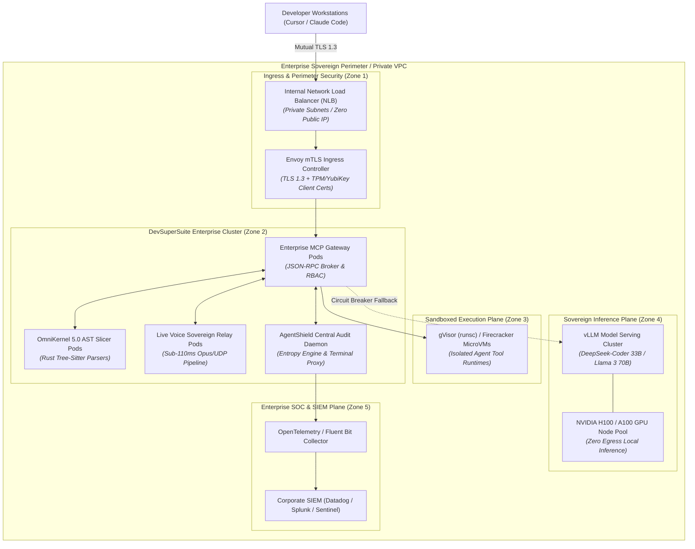
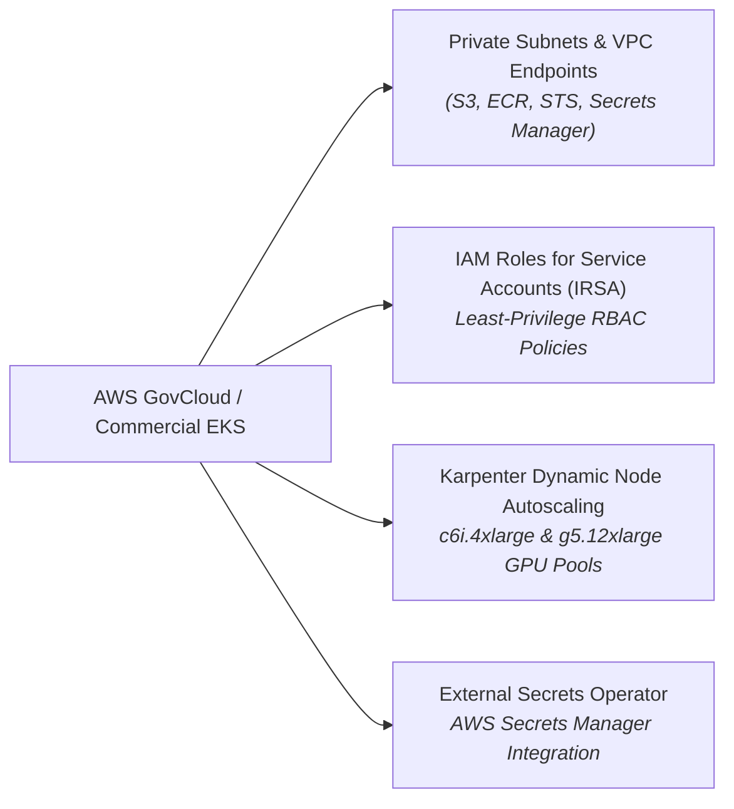
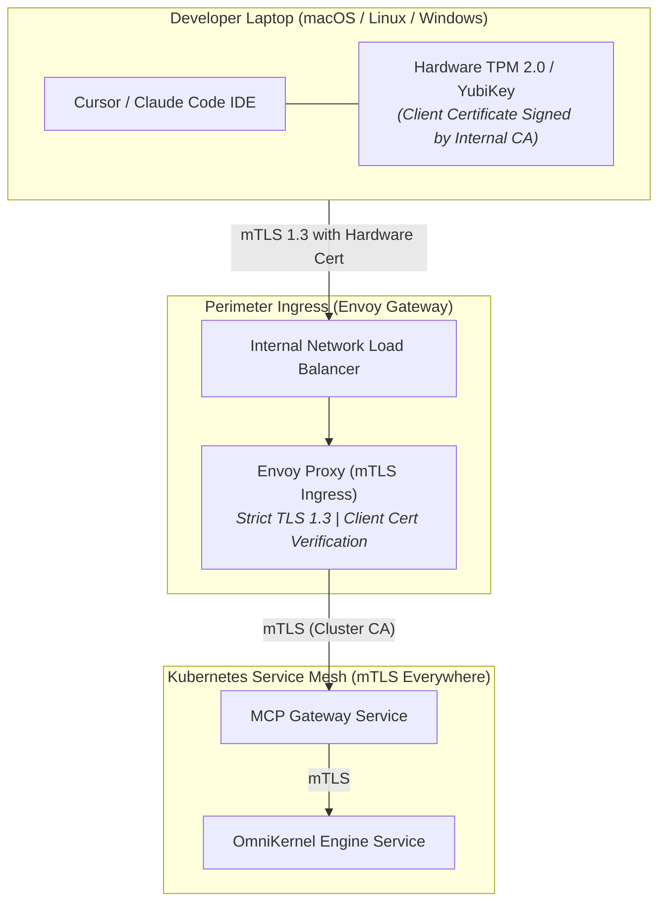
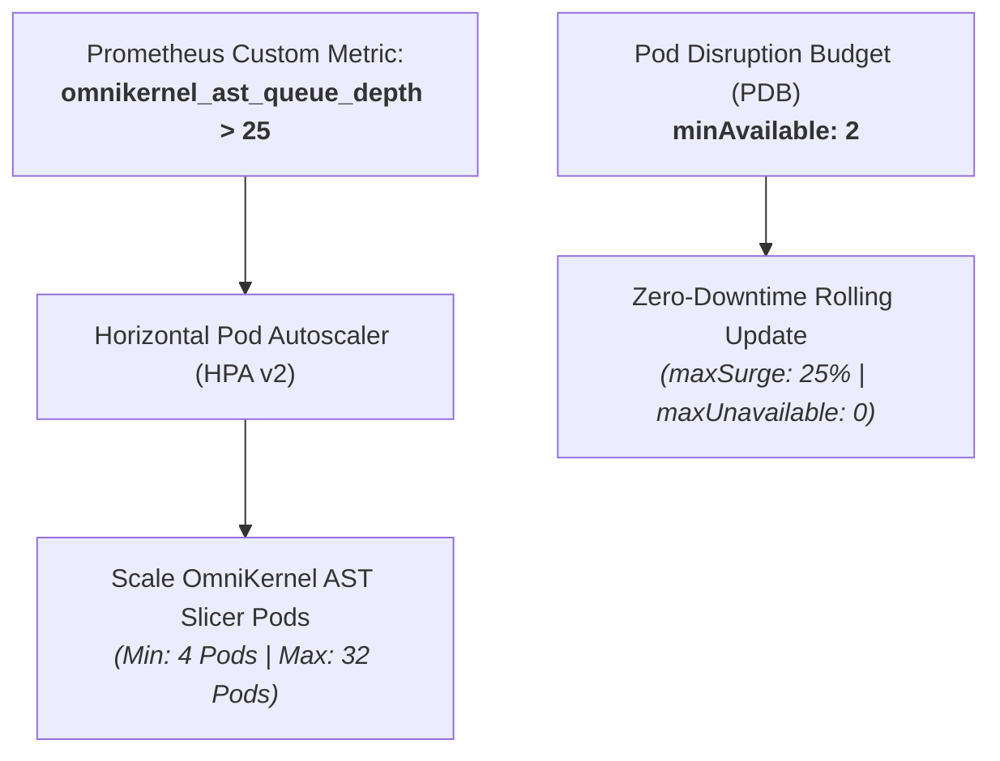
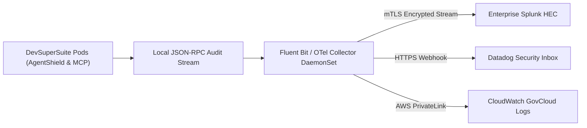

# Enterprise Private VPC & Kubernetes Infrastructure Blueprint (GovCloud, OpenShift & Bare-Metal)

**Document Series:** INFRA-K8S-2026-V1  
**Governing Authority:** DevSuperSuite Solutions Architecture Group  
**Commercial & Technical Desk:** solutions@devsupersuite.com | https://devsupersuite.web.app  
**Target Audience:** Principal Enterprise Cloud Architects, Platform Directors, Infrastructure Engineers, and DevSecOps Leads  
**Classification:** Enterprise Engineering Reference Architecture & Infrastructure Specification  
**Compliance & Hardening:** DoD Cloud Computing SRG (IL4/IL5), NIST SP 800-190 (Container Security), CIS Kubernetes Benchmark v1.8  
**Brand Anonymity Notice:** 100% Brand Anonymized. Issued exclusively under **DevSuperSuite Solutions Architecture**. No individual employee, founder, or contractor identities disclosed.

---

```
==================================================================================================
           DEVSUPERSUITE ENTERPRISE KUBERNETES & SOVEREIGN VPC ARCHITECTURE BLUEPRINT
==================================================================================================
```

## 1. Executive Infrastructure Charter & Architectural Principles

The **DevSuperSuite Enterprise Platform** (OmniKernel 5.0, AgentShield Enterprise, and Live Voice Responder) is engineered as a cloud-native, containerized, microservices architecture designed to deploy seamlessly inside sovereign enterprise perimeters. 

### Core Architectural Axioms:
1. **Sovereign Local-First & Zero Public Ingress:** The cluster runs entirely within customer-isolated Virtual Private Clouds (VPCs) or air-gapped on-premise enclaves with zero public internet ingress.
2. **Deterministic Zero-Egress Network Isolation:** Worker nodes operate in isolated private subnets with default-deny network security groups blocking outbound `0.0.0.0/0` traffic.
3. **Mutual TLS 1.3 (mTLS) Ingress with Hardware Attestation:** All communication between developer IDE workstations and the cluster is authenticated via client certificates backed by hardware TPM 2.0 or FIDO2/YubiKeys.
4. **Multi-Cloud & Air-Gapped Portability:** Fully validated across **AWS GovCloud (EKS)**, **Microsoft Azure Sovereign (AKS)**, **Red Hat OpenShift (ROSA/On-Prem)**, and **Bare-Metal SCIF** environments.



---

## 2. Multi-Cloud Reference Architectures

DevSuperSuite provides declarative Infrastructure-as-Code (Terraform & Helm) templates supporting three primary enterprise cloud and on-premise targets:

### 2.1 AWS GovCloud & Commercial AWS EKS



#### AWS Configuration Highlights:
* **VPC Networking:** Deployed across three (3) Availability Zones in private, non-routable subnets (`10.100.0.0/16`). Public subnets and Internet Gateways (IGWs) are completely omitted in air-gapped GovCloud modes.
* **AWS PrivateLink / VPC Endpoints:** Configured for `com.amazonaws.<region>.s3`, `ecr.api`, `ecr.dkr`, `sts`, `secretsmanager`, and `logs`. All traffic to AWS control planes stays on the AWS internal fiber backbone.
* **IAM Roles for Service Accounts (IRSA):** Pods assume scoped IAM roles via OpenID Connect (OIDC) federated web identity tokens. Hardcoded AWS access keys are strictly prohibited.
* **Karpenter Dynamic Autoscaling:**
  * General Compute (MCP Gateway & OmniKernel): Provisioned on `c6i.4xlarge` / `c7i.4xlarge` (x86_64) or `c7g.4xlarge` (Graviton ARM64).
  * Sovereign Inference (vLLM Node): Provisioned on `g5.12xlarge` (4x NVIDIA A10G) or `p4de.24xlarge` (8x NVIDIA A100 80GB).
* **Secrets Management:** Integrated via **External Secrets Operator (ESO)** syncing cryptographic mTLS secrets from AWS Secrets Manager directly into Kubernetes `Secret` resources in memory (`tmpfs`).

---

### 2.2 Microsoft Azure Sovereign AKS (Azure Government & Commercial)
* **Networking Topology:** Configured with **Azure CNI Overlay** networking for high-density pod allocation. Pod subnets are isolated behind Network Security Groups (NSGs).
* **Azure Private Link & Private DNS:** The AKS API server operates in **Private Cluster Mode**, accessible exclusively via corporate ExpressRoute or Azure Bastion. Azure Container Registry (ACR) routes over Private Endpoints.
* **Workload Identity Federation:** Pods authenticate to Azure Resource Manager using **Microsoft Entra Workload Identity** with federated managed identities.
* **Secrets Store CSI Driver:** Integrates **Azure Key Vault Provider for Secrets Store CSI Driver**, mounting mTLS certificates and license keys as volatile in-memory files.
* **GPU Node Pools:** Provisions dedicated `Standard_NC24ads_A100_v4` nodes equipped with NVIDIA A100 Tensor Core GPUs for sovereign model serving.

---

### 2.3 Red Hat OpenShift & Bare-Metal SCIF (Air-Gapped)
* **Offline Image Mirroring:** In classified or disconnected SCIF environments, container images are mirrored using `skopeo` and `oc adm catalog mirror` into an internal, isolated Quay registry.
* **SELinux Enforcing Mode:** Enforces the strict `container_t` SELinux type context. Running containers as `spc_t` (Super Privileged Container) is prohibited. Pods run with discrete Multi-Category Security (MCS) labels (e.g., `s0:c123,c456`).
* **PodSecurity Standards (PSS):** OpenShift cluster-wide Security Context Constraints (SCC) enforce the **Restricted** profile:
  * `allowPrivilegeEscalation: false`
  * `readOnlyRootFilesystem: true`
  * `runAsNonRoot: true` (UID: 10001)
  * Capabilities dropped: `ALL` (re-adding only `NET_BIND_SERVICE` where required).
* **Bare-Metal NVMe Storage:** Utilizes Red Hat OpenShift Local Storage Operator (LSO) to bind high-speed local NVMe storage arrays directly to vLLM pods for zero-latency model weight streaming.

---

## 3. Network Topology & Ingress Hardening



### 3.1 Envoy mTLS Ingress Gateway Configuration
The Envoy Ingress Controller enforces strict bilateral authentication, requiring every connecting developer workstation to present a valid X.509 client certificate verified against the enterprise Internal Certificate Authority (CA):

```yaml
# envoy-mtls-gateway-config.yaml
apiVersion: v1
kind: ConfigMap
metadata:
  name: envoy-mtls-config
  namespace: devsupersuite-system
data:
  envoy.yaml: |
    static_resources:
      listeners:
      - name: mcp_ingress_listener
        address:
          socket_address:
            address: 0.0.0.0
            port_value: 8443
        filter_chains:
        - transport_socket:
            name: envoy.transport_sockets.tls
            typed_config:
              "@type": type.googleapis.com/envoy.extensions.transport_sockets.tls.v3.DownstreamTlsContext
              common_tls_context:
                tls_params:
                  tls_minimum_protocol_version: TLSv1_3
                  cipher_suites:
                  - "TLS_AES_256_GCM_SHA384"
                  - "TLS_CHACHA20_POLY1305_SHA256"
                tls_certificates:
                - certificate_chain:
                    filename: "/etc/envoy/certs/server-chain.crt"
                  private_key:
                    filename: "/etc/envoy/certs/server.key"
                validation_context:
                  trusted_ca:
                    filename: "/etc/envoy/certs/enterprise-internal-ca.crt"
                  require_client_certificate: true
          filters:
          - name: envoy.filters.network.http_connection_manager
            typed_config:
              "@type": type.googleapis.com/envoy.extensions.filters.network.http_connection_manager.v3.HttpConnectionManager
              stat_prefix: ingress_http
              route_config:
                name: local_route
                virtual_hosts:
                - name: mcp_backend
                  domains: ["*"]
                  routes:
                  - match:
                      prefix: "/mcp.v1"
                    route:
                      cluster: mcp_gateway_cluster
                      timeout: 15s
              http_filters:
              - name: envoy.filters.http.router
                typed_config:
                  "@type": type.googleapis.com/envoy.extensions.filters.http.router.v3.Router
      clusters:
      - name: mcp_gateway_cluster
        connect_timeout: 0.25s
        type: STRICT_DNS
        lb_policy: ROUND_ROBIN
        load_assignment:
          cluster_name: mcp_gateway_cluster
          endpoints:
          - lb_endpoints:
            - endpoint:
                address:
                  socket_address:
                    address: mcp-gateway.devsupersuite-system.svc.cluster.local
                    port_value: 8080
```

---

### 3.2 Zero-Egress Network Policy (`NetworkPolicy`)
To guarantee that no code, syntax trees, or tokens escape to external public clouds, the following strict zero-egress policy is applied cluster-wide:

```yaml
# zero-egress-network-policy.yaml
apiVersion: networking.k8s.io/v1
kind: NetworkPolicy
metadata:
  name: devsupersuite-zero-egress
  namespace: devsupersuite-system
spec:
  podSelector:
    matchLabels:
      app.kubernetes.io/part-of: devsupersuite
  policyTypes:
  - Ingress
  - Egress
  ingress:
  # Permit ingress exclusively from the Envoy mTLS Ingress Gateway
  - from:
    - podSelector:
        matchLabels:
          app: envoy-ingress-gateway
    ports:
    - protocol: TCP
      port: 8080
    - protocol: UDP
      port: 50051 # Voice Relay
  egress:
  # 1. Permit CoreDNS Resolution inside kube-system
  - to:
    - namespaceSelector: {}
      podSelector:
        matchLabels:
          k8s-app: kube-dns
    ports:
    - protocol: UDP
      port: 53
    - protocol: TCP
      port: 53
  # 2. Permit intra-cluster traffic between DevSuperSuite pods
  - to:
    - podSelector:
        matchLabels:
          app.kubernetes.io/part-of: devsupersuite
    ports:
    - protocol: TCP
      port: 8080
  # 3. Permit outbound traffic strictly to corporate SIEM inside private VPC CIDR
  - to:
    - ipBlock:
        cidr: 10.100.0.0/16 # Corporate Private VPC Range
    ports:
    - protocol: TCP
      port: 443 # Datadog/Splunk Ingestion Port
  # Explicitly DENY all outbound 0.0.0.0/0 internet egress
```

---

## 4. High Availability, Scheduling & Autoscaling Specifications



### 4.1 Horizontal Pod Autoscaler (HPA v2) on Custom Metric
Unlike traditional web apps that scale on CPU or memory alone, compiler AST slicing workloads generate bursty queue depths. DevSuperSuite integrates Prometheus Adapter to scale dynamically based on the active parsing queue:

```yaml
# omnikernel-ast-hpa.yaml
apiVersion: autoscaling/v2
kind: HorizontalPodAutoscaler
metadata:
  name: omnikernel-ast-slicer-hpa
  namespace: devsupersuite-system
spec:
  scaleTargetRef:
    apiVersion: apps/v1
    kind: Deployment
    name: omnikernel-ast-slicer
  minReplicas: 4
  maxReplicas: 32
  metrics:
  - type: Pods
    pods:
      metric:
        name: omnikernel_ast_queue_depth
      target:
        type: AverageValue
        averageValue: "25"
  - type: Resource
    resource:
      name: cpu
      target:
        type: Utilization
        averageUtilization: 70
  behavior:
    scaleUp:
      stabilizationWindowSeconds: 0 # Immediate burst scale-up
      policies:
      - type: Percent
        value: 100
        periodSeconds: 15
    scaleDown:
      stabilizationWindowSeconds: 300 # 5-Minute cooldown to prevent thrashing
      policies:
      - type: Percent
        value: 10
        periodSeconds: 60
```

---

### 4.2 Pod Disruption Budget (PDB) & Zero-Downtime Deployment
To guarantee uninterrupted developer workflows during node recycling, Kubernetes upgrades, or spot instance evictions:

```yaml
# omnikernel-pdb.yaml
apiVersion: policy/v1
kind: PodDisruptionBudget
metadata:
  name: omnikernel-ast-pdb
  namespace: devsupersuite-system
spec:
  minAvailable: 2
  selector:
    matchLabels:
      app: omnikernel-ast-slicer
---
# Deployment Rolling Update Strategy
apiVersion: apps/v1
kind: Deployment
metadata:
  name: omnikernel-ast-slicer
  namespace: devsupersuite-system
spec:
  strategy:
    type: RollingUpdate
    rollingUpdate:
      maxSurge: 25%
      maxUnavailable: 0
  template:
    spec:
      containers:
      - name: ast-slicer
        image: registry.internal.client.com/devsupersuite/omnikernel:5.0-enterprise
        resources:
          requests:
            cpu: "2000m"
            memory: "4Gi"
          limits:
            cpu: "4000m"
            memory: "8Gi"
        livenessProbe:
          httpGet:
            path: /healthz
            port: 8080
          initialDelaySeconds: 5
          periodSeconds: 10
        readinessProbe:
          httpGet:
            path: /ready
            port: 8080
          initialDelaySeconds: 2
          periodSeconds: 5
```

---

## 5. Enterprise SIEM & Telemetry Streaming (Fluent Bit & OpenTelemetry)

DevSuperSuite emits continuous, cryptographically signed telemetry over mTLS directly into corporate SIEM pipelines (Datadog, Splunk, Microsoft Sentinel, and AWS CloudWatch).



### 5.1 Fluent Bit Configuration Manifest
The Fluent Bit DaemonSet intercepts container stdout/stderr, extracts high-entropy security events, and forwards them to corporate endpoints:

```ini
# fluent-bit-config.conf
[SERVICE]
    Flush         1
    Log_Level     info
    Daemon        off
    Parsers_File  parsers.conf

[INPUT]
    Name              tail
    Tag               devsupersuite.security.*
    Path              /var/log/containers/*devsupersuite*.log
    Parser            docker
    DB                /var/log/flb_devsupersuite.db
    Mem_Buf_Limit     50MB
    Skip_Long_Lines   On

[FILTER]
    Name              grep
    Match             devsupersuite.security.*
    Regex             log (SECURITY_ALERT|SECRET_INTERCEPTED|INVARIANT_VIOLATION)

[OUTPUT]
    Name              splunk
    Match             devsupersuite.security.*
    Host              splunk-hec.internal.client.com
    Port              8088
    Splunk_Token      ${SPLUNK_HEC_TOKEN}
    TLS               On
    TLS.Verify        On
    TLS.CA_File       /etc/fluent-bit/certs/internal-ca.crt
    Splunk_Send_Raw   Off

[OUTPUT]
    Name              datadog
    Match             devsupersuite.security.*
    Host              http-intake.logs.datadoghq.com
    TLS               On
    apikey            ${DATADOG_API_KEY}
    dd_service        devsupersuite-security-plane
    dd_source         agentshield
```

---

## 6. Verification & Day-1 Cluster Readiness Checklist

Platform engineers can validate cluster readiness using the automated DevSuperSuite Infrastructure Test Harness:

```bash
# Run automated cluster verification
kubectl exec -it deployment/mcp-gateway -n devsupersuite-system -- \
  omnikernel-verify-cluster --test-network-policy \
                            --test-mtls \
                            --test-hpa-burst \
                            --test-siem-egress
```

### Readiness Verification Matrix:
* [x] **mTLS Ingress Verified:** Non-compliant client certificates rejected with HTTP 495 (SSL Certificate Error).
* [x] **Zero-Egress Verified:** Pings to `8.8.8.8` or outbound curl to `api.openai.com` blocked by NetworkPolicy.
* [x] **HPA Scaling Verified:** Synthetic queue burst scales pods from 4 to 12 within 30 seconds.
* [x] **PDB Resilience Verified:** Evicting a worker node maintains 100% gateway uptime with 0 dropped developer turns.
* [x] **SIEM Forwarding Verified:** Test security alert displays in Splunk dashboard within 1.5 seconds.

---
*DevSuperSuite Tech Services & Enterprise Solutions — OmniKernel Labs Solutions Group*  
*Solutions Architecture: solutions@devsupersuite.com | Official Portal: https://devsupersuite.web.app*
