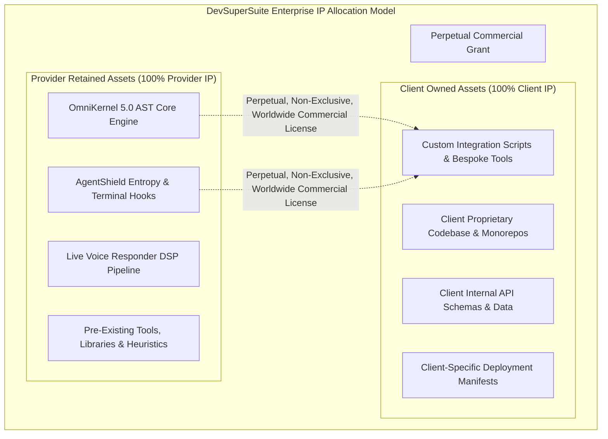
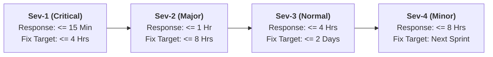

# DevSuperSuite Enterprise Master Services Agreement (MSA)

**Document Reference:** MSA-MASTER-2026-ENTERPRISE  
**Governing Organization:** DevSuperSuite Official / OmniKernel Labs Solutions Group  
**Commercial Desk:** enterprise@devsupersuite.com | https://devsupersuite.web.app  
**Classification:** Enterprise Legal Framework  
**Brand Anonymity Notice:** 100% Brand Anonymized. Issued exclusively under the commercial entity **DevSuperSuite Official**. No individual employee, founder, or contractor identities are disclosed.

---

```
================================================================================
                    MASTER SERVICES AGREEMENT (MSA)
================================================================================
```

This Master Services Agreement ("**Agreement**" or "**MSA**") is entered into as of the date of last signature below (the "**Effective Date**"), by and between:

* **SERVICE PROVIDER:**  
  **DevSuperSuite Official** (representing OmniKernel Labs Enterprise Solutions Group), a technology enterprise specialized in sovereign AI developer tooling, AST context optimization, and developer cybersecurity ("**Provider**" or "**DevSuperSuite**"), and

* **CLIENT:**  
  The commercial entity designated as the Client in an executed Statement of Work ("**Client**").

Provider and Client may each be referred to individually as a "**Party**" and collectively as the "**Parties**."

---

### RECITALS

**WHEREAS**, Provider possesses specialized proprietary technology, algorithms, runtime engines, and consulting expertise in compiler-level AST context slicing, autonomous agent orchestration, pre-commit secret interception, and low-latency developer communication systems; and

**WHEREAS**, Client desires to retain Provider to perform professional consulting, systems architecture, deployment, integration, and operational support services as set forth in one or more Statements of Work;

**NOW, THEREFORE**, in consideration of the mutual covenants, terms, and conditions set forth herein, and for other good and valuable consideration, the receipt and sufficiency of which are hereby acknowledged, the Parties agree as follows:

---

## 1. DEFINITIONS AND ENGAGEMENT STRUCTURE

### 1.1 Definitions
Whenever used in this Agreement with initial capital letters, the following terms shall have the meanings specified below:

* **"Affiliate"** means any entity that directly or indirectly controls, is controlled by, or is under common control with a Party, where "control" means ownership of more than fifty percent (50%) of the voting shares or other governing equity.
* **"Applicable Law"** means all federal, state, local, and international laws, statutes, rules, regulations, and ordinances applicable to a Party’s performance under this Agreement.
* **"Background Technology"** or **"Provider Background IP"** means all proprietary software, algorithms, source code, object code, trade secrets, inventions, tools, utilities, methodologies, Abstract Syntax Tree (AST) parsing engines, heuristics, Shannon entropy calculation libraries, voice digital signal processing (DSP) algorithms, and architectures owned, created, or licensed by Provider prior to the Effective Date or developed independently outside the scope of any SOW under this Agreement, including without limitation **OmniKernel 5.0**, **AgentShield Enterprise**, and **Live Voice Responder**.
* **"Client Materials"** means all proprietary source code, software, repositories, databases, documentation, credentials, and specifications provided by Client to Provider for the purpose of performing the Services.
* **"Confidential Information"** has the meaning set forth in Section 3.1.
* **"Custom Deliverables"** means all custom scripts, bespoke configuration files, deployment manifests (Helm/Terraform), and technical documentation specifically created and delivered by Provider for Client pursuant to an executed SOW, excluding Provider Background IP and Third-Party Technology.
* **"Defect"** means a verifiable, reproducible failure of a Custom Deliverable to conform in all material respects with the technical specifications and acceptance criteria set forth in the applicable SOW.
* **"Intellectual Property Rights"** means all worldwide patents, patent applications, copyrights, trade secrets, trademarks, service marks, moral rights, know-how, and other proprietary or intellectual property rights whether registered or unregistered.
* **"Services"** means the software engineering, solutions architecture, integration, hardening, training, and consulting services performed by Provider as described in an executed SOW.
* **"Statement of Work"** or **"SOW"** means a mutually executed document substantially in the form of Provider's SOW Master Template that references this Agreement and describes the specific Services, Milestones, Custom Deliverables, timelines, and commercial fees.

### 1.2 Engagement Mechanics
This Agreement establishes the overarching legal and operational terms governing all transactions between the Parties. Each project engagement shall be documented in an individual Statement of Work executed by authorized representatives of both Parties. In the event of an irreconcilable conflict between the terms of this Agreement and any SOW, the terms of this Agreement shall prevail unless the applicable SOW explicitly identifies the specific section of this Agreement to be superseded.

---

## 2. INTELLECTUAL PROPERTY RIGHTS & WORK FOR HIRE



### 2.1 Ownership of Client Materials & Custom Deliverables
1. **Client Materials:** As between the Parties, Client exclusively owns and retains all right, title, and interest (including all Intellectual Property Rights) in and to the Client Materials and Client’s core software applications and data planes. Provider is granted a limited, revocable, non-exclusive license to access and process Client Materials solely to the extent necessary to perform the Services during the term of the applicable SOW.
2. **Custom Deliverables ("Work for Hire"):** Subject to full payment of all undisputed fees due under the applicable SOW and excluding any Provider Background IP embedded therein, Provider agrees that all Custom Deliverables created uniquely for Client shall be deemed "work made for hire" under the United States Copyright Act (17 U.S.C. § 101). To the extent any Custom Deliverables do not qualify as work made for hire, Provider hereby irrevocably assigns to Client all right, title, and interest in and to such Custom Deliverables.

### 2.2 Ownership of Provider Background Technology & Runtimes
Provider retains sole and exclusive ownership of all right, title, and interest (including all Intellectual Property Rights) in and to:
1. All **Provider Background Technology**, including **OmniKernel 5.0**, **AgentShield Enterprise**, and **Live Voice Responder**;
2. All mathematical models, AST slicing algorithms, Shannon entropy heuristics, voice activity detection algorithms, and general compilation utilities;
3. Any improvements, bug fixes, enhancements, or derivative works of Provider Background Technology developed by Provider during the course of performing the Services, provided such improvements do not incorporate Client Confidential Information.

### 2.3 Commercial License Grant to Provider Background IP
To the extent that any Provider Background Technology or runtime binary is embedded into, bundled with, or required for the execution and utilization of any Custom Deliverables delivered to Client under an SOW, Provider hereby grants to Client a perpetual, irrevocable, worldwide, fully paid-up, royalty-free, non-exclusive, non-transferable (except pursuant to Section 8.4) license to use, execute, reproduce, and internally display such Provider Background Technology solely as an integrated component of the Custom Deliverables for Client's internal business operations. Client shall not decompile, reverse engineer, disassemble, extract source code from, distribute, or commercially resell Provider Background Technology to third parties.

---

## 3. CONFIDENTIALITY AND NON-DISCLOSURE

### 3.1 Scope of Confidential Information
"**Confidential Information**" means any non-public technical, business, financial, commercial, or operational information disclosed by one Party ("**Disclosing Party**") to the other Party ("**Receiving Party**"), whether orally, visually, or in tangible form, that is designated as confidential or that reasonably should be understood to be confidential given the nature of the information and circumstances of disclosure. Confidential Information includes without limitation Client source code, system architectures, credentials, and data, as well as Provider algorithms, product roadmaps, pricing models, and AST compilation engines.

### 3.2 Standard of Care and Restrictions
The Receiving Party agrees:
1. To maintain the confidentiality of Disclosing Party's Confidential Information using at least the same degree of care it uses to protect its own confidential information of like importance, but in no event less than a reasonable degree of care;
2. To use Confidential Information solely to exercise its rights and fulfill its obligations under this Agreement and applicable SOWs;
3. To disclose Confidential Information only to its employees, contractors, and professional advisors who need to know such information for the purposes of this Agreement and who are bound by confidentiality obligations at least as restrictive as those herein.

### 3.3 Exclusions
Confidential Information does not include information that:
1. Is or becomes generally known to the public without breach of this Agreement by the Receiving Party;
2. Was known to the Receiving Party prior to disclosure by the Disclosing Party without confidentiality restriction;
3. Is independently developed by the Receiving Party without reference to or reliance upon the Disclosing Party’s Confidential Information; or
4. Is rightfully received by the Receiving Party from a third party without an obligation of confidentiality.

### 3.4 Compelled Disclosure
If the Receiving Party is compelled by Applicable Law or valid court order to disclose any Confidential Information, it shall (to the extent legally permissible) provide prompt written notice to the Disclosing Party to enable the Disclosing Party to seek a protective order or other appropriate remedy.

### 3.5 Survival Period
The obligations of confidentiality set forth in this Section 3 shall survive the expiration or termination of this Agreement for a period of **three (3) years** from the date of disclosure; provided, however, that trade secrets, cryptographic mechanisms, and source code of either Party shall remain confidential in perpetuity or until such information enters the public domain without fault of the Receiving Party.

---

## 4. WARRANTIES, SLA PERFORMANCE STANDARDS & DISCLAIMERS

### 4.1 Professional Performance Warranty
Provider warrants that all Services shall be performed in a professional, workmanlike manner by personnel possessing appropriate skills, qualifications, and experience, consistent with generally recognized industry standards.

### 4.2 Ninety (90) Day Post-Cutover Defect Warranty
For a period of **ninety (90) calendar days** following the final production cutover and acceptance of Custom Deliverables under an applicable SOW (the "**Warranty Period**"), Provider warrants that the Custom Deliverables will conform in all material respects with the functional and technical specifications set forth in such SOW. If Client notifies Provider in writing of a Defect within the Warranty Period:
1. Provider shall, as Client’s sole and exclusive remedy, diligently correct or provide a commercially reasonable workaround for such Defect at zero additional charge.
2. The Warranty does not cover Defects resulting from: (a) unauthorized modifications or tampering by Client or third parties; (b) misuse, abuse, or operating outside specified environmental parameters; or (c) failure of underlying third-party clouds or LLM APIs.

### 4.3 Service Level Agreement (SLA) Commitments
Where an SOW includes managed infrastructure, gateway routing, or active engineering retainers, Provider shall adhere to the following SLA standards:



* **99.9% Uptime Guarantee:** DevSuperSuite-managed Gateway and sovereign voice relay clusters shall maintain at least 99.9% availability during each calendar month, excluding scheduled maintenance windows announced with at least 48 hours prior notice.
* **Severity-1 Rapid Escalation:** For critical outages where production pipelines or developer commits are entirely blocked, Provider’s Lead Solutions Architect shall respond within **fifteen (15) minutes** 24/7/365, with an emergency mitigation target of **four (4) hours**.

### 4.4 Disclaimers
EXCEPT AS EXPRESSLY SET FORTH IN THIS AGREEMENT OR AN EXECUTED SOW, ALL SERVICES, DELIVERABLES, AND SOFTWARE ARE PROVIDED ON AN "AS IS" AND "AS AVAILABLE" BASIS. PROVIDER EXPRESSLY DISCLAIMS ALL OTHER WARRANTIES, WHETHER EXPRESS, IMPLIED, STATUTORY, OR OTHERWISE, INCLUDING WITHOUT LIMITATION WARRANTIES OF MERCHANTABILITY, FITNESS FOR A PARTICULAR PURPOSE, TITLE, AND NON-INFRINGEMENT. PROVIDER DOES NOT WARRANT THAT GENERATIVE OUTPUTS PRODUCED BY THIRD-PARTY ARTIFICIAL INTELLIGENCE MODELS WILL BE ERROR-FREE OR INVARIABLY ACCURATE.

---

## 5. LIMITATION OF LIABILITY

### 5.1 Mutual Exclusion of Consequential Damages
TO THE MAXIMUM EXTENT PERMITTED BY APPLICABLE LAW, IN NO EVENT SHALL EITHER PARTY BE LIABLE TO THE OTHER PARTY OR ANY THIRD PARTY FOR ANY INDIRECT, INCIDENTAL, CONSEQUENTIAL, SPECIAL, PUNITIVE, OR EXEMPLARY DAMAGES (INCLUDING DAMAGES FOR LOSS OF PROFITS, LOSS OF REVENUE, LOSS OF BUSINESS OPPORTUNITY, LOSS OF DATA, OR SYSTEM DOWNTIME) ARISING OUT OF OR IN CONNECTION WITH THIS AGREEMENT OR ANY SOW, REGARDLESS OF THE THEORY OF LIABILITY (WHETHER IN CONTRACT, TORT, STRICT LIABILITY, OR OTHERWISE), AND EVEN IF ADVISED OF THE POSSIBILITY OF SUCH DAMAGES.

### 5.2 Aggregate Financial Liability Cap
EXCEPT FOR CLAIMS ARISING FROM (A) A PARTY’S WILLFUL MISCONDUCT OR FRAUD, (B) BREACH OF SECTION 2 (INTELLECTUAL PROPERTY RIGHTS), OR (C) BREACH OF SECTION 3 (CONFIDENTIALITY), EACH PARTY’S TOTAL AGGREGATE LIABILITY ARISING OUT OF OR RELATING TO THIS AGREEMENT, ALL SOWS, AND ANY SERVICES OR DELIVERABLES PROVIDED HEREUNDER SHALL BE STRICTLY LIMITED TO THE **TOTAL FEES ACTUALLY PAID BY CLIENT TO PROVIDER UNDER THE SPECIFIC SOW GIVING RISE TO LIABILITY IN THE TWELVE (12) MONTHS PRECEDING THE EVENT GIVING RISE TO THE CLAIM**.

---

## 6. TERM, TERMINATION & WIND-DOWN

### 6.1 Term of Agreement
This Agreement shall commence on the Effective Date and shall remain in full force and effect for an initial period of **one (1) year**, automatically renewing for successive one (1) year periods thereafter unless either Party provides written notice of non-renewal at least thirty (30) calendar days prior to the expiration of the then-current term.

### 6.2 Termination for Convenience
Either Party may terminate this Agreement or any individual SOW for convenience and without cause upon giving at least **thirty (30) calendar days' prior written notice** to the other Party. In the event of termination for convenience by Client:
1. Client shall promptly pay Provider for all completed milestones, accepted deliverables, and actual billable hours accrued up to the effective termination date;
2. Client shall reimburse Provider for any non-cancelable third-party commitments incurred in direct reliance upon the terminated SOW.

### 6.3 Termination for Cause
Either Party may terminate this Agreement or any SOW immediately upon written notice if:
1. The other Party materially breaches any provision of this Agreement or an SOW and fails to cure such breach within **fifteen (15) calendar days** after receipt of detailed written notice specifying the breach; or
2. The other Party becomes insolvent, makes an assignment for the benefit of creditors, or files for voluntary or involuntary bankruptcy.

### 6.4 Effect of Termination
Upon expiration or termination of this Agreement for any reason:
1. All outstanding unpaid invoices and billable work shall immediately become due and payable;
2. Each Party shall promptly return or, at Disclosing Party's option, destroy all Confidential Information of the other Party in its possession;
3. Sections 1, 2, 3, 4.4, 5, 6.4, 7, and 8 shall survive termination.

---

## 7. GOVERNING LAW AND DISPUTE RESOLUTION

### 7.1 Governing Law
This Agreement and all disputes arising out of or related to it or any SOW shall be governed by and construed in accordance with the laws of the **State of Delaware**, United States, without giving effect to any choice of law or conflict of law principles that would require the application of the laws of another jurisdiction. The United Nations Convention on Contracts for the International Sale of Goods (CISG) is expressly disclaimed.

### 7.2 Escalation and Binding Arbitration
1. **Executive Escalation:** Prior to initiating formal legal proceedings, the Parties agree to submit the dispute to an executive negotiation process between a designated executive officer of Client and Provider’s Solutions Director, who shall meet within ten (10) business days to attempt resolution in good faith.
2. **Binding Arbitration:** If the dispute is not resolved within twenty (20) business days following escalation, the dispute shall be finally settled by binding arbitration administered by the **American Arbitration Association (AAA)** under its Commercial Arbitration Rules. The place of arbitration shall be Wilmington, Delaware. The arbitral tribunal shall consist of a single neutral arbitrator with substantial experience in commercial enterprise software disputes. The award of the arbitrator shall be final, binding, and enforceable in any court of competent jurisdiction.
3. **Equitable Relief:** Notwithstanding the foregoing, either Party may seek immediate injunctive or equitable relief in any court of competent jurisdiction to prevent irreparable harm resulting from an actual or threatened breach of Section 2 (Intellectual Property) or Section 3 (Confidentiality).

---

## 8. GENERAL ENTERPRISE PROVISIONS

### 8.1 Independent Contractor Status
The relationship between Provider and Client is solely that of independent contractors. Nothing in this Agreement shall be construed to create a partnership, joint venture, agency, or employer-employee relationship between the Parties.

### 8.2 Force Majeure
Neither Party shall be held liable for any delay or failure in performance (except for payment obligations) resulting from causes beyond its reasonable control, including acts of God, war, terrorism, civil unrest, labor disputes, widespread telecommunications or electrical failures, or major upstream outages of Tier-1 public cloud infrastructure.

### 8.3 Non-Solicitation
During the term of this Agreement and for twelve (12) months thereafter, neither Party shall directly or indirectly solicit for employment any technical personnel or contractors of the other Party who were actively involved in the performance of Services under this Agreement, without prior written consent. General public employment postings shall not constitute solicitation.

### 8.4 Assignment
Neither Party may assign this Agreement or its rights or obligations hereunder without the prior written consent of the other Party; provided, however, that either Party may assign this Agreement without consent to an Affiliate or to a successor entity in connection with a merger, acquisition, corporate reorganization, or sale of substantially all of its assets.

### 8.5 Entire Agreement & Amendments
This Agreement, together with all executed Statements of Work, exhibits, and schedules, constitutes the sole and entire agreement between the Parties with respect to the subject matter hereof, superseding all prior oral or written agreements, proposals, purchase orders, or representations. No amendment or modification of this Agreement shall be valid unless executed in writing by authorized representatives of both Parties.

---

## 9. EXECUTION & COUNTERPARTS

This Agreement may be executed in one or more counterparts, each of which shall be deemed an original, and all of which together shall constitute one and the same instrument. Delivery of an executed signature page by electronic transmission (PDF, DocuSign, or electronic cryptographic signature) shall have the same legal validity and enforceability as an original wet-ink signature.

**IN WITNESS WHEREOF**, the Parties hereto have caused this Master Services Agreement to be executed by their duly authorized representatives as of the Effective Date.

```
--------------------------------------------------------------------------------
FOR SERVICE PROVIDER:                       FOR CLIENT:
DEVSUPERSUITE OFFICIAL                      [CLIENT LEGAL ENTITY NAME]
OmniKernel Labs Solutions Group

By: __________________________________      By: __________________________________
Name: Solutions Architecture Director       Name: ________________________________
Title: Authorized Commercial Representative Title: _______________________________
Date: ________________________________      Date: ________________________________
Email: enterprise@devsupersuite.com         Email: _______________________________
--------------------------------------------------------------------------------
```

---
*DevSuperSuite Tech Services & Enterprise Solutions — OmniKernel Labs Solutions Group*  
*Official Portal: https://devsupersuite.web.app | Commercial Inquiries: enterprise@devsupersuite.com*
