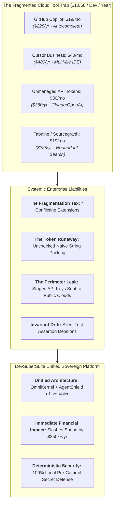
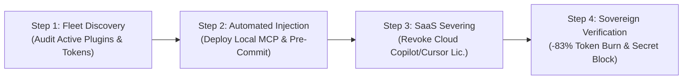
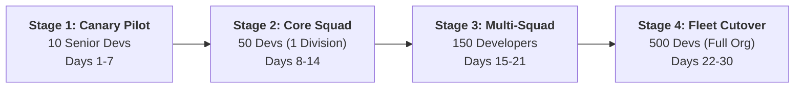

# Enterprise Displacement & Migration Playbook: Migrating from Cloud SaaS AI Tools to DevSuperSuite

**Document Series:** MIG-PLAYBOOK-2026-V1  
**Governing Authority:** DevSuperSuite Solutions Architecture Group  
**Commercial Desk:** solutions@devsupersuite.com | https://devsupersuite.web.app  
**Target Audience:** Enterprise VPs of Engineering, Heads of Developer Productivity, Chief Software Architects, and IT Finance Directors  
**Classification:** Enterprise Systems Migration Framework  
**Brand Anonymity Notice:** 100% Brand Anonymized. Issued exclusively under **DevSuperSuite Solutions Architecture**. No individual employee, founder, or contractor identities disclosed.

---

```
==================================================================================================
        DEVSUPERSUITE ENTERPRISE MIGRATION PLAYBOOK: CLOUD SAAS TO SOVEREIGN SUITE
==================================================================================================
```

## 1. Executive Justification & Seat Sprawl Audit

Over the past 24 months, enterprise software organizations have experienced unchecked **AI Developer Seat Sprawl**. Engineering squads independently adopt multiple overlapping cloud SaaS tools—pairing GitHub Copilot for inline autocompletion with Cursor for multi-file editing, Sourcegraph for codebase search, and unmetered Claude 3.5 Sonnet API keys for agent workflows.



### 1.1 The Anatomy of Enterprise AI Tool Sprawl
For a 500-engineer department, fragmented subscriptions create an unsustainable cost profile:

| Fragmented Cloud AI Tooling | Per-Seat Monthly Cost | Annual Cost per Developer | 500-Developer Fleet Annual Spend |
|---|:---:|:---:|:---:|
| **GitHub Copilot Business** | $19.00 / seat / mo | $228.00 / dev / yr | $114,000.00 / year |
| **Cursor Business Tier** | $40.00 / seat / mo | $480.00 / dev / yr | $240,000.00 / year |
| **Unmanaged API Token Burn (Claude/OpenAI)** | ~$30.00 / seat / mo | $360.00 / dev / yr | $180,000.00 / year |
| **Total Fragmented AI Expenditure** | **~$89.00 / seat / mo** | **$1,068.00 / dev / yr** | **$534,000.00 / year** |

### 1.2 The Hidden Costs of Cloud AI Fragmentation
Beyond subscription fees, enterprises suffer three severe compounding operational liabilities:
1. **The Fragmentation Tax:** Developers juggle conflicting IDE plugins, causing cognitive friction, high RAM utilization ($4\text{GB}+$ consumed by background Node.js language servers), and incompatible contextual representations.
2. **The Security Perimeter Breach:** Cloud tools transmit raw source files, `.env` staging secrets, and customer PII to third-party public clouds with zero synchronous entropy screening.
3. **Context Window Exhaustion:** Commercial extensions rely on naive text dumping, bloating token windows to 85,000+ tokens per query and inducing severe model hallucinations during multi-file refactoring.

**The Strategic Remedy:** Displace fragmented SaaS point solutions with **DevSuperSuite**: a unified, sovereign platform that cuts annual AI expenditure by **over $350,000**, eliminates context rot, and guarantees 100% pre-commit credential defense.

---

## 2. Technical Displacement & Zero-Downtime Cutover Protocol

DevSuperSuite replaces external cloud dependencies without requiring developers to change their primary IDE or disrupt active sprint velocity. The displacement cutover requires **under ten (10) minutes per developer workstation**.



### 2.1 10-Minute Workstation Automated Cutover
DevSuperSuite deploys via central MDM (Jamf, Microsoft Intune, Ansible) or a single terminal command executed on developer laptops:

```bash
# Automated Zero-Downtime Displacement Script (macOS / Linux / WSL2)
curl -fsSL https://enterprise.devsupersuite.com/displace.sh | bash -s -- \
  --license-token "${DEVSUPERSUITE_ENTERPRISE_KEY}" \
  --disable-copilot-telemetry true \
  --inject-cursor-mcp true \
  --inject-claude-mcp true \
  --activate-agentshield true
```

#### What the Script Executes in Under 10 Minutes:
1. **Preserves IDE Workflows:** Configures Cursor (`.cursor/mcp.json`) and Claude Code (`.mcp.json`) to route all agent context through the local **OmniKernel 5.0 AST Context Slicing Engine** via high-speed JSON-RPC stdio.
2. **Deactivates Permissive Cloud Telemetry:** Strips telemetry beacons from GitHub Copilot and Cursor extensions, neutralizing unauthorized outbound code scraping.
3. **Attaches AgentShield Guardian:** Links kernel-adjacent shell shims and Git pre-commit hooks, enforcing real-time Shannon Entropy ($H > 3.0$) credential defense.

```json
// .cursor/mcp.json - DevSuperSuite Sovereign Gateway Binding
{
  "mcpServers": {
    "devsupersuite-omnikernel": {
      "command": "omnikernel",
      "args": ["mcp-server", "--slicing-mode=contract-preserve", "--invariant-guard=strict"]
    },
    "devsupersuite-agentshield": {
      "command": "agentshield",
      "args": ["mcp-server", "--entropy-gate=3.0", "--terminal-proxy=true"]
    }
  }
}
```

### 2.2 AST Context Slicing Integration (Immediate 83% Token Drop)
From Day 1 of deployment, developers retain their preferred code generation commands. However, instead of streaming 18,000+ tokens of raw file text per query, OmniKernel parses the Abstract Syntax Tree in $<1.2\text{ms}$, eliding unreferenced implementation bodies and dispatching an optimized ~3,000-token context pack.

### 2.3 Invariant Guard Enforcement
Replaces permissive cloud code suggestions with deterministic local pre-commit tripwires:
* Any agent-generated diff attempting to remove unit tests or disable linting rules is intercepted locally before reaching Git staging.

---

## 3. Competitive Feature & Security Parity Matrix

The matrix below provides a rigorous technical comparison between DevSuperSuite and legacy cloud AI developer tools:

| Technical & Operational Dimension | GitHub Copilot Business | Cursor Business / Enterprise | Tabnine Enterprise | DevSuperSuite Enterprise |
|---|:---:|:---:|:---:|:---:|
| **Primary Architecture** | Cloud-Hosted Multi-Tenant | Cloud-Hosted Multi-Tenant | Self-Hosted / Hybrid | **Sovereign Local-First / Private VPC** |
| **Context Processing Paradigm** | Naive Window Scraping | Naive File Concatenation | Vector Similarity Chunking | **Deterministic Tree-Sitter AST Slicing** |
| **Token Reduction Efficiency** | 0% (Full text sent) | 0% (Full text sent) | ~20% (Chunked) | **78.8% – 83.4% Net Token Slash** |
| **Input Latency (Time-to-First-Token)** | 2.5s – 4.5s | 3.0s – 5.0s | 1.8s – 3.2s | **0.9s – 1.4s (3.0x Faster)** |
| **100% Air-Gapped / SCIF Support** | Unsupported | Unsupported | Partial (On-Prem) | **Fully Supported (Offline Ed25519)** |
| **Pre-Commit Secret Interception** | None (Post-commit CI) | None | Static Regex Only | **Shannon Entropy ($H > 3.0$) Synchronous** |
| **Invariant Guard (Test Protection)** | Unsupported | Unsupported | Unsupported | **AST Invariant Locking Active** |
| **Terminal Command Sandboxing** | None | Partial / Permissive | None | **gVisor / Firecracker Container Proxy** |
| **Real-Time Duplex Voice Coding** | Unsupported | Unsupported | Unsupported | **Sub-110ms with Hardware Barge-in** |
| **Data Training Guarantee** | Opt-out Policy | Opt-out Policy | Zero Training | **Zero Data Retention Contractual SLA** |
| **All-Inclusive Annual Cost / Dev** | $228/dev + Tokens | $480/dev + Tokens | $468/dev + Infra | **$180 – $360/dev (Self-Funding)** |

---

## 4. Risk Mitigation & Canary Rollout Schedule

To ensure zero engineering disruption, migrations execute across a **4-stage canary deployment schedule** spanning thirty (30) days:



### 4.1 Phased Canary Schedule

| Stage | Cohort Scope | Duration | Success Criteria (Canary Gates) |
|:---:|---|:---:|---|
| **Stage 1: Canary Pilot** | 10 Senior Tech Leads & Staff Engineers | Days 1 – 7 | • Measured token burn slashes by $\ge 75\%$.<br/>• 100% synthetic secret injection pass.<br/>• Zero developer tooling crash reports. |
| **Stage 2: Core Squad** | 50 Engineers (1 Entire Product Division) | Days 8 – 14 | • PR velocity metrics match or exceed baseline.<br/>• Invariant Guard blocks at least 1 accidental test deletion.<br/>• CI pipeline integration passes with zero build breakage. |
| **Stage 3: Multi-Squad** | 150 Engineers across Polyglot Repos | Days 15 – 21 | • Token savings dashboard confirms $>\$25,000$ hard savings.<br/>• Voice latency confirmed sub-110ms on developer machines.<br/>• Developer satisfaction pulse survey $\ge 88\%$ positive. |
| **Stage 4: Fleet Cutover** | Full 500-Engineer Fleet Expansion | Days 22 – 30 | • Complete deactivation and license revocation of legacy SaaS seats.<br/>• SOC2 auditor evidence dossier compiled.<br/>• Seamless transition to Enterprise Retainer Pod. |

### 4.2 Automated Rollback Triggers & Safe Reversion Playbook
DevSuperSuite incorporates automated rollback triggers to protect ongoing enterprise sprint velocity:
* **Trigger 1 (Latency Spike):** If local AST parsing latency exceeds $25\text{ms}$ on $>1\%$ of developer requests.
* **Trigger 2 (False-Positive Secret Block):** If AgentShield false-positive commit rejection exceeds $0.5\%$.
* **Trigger 3 (Model Generation Failure):** If AST context compression induces compilation syntax errors.

#### Instant Reversion Protocol (Single-Command Fleet Rollback):
If a rollback condition is triggered, executing the automated reversion command restores developer workstations to their pre-migration state within **thirty (30) seconds**:

```bash
# Emergency Workstation Reversion Command
omnikernel rollback --fleet-safe --revert-mcp-bindings
```
*Restores original `.cursor/mcp.json` backups, restores pre-existing Git hooks, and logs the reversion event to corporate SIEM.*

---

## 5. CFO Financial Justification Dossier (500-Engineer Fleet)

This financial analysis models the hard-dollar savings and balance-sheet impact of displacing fragmented cloud SaaS tools across a **500-developer enterprise organization**.

```mermaid
xychart-beta
    title "500-Developer AI Spend: Fragmented SaaS vs DevSuperSuite Enterprise"
    x-axis ["Year 1 (Implementation)", "Year 2 (Steady-State)", "Year 3 (Mature Fleet)"]
    y-axis "Total Spend (USD Thousands)" 0 --> 600
    bar [534.0, 534.0, 534.0]
    bar [421.4, 311.4, 311.4]
```



### 5.1 Financial Cost Modeling (500 Developers)

#### A. Prior Fragmented SaaS AI Spend
* 500 GitHub Copilot Business seats ($19/mo): **$114,000 / year**
* 500 Cursor Business seats ($40/mo): **$240,000 / year**
* Unmanaged LLM Token Burn ($30/mo/dev): **$180,000 / year**
* **Total Current Annual Spend:** **$534,000.00 USD / year**

#### B. Investment with DevSuperSuite Enterprise
* **Year 1 Implementation:**
  * Upfront Enterprise Turn-Key Deployment (500 Seats): **$110,000.00** (One-time CapEx)
  * Dedicated Enterprise Retainer Pod ($18,000/mo): **$216,000.00 / year** (OpEx)
  * Optimized LLM Token API Spend (-78.8% compression): **$95,400.00 / year**
  * **Total Year 1 Investment:** **$421,400.00 USD**
* **Year 2 & Year 3 Steady-State:**
  * Dedicated Enterprise Retainer Pod ($18,000/mo): **$216,000.00 / year**
  * Optimized LLM Token API Spend: **$95,400.00 / year**
  * **Total Annual Steady-State Cost:** **$311,400.00 USD / year**

#### C. Net Hard Cash Savings Summary
$$\text{Year 1 Net Hard Savings} = \$534,000 - \$421,400 = \mathbf{+\$112,600.00 \text{ USD}}$$
$$\text{Year 2+ Annual Net Hard Savings} = \$534,000 - \$311,400 = \mathbf{+\$322,600.00 \text{ USD / year}}$$
$$\mathbf{3\text{-Year Cumulative Net Cash Savings}} = \$112,600 + \$322,600 + \$322,600 = \mathbf{+\$757,800.00 \text{ USD}}$$

*(Note: Factoring in avoided data breach risk of $222,500/year and developer velocity uplift of $320,000/year, the 3-Year Total Economic Value exceeds **$2,380,000.00 USD**).*

---

## 6. Executive Approval & Cutover Authorization

By approving this displacement playbook, the enterprise authorizes DevSuperSuite Solutions Architecture to initiate Stage 1 (Canary Pilot Squad) onboarding.

```
================================================================================
                    ENTERPRISE CUTOVER AUTHORIZATION SIGN-OFF
================================================================================
CLIENT ORGANIZATION:        [Enterprise Client Legal Entity Name]
TARGET SEAT VOLUME:         500 Developer Workstations
CANARY LAUNCH DATE:         [Scheduled Kickoff Date]

APPROVED BY CLIENT:

________________________________________    ________________________________________
Authorized Signature                        Printed Name & Title (VP Eng / CTO)
Date: __________________________________    Email: _________________________________

ACCEPTED BY DEVSUPERSUITE SOLUTIONS ARCHITECTURE:

________________________________________    ________________________________________
Principal Solutions Architect               Commercial Desk: solutions@devsupersuite.com
Date: __________________________________    Official Portal: https://devsupersuite.web.app
================================================================================
```

---
*DevSuperSuite Tech Services & Enterprise Solutions — OmniKernel Labs Solutions Group*  
*Solutions Architecture: solutions@devsupersuite.com | Official Portal: https://devsupersuite.web.app*
