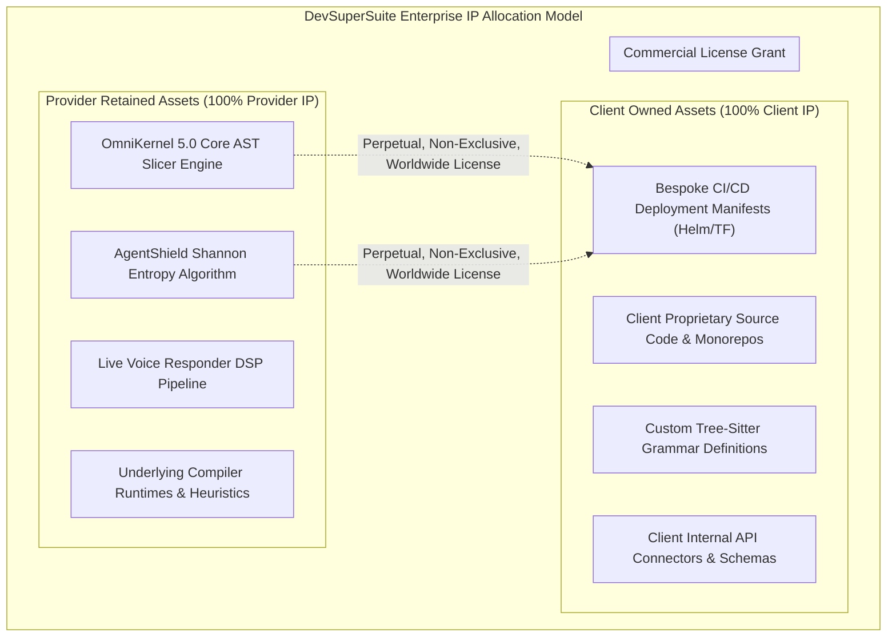
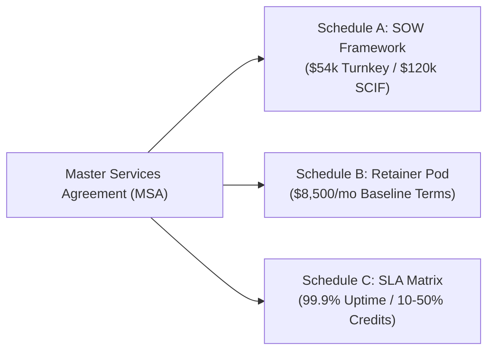
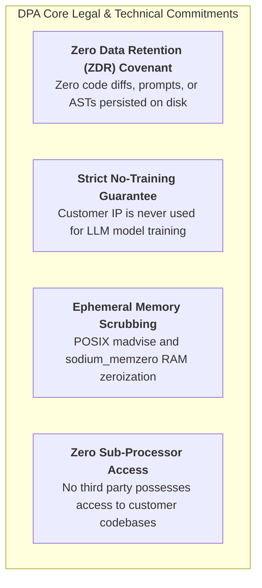

# Institutional Master Services Agreement (MSA) & Data Processing Addendum (DPA) Contract Suite

**Document Series:** LEGAL-SUITE-2026-V1  
**Governing Authority:** DevSuperSuite Solutions Architecture & Legal Counsel  
**Commercial & Legal Desk:** legal@devsupersuite.com | https://devsupersuite.web.app  
**Target Audience:** Corporate Legal Counsel, General Counsel, Heads of Enterprise Procurement, Chief Privacy Officers (CPOs), and Enterprise Contract Negotiators  
**Classification:** Enterprise Legal Framework & Binding Contract Suite  
**Jurisdictional Scope:** State of Delaware, United States // GDPR (EU 2016/679) // UK GDPR // CCPA/CPRA (California)  
**Brand Anonymity Notice:** 100% Brand Anonymized. Issued exclusively under **DevSuperSuite Solutions Architecture & Legal Counsel** (OmniKernel Labs Solutions Group). No individual employee, founder, or contractor identities disclosed.

---

```
==================================================================================================
                 MASTER SERVICES AGREEMENT (MSA) & DATA PROCESSING ADDENDUM
==================================================================================================
```

This document constitutes the master legal framework governing the licensing, architectural deployment, systems integration, and ongoing operational support of **DevSuperSuite Enterprise Solutions** between:

1. **SERVICE PROVIDER:**  
   **DevSuperSuite Official** (representing OmniKernel Labs Solutions Group), a technology enterprise specialized in sovereign AI developer acceleration, AST context optimization, and developer cybersecurity ("**Provider**" or "**DevSuperSuite**"), and
2. **CLIENT:**  
   The commercial enterprise or public entity designated as the Client in an executed Statement of Work ("**Client**").

Provider and Client may each be referred to individually as a "**Party**" and collectively as the "**Parties**."

---

## PART 1: MASTER SERVICES AGREEMENT (MSA) TERMS AND CONDITIONS

### 1. ENGAGEMENT STRUCTURE, DEFINITIONS & ORDER OF PRECEDENCE

#### 1.1 Definitions
* "**Affiliate**" means any corporate entity that directly or indirectly controls, is controlled by, or is under common control with a Party, where "control" denotes ownership of greater than fifty percent (50%) of voting equity.
* "**Background Technology**" or "**Provider Background IP**" means all proprietary software, runtimes, algorithms, Abstract Syntax Tree (AST) parsing engines, heuristics, Shannon entropy calculation libraries, voice digital signal processing (DSP) pipelines, and architecture owned or developed by Provider prior to or independently of this Agreement, including without limitation **OmniKernel 5.0**, **AgentShield Enterprise**, and **Live Voice Responder**.
* "**Client Materials**" means all proprietary source code, software repositories, schemas, credentials, and internal technical documentation provided by Client to Provider.
* "**Custom Deliverables**" means all bespoke scripts, custom deployment manifests (Helm/Terraform), custom Tree-Sitter grammar definitions, and integration workflows developed specifically for Client pursuant to an executed SOW, excluding Provider Background IP.
* "**Statement of Work**" or "**SOW**" means an ordering document substantially in the form of Schedule A, executed by authorized representatives of both Parties.

#### 1.2 Engagement Mechanics & Precedence
Each project engagement shall be governed by an individual SOW. In the event of a direct conflict between the terms of this MSA and any SOW, this MSA shall prevail unless the SOW explicitly identifies the specific section of this MSA to be superseded.

---

### 2. INTELLECTUAL PROPERTY RIGHTS, WORK FOR HIRE & LICENSING



#### 2.1 Client Ownership of Custom Deliverables ("Work Made for Hire")
Subject to full payment of all undisputed fees due under the applicable SOW, Provider agrees that all Custom Deliverables created uniquely for Client shall be deemed "work made for hire" under the United States Copyright Act (17 U.S.C. § 101). Provider hereby assigns to Client all worldwide right, title, and interest in and to such Custom Deliverables.

#### 2.2 Provider Retention of Background IP & Core Engines
Provider retains sole and exclusive ownership of all right, title, and interest in and to all Provider Background Technology, including OmniKernel 5.0, AgentShield Enterprise, and Live Voice Responder, and all algorithmic improvements thereto.

#### 2.3 Commercial License Grant to Embedded Background IP
Provider hereby grants to Client a perpetual, irrevocable, worldwide, fully paid-up, royalty-free, non-exclusive license to use, execute, reproduce, and internally display Provider Background Technology solely as an integrated component of the Custom Deliverables for Client's internal business operations. Client shall not decompile, reverse engineer, disassemble, or commercially redistribute Provider Background Technology.

---

### 3. FEES, INVOICING & PAYMENT TERMS

* **Milestone Invoicing:** Fixed-fee SOWs are billed according to the milestone gating schedule specified in Schedule A (30% Kickoff Deposit, 40% Staging Validation, 30% Final Production Acceptance).
* **Payment Terms:** All undisputed invoices are rendered electronically in USD and payable within **Net thirty (30) calendar days** from the invoice date.
* **Late Payments:** Late payments shall accrue interest at the rate of one percent (1.0%) per month or the maximum statutory limit, whichever is lower.
* **Taxes:** Fees do not include applicable federal, state, or local sales, use, or value-added taxes (VAT), which shall be the responsibility of Client (excluding taxes based on Provider’s net income).

---

### 4. WARRANTIES, PERFORMANCE COVENANTS & DEFECT REMEDIATION

#### 4.1 Professional Performance Warranty
Provider warrants that all Services shall be performed in a professional, workmanlike manner consistent with generally recognized enterprise software engineering standards.

#### 4.2 Objective Double-Metric Performance Covenant
Provider expressly covenants that the deployed Custom Deliverables and Software shall achieve:
1. **Context Token Reduction:** A verified aggregate LLM context token reduction of not less than **seventy percent (70.0%)** across representative codebase Pull Requests; and
2. **Secret Interception:** **One hundred percent (100.0%)** pre-commit interception of high-entropy credentials ($H > 3.0$).

If the system fails to achieve either threshold during User Acceptance Testing (UAT), Provider shall be granted a ten (10) business day engineering remediation window at zero charge. If the re-test fails, Client may terminate the SOW for cause and receive a **prompt, 100% full refund of all fees paid under that SOW**.

#### 4.3 Ninety (90) Day Comprehensive Defect Warranty
For ninety (90) calendar days post-production sign-off, Provider warrants that the Custom Deliverables will conform in all material respects with the SOW specifications. Provider shall correct any verified Defect at zero additional charge.

#### 4.4 Disclaimers
EXCEPT AS EXPRESSLY SET FORTH HEREIN, PROVIDER DISCLAIMS ALL OTHER WARRANTIES, EXPRESS OR IMPLIED, INCLUDING WARRANTIES OF MERCHANTABILITY, FITNESS FOR A PARTICULAR PURPOSE, AND NON-INFRINGEMENT.

---

### 5. INDEMNIFICATION & THIRD-PARTY DEFENSE

#### 5.1 Provider Intellectual Property Indemnification
Provider shall defend, indemnify, and hold harmless Client, its Affiliates, and their respective directors, officers, and employees from and against any third-party claims, suits, or proceedings alleging that the Provider Background IP infringes any valid United States patent, copyright, or trademark, or misappropriates a trade secret. Provider shall pay all damages, settlements, and reasonable legal costs awarded against Client.

#### 5.2 Client Indemnification
Client shall defend, indemnify, and hold harmless Provider from and against any third-party claims arising out of: (a) Client Materials; (b) Client’s violation of Applicable Law; or (c) unauthorized modifications made by Client to Provider Background IP.

---

### 6. LIMITATION OF LIABILITY

#### 6.1 Mutual Waiver of Consequential Damages
TO THE MAXIMUM EXTENT PERMITTED BY LAW, NEITHER PARTY SHALL BE LIABLE TO THE OTHER FOR ANY INDIRECT, INCIDENTAL, CONSEQUENTIAL, SPECIAL, PUNITIVE, OR EXEMPLARY DAMAGES (INCLUDING LOSS OF PROFITS, REVENUE, DATA, OR BUSINESS INTERRUPTION), EVEN IF ADVISED OF THE POSSIBILITY OF SUCH DAMAGES.

#### 6.2 Aggregate Liability Cap
EXCEPT FOR CLAIMS ARISING FROM WILLFUL MISCONDUCT, FRAUD, OR BREACH OF CONFIDENTIALITY (SECTION 7), EACH PARTY’S TOTAL AGGREGATE LIABILITY ARISING OUT OF OR RELATING TO THIS AGREEMENT OR ANY SOW SHALL BE STRICTLY LIMITED TO THE **TOTAL FEES ACTUALLY PAID BY CLIENT TO PROVIDER UNDER THE SPECIFIC SOW GIVING RISE TO LIABILITY IN THE TWELVE (12) MONTHS PRECEDING THE CLAIM**.

---

### 7. CONFIDENTIALITY & TRADE SECRETS

* **Obligation:** Each Party shall protect the other Party’s Confidential Information with the same degree of care it uses for its own confidential assets (not less than reasonable care).
* **Survival:** Confidentiality obligations shall survive termination for **three (3) years**; provided, however, that trade secrets, cryptographic algorithms, and source code shall remain protected in perpetuity.

---

### 8. TERM, TERMINATION & GOVERNING LAW

* **Term:** Initial term of one (1) year, auto-renewing annually unless terminated with thirty (30) days' written notice.
* **Termination for Convenience:** Either Party may terminate this Agreement or an SOW upon thirty (30) days' written notice, subject to payment for completed milestones.
* **Termination for Cause:** Either Party may terminate immediately upon written notice if the other Party materially breaches this Agreement and fails to cure within fifteen (15) days.
* **Governing Law & Arbitration:** Governed by the laws of the **State of Delaware**, USA. Any unresolved dispute shall be settled by binding commercial arbitration administered by the **American Arbitration Association (AAA)** in Wilmington, Delaware.

---

## PART 2: ATTACHED SCHEDULES TO THE MASTER SERVICES AGREEMENT



---

### SCHEDULE A: STATEMENT OF WORK (SOW) STANDARD FRAMEWORK

#### Package Selection A: Turn-Key Enterprise AI Optimization ($54,000 USD / 4 Weeks)
* **Scope:** 100-workstation deployment of OmniKernel AST slicer and AgentShield pre-commit hooks; GitHub Actions / GitLab CI context gate integration; developer training workshops.
* **Milestone Payments:** M1 Kickoff (30% / $16,200), M2 Staging Validation (40% / $21,600), M3 Production Sign-Off (30% / $16,200).

#### Package Selection B: Sovereign Air-Gapped Kubernetes & SCIF Deployment ($120,000 USD / 8 Weeks)
* **Scope:** 500-seat deployment across air-gapped AWS GovCloud, Azure Sovereign, or Red Hat OpenShift; Envoy TPM 2.0 mTLS gateway; offline Ed25519 licensing; private vLLM inference cluster on NVIDIA GPU nodes; CMMC 2.0 / ITAR compliance dossier.
* **Milestone Payments:** M1 Kickoff (30% / $36,000), M2 Staging Cluster (40% / $48,000), M3 Final Cutover (30% / $36,000).

---

### SCHEDULE B: DEDICATED ENGINEERING RETAINER POD TERMS

* **Monthly Base Fee:** **$8,500.00 USD / month** (Billed Net 30).
* **Dedicated Capacity:** **45 Engineering Hours per month** provided by Lead Solutions Architects and Senior AI Systems Engineers.
* **Hour Rollover:** Unused hours roll over for up to sixty (60) calendar days.
* **Overage Rate:** Additional engineering hours billed at the discounted enterprise rate of **$95.00 / hour**.
* **Scope:** Ongoing custom MCP tool engineering, parser rule calibration, quarterly model fine-tuning, and 24/7 Severity-1 incident response.

---

### SCHEDULE C: SERVICE LEVEL AGREEMENT (SLA) & FINANCIAL CREDIT MATRIX

#### 1. Incident Severity & Turnaround Commitments

| Priority Level | Response SLA | Target Mitigation SLA | Escalation Team | Availability |
|---|:---:|:---:|---|:---:|
| **Severity-1 (Critical Outage)** | **$\le 15$ Minutes** | **$\le 4$ Hours** | Principal Solutions Architect + Lead SecOps | 24/7/365 |
| **Severity-2 (Major Degradation)** | $\le 1$ Hour | $\le 8$ Hours | Senior AI Systems Engineer | Business Hours |
| **Severity-3 (Normal Request)** | $\le 4$ Hours | $\le 2$ Business Days | Customer Success Solutions Engineer | Business Hours |

#### 2. 99.9% Monthly Uptime Guarantee & Financial Service Credit Matrix
Provider guarantees **99.9% availability** for managed Gateway and Relay clusters. If monthly uptime falls below SLA targets, Client shall be entitled to the following financial fee credits applied against the subsequent monthly invoice:

```
+--------------------------------------------------------------------------------------------------+
| MONTHLY UPTIME PERCENTAGE                  FINANCIAL SERVICE CREDIT (% OF MONTHLY FEE)           |
| • 99.0% to 99.89% Uptime:                  10% Credit Applied to Monthly Invoiced Retainer       |
| • 98.0% to 98.99% Uptime:                  25% Credit Applied to Monthly Invoiced Retainer       |
| • Below 98.0% Uptime:                      50% Credit Applied to Monthly Invoiced Retainer       |
+--------------------------------------------------------------------------------------------------+
```

---

## PART 3: ENTERPRISE DATA PROCESSING ADDENDUM (DPA)

This Data Processing Addendum ("**DPA**") supplements the Master Services Agreement between Provider and Client, ensuring compliance with **GDPR (Regulation EU 2016/679 Article 28)**, the **UK Data Protection Act 2018 (UK GDPR)**, and the **California Consumer Privacy Act as amended by the CPRA (CCPA/CPRA)**.



### 1. SCOPE AND NATURE OF PROCESSING
* **Subject Matter:** Software performance telemetry, compiler reachability analysis, and pre-commit security interception.
* **Exclusion of Processing:** Provider operates as a **Sovereign Local-First Software Provider**. Provider does **not** ingest, process, or store Client customer personal data, healthcare data (PHI), or financial cardholder data (PCI).

---

### 2. BINDING ZERO-DATA RETENTION (ZDR) & NO-TRAINING COVENANT
Provider makes the following legally binding representations:
1. **Zero Disk Retention:** Provider warrants that no Client proprietary source code, git diffs, Abstract Syntax Tree representations, or developer prompts are retained on persistent storage media.
2. **Absolute Prohibition on Model Training:** Provider contractually warrants that Client data, codebases, and interactions are **NEVER** used to train, tune, validate, or distill artificial intelligence models, machine learning weights, or algorithms operated by Provider or any third party.

---

### 3. TECHNICAL & ORGANIZATIONAL SECURITY MEASURES (TOMs)
Pursuant to Article 32 of the GDPR, Provider maintains strict technical safeguards:
* **In-Memory Crypto-Shredding:** Volatile RAM allocated for AST parsing is protected via POSIX `madvise(MADV_DONTDUMP)` and explicitly cleared using `sodium_memzero()` immediately upon serialization.
* **Perimeter Isolation:** The platform executes inside client-controlled VPCs or air-gapped enclaves with default-deny network egress.
* **Hardware-Bound Authentication:** Workstation access enforces mTLS 1.3 with client certificates bound to hardware TPM 2.0 or Secure Enclave chips.

---

### 4. SUB-PROCESSORS & CROSS-BORDER DATA TRANSFERS
* **Zero Code Sub-Processors:** Provider engages zero third-party sub-processors with logical access to Client source code.
* **Standard Contractual Clauses (SCCs):** To the extent cross-border transfers of diagnostic metadata occur, the **EU Standard Contractual Clauses (Commission Implementing Decision (EU) 2021/914, Module 2: Controller-to-Processor)** are hereby incorporated by reference.

---

## PART 4: FORMAL BILATERAL EXECUTION CHARTER

IN WITNESS WHEREOF, the Parties hereto have caused this Master Services Agreement (MSA), Schedules A–C, and the Data Processing Addendum (DPA) to be executed by their authorized corporate officers.

```
==================================================================================================
                 MASTER AGREEMENT & DPA COUNTERSIGNATURE EXECUTION BLOCK
==================================================================================================
FOR DEVSUPERSUITE OFFICIAL:                 FOR CLIENT:
(OmniKernel Labs Solutions Group)           [CLIENT LEGAL ENTITY NAME]

By: ____________________________________    By: ____________________________________
Name: General Counsel & Alliances Director  Name: __________________________________
Title: Authorized Legal Representative      Title: General Counsel / VP Procurement
Date: __________________________________    Date: __________________________________
Email: legal@devsupersuite.com              Email: _________________________________
==================================================================================================
```

---
*DevSuperSuite Tech Services & Enterprise Solutions — OmniKernel Labs Solutions Group*  
*Legal & Commercial Desk: legal@devsupersuite.com | Official Portal: https://devsupersuite.web.app*
