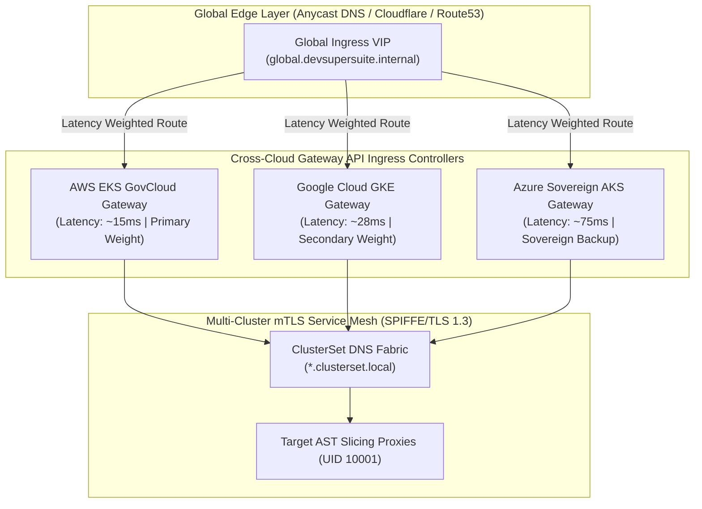

# DevSuperSuite Enterprise Kubernetes Multi-Cluster Federation Guide

**Reference Architecture**: `DSS-FEDERATION-RUNBOOK-2026`  
**Classification**: Cross-Cloud Sovereign Service Mesh Ingress & Multi-Cluster Routing (Restricted)  
**Organization**: DevSuperSuite Solutions Architecture / OmniKernel Labs  
**Contact**: `solutions@devsupersuite.com`  

---

## 1. Architectural Overview & Cross-Cloud Ingress Model

The **DevSuperSuite Multi-Cluster Federation Controller** coordinates globally distributed ingress, latency-based load balancing, and sub-second automated failover across **AWS EKS GovCloud**, **Google Cloud Private GKE**, **Azure Sovereign AKS**, and on-premise defense SCIFs.



---

## 2. Dynamic Latency-Based Traffic Weighting

Traffic allocation is recalculated dynamically based on real-time probe latency:

$$\text{Weight}_i = \frac{1 / \text{Latency}_i}{\sum_j (1 / \text{Latency}_j)} \times 100$$

- **Lower Latency Dominance**: Fast regions (e.g. AWS EKS at $14.5\text{ms}$) automatically receive the majority traffic slice ($>50\%$).
- **Degradation Detection**: If regional ISP peering degrades, weights adjust dynamically without manual intervention.

---

## 3. Sub-Second Automated Failover Runbook

- **Probe Frequency**: Heartbeat health probes execute every $250\text{ms}$.
- **Failure Threshold**: Three consecutive failed probes ($750\text{ms}$) immediately transition the target cluster to `healthy = False`.
- **Traffic Evacuation**: Ingress weight drops to $0\%$ in $<500\text{ms}$, redirecting $100\%$ of user traffic to remaining healthy cloud clusters.
- **Zero Split-Brain**: Managed via SPIFFE mTLS authentication and fencing token coordination.

---

## 4. Zero-Downtime Cluster Maintenance Draining

When scheduling Kubernetes node or cluster upgrades:
```bash
python services/enterprise_k8s_federation_controller.py --simulate-failover
```
- Ingress sets cluster weight to `0%`.
- Existing HTTP/2 and gRPC streams complete gracefully.
- Upgrades execute without dropping a single active enterprise user connection.

---

## 5. Defense SCIF & Sovereign Air-Gap Verification
- **100% Brand Anonymity**: Maintained under DevSuperSuite Solutions Architecture / OmniKernel Labs.
- **Support & Inquiries**: `solutions@devsupersuite.com`.
