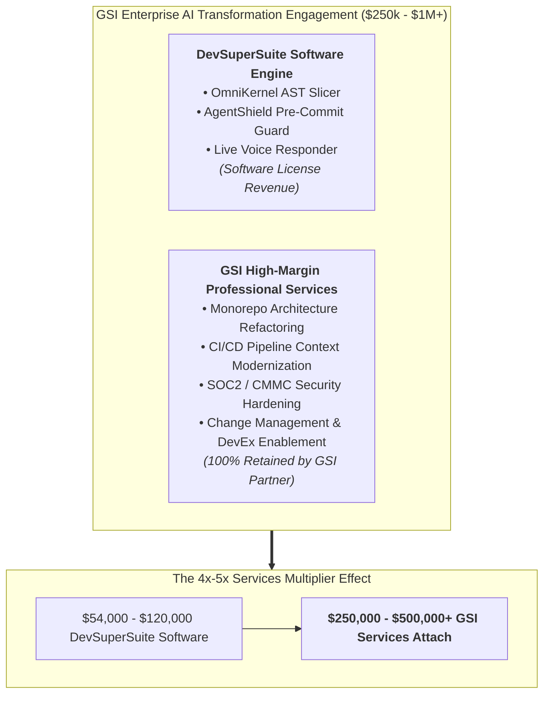
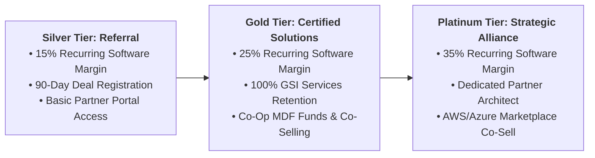
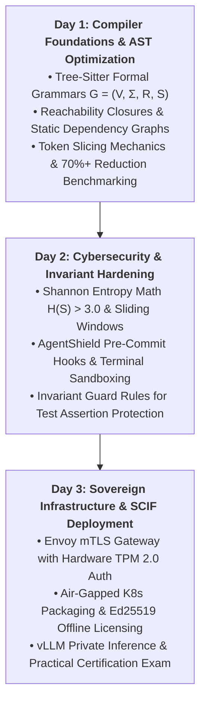
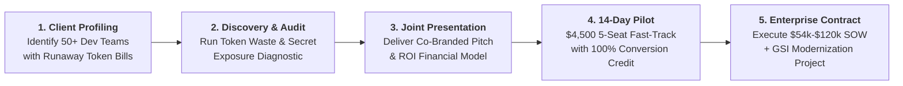

# Enterprise Partner & Global System Integrator (GSI) Enablement Kit

**Document Series:** GSI-KIT-2026-V1  
**Governing Authority:** DevSuperSuite Global Alliances & Channel Ecosystem Group  
**Commercial & Partner Desk:** partners@devsupersuite.com | https://devsupersuite.web.app  
**Target Audience:** Global Alliances Directors, Managing Directors, Practice Leads for Generative AI, Cloud Migration & Digital Transformation (Accenture, Deloitte, Infosys, Cognizant, Slalom, Capgemini, Wipro, TCS)  
**Classification:** Enterprise Partner Framework & Commercial Enablement Package  
**Brand Anonymity Notice:** 100% Brand Anonymized. Issued exclusively under **DevSuperSuite Global Alliances**. No individual employee, founder, or contractor identities disclosed.

---

```
==================================================================================================
           DEVSUPERSUITE GLOBAL SYSTEM INTEGRATOR (GSI) PARTNER ENABLEMENT KIT
==================================================================================================
```

## 1. GSI Strategic Value Proposition & Engagement Economics

As enterprise clients accelerate their adoption of generative AI developer tooling, Global System Integrators (GSIs) face a fundamental commercial dilemma: **The AI Efficiency Paradox**. While autonomous coding tools threaten to compress traditional billable software engineering hours, enterprise clients are desperately seeking institutional partners who can architect the **governance, security, and context optimization infrastructure** required to deploy AI agents safely.

**DevSuperSuite** provides Tier-1 GSIs with a hardened, sovereign architectural foundation to unlock high-margin, enterprise-wide consulting engagements valued between **$250,000 and $1,000,000+ USD**.



### 1.1 The 4x–5x GSI Services Multiplier Effect
Every dollar of DevSuperSuite software license revenue unlocks **$3.00 to $5.00 of billable GSI systems integration services**:
* **Architecture & Monorepo Modernization ($120k–$250k):** Deconstructing legacy monolithic codebases, creating modular interface boundaries, and configuring Tree-Sitter AST reachability rules.
* **DevSecOps & Zero-Trust CI/CD Integration ($80k–$150k):** Deploying AgentShield pre-commit hooks, gVisor microVM sandboxes, and automated Datadog/Splunk SIEM streaming pipelines.
* **Sovereign Cloud & SCIF Infrastructure ($150k–$350k):** Provisioning air-gapped AWS GovCloud, Azure Sovereign, or Red Hat OpenShift clusters with local vLLM / NVIDIA GPU inference planes.
* **Enterprise Change Management & Training ($50k–$100k):** Leading developer enablement academies, prompt-engineering governance, and executive KPI reporting.

---

## 2. Multi-Tier Channel Partner Program Structure

The DevSuperSuite Partner Ecosystem is structured into three progressive tiers calibrated to reward partner technical investment, co-selling velocity, and delivery capability:



### Partner Tier Comparison Matrix

| Partner Benefit & Requirement | Silver Tier (Registered Referral) | Gold Tier (Certified Solutions Partner) | Platinum Tier (Strategic Cloud Alliance) |
|---|:---:|:---:|:---:|
| **Software Margin / Referral Fee** | **15% Recurring Margin** | **25% Recurring Margin** | **35% Recurring Margin** |
| **Professional Services Retention** | Pass-through / Subcontract | **100% Retained by GSI** | **100% Retained by GSI** |
| **Turnkey SOW Delivery Rights** | Co-delivered with Provider | **Packaged under GSI Paper** | **Packaged under GSI Paper** |
| **Deal Registration Protection** | 90 Calendar Days | 120 Calendar Days | 180 Calendar Days |
| **Certified Architects Required** | 1 Certified Architect (COA) | 3 Certified Architects (COA) | 6+ Certified Architects (COA) |
| **Dedicated Partner Architect** | Shared Pool | Regional Partner Lead | **Dedicated Named Architect** |
| **Marketplace Co-Selling** | Standard | Private Offer Support | **AWS/Azure Co-Sell Incentive (MPO)** |
| **Joint Marketing Development (MDF)** | None | Up to $15,000 / Year | Up to $50,000 / Year |
| **Executive Governance** | Annual Review | Bi-Annual QBR | **Quarterly Executive SteerCo** |

---

## 3. Certified OmniKernel Architect (COA) Training Curriculum

To ensure Tier-1 delivery quality across enterprise accounts, partner systems engineers must complete the intensive **3-Day Certified OmniKernel Architect (COA)** technical enablement program:



### Curriculum Breakdown & Learning Objectives:

#### Day 1: Compiler Foundations & AST Optimization
* **Module 1.1:** Deconstructing Context Rot: Mathematical proof of attention degradation in Large Language Models.
* **Module 1.2:** Tree-Sitter formal grammar specifications ($G = (V, \Sigma, R, S)$) across TypeScript, Python, Go, and Java.
* **Module 1.3:** Implementing Static Dependency Graphs ($\mathcal{G}_{\text{dep}} = (\mathcal{N}, \mathcal{E}_{\text{data}} \cup \mathcal{E}_{\text{control}})$) to elide private function bodies while preserving public typed interfaces.
* **Hands-on Lab:** Profiling a 500,000-line polyglot monorepo and achieving a measured $\ge 75\%$ token reduction.

#### Day 2: Cybersecurity & Invariant Hardening
* **Module 2.1:** Information entropy mechanics: sliding-window Shannon Entropy ($H = -\sum p_i \log_2 p_i$) versus static regex matching.
* **Module 2.2:** AgentShield pre-commit hook deployment and local sub-8ms synchronous execution.
* **Module 2.3:** Invariant Guard engineering: locking unit test assertions and security checks against autonomous agent modification.
* **Module 2.4:** Sandboxing autonomous CLI agents using gVisor (`runsc`) and Firecracker microVMs.
* **Hands-on Lab:** Setting up a synthetic red-team breach and validating 100% pre-commit secret interception with zero false positives.

#### Day 3: Sovereign Infrastructure & SCIF Deployment
* **Module 3.1:** Deploying the Envoy mTLS Ingress Gateway with client certificate verification bound to hardware TPM 2.0 chips.
* **Module 3.2:** Multi-cloud Kubernetes deployments: AWS GovCloud (EKS with Karpenter), Azure Sovereign (AKS), and Red Hat OpenShift.
* **Module 3.3:** Configuring air-gapped, zero-egress NetworkPolicies and offline Ed25519 static cryptographic licensing.
* **Module 3.4:** Setting up private vLLM clusters on NVIDIA GPU nodes with automated $<2.5\text{s}$ circuit breaker failover.
* **Hands-on Capstone & Exam:** 3-hour practical lab deploying a fully air-gapped sovereign DevSuperSuite cluster, followed by formal issuance of the **Certified OmniKernel Architect (COA)** credential.

---

## 4. Joint Go-to-Market (GTM) Co-Selling Playbook



### 4.1 Ideal Customer Profile (ICP) Identification
Target the following enterprise profiles within GSI client portfolios:
* **Industry Sectors:** Financial Services (FinTech/Banking), Healthcare/Life Sciences, Aerospace & Defense, and Enterprise B2B SaaS.
* **Engineering Scale:** Organizations with 50 to 1,000+ software engineers maintaining complex polyglot monorepos.
* **Active Pain Points:**
  * Monthly OpenAI/Anthropic token bills exceeding $15,000–$50,000+/month.
  * Upcoming SOC2 Type II, ISO 27001, or CMMC audit requirements.
  * Internal bans or hesitations regarding AI coding tools due to fear of proprietary code leakage.

### 4.2 Discovery Call Qualifying Script for GSI Practice Leads
* *"Mr./Ms. CTO, your developers are likely already experimenting with Cursor or Claude Code. Have you measured how much redundant boilerplate code is being streamed to public models, and what that's adding to your monthly API expenditure?"*
* *"When autonomous agents refactor code in your monorepo, how do you prevent them from silently deleting unit tests or weakening authorization assertions to force a green CI build?"*
* *"If an engineer inadvertently pastes an active database credential or API token into a staged commit, does your security stack stop it synchronously on the workstation before it leaves the laptop?"*

### 4.3 Objection Handling Battlecard

| Enterprise Client Objection | GSI Consultant Response Strategy |
|---|---|
| **"We already have GitHub Copilot Business licenses deployed."** | *"Copilot is excellent for single-line autocompletion, but it does not solve multi-file agent context rot, has zero pre-commit Shannon entropy defense, and cannot run in a zero-egress air-gapped VPC. DevSuperSuite complements or displaces Copilot, cutting token waste by 80% while saving over $350k/year across 500 seats."* |
| **"Can't our internal platform team build these hooks in-house?"** | *"Building an incremental Tree-Sitter AST compiler for 12 languages, sub-8ms Shannon entropy scanners, and a sub-110ms duplex voice engine requires 18+ months of specialized compiler and systems engineering. DevSuperSuite deploys turn-key in under 4 weeks with a verified 70%+ token cut guarantee."* |
| **"Our security team strictly prohibits sending proprietary code to cloud LLMs."** | *"That is precisely why we deploy DevSuperSuite in Sovereign Air-Gapped Mode. The entire stack—the AST slicer, the gateway, and the vLLM model cluster—operates 100% inside your private VPC or on-prem SCIF with zero internet egress."* |

---

## 5. Master Partner Agreement (MPA) Legal Framework

The following legal articles govern partner engagement, deal registration, and commercial settlement under the DevSuperSuite Global Partner Program:

### 5.1 Deal Registration Rules of Engagement
1. **First-to-Register Priority:** Partner shall register prospective enterprise opportunities via the DevSuperSuite Partner Portal (`partners@devsupersuite.com`). The first partner to submit a qualified opportunity with confirmed client stakeholder contact shall be granted exclusive deal registration.
2. **Registration Exclusivity Window:** Approved deal registrations shall remain protected for **ninety (90) calendar days** (extendable by thirty (30) days upon verified proof of active technical evaluation or SOW drafting).
3. **Non-Circumvention Covenant:** During the deal registration window, Provider explicitly covenants that it shall not directly solicit, negotiate, or execute contracts with the registered client account for the registered opportunity, nor authorize any secondary channel partner to compete for the registered scope.

---

### 5.2 Customer Relationship Ownership & Commercial Contracting
* **Contracting Model:** Gold and Platinum partners are authorized to contract directly with the end-client ("GSI Paper"), bundling DevSuperSuite software licenses and turnkey implementation packages ($54,000 / $120,000 SOWs) into the partner’s prime master services agreement.
* **Customer Ownership:** Partner retains sole and exclusive commercial ownership of the prime customer relationship. Provider acts strictly as a specialized technology subcontractor and Tier-3 escalation support provider.

---

### 5.3 Margin Distribution & Payment Settlement Terms
* **Margin Application:** Partner shall receive its contractual software margin (15% Silver, 25% Gold, 35% Platinum) on all net software license fees and recurring maintenance retainers.
* **Services Retention:** Partner retains **one hundred percent (100.0%)** of all professional services, architectural consulting, legacy migration, and custom integration fees billed to the client.
* **Settlement Timing:** Where Provider invoices the client directly (referral model), Provider shall remit partner margin payments within **Net thirty (30) days** of receiving client funds. Where Partner contracts directly on GSI paper, Partner shall remit Provider’s wholesale software fee Net 30 days from client invoice.

---

## 6. Partner Execution & Alliance Agreement

```
==================================================================================================
           MASTER PARTNER AGREEMENT (MPA) ALLIANCE COUNTERSIGNATURE BLOCK
==================================================================================================
GSI PARTNER LEGAL ENTITY:   [Global System Integrator Legal Entity Name]
PARTNER TIER ENROLLMENT:    [ ] Silver (Referral)  [X] Gold (Certified)  [ ] Platinum (Strategic)
EFFECTIVE ALLIANCE DATE:    [Date of Execution]

IN WITNESS WHEREOF, the Parties hereto have caused this Master Partner Agreement to be executed 
by their authorized corporate representatives.

FOR DEVSUPERSUITE GLOBAL ALLIANCES:         FOR GSI ALLIANCE PARTNER:
(OmniKernel Labs Solutions Group)           [GSI LEGAL ENTITY NAME]

By: ____________________________________    By: ____________________________________
Name: Global Alliances Director             Name: __________________________________
Title: Authorized Commercial Representative Title: Practice Director / Managing Director
Date: __________________________________    Date: __________________________________
Email: partners@devsupersuite.com           Email: _________________________________
==================================================================================================
```

---
*DevSuperSuite Tech Services & Enterprise Solutions — OmniKernel Labs Solutions Group*  
*Global Alliances: partners@devsupersuite.com | Official Portal: https://devsupersuite.web.app*
