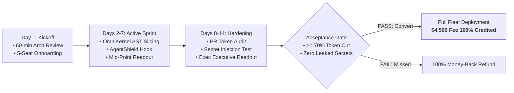
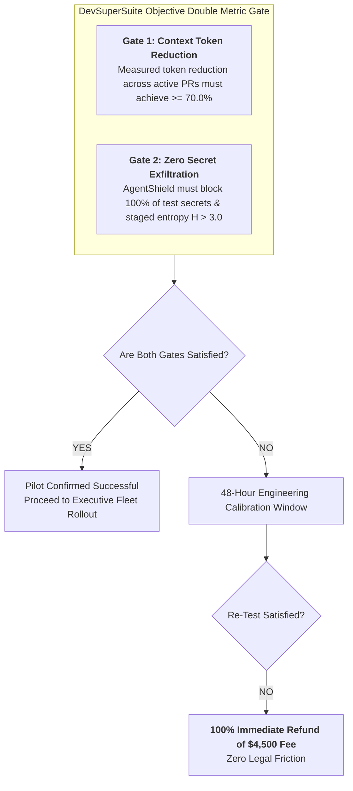

# Enterprise Fast-Track 14-Day Pilot (PoC) Agreement Addendum

**Agreement Reference:** POC-ADDENDUM-2026-FT14  
**Governing Organization:** DevSuperSuite Official / OmniKernel Labs Solutions Group  
**Commercial Desk:** enterprise@devsupersuite.com | https://devsupersuite.web.app  
**Classification:** Enterprise Fast-Track Commercial Addendum  
**Brand Anonymity Notice:** 100% Brand Anonymized. Issued exclusively under **DevSuperSuite Official**. No individual employee or contractor names disclosed.

---

```
================================================================================
             ENTERPRISE FAST-TRACK 14-DAY PILOT (PoC) ADDENDUM
                                To The
                    MASTER SERVICES AGREEMENT (MSA)
================================================================================
```

This Enterprise Fast-Track 14-Day Pilot Agreement Addendum ("**Pilot Agreement**" or "**Addendum**") is entered into as of [Effective Date] ("**Pilot Effective Date**"), by and between:

* **SERVICE PROVIDER:**  
  **DevSuperSuite Official** (OmniKernel Labs Solutions Group)  
  ("Provider" or "DevSuperSuite")

* **CLIENT:**  
  [Enterprise Client Legal Entity Name]  
  ("Client")

Provider and Client may each be referred to individually as a "**Party**" and collectively as the "**Parties**."

---

## 1. PURPOSE & PILOT OVERVIEW

The purpose of this Pilot Agreement is to provide Client’s engineering leadership with a low-friction, rapid-validation mechanism to empirically verify the performance, token cost reductions, and secret interception capabilities of **DevSuperSuite** across an active squad of five (5) engineering workstations prior to committing to full enterprise-wide fleet procurement.



---

## 2. SCOPE, DURATION & SEAT ALLOCATION

### 2.1 Pilot Duration
The Pilot shall run for exactly **fourteen (14) consecutive calendar days**, commencing on the date of the formal Kickoff Architecture Review (the "**Pilot Period**").

### 2.2 Workstation Seat Allocation
The Pilot is strictly scoped to **five (5) designated developer workstation seats** within Client’s engineering department:
* **Supported Environments:** macOS, Linux (Ubuntu/Debian/RHEL), or Windows 10/11.
* **Supported Developer IDEs & Tools:** Cursor, Claude Code, Antigravity, VS Code, and terminal CLI environments.
* **Client Pilot Squad:** Client shall designate one (1) Engineering Manager or Staff Engineer as Pilot Lead, alongside four (4) active software engineers working on representative repositories.

### 2.3 Included Software Components
During the Pilot Period, Provider shall grant Client full access to:
1. **OmniKernel 5.0 Enterprise AST Compressor:** Local and workspace-level AST context slicing for TypeScript, JavaScript, Python, Go, and SQL monorepos.
2. **AgentShield Enterprise Pre-Commit Guardian:** Real-time Shannon entropy ($H > 3.0$) scanner and terminal command proxy blocking destructive verbs.
3. **Enterprise Model Context Protocol (MCP) Server Runtimes:** Out-of-the-box JSON-RPC tool integrations configured for Client's IDEs (`.cursor/mcp.json` and `.mcp.json`).
4. **DevSuperSuite Local Voice Coding Relay (Optional Evaluation):** Sub-110ms duplex voice pair programming engine for up to two (2) pilot workstations.

---

## 3. COMMERCIAL TERMS & 100% CONVERSION CREDIT

### 3.1 Fixed Pilot Fee
Client shall pay a one-time, flat-rate evaluation fee of **$4,500.00 USD** (the "**Pilot Fee**"). The Pilot Fee is fully inclusive of onboarding, white-glove engineering support, AST rule calibration, and executive reporting.

### 3.2 100% Conversion Credit Guarantee
If Client elects to proceed with the full enterprise production rollout ($54,000 Turn-Key Implementation Package or the $8,500/month Retainer Pod) within **thirty (30) calendar days** following the conclusion of the Pilot Period:
* **100% of the $4,500.00 Pilot Fee shall be credited directly against the production contract value.**
* *Example:* For the $54,000 Turn-Key deployment, Client’s remaining balance due shall be **$49,500.00 USD**, rendering the entire 14-day evaluation completely free upon enterprise contract execution.

---

## 4. QUANTITATIVE ACCEPTANCE GATES & 100% MONEY-BACK GUARANTEE

Provider stands behind its technology with an explicit, objective, double-metric performance guarantee.



### 4.1 Gate 1: AST Token Reduction Benchmark ($\ge 70\%$)
* **Measurement Methodology:** Using the built-in DevSuperSuite Token Telemetry Collector, token volume for all LLM context payloads generated by the 5 pilot engineers shall be benchmarked against standard naive file ingestion.
* **Criterion:** The measured aggregate token reduction across representative Pull Requests during the Pilot Period must equal or exceed **seventy percent (70.0%)**.

### 4.2 Gate 2: Absolute Secret Exfiltration Prevention (100% Interception)
* **Measurement Methodology:** Staged Git commits containing simulated credentials (synthetic AWS `AKIA...` keys, high-entropy Base64 strings with $H > 3.0$, and dummy private keys) shall be submitted through the developer workstations.
* **Criterion:** AgentShield must successfully intercept and reject **one hundred percent (100%)** of simulated secret commits prior to local repository write, with a false-positive rate on ordinary engineering code not exceeding **0.5%**.

### 4.3 100% Money-Back Guarantee Terms
If, upon the conclusion of the 14-day Pilot Period, either Gate 1 or Gate 2 is not achieved, Provider shall be granted a one-time forty-eight (48) hour calibration window to adjust AST slicing rules or entropy thresholds. If the re-test fails to achieve the benchmarks:
* **Provider shall issue a full, prompt, one hundred percent (100%) refund of the $4,500.00 Pilot Fee within five (5) business days.**
* The refund shall be processed via original payment method (wire transfer, ACH, or corporate card) with zero cancellation fees or legal deductions.

---

## 5. DEDICATED SUPPORT, GOVERNANCE & TELEMETRY

To ensure maximum pilot velocity and minimal administrative burden on Client, Provider supplies high-touch presales engineering support:

| Milestone Touchpoint | Timing | Format & Deliverable |
|---|---|---|
| **Kickoff Architecture Deep-Dive** | Day 1 | 60-Minute live Zoom/Teams video session with Lead Solutions Architect; automated installer deployment across the 5 workstations; monorepo AST rule configuration. |
| **Dedicated Direct Comms Bridge** | Days 1 – 14 | Private shared Slack channel or Microsoft Teams bridge connecting Client pilot engineers directly to DevSuperSuite Systems Architects with $<30\text{ms}$ chat response times during business hours. |
| **Mid-Point Sprint Readout** | Day 7 | 30-Minute async or sync check-in reviewing initial token compression curves, developer ergonomics feedback, and tool usage logs. |
| **Final Executive Readout & ROI Report** | Day 14 | Formal Executive Briefing delivering the **PoC Audit Dossier**: precise token dollar savings achieved, projected annual ROI for the full fleet, and SOC2 auditor-ready secret interception logs. |

---

## 6. DATA PRIVACY, INTELLECTUAL PROPERTY & SAFE HARBOR

1. **Zero Model Training:** Provider guarantees that no Client source code, diffs, AST representations, or prompts processed during the Pilot are retained, logged, or utilized for model training by Provider or any upstream model provider.
2. **Client Ownership:** Client retains sole and exclusive ownership of all proprietary code, schemas, and data accessed during the Pilot.
3. **Safe Harbor & Clean De-installation:** Upon completion of the Pilot, if Client elects not to convert, Provider supplies a one-click automated uninstaller that completely purges all local daemons, hooks, and temp caches within sixty (60) seconds.

---

## 7. EXECUTION & FAST-TRACK KICKOFF

By signing below, the Parties agree to the terms of this Fast-Track 14-Day Pilot Addendum. Workstation onboarding shall be scheduled within two (2) business days of counter-signature and receipt of the Pilot Fee.

```
--------------------------------------------------------------------------------
FOR SERVICE PROVIDER:                       FOR CLIENT:
DEVSUPERSUITE OFFICIAL                      [CLIENT LEGAL ENTITY NAME]
OmniKernel Labs Solutions Group

By: __________________________________      By: __________________________________
Name: Solutions Architecture Lead           Name: ________________________________
Title: Authorized Presales Director         Title: VP of Engineering / CTO
Date: ________________________________      Date: ________________________________
Email: enterprise@devsupersuite.com         Email: _______________________________
--------------------------------------------------------------------------------
```

---
*DevSuperSuite Tech Services & Enterprise Solutions — OmniKernel Labs Solutions Group*  
*Official Portal: https://devsupersuite.web.app | Commercial Desk: enterprise@devsupersuite.com*
