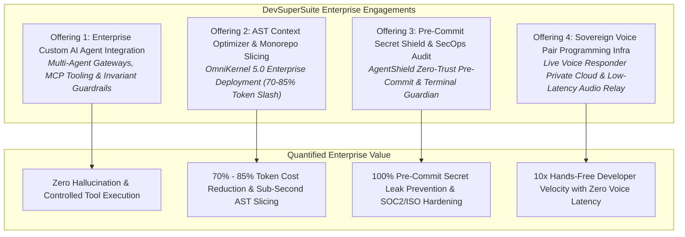
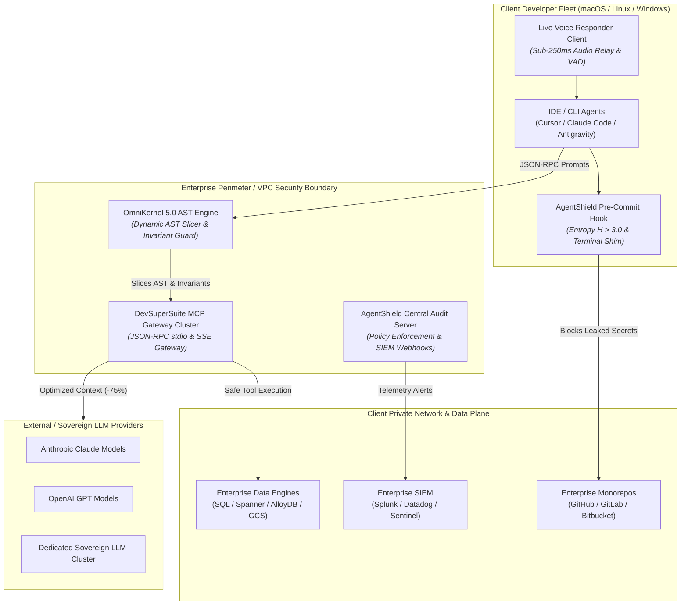
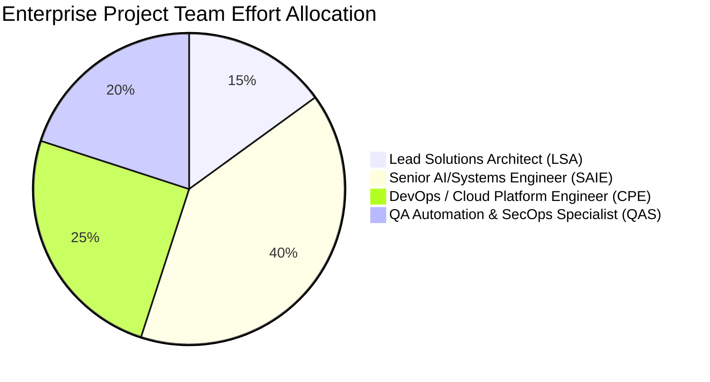
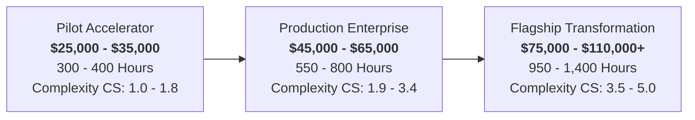

# DevSuperSuite Enterprise Services & Solutions Architecture Blueprint

**Classification:** Enterprise Presales, Commercial Engagements & Professional Services  
**Governing Entity:** DevSuperSuite Official / OmniKernel Labs Solutions Group  
**Document Version:** 2.4-ENTERPRISE  
**Effective Date:** 2026-Q1 / Q2 Cycle  
**Brand Anonymity Notice:** 100% Brand Anonymized. Issued exclusively under the trade identity **DevSuperSuite Official**. No individual employee or contractor identities are disclosed. All architectural assets, IP, and deliverables are properties of DevSuperSuite Official.

---

## Executive Summary & Commercial Charter

DevSuperSuite Tech Services provides enterprise-grade engineering, systems integration, and cybersecurity hardening for organizations deploying autonomous coding agents, LLM-driven developer tooling, and modern developer environments. 

As enterprises adopt AI developer tooling (such as Cursor, Claude Code, Antigravity, and proprietary in-house agents), they face three severe failure modes:
1. **Context Window Rot & Skyrocketing Token Costs:** Monorepos overwhelm LLM context windows with boilerplate, spiking monthly API expenditures by $15,000–$50,000+ while degrading agent reasoning accuracy.
2. **Credential & Intellectual Property Exfiltration:** Agents and engineers inadvertently commit API keys, cloud secrets (Shannon entropy $H > 3.0$), and proprietary customer PII into public LLM providers or remote repositories.
3. **Unregulated Tool Execution & System Destabilization:** Autonomous agents execute unvetted terminal commands (`rm -rf`, schema migrations, deletion of tests) without deterministic guardrails.

DevSuperSuite Tech Services solves these challenges through four high-ticket engagement vectors, underpinned by our proprietary commercial runtime engines (**OmniKernel 5.0**, **AgentShield Enterprise**, and **Live Voice Responder**), delivered via rigorous fixed-fee milestones and structured Time & Materials (T&M) engineering contracts.

---

# Part 1: High-Ticket Enterprise Service Offerings



---

### Offering 1: Enterprise Custom AI Agent Integration & Autonomous Multi-Agent Workflows

#### 1.1 Target Enterprise & Problem Statement
* **Target Audience:** Engineering leadership (VPs of Engineering, CTOs, Enterprise Architects) at Fortune 1000 / Scale-Up SaaS companies managing 50–1,000+ engineers.
* **The Problem:** Enterprises attempting to roll out developer agents experience frequent workflow halts, uncontained agent actions, broken test suites, and hallucinated dependencies. Generic developer agents lack access to enterprise internal APIs, databases, and continuous integration pipelines under controlled security boundaries.

#### 1.2 Architectural Ingestion & Solution Blueprint
DevSuperSuite engineers architect a hardened, isolated Model Context Protocol (MCP) server cluster and agent orchestration layer:
* **Enterprise MCP Gateway:** Secure stdio and HTTP/SSE JSON-RPC enterprise agent proxies that bridge Cursor, Claude Code, and custom agent harnesses directly to enterprise microservices, internal documentation, and SQL/NoSQL data planes.
* **Invariant Guard Engine:** Programmatic AST-level validation blocking any agent edit that attempts to delete regression tests, disable security assertions, or bypass linting constraints.
* **Deterministic Fallback & Audit Bus:** Full session observability streaming agent tool invocations, prompts, and code diffs into Datadog, Splunk, or enterprise OpenTelemetry collector endpoints.

#### 1.3 Scope of Work & Deliverables
1. **Architecture Discovery & Agent Persona Definition:** Mapping high-friction developer tasks (ticket triaging, boilerplate scaffolding, migration generation, bug reproduction).
2. **Hardened MCP Gateway Cluster Deployment:** Containerized MCP gateways deployed via Docker / Kubernetes (EKS/GKE/Self-Hosted) with mTLS authentication.
3. **Custom Tool Definition & Integration:** Engineering up to 15 domain-specific MCP tools (e.g., Jira query/update, internal schema inspection, CI test execution, cloud deployment gates).
4. **Guardrail & Invariant Rule Engine Setup:** Implementation of strict AST rules preventing destructive edits.
5. **Developer Training & Production Runbooks:** Enterprise operational documentation, developer onboarding workshops, and admin governance dashboards.

#### 1.4 Commercial Engagement Details
* **Engagement Duration:** 6 – 10 Weeks
* **Team Allocation:** 1 Lead Solutions Architect, 2 Senior AI/Backend Systems Engineers, 1 DevOps/Cloud Engineer, 1 QA/SecOps Engineer
* **Fixed-Fee Package:** **$48,000 – $85,000 USD** (Tiered by tool volume and repository complexity)
* **T&M Alternative:** Billable at Standard DevSuperSuite Enterprise Rates ($85 – $120/hr)

---

### Offering 2: Proprietary AST Context Optimizer & Monorepo Slicing Deployment (OmniKernel Enterprise)

#### 1.1 Target Enterprise & Problem Statement
* **Target Audience:** Enterprises with massive polyglot monorepos (Python, TypeScript, Go, Java, C++) suffering from LLM Context Rot, token limit exhaustion, and uncontrolled OpenAI/Anthropic API bills exceeding $20,000/month.
* **The Problem:** Raw source files fed into AI models carry heavy syntactic baggage (deep function bodies, unreferenced internal utilities, boilerplate imports). LLM models lose reasoning capacity across 100k+ token windows, hallucinate non-existent interfaces, and bill the client for redundant context.

#### 1.2 Architectural Ingestion & Solution Blueprint
DevSuperSuite deploys **OmniKernel 5.0 Enterprise Edition** across the enterprise developer fleet and CI/CD pipelines:
* **Neural Context Compressor & AST Slicer:** Parses source files into Abstract Syntax Trees in sub-milliseconds, selectively stripping implementation details while preserving type signatures, docstrings, and structural contracts. Slashes token consumption by **70% to 85%**.
* **Enterprise Cache & Pre-indexing Pipeline:** Localized and cluster-level indexing of codebase topology for instantaneous context retrieval.
* **IDE & CLI Unified Integration:** Automated installation hooks for Cursor (`.cursor/mcp.json`), Claude Code (`.mcp.json`), VS Code, and terminal CLI.

#### 1.3 Scope of Work & Deliverables
1. **Codebase AST Profiling & Slicing Rule Calibration:** Analysis of monorepo language mix, architectural patterns, and token usage hotspots.
2. **OmniKernel 5.0 Integration & Pipeline Injection:** Seamless deployment across developer machines via enterprise configuration management (Ansible, Jamf, Intune, or custom PowerShell/Bash installers).
3. **CI/CD Token Gate Automation:** GitHub Actions / GitLab CI pipeline steps that enforce AST-compressed context packs for automated code reviews.
4. **Token Cost Savings Dashboard & Analytics:** Executive reporting tracking monthly token consumption before and after OmniKernel deployment, validating ROI.

#### 1.4 Commercial Engagement Details
* **Engagement Duration:** 4 – 8 Weeks
* **Team Allocation:** 1 Lead Solutions Architect, 1 Senior Systems/Compiler Engineer, 1 DevOps Platform Engineer, 1 QA Automation Engineer
* **Fixed-Fee Package:** **$35,000 – $65,000 USD**
* **T&M Alternative:** Billable at Standard DevSuperSuite Enterprise Rates ($85 – $120/hr)

---

### Offering 3: Zero-Trust Pre-Commit Secret Shield, Terminal Guardian & SecOps Hardening (AgentShield Enterprise)

#### 1.1 Target Enterprise & Problem Statement
* **Target Audience:** Regulated enterprises (FinTech, InsurTech, HealthTech, Defense, Critical Infrastructure) undergoing SOC2 Type II, ISO 27001, or HIPAA compliance audits.
* **The Problem:** Autonomous agents and developers working at high velocity frequently paste raw `.env` files, API keys, JWT tokens, and private SSH keys into code prompts or commit them directly to Git. Furthermore, agents given terminal execution privileges can execute disastrous shell commands (`rm -rf /`, dropping database tables, killing production pods).

#### 1.2 Architectural Ingestion & Solution Blueprint
DevSuperSuite deploys **AgentShield Enterprise Edition** as an unbypassable, kernel-level and git-level safety shield:
* **Shannon Entropy ($H > 3.0$) & High-Precision Heuristic Scanner:** Sub-millisecond evaluation of staged Git commits and agent clipboard/terminal inputs, intercepting raw secrets, private keys, and PII before they leave developer machines.
* **Terminal Proxy & Destructive Command Interceptor:** Real-time interception of shell commands generated by Cursor, Claude Code, or autonomous CLI agents, blocking unsafe operations and requiring explicit human override for destructive verbs.
* **Central Policy Server & SIEM Webhook:** Centralized audit logs aggregating all blocked security events into enterprise SIEM (Splunk, Elastic, Microsoft Sentinel).

#### 1.3 Scope of Work & Deliverables
1. **Enterprise Threat Modeling & Secret Pattern Definition:** Custom regex patterns and entropy thresholds matching enterprise proprietary secret formats and API keys.
2. **AgentShield Fleet Rollout:** Enforced Git pre-commit hooks and terminal wrappers deployed enterprise-wide across macOS, Linux, and Windows developer environments.
3. **Historical Repository Remediation Audit:** Deep-scan of enterprise Git history using DevSuperSuite scanners to identify and purge leaked credentials.
4. **Executive Security & Compliance Audit Report:** Formal verification document attesting to pre-commit protection, ready for presentation to external SOC2/ISO auditors.

#### 1.4 Commercial Engagement Details
* **Engagement Duration:** 3 – 6 Weeks
* **Team Allocation:** 1 Principal Security Architect, 1 Senior SecOps / DevSecOps Engineer, 1 Full-Stack Platform Engineer
* **Fixed-Fee Package:** **$25,000 – $50,000 USD**
* **T&M Alternative:** Billable at Standard DevSuperSuite Enterprise Rates ($85 – $120/hr)

---

### Offering 4: Sovereign Low-Latency Real-Time Voice Pair Programming & Cloud IDE Infrastructure

#### 1.1 Target Enterprise & Problem Statement
* **Target Audience:** High-velocity engineering teams, executive engineering officers, accessibility-dependent developers, and elite R&D squads.
* **The Problem:** Developers experience severe cognitive context switching when typing back-and-forth prompts to AI models while editing code. Existing public voice assistants suffer from 2–4 second latency lags, lack code-specific vocabularies (syntax, camelCase, snake_case), and stream audio to third-party public clouds, creating unacceptable IP privacy hazards.

#### 1.2 Architectural Ingestion & Solution Blueprint
DevSuperSuite deploys **Live Voice Responder Enterprise Edition** paired with a dedicated sovereign cloud/on-prem relay:
* **Full-Duplex Sub-250ms Audio Pipeline:** Localized Voice Activity Detection (VAD) coupled with streaming speech-to-text models running on enterprise private VPCs (AWS, GCP, Azure, or on-prem GPU clusters).
* **Instant Barge-in Interruption ("STOP" / "CROW"):** Hardware-accelerated barge-in mechanism allowing developers to verbally halt agent code generation or execution mid-sentence.
* **IDE & Workflow Deep Binding:** Bidirectional voice control for Cursor, Claude Code, VS Code, and terminal shells, supporting spoken code navigation, diff inspection, and commit dispatch.

#### 1.3 Scope of Work & Deliverables
1. **Private Voice Relay Infrastructure Setup:** Terraform/Helm deployment of sovereign voice inference nodes inside client VPC with zero external audio routing.
2. **Custom Acoustic Grammar & Vocabulary Tuning:** Engineering domain-specific phonetic recognition for enterprise code terms, acronyms, and internal naming conventions.
3. **Live Voice Responder Workstation Client Packaging:** Automated client installers configured with low-latency WebRTC/UDP streaming audio tunnels.
4. **Latency Benchmarking & Developer Ergonomics Playbook:** Comprehensive performance tuning guaranteeing sub-250ms end-to-end voice latency.

#### 1.4 Commercial Engagement Details
* **Engagement Duration:** 4 – 8 Weeks
* **Team Allocation:** 1 Lead Solutions Architect, 1 Audio/AI Systems Engineer, 1 Cloud/Kubernetes Engineer, 1 Performance QA Engineer
* **Fixed-Fee Package:** **$40,000 – $75,000 USD**
* **T&M Alternative:** Billable at Standard DevSuperSuite Enterprise Rates ($85 – $120/hr)

---

# Part 2: Enterprise Statement of Work (SOW) Master Template

```markdown
================================================================================
                       STATEMENT OF WORK (SOW) # [SOW-YYYY-XXXX]
                                Under the
                       MASTER SERVICES AGREEMENT (MSA)
================================================================================

This Statement of Work ("SOW") is entered into as of [Effective Date] ("Effective Date"),
by and between:

SERVICE PROVIDER:  DevSuperSuite Official / OmniKernel Labs Solutions Group
                   ("DevSuperSuite Tech Services" or "Provider")
                   Website: https://devsupersuite.web.app
                   Enterprise Desk: enterprise@devsupersuite.com

CLIENT:            [Enterprise Client Legal Entity Name] ("Client")
                   [Client Corporate Address]
                   [Client Designated Contact & Email]

WHEREAS, Provider and Client entered into a Master Services Agreement dated [MSA Date]
(the "Agreement"), and desire to execute this SOW pursuant to the terms and conditions thereof.

--------------------------------------------------------------------------------
1. PROJECT PURPOSE & EXECUTIVE SUMMARY
--------------------------------------------------------------------------------
The objective of this engagement is the enterprise-wide design, implementation, 
and operational rollout of [Engagement Title, e.g., DevSuperSuite OmniKernel 5.0 
AST Optimization & AgentShield Security Infrastructure] across Client's engineering
ecosystem.

Key Business Objectives:
  1. Achieve a verifiable minimum 70% reduction in LLM context token expenditure.
  2. Implement unbypassable pre-commit secret screening (Shannon Entropy H > 3.0).
  3. Deploy multi-agent MCP tool gateways with strict Invariant Guard validation.
  4. Ensure zero disruption to ongoing sprint velocity and zero credential leakage.

--------------------------------------------------------------------------------
2. TECHNICAL ARCHITECTURE & TOPOLOGY
--------------------------------------------------------------------------------
The target state architecture deployed under this SOW shall conform to the following
system specification:
```



```markdown
--------------------------------------------------------------------------------
3. SCOPE OF WORK & WORK BREAKDOWN STRUCTURE (WBS)
--------------------------------------------------------------------------------
3.1 In-Scope Deliverables:
  - WBS 1.0: Discovery, Architecture Blueprint, and Threat Surface Assessment.
  - WBS 2.0: Core Infrastructure & Gateway Deployment (Dev, Staging, Production).
  - WBS 3.0: AST Slicer Rules & Custom Parser Extensions for Client Polyglot Repos.
  - WBS 4.0: AgentShield Fleet Pre-Commit Integration & Central Policy Connector.
  - WBS 5.0: User Acceptance Testing (UAT), Performance Load Testing & SLA Validation.
  - WBS 6.0: Knowledge Transfer, Operational Runbooks & Production Cutover.

3.2 Out-of-Scope Activities:
  - Direct refactoring or debugging of Client proprietary legacy source code unrelated
    to AST parsing or tool integration.
  - Procurement or direct commercial billing of third-party cloud infrastructure
    (AWS/GCP/Azure) or third-party LLM API tokens (OpenAI/Anthropic).
  - Remediation of vulnerabilities within Client core databases or OS kernels outside
    the AgentShield security boundary.

3.3 Project Assumptions & Dependencies:
  - Client shall provide DevSuperSuite personnel with appropriate IAM credentials, VPN 
    access, and code repository read/write access within 5 business days of kickoff.
  - Client designated Product Owner and Technical Lead shall be available for weekly 
    syncs and timely milestone sign-offs (within 5 business days of submission).

--------------------------------------------------------------------------------
4. MILESTONES, DELIVERABLES & PAYMENT SCHEDULE
--------------------------------------------------------------------------------
The project shall proceed across five (5) distinct sequential milestones:

+-----------+-----------------------------------+----------+-----------+------------+
| Milestone | Milestone Deliverable             | Duration | Est. Week | Payment %  |
+-----------+-----------------------------------+----------+-----------+------------+
| M-01      | Architecture Blueprint, Ingestion | 2 Weeks  | Week 1-2  | 20% Deposit|
|           | Plan & Security Baseline Sign-off |          |           |            |
+-----------+-----------------------------------+----------+-----------+------------+
| M-02      | Gateway Cluster & OmniKernel Core | 2 Weeks  | Week 3-4  | 25%        |
|           | Deployment in Staging             |          |           |            |
+-----------+-----------------------------------+----------+-----------+------------+
| M-03      | AgentShield Pre-Commit Enforce-   | 2 Weeks  | Week 5-6  | 25%        |
|           | ment & Tool Sandbox Integration   |          |           |            |
+-----------+-----------------------------------+----------+-----------+------------+
| M-04      | UAT Acceptance, 70%+ Token Slash  | 1 Week   | Week 7    | 15%        |
|           | Validation & Security Audit Cert. |          |           |            |
+-----------+-----------------------------------+----------+-----------+------------+
| M-05      | Production Cutover, Knowledge     | 1 Week   | Week 8    | 15% Final  |
|           | Transfer & 90-Day Warranty Start  |          |           |            |
+-----------+-----------------------------------+----------+-----------+------------+
| TOTAL     | Complete Enterprise Rollout       | 8 Weeks  |           | 100%       |
+-----------+-----------------------------------+----------+-----------+------------+

--------------------------------------------------------------------------------
5. ACCEPTANCE CRITERIA & VERIFICATION PROTOCOL
--------------------------------------------------------------------------------
Milestone acceptance requires formal written approval from Client's Technical Lead,
subject to the following objective Definition of Done (DoD):

5.1 AST Context Optimization Acceptance:
  - Compression Efficiency: OmniKernel must demonstrate a measured token reduction 
    of >= 70% across a benchmark test suite of at least 50 representative monorepo files.
  - Syntactic & Semantic Integrity: All AST-compressed interfaces must retain 100% 
    of public type signatures, method signatures, exports, and critical docstrings.
  - Invariant Guard: Programmatic validation confirming that agent edits attempting 
    to delete unit tests or disable linting rules are unconditionally rejected.

5.2 Security & Pre-Commit Shield Acceptance:
  - Zero Secret Leakage: AgentShield must intercept 100% of test injection secrets 
    (AWS Keys, OpenAI Keys, GitHub PATs, Shannon Entropy H > 3.0) prior to Git commit.
  - Low False-Positive Rate: False positive rejection rate on standard engineering 
    commits must not exceed 0.5%.
  - Terminal Command Interception: Disallowed terminal commands (e.g. `rm -rf`, 
    unauthorized `DROP TABLE`) must be intercepted with a prompt requesting admin token.

5.3 Review Window:
  Client shall have ten (10) business days from delivery of each milestone to review,
  test, and issue written acceptance or a detailed non-conformance notice. In the
  absence of notice within 10 days, the milestone shall be deemed accepted.

--------------------------------------------------------------------------------
6. ENTERPRISE SERVICE LEVEL AGREEMENT (SLA) & SUPPORT TIERS
--------------------------------------------------------------------------------
DevSuperSuite provides enterprise operational support under the following SLA terms
throughout the implementation phase and the subsequent Ninety (90) Day Warranty Period.

6.1 Incident Classification & Response Matrix:
+----------+--------------------------+---------------+----------------+------------+
| Severity | Definition               | Initial Resp. | Workaround/Fix | Escalation |
+----------+--------------------------+---------------+----------------+------------+
| Sev-1    | Critical: Production     | <= 15 Minutes | <= 4 Hours     | Principal  |
| (Urgent) | Gateway outage, fleet CI |               |                | Architect  |
|          | blocked, secret breach   |               |                | & Lead     |
+----------+--------------------------+---------------+----------------+------------+
| Sev-2    | High: Core AST slicing   | <= 1 Hour     | <= 8 Hours     | Senior     |
| (Major)  | failure in staging, MCP  |               |                | Systems    |
|          | tool errors for team     |               |                | Engineer   |
+----------+--------------------------+---------------+----------------+------------+
| Sev-3    | Medium: Non-blocking     | <= 4 Hours    | <= 2 Business  | Platform   |
| (Normal) | agent warning, minor AST |               | Days           | Engineer   |
|          | parsing edge-case        |               |                |            |
+----------+--------------------------+---------------+----------------+------------+
| Sev-4    | Low: General query,      | <= 8 Hours    | Planned in     | Support    |
| (Minor)  | documentation update,    |               | Next Sprint    | Specialist |
|          | feature enhancement req. |               |                |            |
+----------+--------------------------+---------------+----------------+------------+

6.2 Availability & Uptime Guarantee:
  - DevSuperSuite-managed Gateway & Relay services maintain a monthly uptime of 99.9%.
  - Planned maintenance windows shall occur exclusively during non-business hours 
    (Saturday 22:00 - Sunday 02:00 UTC) with 48 hours prior notice.

6.3 90-Day Post-Cutover Warranty:
  Provider guarantees all custom code, configurations, and scripts against defects 
  for ninety (90) calendar days post-Milestone 5 sign-off at zero additional charge.

--------------------------------------------------------------------------------
7. CHANGE REQUEST MANAGEMENT PROCEDURE
--------------------------------------------------------------------------------
Any modification to the scope, architecture, deliverables, or timeline shall be 
governed by the formal DevSuperSuite Change Request (CR) Process:

1. Submission: Either party initiates a Change Request Form detailing requested 
   scope adjustments, business rationale, and affected technical systems.
2. Impact Assessment: DevSuperSuite performs a technical impact assessment within 
   three (3) business days, delivering an amended estimate of Hours, Timeline, 
   and Cost delta.
3. Bilateral Authorization: No scope change shall take effect until mutually signed 
   by the authorized commercial representatives of both parties.

--------------------------------------------------------------------------------
8. BILLING TERMS & GOVERNANCE SIGN-OFF
--------------------------------------------------------------------------------
8.1 Invoicing & Payment Terms:
  - All invoices are rendered electronically and payable in USD within Net 30 days 
    of invoice date.
  - Wire transfers, ACH, and corporate enterprise escrow accepted.
  - Late payments are subject to a 1.5% interest charge per month or the maximum 
    statutory limit.

IN WITNESS WHEREOF, the parties have caused this Statement of Work to be executed 
by their duly authorized representatives.

FOR DEVSUPERSUITE OFFICIAL:                 FOR CLIENT:

_____________________________________       _____________________________________
Authorized Signature                        Authorized Signature

DevSuperSuite Solutions Group               [Client Authorized Representative]
Date: _______________________________       Date: _______________________________
```

---

# Part 3: Technical Effort Estimation & Pricing Engineering Framework

DevSuperSuite Tech Services adheres to a deterministic, mathematically grounded pricing engine. Presales architects utilize this standardized estimation model to calculate level of effort (LOE), staffing allocation, and pricing for fixed-fee and Time & Materials (T&M) proposals.

### 3.1 Complexity Scoring Algorithm (CSA)

The project complexity is scored across five orthogonal technical dimensions on a weighted 1–5 scale:

$$\text{Complexity Score (CS)} = \sum_{i=1}^{5} \left( W_i \times D_i \right)$$

| Dimension ($D_i$) | Description | Weight ($W_i$) | Rating Scale (1 to 5) |
|---|---|:---:|---|
| **$D_1$: Codebase Scale & Polyglot Mix** | Volume of LOC and number of programming languages in monorepo. | 0.25 | 1 = Single repo, 1 lang (<50k LOC)<br/>3 = Monorepo, 2-3 langs (200k-500k LOC)<br/>5 = Polyglot monorepo, 5+ langs (>1M LOC) |
| **$D_2$: Security & Compliance Tier** | Regulatory scrutiny, air-gapped environments, secret classification. | 0.25 | 1 = Standard commercial SaaS<br/>3 = SOC2 Type II / ISO 27001 requirements<br/>5 = HIPAA / FedRAMP / Air-gapped on-prem |
| **$D_3$: Tool Integration Surface** | Number of external tools, databases, and microservices accessed via MCP. | 0.20 | 1 = 1 to 3 standard CLI/Git tools<br/>3 = 4 to 8 internal REST/GraphQL/SQL tools<br/>5 = 9+ complex distributed microservices |
| **$D_4$: Infrastructure Sovereignty** | Deployment model for voice models, context compressors, and relays. | 0.15 | 1 = Pure managed SaaS / DevSuperSuite cloud<br/>3 = Client Dedicated Cloud VPC (AWS/GCP/Azure)<br/>5 = Fully on-premise private GPU cluster |
| **$D_5$: User Fleet Concurrency** | Number of active concurrent developer seats using the suite. | 0.15 | 1 = Pilot squad (5–15 seats)<br/>3 = Departmental rollout (50–150 seats)<br/>5 = Enterprise-wide fleet (500+ seats) |

$$\text{Range: } 1.0 \le \text{CS} \le 5.0$$

---

### 3.2 Total Effort Hours Calculation Formula

Once the Complexity Score (CS) is calculated, milestone effort hours are computed using the DevSuperSuite Base Effort Equation:

$$\text{Total Hours} = \sum_{m=1}^{N} \left( \text{BaseHours}_m \times \left[ 1 + \alpha (\text{CS} - 1) \right] \times R_m \right) \times (1 + \beta_{\text{contingency}})$$

Where:
* $\text{BaseHours}_m$: Standard baseline hours for Milestone $m$ under ideal low-complexity conditions ($\text{CS}=1.0$).
* $\alpha$: Complexity scaling elasticity coefficient, calibrated at $\alpha = 0.35$.
* $R_m$: Milestone Risk Multiplier ($1.00 \le R_m \le 1.30$, reflecting architectural unknown dependencies).
* $\beta_{\text{contingency}}$: Enterprise Delivery Buffer, standardized at $0.15$ (15%) for fixed-fee contracts or $0.10$ (10%) for T&M caps.

#### Baseline Milestone Effort Matrix ($\text{CS}=1.0$ Baseline):
* **M1 (Discovery & Architecture):** $40 \text{ hrs}$ ($R_1 = 1.05$)
* **M2 (Core Gateway & Pipeline):** $80 \text{ hrs}$ ($R_2 = 1.15$)
* **M3 (Hardening & Tool Sandboxing):** $80 \text{ hrs}$ ($R_3 = 1.20$)
* **M4 (UAT & Performance Tuning):** $40 \text{ hrs}$ ($R_4 = 1.10$)
* **M5 (Cutover & Knowledge Transfer):** $40 \text{ hrs}$ ($R_5 = 1.05$)
* **Total Base ($CS=1.0$):** $280 \text{ hrs}$

---

### 3.3 Dev Team Allocation & Role Composition Matrix

A standard enterprise delivery squad consists of 4 to 5 specialized technical disciplines. Staffing proportions are maintained according to the standard staffing ratio:



| Role Code | Professional Role | Allocation % | Core Engagement Responsibilities |
|---|---|:---:|---|
| **LSA** | Lead Solutions Architect | 15% | High-level topology, SOW governance, client stakeholder alignment, threat modeling, final acceptance sign-off. |
| **SAIE** | Senior AI / Systems Engineer | 40% | OmniKernel AST parser integration, MCP JSON-RPC protocol implementation, Invariant Guard rule authoring, voice relay tuning. |
| **CPE** | Cloud / DevOps Platform Engineer | 25% | Docker/K8s cluster provisioning, Terraform templates, mTLS proxy setup, CI/CD pipeline hook automation, SIEM routing. |
| **QAS** | QA Automation & SecOps Specialist | 20% | Pre-commit entropy stress testing, regression test suite execution, performance latency profiling, compliance verification. |

---

### 3.4 Tiered Time & Materials (T&M) Rate Card

DevSuperSuite maintains a strict, transparent billable rate card calibrated to deliver Tier-1 systems engineering while providing superior ROI compared to legacy consulting firms:

| Billing Code | Professional Seniority Level | Standard Hourly Rate (USD) | Discounted Enterprise Rate (>500 hrs) |
|---|---|:---:|:---:|
| **DIR-01** | Executive Solutions Director / Principal Architect | **$120.00 / hr** | $110.00 / hr |
| **LSA-02** | Lead Solutions Architect / SecOps Architect | **$105.00 / hr** | $95.00 / hr |
| **SAIE-03** | Senior AI Systems & Compiler Engineer | **$90.00 / hr** | $82.50 / hr |
| **CPE-04** | Senior Cloud / DevOps Platform Engineer | **$80.00 / hr** | $72.50 / hr |
| **FSD-05** | Full-Stack Systems Developer | **$65.00 / hr** | $58.00 / hr |
| **QAS-06** | QA Automation & SecOps Testing Engineer | **$45.00 / hr** | $40.00 / hr |

#### Enterprise Blended Hourly Rate Formula:
$$\text{Rate}_{\text{Blended}} = \sum_{j=1}^{K} \left( \text{Allocation}_j \times \text{Rate}_j \right)$$

$$\text{Rate}_{\text{Blended}} = (0.15 \times \$105) + (0.40 \times \$90) + (0.25 \times \$80) + (0.20 \times \$45)$$
$$\text{Rate}_{\text{Blended}} = \$15.75 + \$36.00 + \$20.00 + \$9.00 = \mathbf{\$80.75 \text{ / hr}}$$

The standard blended rate for DevSuperSuite tech engagements is **$80.75/hr** (or **$82.50/hr** when factoring in Principal Director governance).

---

### 3.5 Ready-to-Quote Engagement Packages & Price Modeling

Using our complexity and effort formulas, standard enterprise proposals map to three primary engagement tiers:



| Engagement Tier | Typical Enterprise Profile | Est. Hours | Duration | Blended Rate | Standard Fixed Price |
|---|---|:---:|:---:|:---:|:---:|
| **Tier 1: Pilot Accelerator** | Single-language repo, up to 50 developers, standard MCP tool integration, AgentShield pre-commit install. | 320 – 420 hrs | 4 – 5 Weeks | $80.75/hr | **$28,500 – $35,000 USD** |
| **Tier 2: Production Enterprise** | Large monorepo (2–3 languages), 50–200 developers, OmniKernel AST optimizer, custom MCP tools, SIEM audit bridge. | 580 – 780 hrs | 6 – 8 Weeks | $80.75/hr | **$48,000 – $65,000 USD** |
| **Tier 3: Flagship Sovereign** | Polyglot monorepo (>1M LOC), 200–1,000+ developers, dedicated sovereign voice cloud, on-prem GPU relay, air-gapped security. | 950 – 1,350 hrs | 8 – 12 Weeks | $80.75/hr | **$80,000 – $110,000 USD** |

---

## Presales Workflow & Client Conversion Protocol

When engaging inbound enterprise prospects or responding to enterprise RFPs, presales leads shall follow the four-step qualification and closing sequence:

1. **Step 1: Technical Discovery & Architecture Assessment (Day 1 – 3)**
   - Run the DevSuperSuite Monorepo AST Profiler script on sample client repositories.
   - Calculate baseline Token Waste ($/month) and secret exposure vulnerability score.
2. **Step 2: Formal Presales Blueprint & SOW Generation (Day 4 – 7)**
   - Populate the SOW Master Template with client-specific repository names, security constraints, and custom MCP tool definitions.
   - Calculate the Complexity Score (CS) and generate the Milestone Deliverable Schedule.
3. **Step 3: Executive Demo & Technical Walkthrough (Day 8 – 10)**
   - Demonstrate live sub-second AST context compression using OmniKernel 5.0.
   - Demonstrate real-time interception of $H > 3.0$ secrets with AgentShield.
   - Present the projected 12-month ROI matrix (average 4.8x payback on LLM token savings alone).
4. **Step 4: Bilateral SOW Execution & Kickoff (Day 11 – 14)**
   - Execute bilateral SOW under Master Services Agreement.
   - Receive Milestone 1 (20% deposit) and provision dedicated client Slack/Teams bridge and secure engineering workspace.

---
*DevSuperSuite Tech Services & Enterprise Solutions — OmniKernel Labs Solutions Group*  
*Official Portal: https://devsupersuite.web.app | Contact: enterprise@devsupersuite.com*
