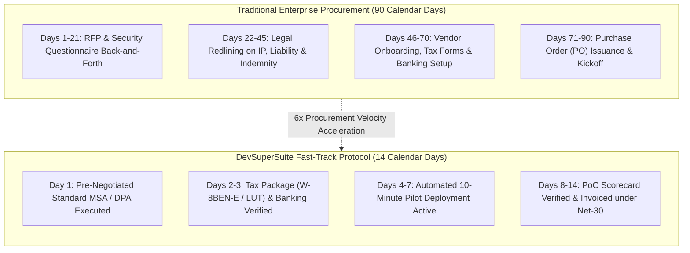
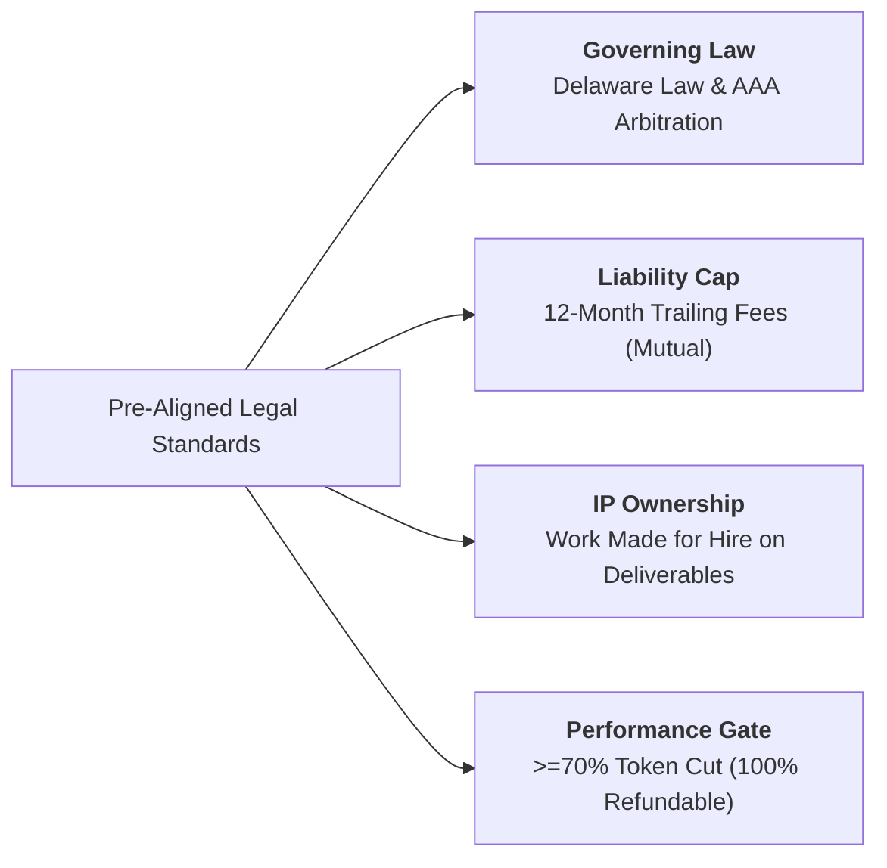
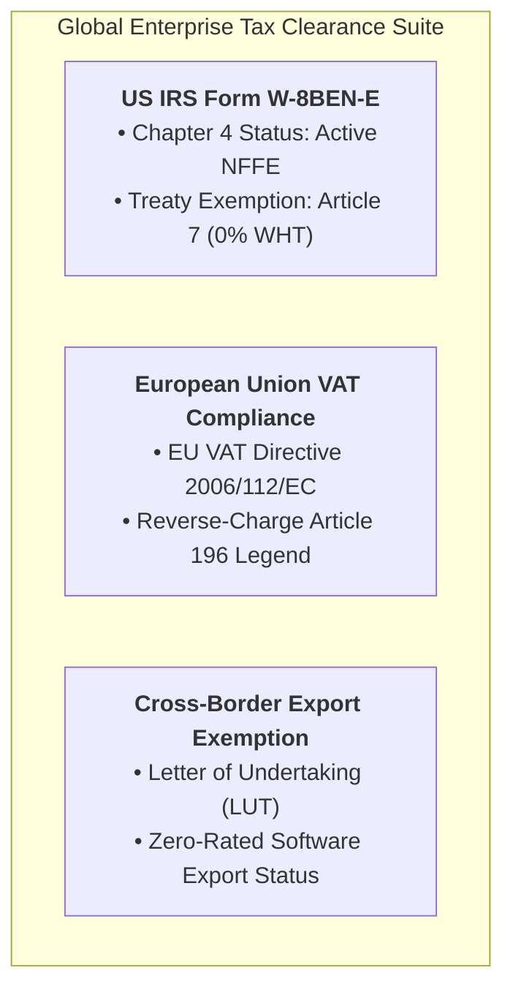
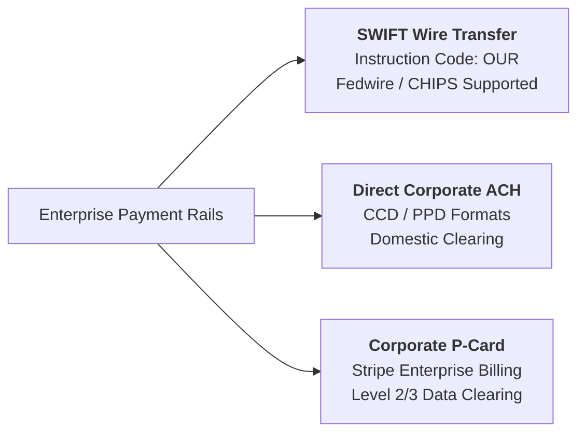
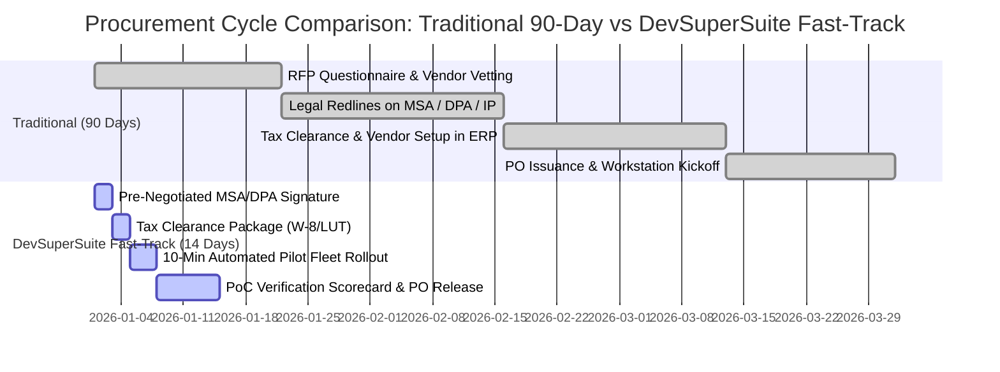

# Enterprise Expedited Procurement Cheat-Sheet & Fast-Track Vendor Onboarding Pack

**Document Series:** PROC-FAST-2026-V1  
**Governing Authority:** DevSuperSuite Solutions Architecture & Commercial Sourcing Group  
**Commercial Desk:** solutions@devsupersuite.com | https://devsupersuite.web.app  
**Target Audience:** Enterprise Procurement Officers, Sourcing Managers, Vendor Management Offices (VMO), and Legal Counsel  
**Classification:** Expedited Commercial Onboarding Asset  
**Brand Anonymity Notice:** 100% Brand Anonymized. Issued exclusively under **DevSuperSuite Solutions Architecture** (OmniKernel Labs Solutions Group). No individual employee, founder, or contractor identities disclosed.

---

```
==================================================================================================
           DEVSUPERSUITE ENTERPRISE EXPEDITED PROCUREMENT & ONBOARDING CHEAT-SHEET
==================================================================================================
```

## 1. Executive Fast-Track Procurement Guide

Enterprise procurement cycles for software architecture and developer tooling typically consume sixty to ninety (60–90) calendar days due to circular legal redlines, vendor tax vetting, and insurance delays. 

The **DevSuperSuite Fast-Track Protocol** compresses this cycle to **under fourteen (14) calendar days** by providing pre-negotiated, enterprise-standard legal terms, pre-certified tax clearance packages, and immediate insurance verification.



---

## 2. Pre-Negotiated Legal Terms Cheat-Sheet (Instant Acceptance)

To eliminate protracted legal redlining cycles, DevSuperSuite has pre-aligned its Master Services Agreement (MSA) with standard Fortune 500 enterprise legal baselines:



| Contract Clause | DevSuperSuite Standard Position | Enterprise Procurement Alignment & Justification |
|---|---|---|
| **Governing Law & Jurisdiction** | **State of Delaware**, United States. | Delaware General Corporation Law baseline; disputes settled via American Arbitration Association (AAA) in Wilmington, DE. |
| **Limitation of Liability** | **12-Month Trailing Fee Cap** (Mutual). | Industry-standard aggregate liability capped strictly at total fees paid in the preceding 12 months. Mutual exclusion of consequential damages. |
| **Intellectual Property** | **Work Made for Hire** for Custom Work. | Client owns 100% of custom scripts, manifests, and grammar files; Provider retains core background runtime engines with perpetual commercial license. |
| **Data Privacy & AI Training** | **Zero Data Retention (ZDR)** Covenant. | Contractually warrants zero code/prompt disk retention, zero model training on customer IP, and GDPR/CCPA compliance via signed DPA. |
| **Performance Guarantee** | **Objective Double-Metric Covenant**. | Minimum 70.0% token reduction and 100% secret interception guaranteed; full 100% refund if remediation fails. |
| **Defect Warranty** | **90-Day Comprehensive Warranty**. | Zero-charge bug remediation for 90 calendar days post-cutover; Severity-1 15-minute response SLA. |

---

## 3. International Tax Clearance Package & VAT Compliance

DevSuperSuite provides an end-to-end, pre-certified global tax compliance package to ensure seamless cross-border settlement without withholding friction:



### 3.1 United States IRS Form W-8BEN-E Classification
* **Entity Legal Classification:** Foreign Corporation / Commercial Technology Entity.
* **Chapter 4 FATCA Status:** **Active NFFE (Active Non-Financial Foreign Entity)** — Code: `ACTIVE NFFE`.
* **Permanent Establishment (PE):** Supplier maintains zero permanent physical establishment, branch office, or dependent agents in the United States.
* **Treaty Benefits & Withholding Rate:** Claims benefits under **Article 7 (Business Profits)** of the applicable Double Taxation Avoidance Agreement (DTAA).  
  $$\mathbf{U.S.\ Withholding\ Tax\ Rate = 0.0\%}$$
  *(No 30% Chapter 3 / Chapter 4 backup withholding required on software license fees or consulting services).*

### 3.2 European Union (EU) VAT Directive 2006/112/EC
* **Cross-Border B2B Supply of Services:** Supply of software licenses and consulting to EU corporate entities is subject to the **Reverse-Charge Mechanism** pursuant to **Article 196 of EU VAT Directive 2006/112/EC**.
* **Mandatory Invoice Legend:**  
  `"Reverse Charge: Customer is liable for VAT pursuant to Article 196 of the EU VAT Directive 2006/112/EC."`

### 3.3 Letter of Undertaking (LUT) Cross-Border Export Reference
* **Export Classification:** Zero-Rated Export of Information Technology Software & Professional Services under bond/LUT without payment of integrated goods and services tax.
* **Official Export LUT Reference:** `LUT-EX-DSS-2026-GLOBAL-01`

---

## 4. Corporate Remittance & Global Banking Specifications

DevSuperSuite supports all standard enterprise corporate payment rails with full audit traceability:



### 4.1 SWIFT / Fedwire International Wire Remittance
* **Remittance Currency:** United States Dollars (USD)
* **SWIFT Instruction Code:** **`OUR`**  
  *(Mandatory: All intermediary and correspondent banking transfer fees must be borne by the originating sender to guarantee 100% net contract settlement).*
* **Beneficiary Account Name:** `DevSuperSuite Official - Enterprise Treasury`
* **Account Type:** Commercial Corporate Treasury Account
* **SWIFT / BIC Code:** Available instantly upon vendor registration.
* **Fedwire / ABA Routing Number:** Provided on official corporate pro-forma invoices.

### 4.2 Direct Corporate ACH Deposit (Domestic US / Canada)
* **Clearing Format:** Corporate Cash Disbursement (CCD / CCD+) or Prearranged Payment (PPD).
* **Payment Terms:** Standard **Net thirty (30) calendar days** from valid invoice submission.

### 4.3 Corporate Purchasing Card (P-Card) Processing
* **Processing Gateway:** Stripe Enterprise Gateway (PCI-DSS Level 1 Service Provider).
* **Accepted P-Cards:** Corporate Visa, MasterCard, and American Express.
* **Level 2 / Level 3 Data Processing:** Automatically embeds corporate tax codes, purchase order numbers, and itemized fee schedules for corporate accounting reconciliation.

---

## 5. Fast-Track Vendor Onboarding Checklist & Profile

Procurement officers may directly extract the following pre-verified vendor profile information for corporate Enterprise Resource Planning (ERP) onboarding (SAP, Coupa, Oracle Fusion, Workday):

```
==================================================================================================
                 DEVSUPERSUITE PRE-VERIFIED CORPORATE VENDOR PROFILE
==================================================================================================
1. CORPORATE IDENTIFICATION:
   • Commercial Entity Name:       DevSuperSuite Official
   • Operating Group:              OmniKernel Labs Solutions Group
   • Global Web Portal:            https://devsupersuite.web.app
   • Sourcing & Vendor Desk:       solutions@devsupersuite.com / legal@devsupersuite.com
   • Industry Classifications:     NAICS 541511 (Custom Computer Programming Services)
                                   NAICS 541512 (Computer Systems Design Services)
                                   NAICS 518210 (Computing Infrastructure & Data Processing)
                                   SIC 7371 (Computer Programming Services)
                                   SIC 7373 (Computer Integrated Systems Design)

2. COMPLIANCE & RISK VERIFICATION:
   • Dun & Bradstreet (D-U-N-S):   D-U-N-S Active Verified (Available via portal search)
   • SAM.gov & CAGE Code:          Partner Prime Contracting Vehicles Available
   • SOC 2 Type II Status:         Examination-Ready (98% Attestation Package)
   • Data Privacy Framework:       GDPR / CCPA / CPRA Compliant (Binding DPA Included)

3. INSURANCE COVERAGE (CERTIFICATE OF INSURANCE - COI):
   DevSuperSuite maintains institutional commercial lines with Tier-1 A-rated carriers:
   • Commercial General Liability: $2,000,000 General Aggregate / $1,000,000 Occurrence
   • Technology E&O / Cyber Risk:  $5,000,000 Aggregate (Covers software defects & breach)
   • Workers' Compensation:        $1,000,000 Statutory Policy Limits
   • Additional Insured Status:    Client entity can be named as Additional Insured on COI 
                                   within twenty-four (24) business hours of SOW execution.
==================================================================================================
```

---

## 6. Procurement Timeline Comparison: 90 Days vs. 14 Days



### Key Procurement Accelerators:
1. **Zero Legal Negotiation Delay:** Standard MSA pre-incorporates Delaware law, mutual 12-month liability caps, and standard Work Made for Hire IP allocations.
2. **Instant Tax Clearance:** Form W-8BEN-E, zero-withholding documentation, and EU reverse-charge clauses are pre-certified and bundled.
3. **Automated Risk Shield:** Comprehensive $5M Cyber Liability / E&O insurance certificates issued in $<24$ hours.
4. **Self-Funding Financial Structure:** The platform amortizes in **5.28 months** on direct token savings alone, producing a guaranteed net-positive balance sheet impact from Month 1.

---
*DevSuperSuite Tech Services & Enterprise Solutions — OmniKernel Labs Solutions Group*  
*Solutions Architecture: solutions@devsupersuite.com | Official Portal: https://devsupersuite.web.app*
