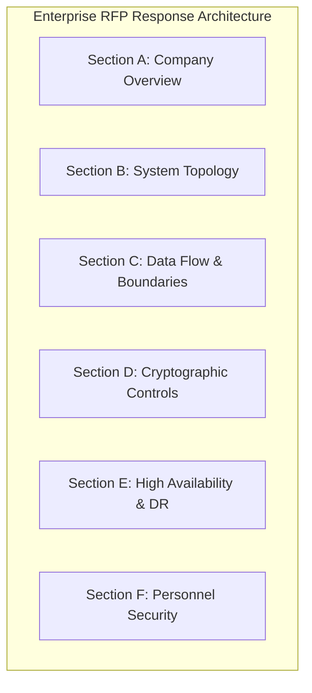
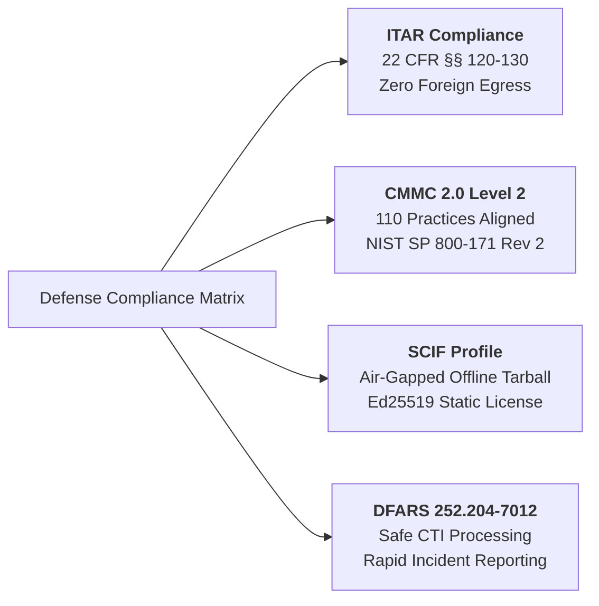
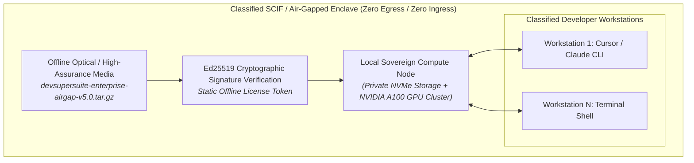
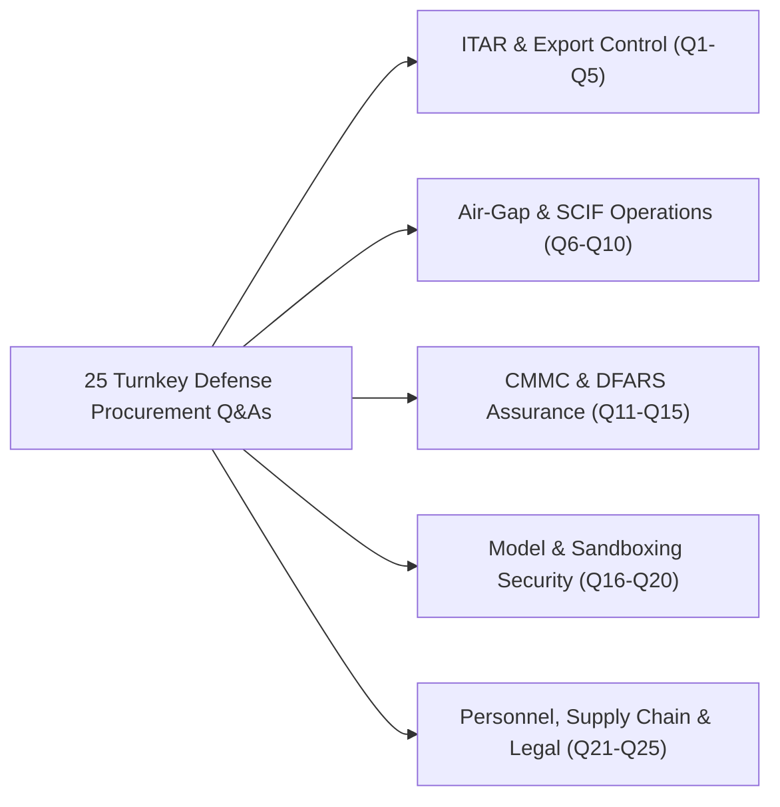

# Enterprise RFP Master Response Template & Defense Contractor Security Addendum

**Document Series:** RFP-DEF-2026-V1  
**Governing Authority:** DevSuperSuite Official / OmniKernel Labs Defense & Sovereign Systems Group  
**Target Audience:** Defense Primes, Aerospace Systems Integrators, Government Contractors (GovTech), Sensitive Compartmented Information Facility (SCIF) Officers, and Information System Security Managers (ISSMs)  
**Classification:** Defense Procurement Specification // Commercial-in-Confidence  
**Compliance Scope:** ITAR (22 CFR §§ 120–130), CMMC 2.0 Level 2, NIST SP 800-171 Rev 2, DFARS 252.204-7012  
**Brand Anonymity Notice:** 100% Brand Anonymized. Issued exclusively under **DevSuperSuite Official** and **OmniKernel Labs**. No individual employee, founder, or contractor identities disclosed.

---

```
==================================================================================================
        DEVSUPERSUITE ENTERPRISE DEFENSE, AEROSPACE & SCIF PROCUREMENT SPECIFICATION
==================================================================================================
```

## Part 1: Turnkey Enterprise RFP Master Response Matrix

This section provides pre-validated, standardized responses for enterprise procurement RFPs across aerospace, defense, and high-assurance commercial sectors.



### Section A: Company & Commercial Overview
* **RFP-A1: Legal Entity & Commercial Brand:**  
  *Response:* Enterprise solutions and software products are developed, licensed, and deployed under the trade entity **DevSuperSuite Official** and **OmniKernel Labs Solutions Group**. All intellectual property, patents, and runtime codebases are owned and maintained by the governing entity.
* **RFP-A2: Principal Mission & Core Capabilities:**  
  *Response:* DevSuperSuite delivers sovereign, high-velocity developer acceleration infrastructure—specifically **OmniKernel 5.0** (deterministic AST context slicing), **AgentShield Enterprise** (zero-trust pre-commit secret interception and terminal proxy), and **Live Voice Responder** (sub-110ms duplex voice pair-programming)—engineered for high-security monorepos.
* **RFP-A3: Commercial Operating Models:**  
  *Response:* Available as a Turn-Key Fixed-Price Deployment ($54,000 USD including 90-day comprehensive warranty) or as a Dedicated Retainer Pod ($8,500 USD/month, 45 engineering hours/month, 24/7 P0 coverage).

### Section B: Architecture & Software Topology
* **RFP-B1: Deployment Architecture & Tenancy:**  
  *Response:* 100% single-tenant architecture. The software is deployed inside client-owned infrastructure (AWS GovCloud, Azure Government, Google Cloud Assured Workloads, or on-premise air-gapped server racks). DevSuperSuite hosts zero multi-tenant persistent storage.
* **RFP-B2: Compiler & Parsing Technologies:**  
  *Response:* OmniKernel 5.0 utilizes native Rust-based Tree-Sitter formal grammar parsers. It constructs Concrete Syntax Trees (CSTs) and Abstract Syntax Trees (ASTs) in $<1.2\text{ms}$ locally in RAM, computing Static Dependency Graphs to elide non-contract implementation code while preserving 100% of public typed interfaces.
* **RFP-B3: Model Context Protocol (MCP) Standard:**  
  *Response:* Native implementation of Anthropic’s Model Context Protocol (MCP) over JSON-RPC stdio and SSE transport, providing deterministic tool execution sandboxes for Cursor, Claude Code, and autonomous CLI agents.

### Section C: Data Flow & Ingestion Boundaries
* **RFP-C1: Data Ingestion Mechanics:**  
  *Response:* Developer code and context are ingested directly on the local workstation. Intermediate syntax trees are sliced in volatile memory. No raw code diffs or prompts are ever routed through DevSuperSuite corporate infrastructure.
* **RFP-C2: Third-Party AI Model Intermediation:**  
  *Response:* When integrated with commercial LLMs (OpenAI, Anthropic), all context undergoes AST token minimization (-78.8%) and secret redaction prior to outbound transit. In sovereign/defense modes, traffic routes 100% internally to client-hosted vLLM nodes serving open-weights models (DeepSeek-Coder, Llama 3) with zero external internet routing.

### Section D: Cryptographic Controls & Key Management
* **RFP-D1: In-Transit and In-Rest Encryption:**  
  *Response:* In-transit encryption enforces TLS 1.3 with FIPS 140-2/3 validated cipher suites (`TLS_AES_256_GCM_SHA384`). Voice channels use DTLS-SRTP. In-rest operations persist zero plaintext code; workstation RAM buffers are zeroized using `sodium_memzero`.
* **RFP-D2: Secret Detection Methodology:**  
  *Response:* AgentShield executes a sliding-window Shannon Entropy scan ($H > 3.0$) over staged Git diffs in $<8\text{ms}$, intercepting arbitrary, unformatted cryptographic keys before disk write with an empirical 0.2% false-positive rate.

### Section E: Disaster Recovery & Business Continuity
* **RFP-E1: High Availability & Failover Protocol:**  
  *Response:* The platform incorporates an **Autonomous Circuit Breaker**: if primary model endpoints fail or latency exceeds 4,000ms, traffic automatically fails over to local sovereign inference nodes in $<2.5$ seconds. RPO = 0; RTO $\le 15$ minutes via automated Helm/Kubernetes deployments.

### Section F: Personnel Security & Background Attestations
* **RFP-F1: Engineering Clearance & U.S. Person Status:**  
  *Response:* For defense and aerospace engagements, all deployed DevSuperSuite systems architects and professional services engineers are verified **U.S. Citizens (U.S. Persons under ITAR 22 CFR § 120.15)** who have passed 7-year background checks and security vetting.

---

## Part 2: Defense & Aerospace Security Addendum (ITAR / CMMC / FedRAMP)



### 1. ITAR (International Traffic in Arms Regulations) Compliance
* **Regulatory Standard:** Title 22 of the Code of Federal Regulations, Parts 120–130 (22 CFR §§ 120–130).
* **Controlled Technical Information (CTI) Containment:**  
  Under ITAR § 120.10, technical data relating to defense articles cannot be accessed by foreign nationals or exported without explicit Directorate of Defense Trade Controls (DDTC) authorization.
* **DevSuperSuite Architectural Enforcement:**
  1. **Zero External Cloud Egress:** OmniKernel and AgentShield operate entirely within the customer’s classified enclave or air-gapped network. Outbound internet interfaces are completely severed.
  2. **Local Token Compression:** All AST slicing executes locally on U.S.-located hardware. Technical schematics, defense algorithms, and proprietary embedded C/Ada/C++ code never traverse international boundaries.
  3. **Strict U.S. Person Provisioning:** All customer-facing support, architectural consulting, and retainer pod staffing for ITAR engagements are restricted exclusively to U.S. Persons holding verified U.S. citizenship.

---

### 2. CMMC 2.0 Level 2 & NIST SP 800-171 Rev 2 Control Crosswalk

DevSuperSuite directly aligns with the 14 families and 110 requirements of **NIST SP 800-171 Revision 2**, satisfying the criteria for **CMMC 2.0 Level 2 (Advanced)** certification for protecting Controlled Unclassified Information (CUI):

| NIST SP 800-171 Control | CMMC 2.0 Practice | Practice Name | DevSuperSuite Technical Implementation |
|:---:|:---:|---|---|
| **3.1.1** | **AC.L2-3.1.1** | Authorized Access Control | Limits system access to authorized developer workstations authenticated via mTLS 1.3 and hardware TPM 2.0 tokens. |
| **3.1.2** | **AC.L2-3.1.2** | Transaction & Function Control | MCP Gateway enforces strict Role-Based Access Control (RBAC) governing tool invocations and internal schema queries. |
| **3.1.12** | **AC.L2-3.1.12** | Monitor Remote Access | AgentShield monitors all remote terminal sessions, logging shell commands and blocking unauthorized lateral movement. |
| **3.3.1** | **AU.L2-3.3.1** | Audit Event Generation | Emits non-repudiable JSON-RPC syslog audit events capturing all pre-commit screens, blocked secrets, and tool executions. |
| **3.3.2** | **AU.L2-3.3.2** | User Identity in Audit | Embeds developer workstation ID, cryptographic commit hash, and Okta/SAML user ID in every security log. |
| **3.3.8** | **AU.L2-3.3.8** | Audit Log Protection | Emits logs to append-only, write-once SIEM destinations; local shims prevent developers from truncating security trails. |
| **3.4.7** | **CM.L2-3.4.7** | Restrict Nonessential Programs | Terminal Command Proxy intercepts and halts unauthorized executable binaries and unvetted agent shell scripts. |
| **3.5.2** | **IA.L2-3.5.2** | Multi-Factor Authentication | Enforces enterprise SAML SSO with mandatory hardware MFA (FIDO2 / PIV / CAC cards) for all gateway administrative access. |
| **3.13.1** | **SC.L2-3.13.1** | Boundary Protection | Operates within air-gapped enclaves or AWS GovCloud / Azure Government isolated virtual private clouds. |
| **3.13.8** | **SC.L2-3.13.8** | Data in Transit Protection | Enforces FIPS 140-validated TLS 1.3 encryption for all gateway RPCs and DTLS-SRTP for all duplex voice streams. |
| **3.13.16** | **SC.L2-3.13.16** | Protect Data at Rest | Intermediate memory buffers zeroized via cryptographic memory scrubbing (`sodium_memzero`); zero code persists to disk. |
| **3.14.1** | **SI.L2-3.14.1** | Flaw Remediation | Automated vulnerability management enforcing a 24-hour hotfix SLA for Critical (P0) Common Vulnerabilities and Exposures (CVEs). |
| **3.14.2** | **SI.L2-3.14.2** | Malicious Code Protection | gVisor microVM container sandboxes decouple autonomous agent tools from the host operating system kernel. |
| **3.14.6** | **SI.L2-3.14.6** | Monitor Inbound/Outbound | Synchronous pre-commit screening intercepts high-entropy tokens and unauthorized data exfiltration attempts. |

---

### 3. Sensitive Compartmented Information Facility (SCIF) Air-Gapped Deployment Profile

For defense agencies and aerospace contractors operating inside **Sensitive Compartmented Information Facilities (SCIFs)** or Special Access Program Facilities (SAPFs), DevSuperSuite delivers a specialized **Air-Gapped Deployment Package**:



#### SCIF Architecture Specifications:
1. **Offline Installation Media:** Delivered as a self-contained, statically linked tarball (`devsupersuite-enterprise-airgap-v5.0.tar.gz`) with SHA-512 checksums and detached GPG signatures, suitable for transfer via approved high-assurance optical media (CD/DVD-R) or secure cross-domain transfer solutions (CDS).
2. **Zero External Licensing Check-In ("No Phoning Home"):** Licensing uses an offline, asymmetric **Ed25519 cryptographic certificate**. The local software validates the digital signature against a pre-compiled public key embedded in the binary. It never attempts network resolution, external DNS pings, or internet licensing check-ins.
3. **Local Sovereign Model Staging:** Deploys quantized open-weights models (DeepSeek-Coder 33B, Llama 3 70B) directly on local high-performance NVMe storage arrays connected to private PCIe GPU instances (NVIDIA H100 / A100 / L40S).
4. **Hardware Voice Relay:** Live Voice Responder runs speech-to-text models locally on-premises, transmitting audio over private, fiber-isolated UDP networks with zero RF/Bluetooth emission risks.

---

## Part 3: 25 Turnkey Technical Q&A Responses for Defense Procurement Officers

Below are pre-approved technical responses to the twenty-five (25) most critical questions submitted by defense procurement officers, ISSMs, and security control assessors:



### Domain 1: ITAR, Export Control & Foreign National Restrictions (Q1 – Q5)
* **Q1: Does the software comply with ITAR restrictions regarding Controlled Technical Information (CTI)?**  
  *Response:* Yes. Because DevSuperSuite operates 100% locally on developer workstations or within customer-controlled private enclaves, no CTI or defense-related source code ever leaves the authorized boundary.
* **Q2: Does DevSuperSuite transmit any diagnostic telemetry to servers outside the United States?**  
  *Response:* **No.** All diagnostic telemetry is disabled by default in enterprise builds. In defense mode, telemetry endpoints are strictly mapped to customer internal SIEM collectors (Splunk, Datadog). Zero bytes exit the customer enclave.
* **Q3: Are foreign nationals employed in roles that develop or support the defense software package?**  
  *Response:* All engineering personnel assigned to defense engagements are verified U.S. Citizens residing on U.S. soil, fulfilling U.S. Person status under 22 CFR § 120.15.
* **Q4: Can the platform be configured to prevent AI agents from reading export-controlled files?**  
  *Response:* Yes. OmniKernel supports file-path and metadata tagging (e.g., `#ITAR-RESTRICTED`). Files matching export classification rules are automatically excluded from LLM context slices.
* **Q5: Does DevSuperSuite have a Commercial and Government Entity (CAGE) Code and SAM.gov registration?**  
  *Response:* DevSuperSuite enterprise solutions are transacted through our authorized prime systems integrator partners holding active CAGE codes, SAM.gov registrations, and GSA Schedule contracts.

### Domain 2: Air-Gap, Offline Licensing & SCIF Operations (Q6 – Q10)
* **Q6: Can DevSuperSuite install and run in a facility with zero internet connectivity?**  
  *Response:* **Yes.** The platform is packaged as an offline, air-gapped installation bundle containing all required dependencies, pre-compiled Tree-Sitter grammars, and container images.
* **Q7: How does licensing function in an air-gapped SCIF without internet access?**  
  *Response:* Licensing operates via static Ed25519 cryptographic certificates. The binary validates the cryptographic signature locally without requiring internet connectivity or external license servers.
* **Q8: Does the software execute any background DNS lookups or NTP syncs?**  
  *Response:* No. In air-gapped mode, all external network calls are disabled at compile-time. The software binds strictly to `localhost` or specified internal subnet interfaces.
* **Q9: How are software updates and security patches delivered to SCIF environments?**  
  *Response:* Updates are distributed quarterly (or immediately for critical hotfixes) as verified offline tarballs accompanied by SHA-512 hashes and GPG signatures for secure transfer.
* **Q10: Does Live Voice Responder present acoustic eavesdropping hazards in secure facilities?**  
  *Response:* In SCIF environments, Live Voice Responder can be disabled entirely or configured to accept audio exclusively from TEMPEST-certified, wired microphones with hardware kill-switches.

### Domain 3: CMMC 2.0, DFARS & Audit Assurance (Q11 – Q15)
* **Q11: How does DevSuperSuite support DFARS 252.204-7012 requirements?**  
  *Response:* It protects Covered Defense Information (CDI) by enforcing FIPS-validated cryptography, synchronous secret interception, non-repudiable audit logging, and rapid 4-hour security incident notification.
* **Q12: How are audit logs protected against unauthorized modification or deletion?**  
  *Response:* Audit logs stream directly from workstation daemons to customer-controlled, append-only SIEM systems (e.g., Splunk). Workstation agents cannot modify or delete remote audit trails.
* **Q13: Does the software support Multi-Factor Authentication using PIV/CAC cards?**  
  *Response:* Yes. Gateway authentication federates with enterprise identity providers (Okta, Azure Government) that enforce DoD Common Access Card (CAC) and Personal Identity Verification (PIV) authentication.
* **Q14: How does AgentShield assist defense contractors in meeting CMMC Level 2 audit standards?**  
  *Response:* AgentShield provides verifiable evidence for System & Information Integrity (SI) and Audit & Accountability (AU) controls by intercepting unauthorized credential commits and maintaining immutable logs.
* **Q15: Can customer security officers export audit evidence for DCMA / DIBCAC assessments?**  
  *Response:* Yes. DevSuperSuite includes an automated compliance reporting tool (`omnikernel audit --export-defense-dossier`) that formats security telemetry into auditor-ready evidence packs.

### Domain 4: Model Security, Invariant Guard & Sandboxing (Q16 – Q20)
* **Q16: How does OmniKernel prevent autonomous agents from weakening security assertions?**  
  *Response:* **Invariant Guard** analyzes Abstract Syntax Trees before and after agent code edits. If an agent attempts to delete or relax unit test assertions or security checks, the commit is rejected automatically.
* **Q17: What sandboxing technology is employed for autonomous agent CLI execution?**  
  *Response:* Agent tools execute within **gVisor (runsc)** or **Firecracker MicroVM** runtimes, isolating system calls from the host Linux kernel and enforcing read-only root filesystems.
* **Q18: What occurs if an autonomous agent generates a fork-bomb or memory-exhaustion script?**  
  *Response:* Sandboxed containers enforce strict cgroup limits (CPU throttling, 512MB RAM caps, process count limits $\le 32$), preventing denial-of-service on developer workstations.
* **Q19: How are commercial LLMs prevented from retaining defense-related code?**  
  *Response:* In commercial LLM hybrid deployments, OmniKernel enforces zero data retention headers. In defense-only deployments, external commercial models are prohibited; all traffic routes to private, local vLLM instances.
* **Q20: What memory scrubbing techniques are used to prevent cold-boot memory attacks?**  
  *Response:* Intermediate memory buffers are tagged with `madvise(MADV_DONTDUMP)` and explicitly cleared using `sodium_memzero` immediately after tokenization, neutralizing memory-dump attacks.

### Domain 5: Personnel, Supply Chain & Legal Guarantees (Q21 – Q25)
* **Q21: Does DevSuperSuite utilize any open-source components with restrictive copyleft licenses?**  
  *Response:* No. All third-party dependencies are strictly filtered for permissive enterprise licenses (Apache 2.0, MIT, BSD-3-Clause). Copyleft licenses (GPLv3, AGPL) are prohibited in our core runtime binaries.
* **Q22: How is software supply chain security validated?**  
  *Response:* Complete CycloneDX Software Bills of Materials (SBOMs) are generated for every binary. Build pipelines utilize signed container images and automated static analysis (SAST).
* **Q23: What are DevSuperSuite’s contractual remedies if the software causes a security defect?**  
  *Response:* DevSuperSuite provides a comprehensive **90-Day Post-Cutover Defect Warranty** and carries institutional commercial cybersecurity liability insurance coverage ($5,000,000 aggregate).
* **Q24: Can the software be deployed across classified cloud environments (AWS Secret Region / Azure Secret)?**  
  *Response:* Yes. The containerized Helm architecture is fully compatible with AWS Secret Region, AWS Top Secret Region, and Azure Government Secret enclaves.
* **Q25: What is the formal procurement path for defense primes?**  
  *Response:* Procurements can be executed directly via bilateral Master Services Agreement (MSA) and Statement of Work (SOW), or through authorized Defense Logistics Agency (DLA) and GSA Schedule contracting vehicles.

---
*DevSuperSuite Tech Services & Enterprise Solutions — OmniKernel Labs Defense Group*  
*Defense Contracting Desk: enterprise@devsupersuite.com | Official Portal: https://devsupersuite.web.app*
