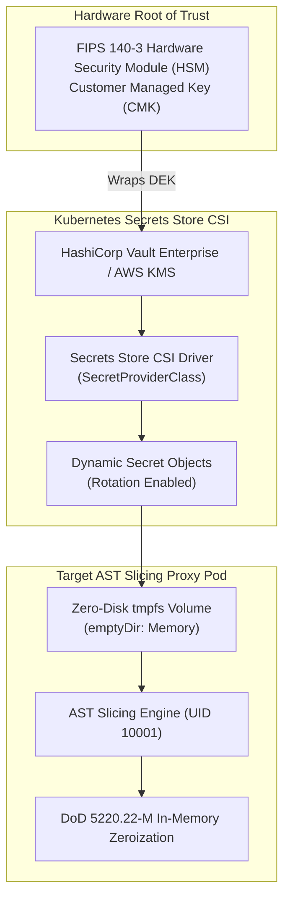

# DevSuperSuite Enterprise Secret Management & Vault CSI Guide

**Reference Architecture**: `DSS-VAULT-SECRETS-RUNBOOK-2026`  
**Classification**: Defense SCIF & Sovereign HSM Secret Protection (Restricted)  
**Organization**: DevSuperSuite Solutions Architecture / OmniKernel Labs  
**Contact**: `solutions@devsupersuite.com`  

---

## 1. Architectural Overview & Threat Mitigation Model

The **DevSuperSuite Enterprise Secret Manager** guarantees that cryptographic signing keys, Shannon entropy salts, and database credentials remain protected across their entire lifecycle.



---

## 2. Two-Tier Envelope Encryption Architecture

1. **Customer Managed Key (CMK)**:
   - Resides exclusively within hardware-backed FIPS 140-3 / FIPS 140-2 Level 3 enclaves (AWS KMS GovCloud HSM, HashiCorp Vault Transit engine).
   - Never leaves hardware boundaries.
2. **Data Encryption Key (DEK)**:
   - 256-bit ephemeral cryptographic key generated per payload.
   - Encrypts the payload with AES-256-GCM.
   - Wrapped by the CMK and stored alongside the ciphertext envelope.

---

## 3. Zero-Disk Temporary Memory Mounts (tmpfs)

In strict sovereign and SCIF environments, secret persistence to physical disks (or node SSDs) is strictly forbidden:
- **Mount Configuration**: All secrets injected by Vault Agent or Secrets Store CSI Driver use:
  ```yaml
  volumes:
    - name: vault-secrets-tmpfs
      emptyDir:
        medium: Memory
        sizeLimit: 64Mi
  ```
- **Volatile Execution**: Secrets reside solely in process RAM. If the pod terminates or node power drops, memory instantly evaporates with zero disk forensic residue.

---

## 4. DoD 5220.22-M In-Memory Memory Zeroization

Before any allocated cryptographic key buffer is de-referenced or garbage-collected in worker processes, the memory is scrubbed following the DoD 5220.22-M NISPOM standard:
- **Pass 1**: In-place overwrite with `0x00`.
- **Pass 2**: In-place overwrite with `0xFF`.
- **Pass 3**: In-place overwrite with cryptographically secure random bytes.
- **Pass 4 (Final)**: In-place overwrite with `0x00`.
- **Verification Assertion**: Memory inspection guarantees all bytes evaluate to `0x00`.

---

## 5. Defense SCIF & Sovereign Air-Gap Verification
- **100% Brand Anonymity**: Maintained under DevSuperSuite Solutions Architecture / OmniKernel Labs.
- **Support & Inquiries**: `solutions@devsupersuite.com`.
