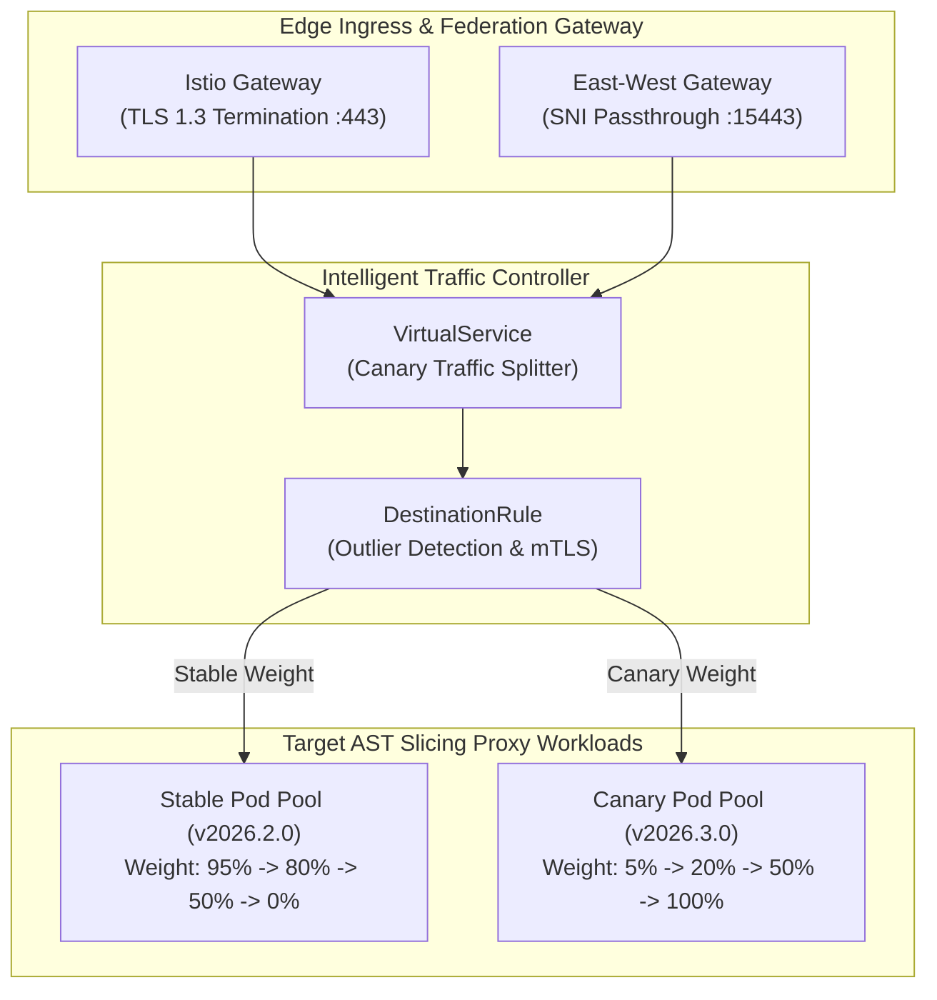

# DevSuperSuite Enterprise Service Mesh & Cross-Cluster Traffic Guide

**Reference Architecture**: `DSS-SERVICE-MESH-RUNBOOK-2026`  
**Classification**: Zero-Trust Multi-Cluster Federation & Traffic Shaping (Restricted)  
**Organization**: DevSuperSuite Solutions Architecture / OmniKernel Labs  
**Contact**: `solutions@devsupersuite.com`  

---

## 1. Architectural Overview & Zero-Trust Mesh Topology

The **DevSuperSuite Service Mesh Controller** orchestrates zero-trust service-to-service communication, progressive canary traffic splitting, and sub-500ms outlier pod ejection across hybrid sovereign clouds (AWS GovCloud, Google Cloud Private GKE, and on-prem OpenShift SCIFs).



---

## 2. Progressive Canary Splitting & Automated Rollback

Traffic progression strictly follows mathematical SLA validation before advancing:

$$\text{Progression Stage}: 95/5 \longrightarrow 80/20 \longrightarrow 50/50 \longrightarrow 0/100$$

### Automated Rollback Invariants
1. **5xx Error Rate Ceiling**: If observed 5xx errors exceed $0.01\%$, traffic immediately reverts to $100\%$ Stable in $<1$ second.
2. **p99 Latency Ceiling**: If observed p99 latency exceeds $250\text{ms}$, rollout aborts instantly.
3. **Internal Header Override**: Engineers can bypass canary weights using `x-canary-override: canary` for end-to-end synthetic verification.

---

## 3. Circuit Breaking & Pod Outlier Detection

The Istio `DestinationRule` enforces immediate ejection of unhealthy pods:

```yaml
outlierDetection:
  consecutive5xxErrors: 3
  interval: 1s
  baseEjectionTime: 30s
  maxEjectionPercent: 50
  minHealthPercent: 50
```

- **Reaction Time**: Envoys detect 3 consecutive 5xx responses within a 1-second interval and eject the unhealthy pod in $<500\text{ms}$.
- **Cascading Collapse Guard**: `maxEjectionPercent: 50` guarantees that at most $50\%$ of the pod pool can be ejected simultaneously, preserving service availability during partial cluster impairments.

---

## 4. Multi-Cluster Federation Across Sovereign Clouds

Cross-region and hybrid cloud clusters communicate via mTLS SNI passthrough on port `15443`:

| Cluster Name | Cloud Infrastructure | Mesh Network | Trust Domain |
| :--- | :--- | :--- | :--- |
| `dss-aws-gov-east-01` | AWS EKS GovCloud | `network-aws-gov` | `aws.devsupersuite.io` |
| `dss-gcp-sec-central-01` | GCP Private GKE | `network-gcp-private` | `gcp.devsupersuite.io` |
| `dss-onprem-scif-dc01` | Red Hat OpenShift SCIF | `network-scif-isolated` | `scif.devsupersuite.io` |

All east-west traffic is strictly encrypted using mutual TLS with cryptographic SPIFFE identities (`spiffe://<trust-domain>/ns/devsupersuite-system/sa/devsupersuite-ast-proxy`).

---

## 5. Defense SCIF & Sovereign Air-Gap Verification
- **100% Brand Anonymity**: Maintained under DevSuperSuite Solutions Architecture / OmniKernel Labs.
- **Support & Inquiries**: `solutions@devsupersuite.com`.
