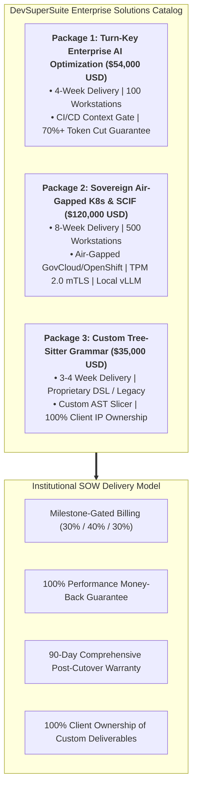
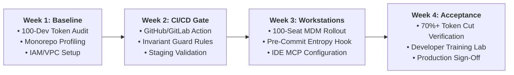
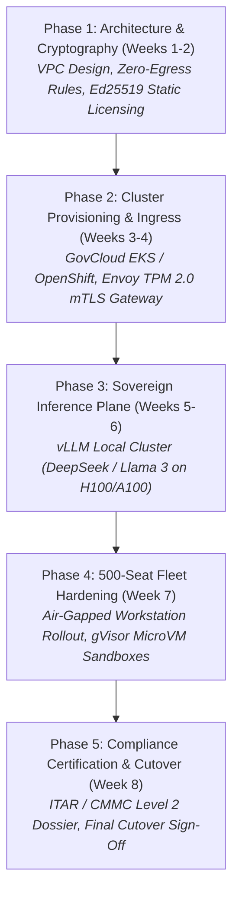
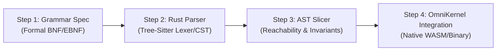

# Enterprise Solutions Catalog & Turnkey Statement of Work (SOW) Delivery Pack

**Document Series:** CAT-SOW-2026-V1  
**Governing Authority:** DevSuperSuite Solutions Architecture Group  
**Commercial & Contract Desk:** solutions@devsupersuite.com | https://devsupersuite.web.app  
**Target Audience:** Enterprise Procurement Committees, Managing Directors of Technology, Chief Information Officers (CIOs), and VPs of Engineering  
**Classification:** Enterprise Commercial Offerings & Legal SOW Delivery Pack  
**Brand Anonymity Notice:** 100% Brand Anonymized. Issued exclusively under **DevSuperSuite Solutions Architecture**. No individual employee, founder, or contractor identities disclosed.

---

```
==================================================================================================
        DEVSUPERSUITE ENTERPRISE SOLUTIONS CATALOG & FIXED-FEE SOW DELIVERY PACK
==================================================================================================
```

## 1. Commercial Executive Summary & Engagement Charter

DevSuperSuite Solutions Architecture provides fixed-fee, outcome-guaranteed systems engineering and software architecture engagements for enterprises deploying autonomous AI coding agents, context optimization pipelines, and developer cybersecurity infrastructure.

Unlike conventional consulting firms that bill open-ended hourly fees with ambiguous deliverables, DevSuperSuite operates on a **Fixed-Price, Milestone-Gated, Performance-Guaranteed Delivery Model**. Every engagement is backed by an objective double-metric guarantee: **$\ge 70\%$ verified LLM token reduction** and **100% pre-commit secret interception**, supported by a full refund covenant if acceptance criteria are not met.



---

## 2. Enterprise Solutions Service Catalog

### Service Package 1: Turn-Key Enterprise AI Optimization & CI/CD Gate
* **Fixed Commercial Investment:** **$54,000.00 USD** (All-inclusive, fixed-price engagement)
* **Delivery Timeline:** **Four (4) Weeks** from Kickoff to Final Production Acceptance
* **Target Audience:** Engineering organizations (up to 100 software engineers) operating high-volume monorepos in TypeScript, Python, Go, Java, or C#.



#### Detailed Scope of Work:
1. **Monorepo AST Profiling & Baseline Audit (Week 1):** Comprehensive static analysis of client codebases, establishing baseline token consumption across active pull requests.
2. **CI/CD Context Gate Injection (Week 2):** Production deployment of the `devsupersuite/omnikernel-action` into GitHub Actions or GitLab CI pipelines, enforcing AST reachability slicing on all automated code reviews.
3. **AgentShield & Invariant Guard Fleet Rollout (Week 3):** Automated MDM deployment (Jamf/Intune/Ansible) configuring local Git pre-commit hooks (Shannon Entropy $H > 3.0$ scanner) and terminal command sandboxes across 100 developer workstations.
4. **IDE Model Context Protocol (MCP) Binding:** Automated stdio configuration for Cursor (`.cursor/mcp.json`) and Claude Code (`.mcp.json`), establishing sub-millisecond local AST slicing.
5. **Developer Workshop & Executive Handover (Week 4):** 2x hands-on training workshops for engineering leads; delivery of the 30-Day ROI Quantification Report; activation of the 90-Day Post-Cutover Warranty.

#### Contractual Acceptance Deliverables:
* Measured token reduction of $\ge 70.0\%$ across a benchmark suite of 50 active monorepo pull requests.
* 100% interception of simulated credentials (AWS, Stripe, high-entropy JWTs) with $<0.5\%$ false-positive rate.
* Formal UAT acceptance sign-off by Client Technical Lead.

---

### Service Package 2: Sovereign Air-Gapped Kubernetes & SCIF Deployment
* **Fixed Commercial Investment:** **$120,000.00 USD** (All-inclusive, fixed-price engagement)
* **Delivery Timeline:** **Eight (8) Weeks** from Architectural Kickoff to Classified Production Cutover
* **Target Audience:** Defense Primes, Aerospace Systems Integrators, Classified SCIF Facilities, and Tier-1 Regulated Financial Institutions (supporting up to 500 engineering seats).



#### Detailed Scope of Work:
1. **Zero-Egress Private Cloud / Bare-Metal Enclave Setup (Weeks 1–2):** Architectural deployment inside AWS GovCloud (EKS), Azure Government (AKS), Red Hat OpenShift, or Bare-Metal SCIF server racks with zero outbound `0.0.0.0/0` routing.
2. **Envoy mTLS Ingress Gateway with Hardware Attestation (Weeks 3–4):** High-availability Envoy controller enforcing TLS 1.3 with mandatory client certificate authentication bound to developer workstation hardware TPM 2.0 chips or FIDO2/YubiKeys.
3. **Sovereign Local Inference Plane (Weeks 5–6):** Production installation of a private vLLM / Ollama inference cluster on dedicated NVIDIA H100 / A100 GPU nodes serving quantized open-weights models (DeepSeek-Coder 33B, Llama 3 70B), with an autonomous circuit breaker guaranteeing $<2.5\text{s}$ failover.
4. **Air-Gapped Offline Media Packaging (Week 7):** Static Ed25519 cryptographic licensing verification (zero external license pings/zero phoning home); deployment of gVisor (`runsc`) microVM tool execution sandboxes.
5. **Fleet Cutover & CMMC 2.0 Compliance Dossier (Week 8):** Onboarding across up to 500 developer seats; delivery of auditor-ready compliance evidence covering NIST SP 800-171 Rev 2 controls; formal SCIF production cutover.

#### Contractual Acceptance Deliverables:
* 100% verified air-gapped operation with zero dropped packets during network severance testing.
* Hardware TPM-backed mTLS authentication verified across sample client workstations.
* End-to-end local inference latency $\le 1.8\text{s}$ for code generation requests.
* Complete CMMC 2.0 Level 2 / ITAR Compliance Attestation Dossier delivered to Client ISSM.

---

### Service Package 3: Custom Tree-Sitter Grammar Development (Proprietary DSLs & Legacy Systems)
* **Fixed Commercial Investment:** **$35,000.00 USD** (All-inclusive, fixed-price engagement)
* **Delivery Timeline:** **Three to Four (3–4) Weeks**
* **Target Audience:** Enterprises operating proprietary internal Domain-Specific Languages (DSLs), proprietary financial modeling scripts, or legacy mainframe languages (COBOL, Fortran, RPG, MUMPS) that lack modern compiler-grade AST parsers for AI tooling.



#### Detailed Scope of Work:
1. **Formal Language Specification & Grammar Modeling (Week 1):** Deconstruct proprietary language specifications into Backus-Naur Form (BNF/EBNF) context-free grammars:
   $$G = (V, \Sigma, R, S)$$
2. **Tree-Sitter Grammar Construction (Week 2):** Author memory-safe, high-speed lexer, scanner, and parser rules in C and Rust, capable of constructing Concrete Syntax Trees (CSTs) in $<1.5\text{ms}$.
3. **AST Slicing Logic & Invariant Definitions (Week 3):** Implement domain-specific reachability slicing rules that preserve proprietary interface contracts, records, and copybooks while eliding internal procedural logic. Define Invariant Guard validation rules for safety-critical logic.
4. **Compiler Test Suite & OmniKernel Engine Integration (Week 4):** Author an automated regression suite consisting of at least one hundred (100) complex source files; compile native static binaries and WebAssembly (WASM) modules; bundle directly into Client’s OmniKernel 5.0 enterprise runtime.

#### Contractual Acceptance Deliverables:
* 100% parser pass rate across a benchmark corpus of 100+ proprietary client source files.
* Measured token reduction of $\ge 70.0\%$ when processing legacy code through OmniKernel.
* **100% Client Ownership:** Full source code repository, grammar definitions, build manifests, and comprehensive documentation transferred irrevocably to Client.

---

## 3. Institutional Statement of Work (SOW) Standard Clauses

The following standardized contractual clauses govern all fixed-fee enterprise engagements executed under the DevSuperSuite Master Services Agreement (MSA):

### 3.1 Milestone Gating & Payment Schedule
Payments are strictly released based on objective technical milestone acceptance:

```
+--------------------------------------------------------------------------------------------------+
| STANDARD ENTERPRISE MILESTONE BILLING SCHEDULE                                                   |
| • Milestone 1 (Project Kickoff & Baseline Audit Sign-off):            30% of Total Contract Value|
| • Milestone 2 (Staging Validation & Telemetry Verification):          40% of Total Contract Value|
| • Milestone 3 (Final Production Cutover & UAT Acceptance):            30% of Total Contract Value|
+--------------------------------------------------------------------------------------------------+
```
* Invoices are rendered upon mutual signature of each Milestone Acceptance Certificate and payable within Net 30 days.

---

### 3.2 Performance Guarantee & 100% Refund Covenant
Provider backs its architecture with an explicit, legally binding performance covenant:

```markdown
"Provider expressly covenants that the deployed Custom Deliverables and Software shall achieve:
 (a) A verified aggregate LLM context token reduction of not less than seventy percent (70.0%) 
     across representative codebase Pull Requests; and
 (b) One hundred percent (100.0%) pre-commit interception of high-entropy credentials (H > 3.0).

In the event that the system fails to achieve either performance threshold during the User 
Acceptance Testing (UAT) phase, Provider shall be granted a ten (10) business day engineering 
remediation window to calibrate parsing grammars and entropy thresholds at zero additional cost 
to Client. If, upon completion of the remediation period, the system fails to satisfy the 
benchmarks, Client shall be entitled to terminate this SOW immediately for cause and receive a 
PROMPT, ONE HUNDRED PERCENT (100.0%) REFUND OF ALL FEES PAID UNDER THIS SOW, with zero legal 
deductions or cancellation fees."
```

---

### 3.3 Intellectual Property Allocation (Work for Hire)
* **Custom Deliverables & Grammar Definitions:** All bespoke configuration files, deployment manifests (Helm/Terraform), CI/CD pipeline definitions, and custom Tree-Sitter grammar source code authored specifically for Client under an SOW shall be deemed "Work Made for Hire" under 17 U.S.C. § 101, and are 100% exclusively owned by Client upon payment.
* **Provider Background IP:** Provider retains exclusive ownership of its core underlying runtime engines (**OmniKernel 5.0**, **AgentShield Enterprise**, and **Live Voice Responder**). Provider grants Client a perpetual, irrevocable, worldwide, non-exclusive, fully paid-up commercial license to execute and internally utilize Provider Background IP as embedded within the deliverables.

---

### 3.4 Service Level Agreements (SLA) & 90-Day Comprehensive Defect Warranty
* **90-Day Post-Cutover Warranty:** Provider warrants all custom code, configurations, and scripts against defects for ninety (90) calendar days post-production sign-off at zero additional charge.
* **Operational SLA Matrix (During Implementation & Active Retainer):**
  * **Severity-1 (Production Blocker / CI Halting Outage):** Initial response within $\le 15$ minutes (24/7/365); resolution/mitigation target $\le 4$ hours. Escalates immediately to Principal Solutions Architect.
  * **Severity-2 (Major Issue / Staging AST Degraded):** Initial response $\le 1$ hour; resolution target $\le 8$ hours.
  * **Severity-3 / 4 (Normal Inquiry / Feature Guidance):** Initial response $\le 4$ to 8 hours.
* **Uptime Guarantee:** DevSuperSuite-managed Gateway clusters maintain a contractual monthly uptime of **99.9%**.

---

## 4. Master SOW Execution Agreement

```
==================================================================================================
                 STATEMENT OF WORK (SOW) COUNTERSIGNATURE BLOCK
==================================================================================================
ENGAGEMENT TITLE:         [Selected Service Package: Package 1 / Package 2 / Package 3]
TOTAL FIXED INVESTMENT:   $[54,000 / 120,000 / 35,000] USD
EFFECTIVE DATE:           [Kickoff Date]

IN WITNESS WHEREOF, the Parties hereto have caused this Statement of Work to be executed by their 
duly authorized commercial representatives.

FOR DEVSUPERSUITE SOLUTIONS ARCHITECTURE:   FOR CLIENT:
(OmniKernel Labs Solutions Group)           [CLIENT LEGAL ENTITY NAME]

By: ____________________________________    By: ____________________________________
Name: Principal Solutions Architect         Name: __________________________________
Title: Authorized Commercial Representative Title: CIO / VP of Engineering / CTO
Date: __________________________________    Date: __________________________________
Email: solutions@devsupersuite.com          Email: _________________________________
==================================================================================================
```

---
*DevSuperSuite Tech Services & Enterprise Solutions — OmniKernel Labs Solutions Group*  
*Solutions Architecture: solutions@devsupersuite.com | Official Portal: https://devsupersuite.web.app*
