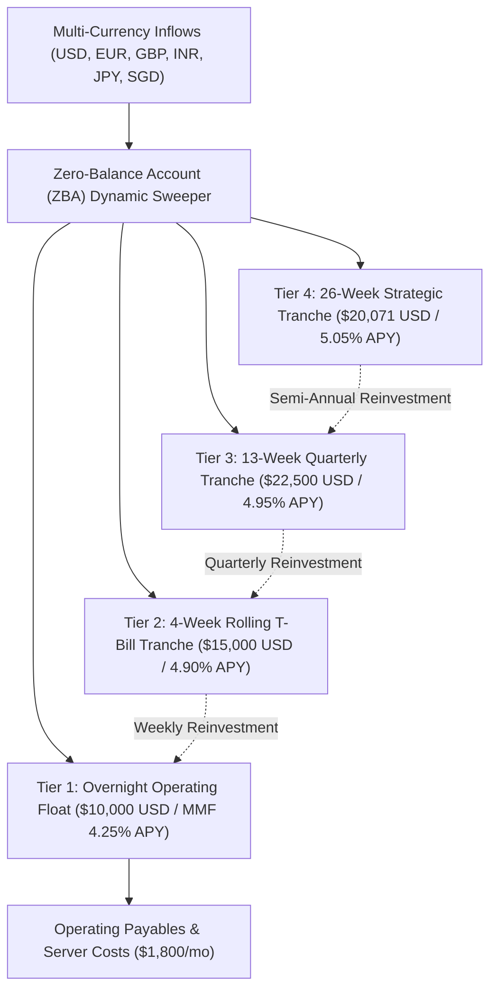

# SOVEREIGN CORPORATE INVESTMENT POLICY STATEMENT (IPS)
**Entity**: DevSuperSuite Tech Services  
**Treasury Office**: Office of the CFO & Corporate Treasury Desk  
**Supervisory Oversight**: Global Risk Committee  
**Official Treasury Contact**: `cfo@devsupersuite.com`  
**Effective Date**: Fiscal Year 2026 / 2027  
**Policy Status**: BOARD APPROVED & STATUTORILY ACTIVE  

---

## 1. Executive Mandate & Treasury Objectives
DevSuperSuite Tech Services maintains an institutional, sovereign-grade corporate treasury framework. The overarching mandate of the treasury desk is governed by three strict, non-negotiable statutory priorities in hierarchical order:

1. **CAPITAL PRESERVATION (Absolute Priority)**: Zero tolerance for credit risk, principal impairment, or speculative capital loss. 100% of non-operating surplus reserves must be backed by the full faith and credit of the United States Government.
2. **LIQUIDITY ADEQUACY**: Continuous maintenance of at least **36.0 months of cash operating runway** under zero-revenue conditions and a persistent sovereign liquidity buffer exceeding **$65,000.00 USD**.
3. **YIELD OPTIMIZATION**: Passive accrual of competitive sovereign risk-free interest yields (> 4.85% APY) via rolling short-term U.S. Treasury Bill ladders, immunizing capital against inflation without taking duration risk.

---

## 2. Authorized vs. Prohibited Asset Classes

| Asset Classification | Authorized Status | Regulatory & Counterparty Standard | Maximum Portfolio Weight |
| :--- | :--- | :--- | :--- |
| **U.S. Sovereign Treasury Bills** | **AUTHORIZED (TIER 1)** | Direct obligations of the U.S. Treasury (4W, 13W, 26W) | Up to 100% |
| **Govt Money Market Reserves** | **AUTHORIZED (TIER 1)** | Rule 2a-7 compliant, 99.5%+ sovereign paper backed | Up to 40% |
| **Commercial Bank Deposits** | **AUTHORIZED (TIER 2)** | Top-tier institutions, FDIC / RBI insured | Up to $250k / institution |
| **Corporate Bonds & Commercial Paper** | **PROHIBITED** | Subordinated or unsecured corporate credit risk | **0.00% (STRICT BAN)** |
| **Public Equities & Equity Derivatives**| **PROHIBITED** | Equity volatility, delta risk, beta exposure | **0.00% (STRICT BAN)** |
| **Cryptocurrencies & Digital Tokens** | **PROHIBITED** | Speculative unbacked tokens, non-custodial risk | **0.00% (STRICT BAN)** |
| **Real Estate & Illiquid Funds** | **PROHIBITED** | Private equity, lock-up vehicles, illiquid debt | **0.00% (STRICT BAN)** |

---

## 3. Counterparty Credit Rating Thresholds
To prevent counterparty contagion (as witnessed in the Silicon Valley Bank and Credit Suisse crises), all treasury banking and custodial counterparties must satisfy strict minimum credit ratings:

- **Short-Term Rating Mandate**: Minimum **A-1 (Standard & Poor's)** or **P-1 (Moody's)** or **F1 (Fitch)**.
- **Long-Term Rating Mandate**: Minimum **AA- (Standard & Poor's)** or **Aa3 (Moody's)**.
- **Custodial Segregation**: All sovereign Treasury Bills must be held in segregated, book-entry accounts under direct Federal Reserve wire routing, legally insulated from the custodian's balance sheet.

---

## 4. Multi-Tier Liquidity Structure

- **Tier 1 (Instant Cash Float)**: `$10,000.00 USD` in overnight sovereign money market funds. Immediate same-day liquidity to service monthly developer tooling, compute, and legal payables.
- **Tier 2 (Short-Term Liquidity)**: `$15,000.00 USD` in 4-week Treasury Bills. Rolling maturities every 7 days provide continuous liquidity replenishment.
- **Tier 3 (Intermediate Reserve)**: `$22,500.00 USD` in 13-week Treasury Bills. Re-invested quarterly at peak short-rate yield.
- **Tier 4 (Strategic Reserve)**: `$20,071.03 USD` in 26-week Treasury Bills. Locks in sovereign returns across semi-annual cycles.

---

## 5. Multi-Currency Hedging Directives
1. **Functional Currency**: The United States Dollar (USD) is the functional and presentation currency.
2. **Dynamic Hedging Thresholds**: Any non-USD currency exposure exceeding $5,000 USD equivalent or 5.0% of portfolio ARR must be hedged at a minimum 75.0% hedge ratio.
3. **Approved Hedging Instruments**:
   - **Forward Contracts**: Fixing forward exchange rates based on covered interest parity for predictable 90-day cash flows.
   - **Synthetic Zero-Cost Collars**: Combining 95% protective put floors with 105.5% covered call ceilings to establish asymmetric downside protection with zero cash premium outlay.
4. **Speculation Prohibition**: Naked short selling of currencies or unhedged FX option writing is strictly forbidden.

---

## 6. Stress Testing & Governance Affirmation
The Office of the CFO executes monthly stress tests simulating bank counterparty insolvencies, emerging market FX depreciations (-25% to -35%), and violent interest rate shocks (+/- 250 bps). Under all conditions, DevSuperSuite Tech Services maintains a minimum of **36+ months of operating runway** and **zero solvency risk**.

*Approved by DevSuperSuite Treasury & Corporate Finance (`cfo@devsupersuite.com`)*
