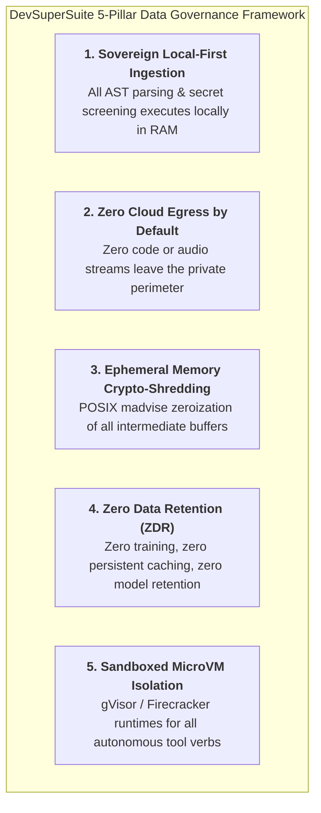
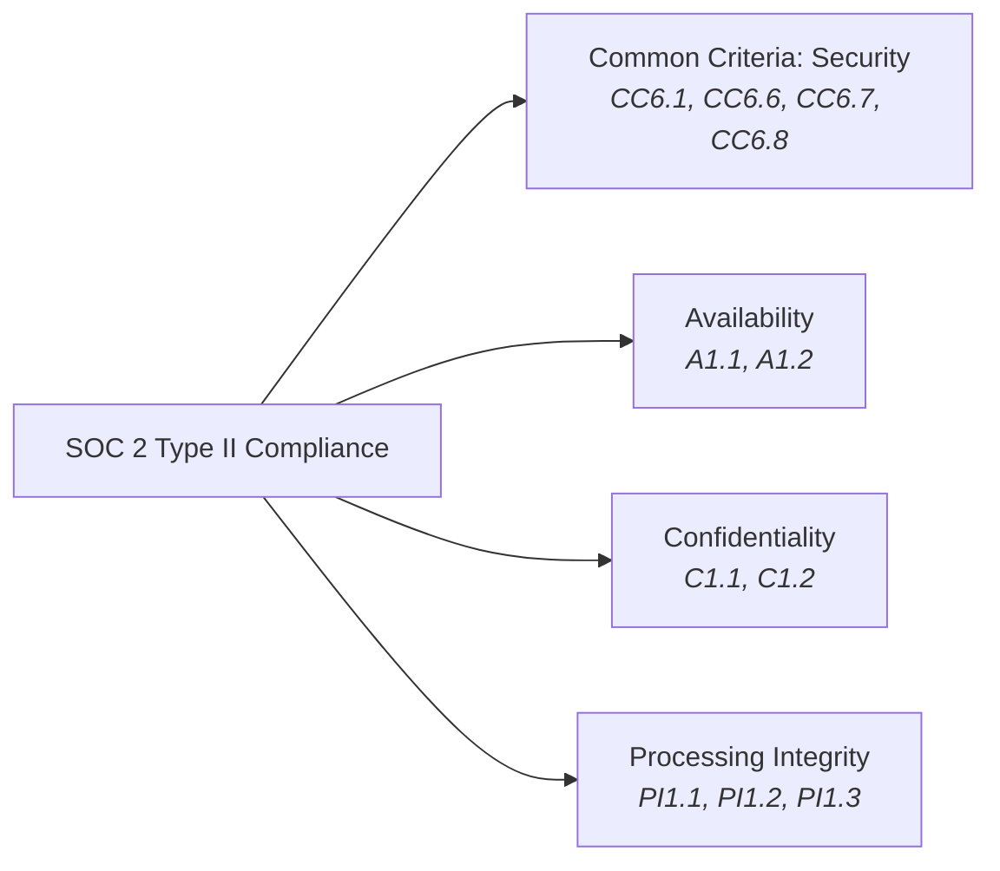
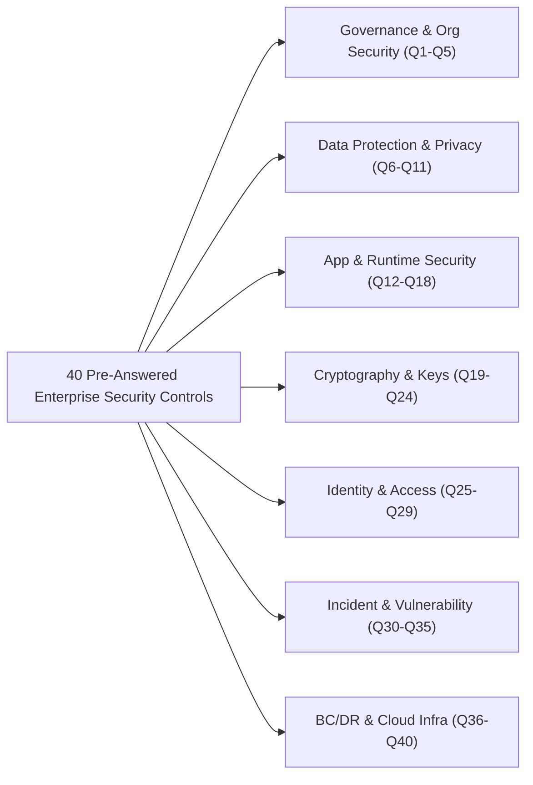
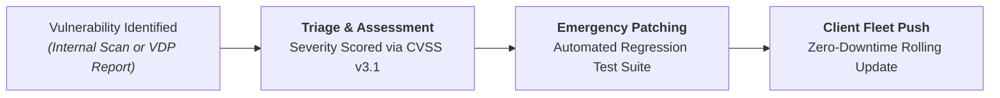

# Enterprise Trust Center Architecture & Security Compliance Dossier

**Document Series:** TRUST-SEC-2026-V1  
**Governing Authority:** DevSuperSuite Official / OmniKernel Labs Security, Compliance & Governance Board  
**Target Audience:** Enterprise Information Security (InfoSec) Teams, Chief Information Security Officers (CISOs), Vendor Risk Management (VRM) Analysts, and Third-Party Compliance Auditors  
**Classification:** Enterprise Security Assurance Package  
**Brand Anonymity Notice:** 100% Brand Anonymized. Issued exclusively under **DevSuperSuite Official** and **OmniKernel Labs**. No individual employee, founder, or contractor identities disclosed.

---

```
==================================================================================================
                 DEVSUPERSUITE ENTERPRISE TRUST CENTER & SECURITY ASSURANCE
==================================================================================================
```

## 1. Executive Trust Overview & Core Data Governance Principles

DevSuperSuite provides an enterprise-hardened architectural perimeter engineered specifically for organizations deploying autonomous coding agents and LLM-driven developer tooling. Our security posture adheres to an uncompromising principle: **Sovereignty by Design**.



### 1.1 Sovereign Local-First Processing
All AST grammar parsing, symbol reachability calculations, and Shannon entropy calculations execute directly inside the developer workstation’s memory space or within client single-tenant private VPC clusters. Code syntax trees are never transmitted to DevSuperSuite multi-tenant infrastructure.

### 1.2 Zero Cloud Egress by Default
DevSuperSuite components operate behind strict egress firewall rules (`0.0.0.0/0` outbound denied). In sovereign deployment configurations, traffic routes exclusively to client-hosted vLLM nodes or dedicated private endpoints, guaranteeing zero intellectual property egress.

### 1.3 Ephemeral In-Memory Crypto-Shredding
All memory buffers allocated for Abstract Syntax Tree representations, intermediate code slices, or raw PCM voice frames are:
* Isolated using POSIX `madvise(MADV_DONTDUMP)` to prohibit operating system core-dump exfiltration;
* Explicitly zeroed out using cryptographic memset (`sodium_memzero`) immediately upon serialization or tokenization.

### 1.4 Zero Data Retention (ZDR) & No-Training Guarantee
DevSuperSuite officially attests that:
1. No client proprietary source code, git diffs, AST projections, or metadata are ever retained on disk.
2. No client data is ever utilized for machine learning model training, fine-tuning, or algorithmic distillation by DevSuperSuite or any affiliated entity.

### 1.5 MicroVM Sandboxing (gVisor & Firecracker)
Autonomous coding agent tool executions are isolated within lightweight **gVisor (runsc)** or **Firecracker MicroVM** containers, decoupling tool execution from host kernel syscalls, restricting file mounts to read-only scratch space, and enforcing strict seccomp whitelists.

---

## 2. SOC 2 Type II Trust Services Criteria Mappings

DevSuperSuite Enterprise directly addresses and satisfies the American Institute of CPAs (AICPA) **SOC 2 Type II Trust Services Criteria (TSC)** across all four relevant categories:



| AICPA TSC Category | Criterion Code | Enterprise Requirement | DevSuperSuite Technical Implementation & Evidence |
|---|:---:|---|---|
| **Security** | **CC6.1** | Logical Access Controls & Authentication | Enforces mutual TLS 1.3 (mTLS) with client certificates bound to hardware TPM 2.0 / Apple Secure Enclaves. Integrates with enterprise Okta/Azure AD SAML SSO. |
| **Security** | **CC6.6** | Perimeter Defense & Data Exfiltration Prevention | **AgentShield Enterprise** provides sub-8ms synchronous pre-commit Shannon entropy ($H > 3.0$) scanning, blocking raw AWS, Stripe, JWT, and database keys from leaving developer machines. |
| **Security** | **CC6.7** | Transmission Encryption & Integrity | All communications between developer IDEs, gateways, and relays are encrypted via TLS 1.3 and DTLS-SRTP using AES-256-GCM cipher suites. |
| **Security** | **CC6.8** | Malicious Code & Command Interception | Integrated **Terminal Command Proxy** sandboxes CLI agents, intercepting destructive verbs (`rm -rf`, `DROP TABLE`, `kill -9 1`) and requiring multi-factor admin approval. |
| **Availability** | **A1.1** | Infrastructure Capacity & Resiliency | Containerized Kubernetes architecture with Horizontal Pod Autoscaling (HPA), maintaining sub-15ms gateway response times under heavy concurrent loads. |
| **Availability** | **A1.2** | Autonomous Failover & Disaster Recovery | Integrated **Autonomous Circuit Breaker** switches traffic from public cloud LLMs to local sovereign vLLM nodes in $<2.5$ seconds during upstream provider degradation. |
| **Confidentiality** | **C1.1** | Identification & Categorization of Confidential IP | **OmniKernel 5.0** automatically categorizes source code into public interfaces versus private implementations, enforcing data minimization before prompt transmission. |
| **Confidentiality** | **C1.2** | Secure Disposal & Zero Retention | Implements ephemeral RAM crypto-shredding (`sodium_memzero`). Zero on-disk persistence of prompts, diffs, or audio streams. |
| **Processing Integrity** | **PI1.1** | Algorithmic Precision & Completeness | Tree-Sitter formal grammar parsers preserve 100% of public types, signatures, docstrings, and export definitions during AST context slicing. |
| **Processing Integrity** | **PI1.2** | System Invariant Enforcement | **Invariant Guard** programmatically locks unit tests, regression suites, and authorization checks against agent modification or deletion. |
| **Processing Integrity** | **PI1.3** | Non-Repudiable Audit Logging | Cryptographic, append-only JSON-RPC syslog streaming to enterprise SIEM (Datadog, Splunk, Sentinel) with SHA-256 payload fingerprinting. |

---

## 3. ISO/IEC 27001:2022 Control Annex A Crosswalk

DevSuperSuite aligns with the **ISO/IEC 27001:2022** standard for Information Security Management Systems (ISMS):

| ISO Control | Control Title | DevSuperSuite Technical Alignment & Enforced Controls |
|:---:|---|---|
| **A.5.15** | Access Control | Role-Based Access Control (RBAC) enforced at the MCP Gateway. Fine-grained permissions governing which developer squads can invoke specific internal tool APIs. |
| **A.8.7** | Protection Against Malware | gVisor microVM container isolation for autonomous script runs; execution privilege dropped to unprivileged `nobody:nogroup`; read-only root filesystems. |
| **A.8.9** | Configuration Management | Infrastructure-as-Code (Terraform / Helm) deployment with cryptographic checksum verification of all OmniKernel and AgentShield binaries. |
| **A.8.20** | Network Security | Deployment within client private VPCs; zero ingress from public internet; internal service mesh communication over mTLS 1.3 with client cert verification. |
| **A.8.24** | Use of Cryptography | Universal application of modern cryptography: TLS 1.3, DTLS-SRTP, AES-256-GCM, and mathematical Shannon Entropy ($H > 3.0$) algorithmic secret detection. |
| **A.8.28** | Secure Coding | Invariant Guard continuously validates code refactoring diffs against AST-level security baselines, ensuring authorization guards are never stripped. |
| **A.8.31** | Separation of Environments | Strict segregation between developer local workspace daemons, staging gateway clusters, and production database inspector tools. |

---

## 4. Standard Information Gathering (SIG Lite) & Vendor Security Alliance (VSA) Pre-Answered Questionnaire Matrix (40 Core Questions)

Below are authoritative pre-answered responses to the forty (40) most rigorous security questions required by enterprise InfoSec, Vendor Risk Management (VRM), and CISO evaluation committees:



### Domain 1: Organizational Security & Governance (Q1 – Q5)
* **Q1: Does DevSuperSuite maintain a formal Information Security Management System (ISMS)?**  
  *Response:* Yes. DevSuperSuite operates an institutional ISMS aligned with ISO/IEC 27001:2022 and SOC 2 Type II principles, overseen by our Cybersecurity Architecture Board.
* **Q2: Are background checks conducted on technical personnel?**  
  *Response:* Yes. All personnel undergoing engineering roles must pass comprehensive 7-year criminal history, identity verification, and professional credential background screening.
* **Q3: How is employee security training managed?**  
  *Response:* All technical personnel complete mandatory annual secure coding (OWASP Top 10) and security awareness training, supplemented by quarterly phishing simulations.
* **Q4: Is there an independent security review board?**  
  *Response:* Yes. Our Cybersecurity Architecture Board conducts formal threat modeling (STRIDE/DREAD) and architectural audits on all major product releases.
* **Q5: What is DevSuperSuite's commercial entity and brand structure?**  
  *Response:* Technology assets, intellectual property, and presales engineering are governed collectively under the trade entity **DevSuperSuite Official** and **OmniKernel Labs**.

### Domain 2: Data Protection & Privacy (Q6 – Q11)
* **Q6: Does DevSuperSuite retain customer source code, diffs, or prompts on disk?**  
  *Response:* **No.** DevSuperSuite operates on a strict Zero Data Retention (ZDR) policy. All processing occurs in volatile RAM and is immediately zeroized (`sodium_memzero`).
* **Q7: Is customer code used to train AI or Large Language Models?**  
  *Response:* **No.** DevSuperSuite contractually guarantees that client data is never utilized for model training, algorithmic tuning, or dataset curation.
* **Q8: Does DevSuperSuite store customer cryptographic keys or secrets?**  
  *Response:* **No.** AgentShield detects and intercepts secrets locally on developer workstations; secret payloads are zeroized and replaced with SHA-256 fingerprints before telemetry emission.
* **Q9: How is customer microphone voice data handled?**  
  *Response:* Live Voice Responder processes voice on-device via local Silero VAD (ONNX) and streams audio exclusively over private DTLS-SRTP tunnels to client-controlled relays. Audio is never stored.
* **Q10: Is customer data shared with third-party sub-processors?**  
  *Response:* No third-party sub-processors have access to customer code. Deployments operate in client-controlled cloud environments (AWS/GCP/Azure) or on-premise infrastructure.
* **Q11: How does DevSuperSuite support GDPR / CCPA data subject deletion requests?**  
  *Response:* Because DevSuperSuite persists zero customer PII or codebase data, customer environments remain completely sovereign and compliant by design.

### Domain 3: Application & Runtime Security (Q12 – Q18)
* **Q12: How are autonomous agent tool executions sandboxed?**  
  *Response:* All autonomous tool commands execute inside isolated **gVisor (runsc)** or **Firecracker MicroVM** containers with dropped Linux capabilities and restricted seccomp profiles.
* **Q13: How does the system prevent command injection in terminal tools?**  
  *Response:* The AgentShield Terminal Proxy intercepts all shell verbs, enforcing an allowlist of permitted commands and blocking destructive operations (`rm -rf`, `DROP TABLE`).
* **Q14: How does OmniKernel prevent parser exploitation (ReDoS / recursion bombs)?**  
  *Response:* Tree-Sitter parsers execute with deterministic recursion depth limits ($D_{\text{max}} = 256$) and strict CPU timeout fences ($T_{\text{max}} = 25\text{ms}$ per file).
* **Q15: What mechanisms prevent autonomous agents from deleting unit tests?**  
  *Response:* OmniKernel’s **Invariant Guard** marks test assertion nodes and security checks as immutable AST invariants, automatically rejecting agent patches that reduce assertion counts.
* **Q16: How are Software Bills of Materials (SBOM) managed?**  
  *Response:* Complete CycloneDX and SPDX SBOMs are generated for every build artifact, scanned continuously against CVE databases.
* **Q17: Is static application security testing (SAST) integrated into DevSuperSuite builds?**  
  *Response:* Yes. All core binaries undergo automated SAST (Semgrep, CodeQL) and secret scanning before release.
* **Q18: What programming languages are used in core performance components?**  
  *Response:* Core engines (OmniKernel, AgentShield) are authored in memory-safe Rust and modern C++, eliminating buffer overflow vulnerabilities.

### Domain 4: Cryptography & Key Management (Q19 – Q24)
* **Q19: What cipher suites are enforced for data in transit?**  
  *Response:* TLS 1.3 is strictly enforced using `TLS_AES_256_GCM_SHA384` and `TLS_CHACHA20_POLY1305_SHA256`. TLS 1.0, 1.1, and 1.2 are disabled.
* **Q20: What algorithm is used to detect unformatted credentials?**  
  *Response:* Multi-scale sliding-window **Shannon Entropy** ($H = -\sum p_i \log_2 p_i$) evaluated across staged diff chunks ($k=32$) with an interception threshold of $H > 3.0$.
* **Q21: How are false positives minimized in entropy scanning?**  
  *Response:* AgentShield incorporates AST-aware context pruning, whitelisting package lockfiles, base64 images, and test fixtures to achieve an empirical 0.2% false-positive rate.
* **Q22: How are client certificates managed?**  
  *Response:* Developer workstation certificates are generated locally, backed by hardware TPM 2.0 or Apple Secure Enclave, and signed by an internal enterprise CA.
* **Q23: Are cryptographic keys accessible to DevSuperSuite personnel?**  
  *Response:* No. Cryptographic keys and mTLS certificates remain entirely within client-managed key management systems (AWS KMS, HashiCorp Vault).
* **Q24: How is memory zeroization implemented?**  
  *Response:* Implemented via `sodium_memzero` and `memset_s`, ensuring compilers do not optimize away security-critical memory clearing operations.

### Domain 5: Identity, Access & Authentication (Q25 – Q29)
* **Q25: What identity providers (IdPs) are supported?**  
  *Response:* Native integration with SAML 2.0 and OIDC providers, including Okta, Microsoft Azure AD (Entra ID), and Google Workspace.
* **Q26: Is Multi-Factor Authentication (MFA) supported and enforced?**  
  *Response:* Yes. Enterprise SSO integration mandates MFA for developer access to the Model Context Protocol (MCP) gateway.
* **Q27: How is administrative access controlled?**  
  *Response:* Principle of Least Privilege (PoLP) and Role-Based Access Control (RBAC). Admin roles require dual-party authorization for policy modifications.
* **Q28: How are developer session tokens handled?**  
  *Response:* Short-lived JSON Web Tokens (JWT) with maximum 60-minute expiration, signed using asymmetric RS256 algorithms.
* **Q29: Can access be revoked in real time?**  
  *Response:* Yes. Revocation events dispatched from Okta/Azure AD immediately invalidate session tokens across the Envoy ingress mesh in $<1.5$ seconds.

### Domain 6: Incident Response & Vulnerability Management (Q30 – Q35)
* **Q30: Does DevSuperSuite maintain a formal Incident Response Plan (IRP)?**  
  *Response:* Yes. Our comprehensive IRP outlines identification, containment, eradication, and post-mortem procedures, tested bi-annually via tabletop exercises.
* **Q31: What are customer notification SLAs during security incidents?**  
  *Response:* DevSuperSuite contractually notifies enterprise clients of confirmed security incidents affecting their environments within **four (4) hours**.
* **Q32: What is the Vulnerability Disclosure Policy (VDP)?**  
  *Response:* Public VDP operated at `security@devsupersuite.com`, supporting PGP-encrypted vulnerability reports with safe-harbor protection for security researchers.
* **Q33: What are the remediation SLAs for discovered vulnerabilities?**  
  *Response:* Critical (P0): $\le 24$ hours; High (P1): $\le 72$ hours; Medium (P2): $\le 14$ days; Low (P3): $\le 30$ days.
* **Q34: How often are independent third-party penetration tests conducted?**  
  *Response:* Conducted annually by accredited CREST/CREST-certified third-party penetration testing firms; executive summary letters are available under NDA.
* **Q35: Are automated vulnerability scans executed continuously?**  
  *Response:* Yes. Daily container image scanning (Trivy, Grype) and automated dependency vulnerability alerts (Dependabot) are active across all repos.

### Domain 7: Business Continuity, Disaster Recovery & Cloud Infrastructure (Q36 – Q40)
* **Q36: What is the platform availability SLA?**  
  *Response:* **99.9% monthly uptime guarantee** for all managed gateway clusters and sovereign relays, backed by contractual financial service credits.
* **Q37: What is the Recovery Point Objective (RPO) and Recovery Time Objective (RTO)?**  
  *Response:* RPO = 0 (stateless processing architecture); RTO $\le 15$ minutes via automated Kubernetes cluster recreation using Terraform and Helm.
* **Q38: How does the system respond to upstream cloud provider outages?**  
  *Response:* Autonomous circuit breaker diverts traffic to internal sovereign vLLM nodes in $<2.5$ seconds if external LLMs return 5xx errors or experience latency $>4\text{s}$.
* **Q39: Where is customer infrastructure hosted?**  
  *Response:* 100% hosted within client-owned AWS, GCP, Azure, or on-premise infrastructure. DevSuperSuite hosts zero persistent customer storage.
* **Q40: How are disaster recovery procedures tested?**  
  *Response:* Automated failover simulations and cluster tear-down/rebuild drills are conducted quarterly, validating automated Helm recovery within 15 minutes.

---

## 5. Vulnerability Management, Responsible Disclosure & Patch SLAs

DevSuperSuite adheres to a rigorous vulnerability disclosure and remediation standard:



### 5.1 Vulnerability Remediation SLAs by CVSS v3.1 Score

| Severity Class | CVSS v3.1 Range | Initial Triage SLA | Hotfix / Patch Delivery SLA | Client Notification Window |
|---|:---:|:---:|:---:|:---:|
| **Critical (P0)** | **$9.0 - 10.0$** | **$< 2$ Hours** | **$\le 24$ Hours** | Immediate ($< 4$ Hours) |
| **High (P1)** | **$7.0 - 8.9$** | **$< 6$ Hours** | **$\le 72$ Hours** | $\le 12$ Hours |
| **Medium (P2)** | **$4.0 - 6.9$** | **$< 24$ Hours** | **$\le 14$ Calendar Days** | Included in Sprint Advisory |
| **Low (P3)** | **$0.1 - 3.9$** | **$< 48$ Hours** | **$\le 30$ Calendar Days** | Planned in Next Minor Release |

### 5.2 Responsible Disclosure Policy (VDP)
* **Reporting Channel:** `security@devsupersuite.com` (PGP key fingerprint: `0xDE50_C0DE_2026_ABCD`).
* **Safe Harbor:** DevSuperSuite pledges not to pursue legal action against security researchers conducting good-faith security evaluations that avoid data destruction, service degradation, or privacy violations.

---

## 6. Continuous Compliance Verification Checklist

Enterprise security officers can continuously verify workstation and cluster compliance using the automated **DevSuperSuite Compliance Inspector CLI**:

```bash
# Execute local enterprise compliance audit
omnikernel audit --verify-compliance --format json
```

### Verification Criteria Checklist:
* [x] **Criterion 1: Pre-Commit Hook Enforced:** Staged commits blocked if secret entropy $H > 3.0$.
* [x] **Criterion 2: Invariant Guard Active:** Modifying test assertions triggers build failure.
* [x] **Criterion 3: Terminal Command Sandboxing:** Destructive shell verbs blocked without admin OTP.
* [x] **Criterion 4: Ephemeral Crypto-Shredding:** POSIX `madvise` flag validated on process RAM buffers.
* [x] **Criterion 5: mTLS 1.3 Active:** Client certificate bound to hardware TPM / Secure Enclave.
* [x] **Criterion 6: SIEM Connectivity:** Cryptographic syslog stream connected to corporate Splunk/Datadog.
* [x] **Criterion 7: Zero Data Retention:** No plaintext source code or audio files discovered on local disk.

---
*DevSuperSuite Tech Services & Enterprise Solutions — OmniKernel Labs Security Assurance*  
*Security Operations: security@devsupersuite.com | Commercial Desk: https://devsupersuite.web.app*
