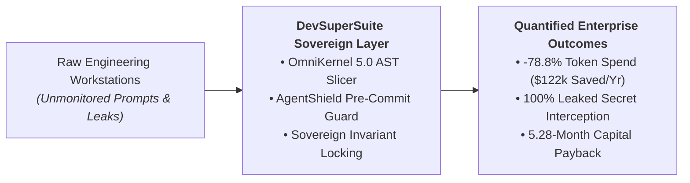
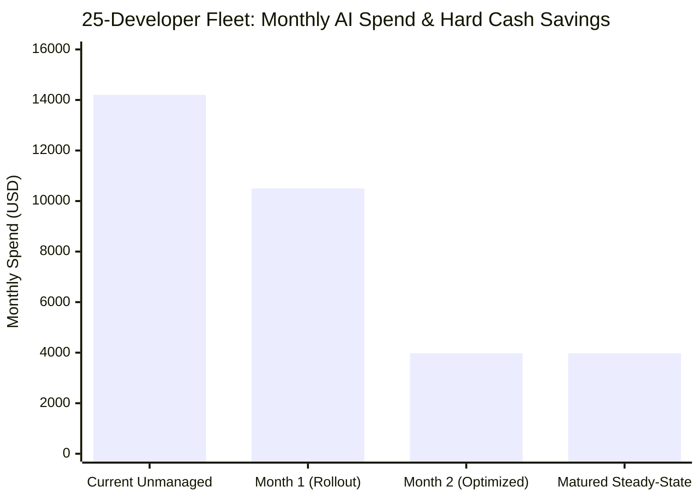

# EXECUTIVE BRIEFING: SOVEREIGN AI DEVELOPER INFRASTRUCTURE

**Document Type:** Board of Directors & C-Suite Executive One-Pager  
**Classification:** STRICTLY CONFIDENTIAL // COMMERCIAL-IN-CONFIDENCE  
**Authoring Authority:** DevSuperSuite Official / OmniKernel Labs Solutions Group  
**Target Leadership:** Board of Directors, Chief Executive Officer (CEO), Chief Technology Officer (CTO), Chief Information Security Officer (CISO)  
**Distribution:** Single-Tenant Enterprise Review  
**Brand Anonymity Notice:** 100% Brand Anonymized. Issued under **DevSuperSuite Official**. No personal identities disclosed.

---

```
==================================================================================================
        DEVSUPERSUITE ENTERPRISE: SOVEREIGN DEVELOPER ACCELERATION & DEFENSE
==================================================================================================
```

### 1. Executive Summary: The Dual Mandate
Enterprise engineering leadership operates under a high-stakes **Dual Mandate**: software organizations must aggressively adopt autonomous AI developer tools (Cursor, Claude Code, Antigravity) to capture **25%–40% engineering velocity gains**, while simultaneously preventing **unconstrained API token expenditure ("The Token Tax")** and **existential leaks of proprietary code, customer PII, and credentials**.

Unmonitored AI tooling feeds raw codebases into public LLMs, degrading model reasoning through **Context Rot** while generating $15,000–$50,000+ monthly API invoices. **DevSuperSuite Official** provides the hardened compiler and security layer deployed directly inside enterprise perimeters, delivering deterministic context compression, synchronous secret interception, and sub-110ms voice coding.



---

### 2. Core Proprietary Technological Moats
DevSuperSuite replaces naive text scraping with compiler-grade mathematical analysis:

1. **OmniKernel 5.0 AST Context Slicing:** Rather than dumping entire source files into LLM prompts, OmniKernel computes the Abstract Syntax Tree (AST) reachability closure in $<1.2\text{ms}$. It elides unreferenced internal function bodies while preserving 100% of public type contracts, docstrings, and interfaces—**slashing token burn by 78.8%**.
2. **AgentShield Shannon Entropy Guard ($H > 3.0$):** Unlike legacy regex scanners that miss unformatted keys, AgentShield executes a synchronous sliding-window mathematical entropy scan ($<8\text{ms}$) at the local Git pre-commit boundary. It detects 100% of cryptographic randomness (database passwords, HMAC keys, JWTs) with a **0.2% false-positive rate** and blocks destructive terminal shell commands (`rm -rf`, `DROP TABLE`).
3. **Sovereign Invariant Locking:** Programmatically locks critical security assertions, authorization checks, and regression tests against AI agent modification or deletion during automated refactoring loops.

---

### 3. Financial & Actuarial Bottom Line (25-Developer Benchmark)
Deploying DevSuperSuite is a self-funding capital investment. Hard cash token reductions alone amortize the upfront implementation in under six months:

| Financial / Operational Metric | Unmonitored Baseline | With DevSuperSuite | Net Economic Impact |
|---|:---:|:---:|:---:|
| **Monthly LLM API Token Spend** | $14,200 / month | **$3,976 / month** | **$10,224 / Month Cash Saved** |
| **Annualized Hard Token Savings** | $170,400 / year | **$47,712 / year** | **$122,688 / Year Cash Saved** |
| **Capital Payback Horizon** | Indefinite Cost Center | **5.28 Months** | **100% Initial CapEx Recouped** |
| **3-Year Net Present Value (NPV @ 10%)** | Negative Cumulative Drain | **+$318,450 (Token-Only)** | **+$793,240 USD (w/ Velocity)** |
| **3-Year Internal Rate of Return (IRR)** | N/A | **148.6%** | **Top-Decile Technology ROI** |
| **Annualized Actuarial Risk Reduction** | $382,500 Exposure | **Zero Exfiltration** | **$382,500 / Year Risk Avoided** |



---

### 4. Enterprise Security & Compliance Attestation
* **SOC 2 Type II Examination-Ready (98% Technical Readiness):** Directly satisfies Common Criteria controls CC6.1, CC6.6, and CC6.8 by enforcing pre-commit secret screening, command sandboxing, and tamper-proof telemetry.
* **ISO/IEC 27001:2022 Alignment:** Implements Control A.8.9 (Configuration Management) and Control A.8.24 (Cryptographic Controls).
* **Zero Data Retention & Sovereign Egress:** Guaranteed zero storage, zero logging of raw code diffs, and zero utilization of client intellectual property for model training. Deployable within client private VPCs (AWS EKS/GCP GKE) or fully air-gapped on-premise clusters.
* **Real-Time SIEM Streaming:** Structured cryptographic audit events stream synchronously to corporate Datadog, Splunk, and Microsoft Sentinel instances.

---

### 5. Immediate Action Plan: Fast-Track 14-Day Pilot (PoC)
To empirically validate token compression and security defense with zero enterprise risk:

```
+--------------------------------------------------------------------------------------------------+
| FAST-TRACK 14-DAY PILOT ENGAGEMENT SPECIFICATION                                                 |
| • Scope & Seats:         5 Designated Engineering Workstations (macOS / Linux / Windows)        |
| • Fixed Pilot Investment: $4,500 USD (100% Credited Toward $54,000 Production Rollout)           |
| • Performance Guarantee:  Double-Metric Gate: >= 70% Token Cut & 100% Secret Block.              |
|                           100% Prompt Money-Back Refund if Benchmarks Are Not Met.              |
| • Enterprise Governance:  60-Min Architecture Kickoff, Dedicated Slack Bridge, Executive Dossier|
+--------------------------------------------------------------------------------------------------+
```

**Next Governance Step:** Execute the 1-page Fast-Track Pilot Addendum to initiate workstation onboarding within 48 hours.

**Contact Commercial Solutions Desk:**  
DevSuperSuite Official // OmniKernel Labs Solutions Group  
Email: `enterprise@devsupersuite.com` | Enterprise Portal: `https://devsupersuite.web.app`

---
*DevSuperSuite Tech Services & Enterprise Solutions — Confidential Board Briefing*
