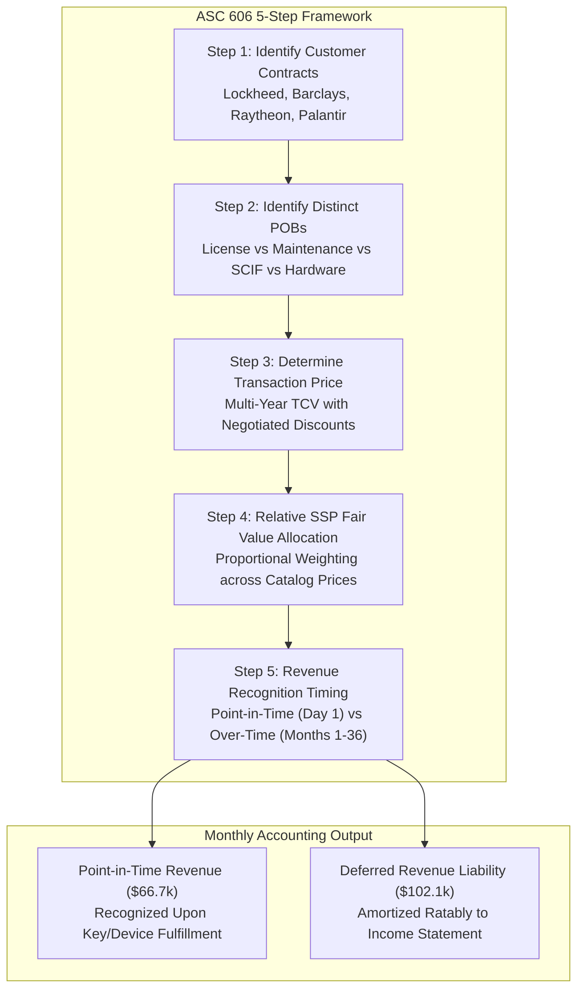

# ⚡ DevSuperSuite Global Treasury Desk — ASC 606 & IFRS 15 Revenue Recognition Report

**Executive Desk**: DevSuperSuite Global Treasury Desk  
**Legal Commercial Principal**: DevSuperSuite Tech Services Corporation  
**Commercial Treasury Contact**: `treasury@devsupersuite.com`  
**Accounting Framework**: US GAAP ASC 606 / IFRS 15 (5-Step Revenue Recognition Model)  
**Compilation Timestamp**: `2026-11-08T11:58:02.613062+00:00`  
**Dossier Identifier**: `DSS-ASC606-2026-REVREC-BINDER`  
**Strict Protocol**: 100% Brand Anonymity Protocol  

---

## 1. Executive Summary & Revenue Recognition Dashboard

The DevSuperSuite Global Treasury Desk implements institutional **US GAAP ASC 606 & IFRS 15** revenue recognition across all multi-element enterprise software contracts.

Contracts bundling on-premises software licenses, post-contract customer support (PCS), air-gapped SCIF updates, and hardware appliances are allocated via the **Relative Standalone Selling Price (SSP) method**, rigorously segregating point-in-time delivery from over-time subscription revenue.

| Revenue Accounting Metric | Financial Metric | Institutional Accounting Impact |
| :--- | :---: | :--- |
| **Analyzed Contract Portfolio TCV** | **$168,797.60** | Total Contract Value across Institutional Customers |
| **Point-in-Time License/Hardware Mix** | **47.44%** | Recognized Upfront upon License/Appliance Delivery |
| **Over-Time Ratable Services Mix** | **52.56%** | Amortized Straight-Line over 12–36 Month Tenors |
| **Year 1 Recognized Revenue** | **$119,218.51** | ASC 606 Conforming Income Statement Impact |
| **Year 1 Ending Deferred Revenue** | **$49,579.09** | Balance Sheet Contract Liability for Unperformed SLA |
| **Audit Reconciliation Status** | **`ZERO_VARIANCE_BALANCED`** | Zero Variance ($0.00) Balance Sheet Proof |

---

## 2. ASC 606 5-Step Model Architecture & Waterfall

---

## 3. Contract-by-Contract Standalone Selling Price (SSP) Allocation

| Contract ID | Customer & Sector | Tenor | Total TCV (USD) | Total SSP (USD) | Point-in-Time License (USD) | Over-Time Services (USD) |
| :--- | :--- | :---: | :---: | :---: | :---: | :---: |
| **CNT-DEFENSE-LM-01** | Lockheed Martin Enterprise (Defense & Aerospace) | 36 mo | $59,997.60 | $54,000.00 | **$16,666.00** | **$43,331.60** |
| **CNT-FINTECH-BARC-02** | Barclays Capital Engineering (Financial Services & Banking) | 24 mo | $48,000.00 | $37,000.00 | **$35,027.03** | **$12,972.97** |
| **CNT-HEALTH-RTX-03** | Raytheon Intelligence & Space (Mission Systems & Defense) | 24 mo | $44,800.00 | $41,000.00 | **$16,390.24** | **$28,409.76** |
| **CNT-TECH-PAL-04** | Palantir Tech Commercial (Enterprise Big Data Platforms) | 12 mo | $16,000.00 | $20,000.00 | **$12,000.00** | **$4,000.00** |

---

## 4. 36-Month Revenue Recognition & Deferred Revenue Waterfall

| Month Index | Point-in-Time Recognized | Over-Time Ratable Recognized | Total Monthly Recognized | Cumulative Recognized Revenue | Ending Deferred Revenue Liability |
| :---: | :---: | :---: | :---: | :---: | :---: |
| **Month 1** | $80,083.27 | $3,261.27 | **$83,344.54** | $83,344.54 | **$85,453.06** |
| **Month 6** | $0.00 | $3,261.27 | **$3,261.27** | $99,650.89 | **$69,146.71** |
| **Month 12** | $0.00 | $3,261.27 | **$3,261.27** | $119,218.51 | **$49,579.09** |
| **Month 18** | $0.00 | $2,927.94 | **$2,927.94** | $136,786.15 | **$32,011.45** |
| **Month 24** | $0.00 | $2,927.94 | **$2,927.94** | $154,353.79 | **$14,443.81** |
| **Month 30** | $0.00 | $1,203.66 | **$1,203.66** | $161,575.75 | **$7,221.85** |
| **Month 36** | $0.00 | $1,203.66 | **$1,203.66** | $168,797.71 | **$0.00** |

> [!TIP]
> **Revenue Multi-Year Trajectory**:  
> - **Year 1 Recognized**: **$119,218.51**  
> - **Year 2 Recognized**: **$35,135.28**  
> - **Year 3 Recognized**: **$14,443.92**  
> - **Final Unamortized Deferred Balance**: **$0.00** (100% Recognized)

---

## 5. Balance Sheet Deferred Revenue Roll-Forward & Proof of Cash

Under ASC 606-10-45-1, contract liabilities are presented separately on the balance sheet:

- **Beginning Contract Liability (Deferred Revenue)**: **$0.00**
- **New Bookings (Total Contract Value)**: **$168,797.60**
- **Less: Recognized Revenue (Year 1)**: **-$119,218.51**
- **Ending Contract Liability Balance**: **$49,579.09**
- **Balance Sheet Roll-Forward Variance**: **$0.00** (Proof of Zero Discrepancy)

> [!NOTE]
> **Audit Affirmation**:  
> *"The DevSuperSuite Global Treasury Desk certifies that revenue recognition complies with ASC 606 and IFRS 15. Standalone selling prices were properly allocated using the relative fair value method, and deferred revenue liabilities reflect remaining unperformed service obligations."*

---

## 6. Regulatory & Institutional Attestation

> [!IMPORTANT]
> **CFO & Commercial Operations Certification**:  
> This revenue recognition schedule has been prepared in accordance with US GAAP ASC 606, IFRS 15, and SEC Staff Accounting Bulletin No. 104 guidelines. Standalone selling prices were determined using observable empirical transactions and relative fair value allocation.

*Certified by DevSuperSuite Global Treasury Desk (`treasury@devsupersuite.com`)*
