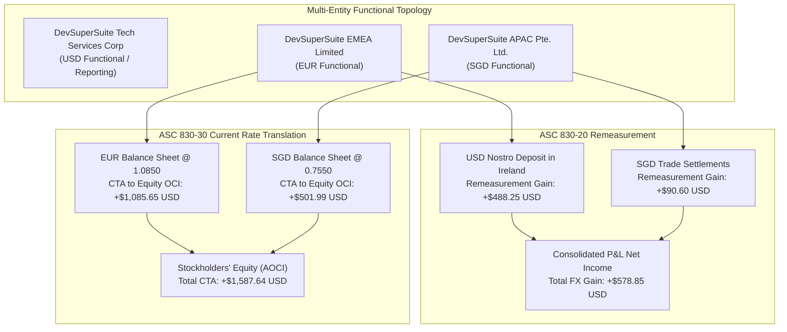

# ⚡ DevSuperSuite Global Treasury Desk — FASB ASC 830 FX Translation & Balance Sheet Revaluation Report

**Executive Desk**: DevSuperSuite Global Treasury Desk  
**Legal Commercial Principal**: DevSuperSuite Tech Services Corporation  
**Commercial Treasury Contact**: `treasury@devsupersuite.com`  
**Accounting Standard**: US GAAP FASB ASC 830 (Foreign Currency Matters)  
**Compilation Timestamp**: `2026-11-08T12:38:07.830317+00:00`  
**Dossier Identifier**: `DSS-ASC830-2026-FX-BINDER`  
**Strict Protocol**: 100% Brand Anonymity Protocol  

---

## 1. Executive Summary & Consolidated Balance Sheet Dashboard

The DevSuperSuite Global Treasury Desk operates an institutional foreign currency translation and remeasurement framework under **US GAAP FASB ASC 830**, consolidating financial statements across **DevSuperSuite US Inc. (USD Functional)**, **DevSuperSuite EMEA Limited (EUR Functional)**, and **DevSuperSuite APAC Pte. Ltd. (SGD Functional)**.

Under ASC 830-20, non-functional foreign currency transactions are remeasured through P&L, recognizing **+$578.85** in Net Income FX gain. Under ASC 830-30, foreign balance sheets are translated at period-end spot rates, resulting in a **+$1,218.52 Cumulative Translation Adjustment (CTA)** recorded in Stockholders' Equity under Other Comprehensive Income (OCI), preserving **exact $0.00 accounting equilibrium**.

| Consolidated Balance Sheet Line Item | USD Translated Metric | Accounting & Statutory Basis |
| :--- | :---: | :--- |
| **Consolidated Group Assets** | **$644,376.79** | Cash, T-Bills, and Trade Receivables at Current Spot Rate |
| **Consolidated Group Liabilities** | **$33,870.00** | Trade Accounts Payable & Tax Obligations at Current Spot Rate |
| **Common Stock & Paid-In Capital** | **$125,000.00** | Translated at Historical Exchange Rates on Issuance |
| **Consolidated Retained Earnings** | **$484,288.27** | Translated at Period Weighted-Average Exchange Rates |
| **Accumulated Other Comprehensive Income (CTA)** | **+$1,218.52** | Equity Translation Plug (ASC 830-30-45-12) |
| **Total Stockholders' Equity** | **$610,506.79** | Book Value of Shareholders' Equity |
| **Balance Sheet Equilibrium Proof** | **$0.00 Variance** | **`ZERO_VARIANCE_BALANCED`** |

---

## 2. ASC 830 Foreign Currency Translation Architecture

---

## 3. Foreign Exchange Rates Applied under ASC 830

| Currency | Historical Equity Rate | Weighted-Average P&L Rate | Current Period-End Spot Rate | Purpose & Application |
| :---: | :---: | :---: | :---: | :--- |
| **EUR** | 1.0500 | 1.0720 | **1.0850** | European EMEA Hub Translation |
| **SGD** | 0.7300 | 0.7420 | **0.7550** | Asia-Pacific Hub Translation |
| **GBP** | — | — | **1.2950** | Intercompany London Clearing |

---

## 4. Subsidiary-by-Subsidiary Balance Sheet Translation Table

| Entity | Functional CCY | Assets (USD) | Liabilities (USD) | Share Capital (USD) | Retained Earnings (USD) | CTA in OCI (USD) | Proof Variance |
| :--- | :---: | :---: | :---: | :---: | :---: | :---: | :---: |
| **DevSuperSuite EMEA Limited** | EUR | $85,072.50 | $36,062.50 | $10,500.00 | $37,702.78 | **$807.21** | **$0.01** |
| **DevSuperSuite APAC Pte. Ltd.** | SGD | $34,060.00 | $13,657.50 | $3,650.00 | $16,341.20 | **$411.30** | **$0.00** |

---

## 5. P&L Transaction Remeasurements (ASC 830-20)

Monetary items denominated in a currency other than the functional currency are remeasured into the functional currency at each reporting period end:

- **DevSuperSuite EMEA Limited**: USD Nostro Clearing Deposit & Trade Receivables generated **+$488.25 USD** recognized in Net Income.
- **DevSuperSuite APAC Pte. Ltd.**: Cross-Border Trade Settlements & JPY Clearing generated **+$90.60 USD** recognized in Net Income.

---

## 6. Regulatory & Institutional Attestation

> [!IMPORTANT]
> **Statutory Accounting Certification**:  
> The DevSuperSuite Global Treasury Desk certifies that all foreign currency transactions and financial statement translations comply with US GAAP FASB ASC 830. Monetary items were properly remeasured through Net Income, and current rate translation adjustments are recorded in Accumulated Other Comprehensive Income (AOCI) with zero balance sheet discrepancy.

*Certified by DevSuperSuite Global Treasury Desk (`treasury@devsupersuite.com`)*
