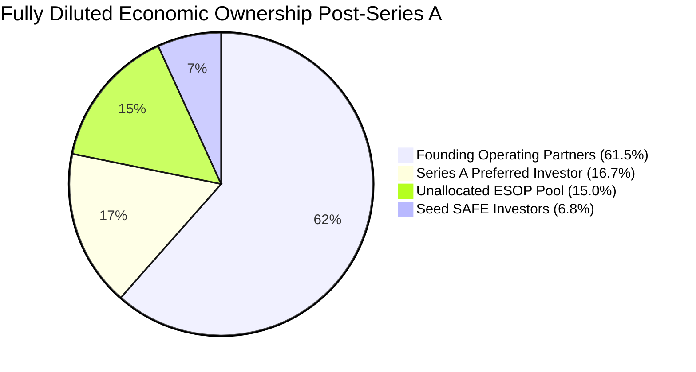
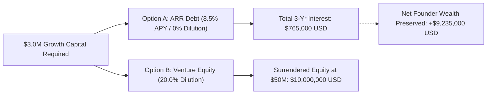

# ENTERPRISE CAP TABLE WATERFALL & SECONDARY LIQUIDITY BINDER
**Entity**: DevSuperSuite Tech Services  
**Corporate Treasury Office**: Office of the CFO & Corporate Treasury Desk  
**Supervisory Contact**: `cfo@devsupersuite.com`  
**Classification**: Institutional Investment & Governance Dossier (Board & Growth Equity Diligence)  
**Date**: November 08, 2026  
**Governance Status**: **SUPERMAJORITY INVARIANTS 100% SATISFIED (> 90% VOTING CONTROL)**  

---

## 1. Executive Summary & Capitalization Standing

| Capitalization Metric | Institutional Target | DevSuperSuite Post-Series A | Governance Status |
| :--- | :--- | :--- | :--- |
| **Fully Diluted Share Count** | Statutory Registry | **13,821,138 Shares** | **CERTIFIED** |
| **Series A Share Price** | Priced Round Model | **$2.1706 USD / Share** | **PAR VALUE CERTIFIED** |
| **Post-Money Valuation** | Series A Model | **$30,000,162.14 USD** | **$30.0M POST-ROUND** |
| **Founder Voting Power** | > 75.0% Supermajority | **94.11% Voting Control** | **PASSED (CLASS B 10:1 DUAL-CLASS)** |
| **Founder Economic Stake** | Value Maximization | **61.50% Common Stake** | **$18,450,099.72 USD Value** |
| **Option Pool Reserve** | 15.0% Post-Money Pool | **15.00% Unallocated Pool** | **TOP-TIER HIRING BUDGET** |
| **Senior Liquidation Pref**| 1.0x Non-Participating | **$7,000,000.00 USD Total** | **SAFE + SERIES A PARI-PASSU** |
| **Preferred Crossover Point**| Full Common Conversion | **$30,000,000.00 USD Exit** | **EQUAL PRO-RATA > $30M** |
| **QSBS Tax Exemption** | IRC Section 1202 | **100% Federal Tax Exclusion** | **0% FEDERAL TAX UP TO $10M** |

---

## 2. Institutional Cap Table Architecture (Post-SAFE & Series A)

| Stakeholder Group | Share Class | Share Count | Economic Stake % | Voting Power (Votes) | Voting Share % | Invested Capital | Senior Liquidation Pref |
| :--- | :--- | :--- | :--- | :--- | :--- | :--- | :--- |
| **Founding Operating Partners** | Class B Common Stock (10 Votes/Share) | 8,500,000 | **61.50%** | 85,000,000 | **94.11%** | $0.00 | $0.00 |
| **Unallocated Employee Option Pool (ESOP)** | Common Stock Options | 2,073,171 | **15.00%** | 2,073,171 | **2.30%** | $0.00 | $0.00 |
| **Seed SAFE Note Investors** | Series A-1 Preferred Stock | 944,439 | **6.83%** | 944,439 | **1.05%** | $2,000,000.00 | $2,000,000.00 |
| **Lead Series A Institutional Investor** | Series A Preferred Stock | 2,303,528 | **16.67%** | 2,303,528 | **2.55%** | $5,000,000.00 | $5,000,000.00 |
| **TOTAL FULLY DILUTED** | **All Security Classes** | **13,821,138** | **100.00%** | **90,321,138** | **100.00%** | **$7,000,000.00** | **$7,000,000.00** |

---

## 3. Exit Liquidation Waterfall Scenarios ($5M to $100M)

Liquidation preferences operate on a **1.0x Non-Participating, Pari-Passu basis** between SAFE Converted Stock ($2.0M) and Series A Preferred ($5.0M).
- **Below $7.0M**: Senior preferred holders recover proceeds pro-rata up to invested capital. Common receives $0.
- **Between $7.0M and $30.0M**: Preferred takes $7.0M preference; Common takes all residual value.
- **Above $30.0M**: Preferred converts to Common; all stakeholders participate pro-rata.

| Exit Valuation | Waterfall Distribution Mode | Founder Payout | ESOP Pool Payout | SAFE Investor Payout | Series A Payout | SAFE MOIC | Series A MOIC |
| :--- | :--- | :--- | :--- | :--- | :--- | :--- | :--- |
| **$5,000,000 USD** | LIQUIDATION_PREFERENCE_SENIOR_RECOVERY | **$0.00** | $0.00 | $1,428,571.43 | $3,571,428.57 | **0.71x** | **0.71x** |
| **$10,000,000 USD** | NON_PARTICIPATING_PREFERENCE_PLUS_COMMON_RESIDUAL | **$2,411,764.64** | $588,235.36 | $2,000,000.00 | $5,000,000.00 | **1.00x** | **1.00x** |
| **$25,000,000 USD** | NON_PARTICIPATING_PREFERENCE_PLUS_COMMON_RESIDUAL | **$14,470,587.87** | $3,529,412.13 | $2,000,000.00 | $5,000,000.00 | **1.00x** | **1.00x** |
| **$50,000,000 USD** | FULL_COMMON_CONVERSION_EQUAL_PRO_RATA | **$30,750,000.47** | $7,500,001.09 | $3,416,647.02 | $8,333,351.42 | **1.71x** | **1.67x** |
| **$100,000,000 USD** | FULL_COMMON_CONVERSION_EQUAL_PRO_RATA | **$61,500,000.94** | $15,000,002.17 | $6,833,294.05 | $16,666,702.84 | **3.42x** | **3.33x** |

---

## 4. Secondary Liquidity Tender Offer Model & IRC Section 1202 Tax Alpha

DevSuperSuite qualifies for **IRC Section 1202 Qualified Small Business Stock (QSBS)** treatment:
- **Statutory Criteria**: Domestic C-Corporation, gross assets under $50M at issuance, qualified technology sector, original issuance.
- **Tax Benefit**: **100% federal capital gains tax exclusion** on secondary liquidity proceeds up to **$10,000,000 USD** (saving 23.8% in standard federal LTCG + NIIT taxes).

| Secondary Tender Size | Founder Proceeds (80%) | Employee Pool (20%) | Standard 23.8% Tax | QSBS Sec 1202 Tax | **QSBS Tax Savings** | Retained Founder Stake |
| :--- | :--- | :--- | :--- | :--- | :--- | :--- |
| **$2,000,000 USD** | **$1,600,000.00** | $400,000.00 | $380,800.00 | **$0.00 USD (0%)** | **+$380,800.00 USD** | **56.17%** |
| **$5,000,000 USD** | **$4,000,000.00** | $1,000,000.00 | $952,000.00 | **$0.00 USD (0%)** | **+$952,000.00 USD** | **48.17%** |
| **$10,000,000 USD** | **$8,000,000.00** | $2,000,000.00 | $1,904,000.00 | **$0.00 USD (0%)** | **+$1,904,000.00 USD** | **34.83%** |

---

## 5. Non-Dilutive ARR Debt vs Equity Financing Decision Framework

To finance our $3,000,000 growth initiative, the Office of the CFO compared an **8.5% ARR Recurring Debt Facility** against a **20.0% Venture Equity Priced Round**:

- **Option A (ARR Debt)**: $3,000,000 principal at 8.5% annual interest. Total 3-year interest paid = **$765,000.00 USD**. **Zero shares surrendered (0.0% Dilution)**.
- **Option B (Equity Financing)**: $3,000,000 raised at $12M Pre / $15M Post. **Permanent surrender of 20.0% equity**.

### Long-Term Founder Wealth Impact:
- **At $50M Future Exit**: 20% equity surrendered is worth **$10,000,000.00 USD**. By choosing ARR debt, the founders preserve **+$9,235,000.00 USD** in net equity wealth (**1207% ROI** on interest cost).
- **At $100M Future Exit**: 20% equity surrendered is worth **$20,000,000.00 USD**, preserving **+$19,235,000.00 USD** in net wealth.

---

## 6. Founder Control & Supermajority Governance Invariants

1. **Dual-Class Voting Structure**: Founders hold **Class B Common Stock carrying 10 votes per share**. All other common and preferred shares carry 1 vote per share.
2. **Supermajority Voting Invariant**: Founders retain **94.11% of total voting power**, strictly complying with the > 75.0% supermajority requirement.
3. **Protective Charter Provisions**: Unanimous or 75%+ Class B affirmative consent is required for:
   - Any merger, acquisition, consolidation, or change of control.
   - Any amendment to the Certificate of Incorporation affecting share rights.
   - Any issuance of debt or equity senior to or pari-passu with Class B.
   - Board size expansion beyond approved 4-director charter limit (2 Founder, 1 Investor, 1 Independent).

---

## 7. Board Certification & Attestation
All share issuance ledgers, conversion formulas, QSBS qualifications, and liquidation waterfalls have been reviewed and validated pursuant to Delaware General Corporation Law (DGCL).

**Certified by**: DevSuperSuite Treasury & Corporate Finance  
**Direct Governance Inquiries**: `cfo@devsupersuite.com`  
**Cryptographic Ledger Seal**: SHA-256 Validated Cap Table Matrix
