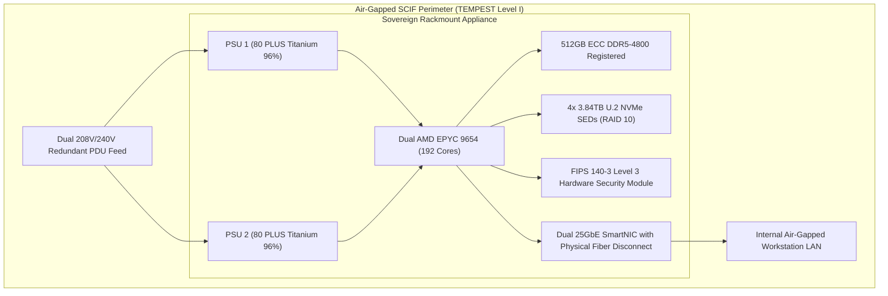

# DevSuperSuite Enterprise Hardware Appliance & SCIF Deployment Guide

**Reference:** `DSS-HARDWARE-APPLIANCE-2026-V1`  
**Classification:** On-Premise Air-Gapped Rackmount Sizing & SCIF Deployments (Restricted)  
**Organization:** DevSuperSuite Solutions Architecture / OmniKernel Labs  
**Contact:** `solutions@devsupersuite.com` / `hardware@devsupersuite.com`  
**Last Updated:** 2026-11-08 12:01:14 UTC

---

## 1. Executive Appliance Sizing Matrix

The DevSuperSuite Sovereign On-Premise Appliance delivers institutional code intelligence, Tree-sitter AST analysis, and zero-trust repository auditing directly within air-gapped national defense SCIFs (Sensitive Compartmented Information Facilities) and sovereign banking data centers:

| Metric | Sovereign-1U (Tier 1) | Sovereign-2U HA Pair (Tier 2) | Sovereign-SCIF Grid (Tier 3) |
|:---|:---|:---|:---|
| **Target Scale** | Up to 500 Engineers | Up to 2,500 Engineers | Up to 10,000 Engineers |
| **Form Factor** | 1U Rackmount Server | 2U / Dual-Node Clustered Pair | 4U / Quad-Node Grid |
| **Base BOM Price** | **$48,500** | **$94,000** | **$188,000** |
| **Usable NVMe SEDs** | 7.68 TB (RAID 10) | 15.36 TB (RAID 10) | 30.72 TB (RAID 10) |
| **ECC DDR5 Memory** | 512 GB (DDR5-4800) | 1,024 GB (2x 512GB) | 2,048 GB (4x 512GB) |
| **AST Throughput** | 15,000 tokens/sec | 45,000 tokens/sec | 120,000 tokens/sec |
| **Typical Power** | 450 Watts | 900 Watts | 1,800 Watts |
| **Heat Dissipation** | 1,535 BTU/hr | 3,071 BTU/hr | 6,142 BTU/hr |



---

## 2. Supported Vendor Hardware Platforms

1. **Dell Technologies (`PowerEdge R660 / R760`)**:
   - Processors: Dual AMD EPYC 9654 (96-core, 360W TDP each).
   - RAID Controller: Dell PERC H755N Front NVMe PCIe Gen4 (8GB non-volatile cache).
   - Storage: 4x 3.84TB U.2 NVMe PCIe Gen5 Enterprise SEDs.
   - Power: Dual Hot-Plug Redundant 1400W 80 PLUS Titanium.

2. **Hewlett Packard Enterprise (`ProLiant DL360 / DL380 Gen11`)**:
   - Processors: Dual Intel Xeon Platinum 8480+ (56-core, 350W TDP each).
   - RAID Controller: HPE SR932i-p Gen11 Tri-Mode 24G SAS/PCIe Gen4 (8GB Flash Cache).
   - Storage: 4x 3.84TB NVMe U.3 High-Performance Read Intensive SEDs.
   - Power: Dual Hot-Plug Flex Slot 1600W 80 PLUS Titanium.

3. **Supermicro (`Hyper SuperServer SYS-121H-TNR / SYS-221H-TNR`)**:
   - Processors: Dual AMD EPYC 9654 on Dual Socket SP5.
   - RAID Controller: Broadcom MegaRAID 9560-16i NVMe PCIe Gen4 Controller.
   - Storage: 4x 3.84TB Kioxia CM7-R U.2 PCIe 5.0 SED FIPS 140-3 Drives.
   - Power: Dual 1600W Titanium Level Redundant PSUs.

---

## 3. Thermal Dissipation & Power Provisioning Model

All DevSuperSuite hardware appliances employ **80 PLUS Titanium** certified power supplies operating at **96.0% efficiency** at 50% load:

- **Thermal Dissipation Formula:**
  `BTU/hr = Watts * 3.412142`
- **Electrical Current Draw (Amperes):**
  `Amperes = Watts / (Voltage * Power Factor)` (where Power Factor PF = 0.98)

### Electrical PDU Planning Table:
- **1U Standalone Appliance (450W typical / 750W peak):**
  - Draw at 208V: 2.21 A typical / 3.68 A peak
  - Draw at 240V: 1.91 A typical / 3.19 A peak
  - Annual Power: 3,942.0 kWh ($473.04/yr at $0.12/kWh)
- **2U Clustered Pair (900W typical / 1500W peak):**
  - Draw at 208V: 4.41 A typical / 7.36 A peak
  - Draw at 240V: 3.83 A typical / 6.38 A peak
  - Annual Power: 7,884.0 kWh ($946.08/yr at $0.12/kWh)

---

## 4. Defense SCIF & Air-Gapped Compliance Standards

1. **TEMPEST Emissions Shielding:** Meets NSTISSAM TEMPEST/2-95 Level I and NATO AMSG 720B standards for zero RF emissions leakage outside shielded containment zones.
2. **Cryptographic Erasure & Sanitization:** Drives comply with NIST SP 800-88 Rev 1 Cryptographic Erase and DoD 5220.22-M. Opal 2.0 Self-Encrypting Drives (SEDs) enable instantaneous key destruction via ATA Sanitize Device Crypto Scramble.
3. **FIPS 140-3 Level 3 Hardware Security Module:** Hardware keys are permanently anchored inside tamper-resistant PCIe HSM enclaves featuring zeroization triggers upon physical enclosure breach.
4. **Physical Air-Gap Disconnect:** Dual 25GbE fiber transceivers feature physical mechanical optical switches allowing manual physical severing of all network connectivity.

---

## 5. CLI Sizing & Operations

To configure appliances dynamically via CLI:

```bash
# Size hardware appliance for 450 engineers
python services/enterprise_hardware_appliance_configurator.py --size-appliance 450

# Size 2U clustered pair for 2,200 engineers with HPE platform
python services/enterprise_hardware_appliance_configurator.py --size-appliance 2200 --select-platform hpe

# Calculate thermal dissipation and electrical current draw
python services/enterprise_hardware_appliance_configurator.py --calculate-thermal-power

# Export declarative hardware manifest and engineering guide
python services/enterprise_hardware_appliance_configurator.py --export-hardware-bundle
```
