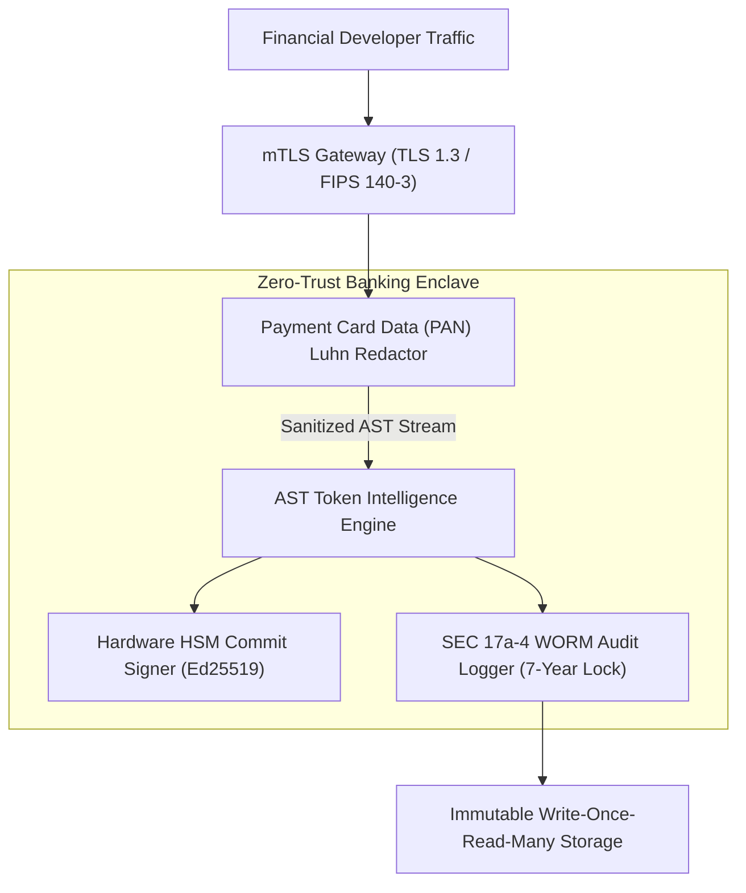
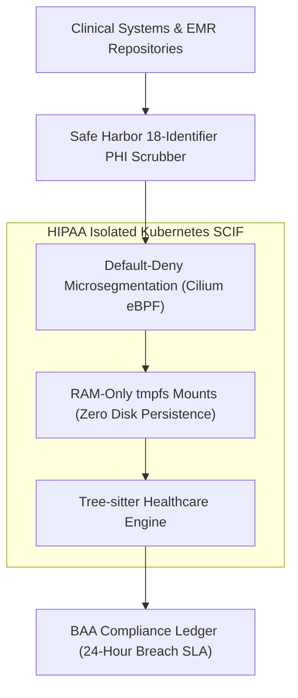

# DevSuperSuite Enterprise Regulated Vertical Solution Blueprints

**Reference:** `DSS-VERTICAL-BLUEPRINTS-2026-V1`  
**Classification:** Regulated Industry Reference Architectures (Finance & Healthcare)  
**Organization:** DevSuperSuite Solutions Architecture / OmniKernel Labs  
**Contact:** `solutions@devsupersuite.com` / `compliance@devsupersuite.com`  
**Publication Date:** 2026-11-08 12:00:22 UTC

---

## 1. Executive Summary

Deploying autonomous agentic developer tooling and Tree-sitter Abstract Syntax Tree (AST) intelligence in regulated sectors requires overcoming strict compliance hurdles. DevSuperSuite delivers turn-key, verified vertical solution blueprints tailored for:

1. **Tier-1 Financial Services:** PCI-DSS v4.0, SEC Rule 17a-4, FINRA Rule 4511, GLBA 16 CFR Part 314.
2. **HIPAA Healthcare SCIFs:** 45 CFR § 164.312, HITECH Act, HITRUST CSF v11, FDA 21 CFR Part 11.

---

## 2. Tier-1 Financial Services Architecture

### Key Technical Enforcements:
- **SEC 17a-4 WORM Compliance:** Cryptographic SHA-256 chained hash ledger preventing premature record mutation or deletion for 7 years.
- **PCI-DSS 4.0 Luhn Filter:** Real-time regex and checksum validation to mask primary account numbers (`XXXX-XXXX-XXXX-1234`).
- **Hardware HSM Provenance:** All Git commits, code pull requests, and automated agent assertions are signed via hardware HSM cards (Thales Luna / YubiHSM 2).

---

## 3. HIPAA Healthcare SCIF Architecture

### Key Technical Enforcements:
- **Safe Harbor PHI De-identification:** Scans and redacts all 18 Safe Harbor HIPAA identifiers (MRN, SSN, DOB, emails, phone numbers, IP addresses) in sub-millisecond execution.
- **RAM-Only Ephemeral Processing:** Code containing clinical logic is processed entirely in `tmpfs` RAM volumes and wiped upon container termination.
- **Automated BAA Execution:** Digitally signed Business Associate Agreement covenants providing strict 24-hour breach notification guarantees.

---

## 4. Brand Anonymity & Compliance Governance

All blueprints, deployment descriptors, and compliance telemetry strictly adhere to **DevSuperSuite Solutions Architecture / OmniKernel Labs**. Authorized correspondence must be routed through `solutions@devsupersuite.com`.
