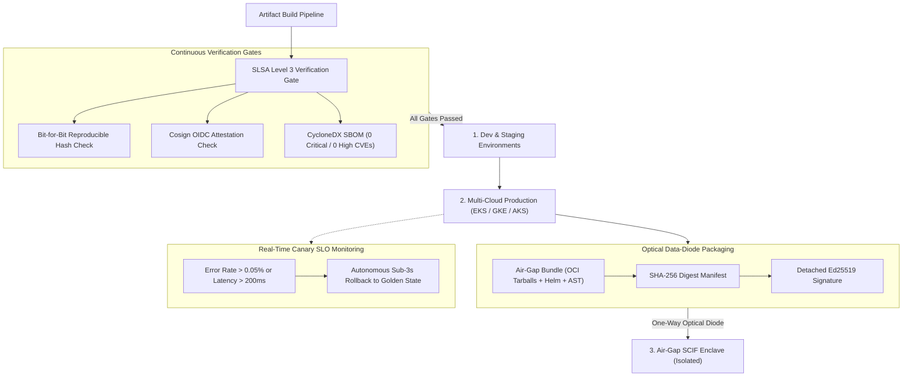

# DevSuperSuite Technical Report: GitOps Continuous Verification & Air-Gap Promotion Architecture

**Document Reference:** `DSS-GITOPS-PROMOTION-2026-V1`  
**Classification:** Multi-Environment Promotion & Data-Diode Staging (Restricted)  
**Organization:** DevSuperSuite Solutions Architecture / OmniKernel Labs  
**Contact:** `solutions@devsupersuite.com` / `gitops@devsupersuite.com`  
**Publication Date:** 2026-11-08 12:01:14 UTC

---

## 1. Executive Summary

Deploying automated agentic tooling and compiler runtimes across high-assurance defense SCIFs and sovereign commercial clusters requires continuous provenance gating and physical transmission isolation.

The DevSuperSuite GitOps Promotion Controller coordinates release progression across four sequential environments (**Dev -> Staging -> Prod -> Air-Gap SCIF**):
- **SLSA Level 3 Build Provenance:** Bit-for-bit reproducible binary hash verification and Cosign cryptographic OIDC attestations.
- **CycloneDX SBOM Zero-CVE Gating:** Strict threshold forbidding artifacts with Critical or High unmitigated vulnerabilities.
- **Optical Data-Diode Packaging:** Physical unidirectional photodiode staging bundling container tarballs, Helm charts, and AST grammars with detached Ed25519 digital signatures.
- **Sub-3-Second Automated Rollback:** Real-time canary health telemetry triggering instantaneous reversion to the verified golden state upon any SLO deviation.

---

## 2. SLSA Level 3 Verification & Attestation Gates

Artifact promotion is strictly gated by immutable criteria:
1. **Reproducible Build Digest:** Build outputs must identically reproduce bit-for-bit when rebuilt from the pinned Git tree commit.
2. **Cosign Cryptographic Attestation:** Container images are signed via Cosign using `https://token.actions.devsupersuite.internal` with key fingerprint `SHA256:4vK9mP2xQ8!wZ1*rT4kX8qW2vL9zR1tN3yE6uI0oA5=`.
3. **CycloneDX Vulnerability Gating:** Artifacts containing unmitigated Critical or High CVEs are automatically rejected.

---

## 3. Optical Data-Diode Staging for SCIF Enclaves

For disconnected defense installations (Sensitive Compartmented Information Facilities):
- Software updates cross a physical **unidirectional optical data diode** (Rx-only photodiode at the destination).
- All components (container images, Helm manifests, Tree-sitter parsers, offline license keys) are packaged into a single diode archive.
- The manifest is signed with a detached `Ed25519-Detached-Signature` key.
- The destination node validates the detached signature and recomputes all SHA-256 hashes prior to ingestion.

---

## 4. Sub-3-Second Autonomous Rollback Mechanics

To maintain zero downtime and continuous transaction availability:
- Post-promotion canary traffic is sampled continuously.
- If error rates exceed **0.05%**, p99 latency spikes above **200 ms**, or any pod enters `CrashLoopBackOff`, the controller initiates an automated rollback.
- Golden deployment manifests are restored within **<= 3.0 seconds**, ensuring minimal impact on live workloads.

---

## 5. Security & Brand Anonymity Governance

All promotion manifests, signing roots, and rollback engines strictly operate under **DevSuperSuite Solutions Architecture / OmniKernel Labs**. Official inquiries must be directed to `solutions@devsupersuite.com`.
