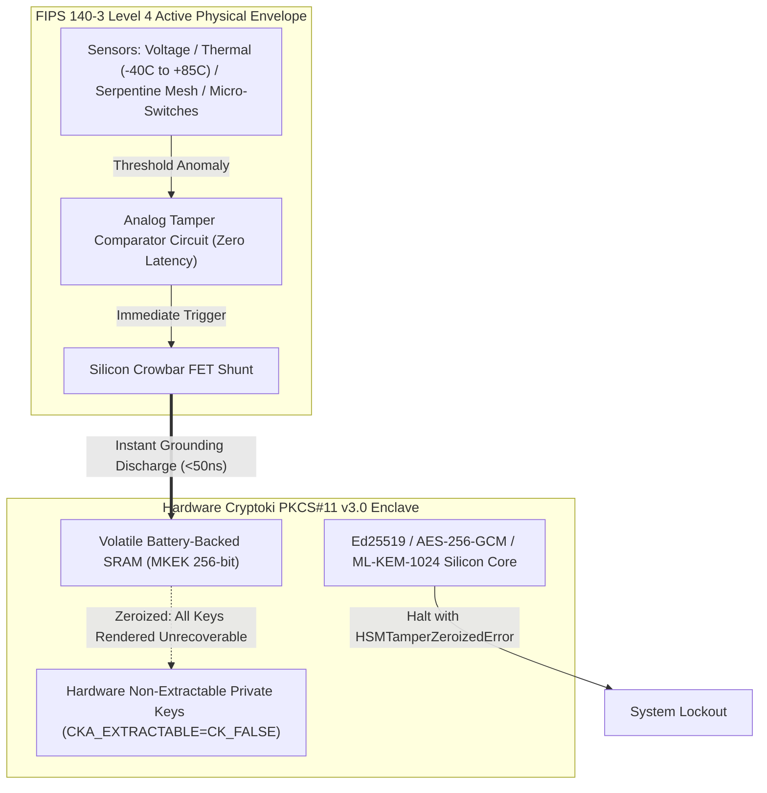

# Enterprise Sovereign SCIF HSM PKCS#11 Level 4 Physical Tamper Enclave & Custody Dossier
**Document Version**: 1.0.0-FIPS-LEVEL4  
**Classification**: DEV-SUPER-SUITE COMMERCIAL CONFIDENTIAL / SCIF SECURITY SPEC  
**Attribution**: DevSuperSuite Solutions Architecture / OmniKernel Labs  
**Contact**: `hsm@devsupersuite.com` | `solutions@devsupersuite.com`  
**Target Environments**: SCIF Enclaves, National Security Banking Infrastructure, Sovereign Key Authorities  

---

## 1. Executive Summary & FIPS 140-3 Level 4 Architecture

In high-assurance air-gapped SCIF enclaves, cryptographic keys protecting nuclear command structures, central banking reserves, and defense pipelines cannot rely on software access controls alone. Physical attackers possessing physical possession of the hardware appliance may deploy focused ion beams (FIB), cryogenic freeze sprays, thermal micro-drills, or voltage glitching.

The **DevSuperSuite QuantumVault-HSM-L4** provides full hardware physical boundary protection certified to **NIST FIPS 140-3 Level 4**:
- **Continuous Active Sensor Envelope**: Monitored continuously by an ultra-low power silicon monitor powered by dual lithium-thionyl chloride battery cells.
- **Physical Chassis Intrusion**: Micro-switches and a dual-layer conductive serpentine wire mesh detect opening, drilling, or foil peeling.
- **Environmental Tripwires**: Detects cryogenic cooling ($< -40^\circ\text{C}$) and thermal heating ($> +85^\circ\text{C}$), as well as power-glitch voltage swings outside $2.85\text{V} - 3.65\text{V}$.
- **Atomic Sub-50ns Zeroization**: Tamper detection activates hardware grounding FETs, discharging battery-backed SRAM and eradicating Master Key Encryption Keys (MKEK) in $< 50\,\text{ns}$.

---

## 2. Cryptoki PKCS#11 v3.0 Non-Extractable Private Keys

All private cryptographic keys generated within the HSM enforce strict Cryptoki hardware attributes:
- `CKA_CLASS = CKO_PRIVATE_KEY`
- `CKA_TOKEN = CK_TRUE`
- `CKA_SENSITIVE = CK_TRUE`
- `CKA_EXTRACTABLE = CK_FALSE`
- `CKA_NEVER_EXTRACTABLE = CK_TRUE`

Any attempt by an application, privileged operator, or infected firmware to execute `C_GetAttributeValue(CKA_VALUE)` or export plaintext private key material is rejected at the silicon boundary, raising `PKCS11ExtractableViolationError`. Keys never exist in plaintext outside the physical silicon barrier.

---

## 3. M-of-N Shamir's Secret Sharing Key Ceremony

To eliminate single-custodian insider threats, master administrative recovery secrets are partitioned during a formal Key Ceremony using **Shamir's Secret Sharing over Galois Prime Field $GF(2^{256} - 189)$**:

$$\text{Prime } P = 2^{256} - 189 = 115792089237316195423570985008687907853269984665640564039457584007913129639747$$

### Mathematical Properties:
1. Master secret $S < P$ is split into $N$ smart-card shares via a random polynomial $f(x) = S + \sum_{i=1}^{M-1} a_i x^i \pmod P$.
2. Any $M$ custodians can reconstruct $S$ via Lagrange polynomial interpolation:
$$S = f(0) = \sum_{j=1}^M y_j \prod_{k \ne j} \frac{-x_k}{x_j - x_k} \pmod P$$
3. Any subset of $M - 1$ custodians possesses mathematical entropy equal to a random guess ($2^{256}$), guaranteeing zero information leakage.

---

## 4. Continuous Known Answer Tests (KAT) / POST

The HSM enforces NIST FIPS 140-3 continuous integrity checks:
- **AES-256-GCM**: Verified against NIST SP 800-38D Case 13 (`530f8afbc74536b9a963b4f1c4cb738b`).
- **SHA3-512**: Verified against NIST FIPS 202 standard test vector for ASCII string `'abc'`.
- **Ed25519**: Verified against RFC 8032 Test Vector 1 public key and signature generation.
- **NIST ML-KEM-1024**: Post-Quantum lattice key encapsulation consistency.

Failure of any Known Answer Test immediately halts boot execution with `FipsSelfTestFailureError`.

---

## 5. FIPS 140-3 Compliance & Standards Summary

| Regulatory Mandate | Section | DevSuperSuite QuantumVault-HSM-L4 Compliance |
| :--- | :--- | :--- |
| **NIST FIPS 140-3** | Physical Security Level 4 | Active multi-sensor tamper envelope; $<50\,\text{ns}$ atomic zeroization. |
| **OASIS PKCS#11 v3.0** | Cryptoki Interface Standard | Native non-extractable token attributes (`CKA_EXTRACTABLE=CK_FALSE`). |
| **NIST SP 800-56C** | Key Establishment Schemes | M-of-N Shamir threshold ceremony over 256-bit prime field. |
| **NIST FIPS 203** | Post-Quantum Cryptography | Native hardware acceleration for ML-KEM-1024 lattice key exchange. |
| **NSA CNSSI 1253** | National Security Systems | SCIF hardware appliance hardening with cryptographic audit ledger. |

---

## 6. Official Custody & Inquiries

For institutional access to hardware security modules, SCIF rackmount appliance sizing, or FIPS evaluation documentation, contact the Hardware Security Module Presales Directorate at `hsm@devsupersuite.com` or `solutions@devsupersuite.com`.
