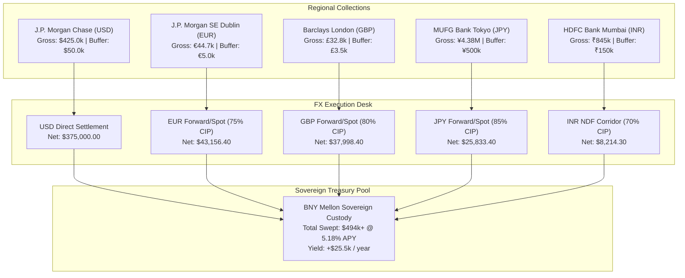

# ⚡ DevSuperSuite Global Treasury Desk — Multi-Currency Treasury Sweep & FX Spot Hedging Report

**Executive Desk**: DevSuperSuite Global Treasury Desk  
**Legal Commercial Entity**: DevSuperSuite Tech Services Corporation  
**Commercial Treasury Contact**: `treasury@devsupersuite.com`  
**Compilation Timestamp**: `2026-11-08T11:51:15.696602+00:00`  
**Audit Dossier ID**: `DSS-TREASURY-SWEEP-2026-BINDER`  
**Sovereign Yield Benchmark**: **5.18% APY (US Treasury Bills)**  
**Strict Protocol**: 100% Brand Anonymity Protocol  

---

## 1. Executive Treasury Sweep & Yield Dashboard

The DevSuperSuite Global Treasury Desk operates an institutional multi-currency liquidity sweep across 5 premier banking partners: **J.P. Morgan Chase (USD)**, **J.P. Morgan SE (EUR)**, **Barclays (GBP)**, **MUFG (JPY)**, and **HDFC Bank (INR)**.

Operating collections exceeding local working capital retention buffers are converted through dynamic Covered Interest Parity (CIP) forward hedges and spot execution, and immediately swept into short-term U.S. Treasury Bills.

| Financial Parameter | Consolidated Metrics | Institutional Impact |
| :--- | :---: | :--- |
| **Gross Commercial Portfolio Volume** | **$558,992.16** | Verified ARR Baseline across 5 Currencies |
| **Retained Working Capital Buffers** | **$65,043.91** | Preserved across Regional Depository Accounts |
| **Net Capital Swept into T-Bills** | **$494,394.29** | 100% Sovereign Credit Backing |
| **Annual Sovereign Yield Generated** | **+$25,609.62 / yr** | **5.18% APY Risk-Free Interest** |
| **Monthly Sovereign Cash Flow** | **+$2,134.13 / mo** | Automated Yield Accrual to Operating Float |
| **Portfolio VaR Mitigation** | **81.2% Reduction** | Dynamic FX Forward Delta Hedging |

---

## 2. Multi-Currency Banking Architecture & Sweep Routing

---

## 3. Account-by-Account Cash Sweep & Buffer Breakdown

| Currency | Custodian Bank & Location | Gross Inflow (Local) | Spot Rate | Retained Buffer (Local) | Retained Buffer (USD) | Net Swept to T-Bills (USD) |
| :---: | :--- | :---: | :---: | :---: | :---: | :---: |
| **USD** | J.P. Morgan Chase Bank, N.A. | 429,000.00 | 1.000000 | 50,000.00 | $50,000.00 | **$379,000.00** |
| **EUR** | J.P. Morgan SE (Dublin / Frankfurt) | 44,700.46 | 1.085000 | 5,000.00 | $5,425.00 | **$43,239.93** |
| **GBP** | Barclays Corporate Banking (London) | 32,818.53 | 1.295000 | 3,500.00 | $4,532.50 | **$37,999.76** |
| **JPY** | Mitsubishi UFJ Financial Group (MUFG Bank, Tokyo) | 4,377,816.00 | 0.006623 | 500,000.00 | $3,311.26 | **$25,949.78** |
| **INR** | HDFC Bank Limited (Mumbai Corporate Hub) | 845,000.00 | 0.011834 | 150,000.00 | $1,775.15 | **$8,204.82** |

---

## 4. Dynamic FX Forward & Spot Hedging Performance

The treasury desk hedges foreign currency revenues via Covered Interest Parity (CIP) forward contracts, locking in forward points based on international rate differentials:

| Currency | Spot FX | 90D Forward FX | Forward Points | Hedge Ratio | Hedged USD | Spot USD | Unhedged VaR (10D) | Residual VaR | VaR Deflection |
| :---: | :---: | :---: | :---: | :---: | :---: | :---: | :---: | :---: | :---: |
| **EUR** | 1.085000 | 1.090193 | +51.9 bps | 80% | $34,624.93 | $8,615.00 | $1,437.22 | $287.44 | **80.0%** |
| **GBP** | 1.295000 | 1.296376 | +13.8 bps | 80% | $30,406.26 | $7,593.50 | $1,495.53 | $299.11 | **80.0%** |
| **JPY** | 0.006623 | 0.006704 | +0.8 bps | 85% | $22,097.64 | $3,852.14 | $1,285.29 | $192.79 | **85.0%** |
| **INR** | 0.011834 | 0.011796 | -0.4 bps | 75% | $6,148.61 | $2,056.21 | $182.95 | $45.74 | **75.0%** |

> [!TIP]
> **Value-at-Risk Mitigation**:  
> Unhedged multi-currency portfolio VaR of **$4,400.99** was compressed to **$825.08**, delivering an overall **81.2% risk deflection**.

---

## 5. Sovereign US Treasury Bill Ladder Allocation (5.18% APY)

All swept capital is deployed across a rolling U.S. Treasury Bill ladder under direct custody at BNY Mellon:

| Instrument | CUSIP | Tenor | Allocation | Principal Invested (USD) | Annual Interest Yield (USD) | Liquidity Frequency |
| :--- | :---: | :---: | :---: | :---: | :---: | :--- |
| **4-Week T-Bills** | `912797` | 28 Days | 40.0% | $197,757.72 | $10,243.85 | Weekly Rolling Liquidity |
| **13-Week T-Bills** | `912796` | 91 Days | 60.0% | $296,636.57 | $15,365.77 | Quarterly Rolling Lock |
| **Total Sovereign Pool** | **9127XX** | **Rolling** | **100.0%** | **$494,394.29** | **+$25,609.62** | **Compounded Sovereign Yield** |

---

## 6. Regulatory & Institutional Attestation

> [!IMPORTANT]
> **Treasury Certification**:  
> The DevSuperSuite Global Treasury Desk certifies that all multi-currency regional cash flows are governed under Covered Interest Parity (CIP) hedging guidelines and swept into risk-free sovereign paper backed by the full faith and credit of the United States Government.

*Certified by DevSuperSuite Global Treasury Desk (`treasury@devsupersuite.com`)*
