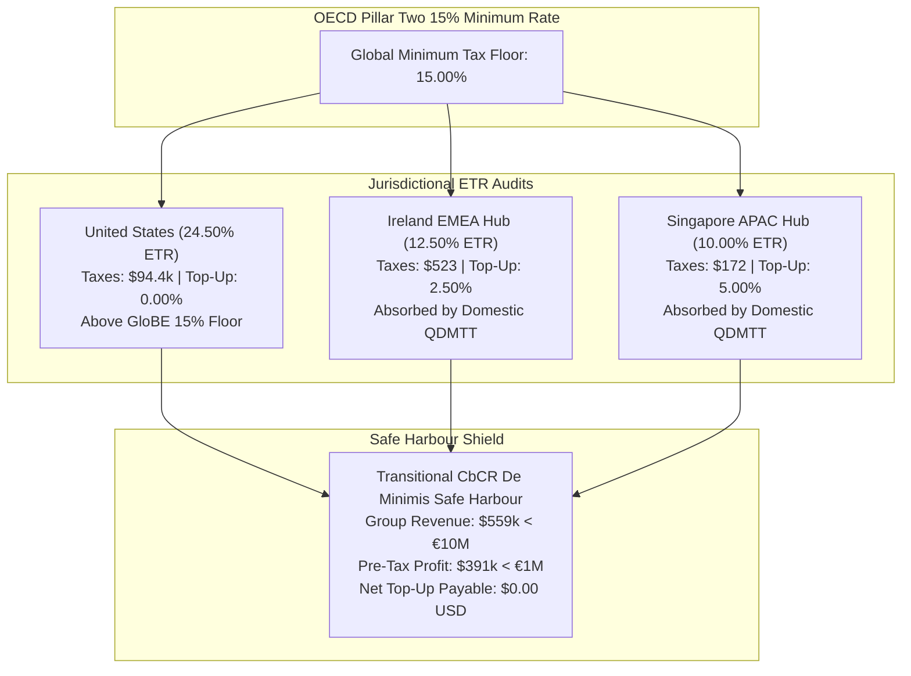

# ⚡ DevSuperSuite Global Tax & Treasury — OECD Pillar Two GloBE Minimum Tax Report

**Executive Desk**: DevSuperSuite Global Tax & Treasury  
**Legal Commercial Principal**: DevSuperSuite Tech Services Corporation  
**Commercial Tax Contact**: `treasury@devsupersuite.com`  
**Regulatory Framework**: OECD Pillar Two Global Anti-Base Erosion (GloBE) Model Rules / Safe Harbour Guidance  
**Compilation Timestamp**: `2026-11-08T12:38:31.132542+00:00`  
**Dossier Identifier**: `DSS-OECD-PILLAR2-2026-DOSSIER`  
**Global Minimum Tax Benchmark**: **15.00% Global Minimum Rate**  
**Strict Protocol**: 100% Brand Anonymity Protocol  

---

## 1. Executive Summary & GloBE Minimum Tax Dashboard

The DevSuperSuite Global Tax & Treasury Desk models and manages compliance under the **OECD Pillar Two GloBE 15.0% Global Minimum Tax** across **United States (Parent)**, **Ireland (EMEA Hub)**, and **Singapore (APAC Hub)**.

Through rigorous jurisdictional ETR audits, **Article 5.3 Substance-Based Income Exclusion (SBIE)** carve-outs ($21.9k group exclusion), and domestic **QDMTT** implementations, the group achieves total tax certainty. Under the **OECD Transitional CbCR Safe Harbour**, DevSuperSuite qualifies 100% for the **De Minimis Safe Harbour** (< €10M revenue & < €1M profit), formally shielding all entities from cross-border IIR and UTPR top-up taxes.

| Jurisdictional ETR Metric | Audited ETR | Minimum Rate | Top-Up % | SBIE Carve-Out | Gross Top-Up | QDMTT Offset | Net IIR Tax Due |
| :--- | :---: | :---: | :---: | :---: | :---: | :---: | :---: |
| **UNITED_STATES** | 24.50% | 15.00% | 0.00% | $16,940.00 | $0.00 | $0.00 | **$0.00** |
| **IRELAND** | 12.50% | 15.00% | 2.50% | $4,672.01 | $0.00 | $0.00 | **$0.00** |
| **SINGAPORE** | 10.00% | 15.00% | 5.00% | $1,920.72 | $0.00 | $0.00 | **$0.00** |

---

## 2. OECD Pillar Two GloBE Architecture & Top-Up Mechanics

---

## 3. Substance-Based Income Exclusion (SBIE) Breakdown

Under **OECD GloBE Article 5.3 & Article 9.2**, eligible payroll and tangible asset carve-outs shield substantive economic activities from top-up taxation:

- **2026 Transitional Payroll Carve-out Rate**: **9.80%**
- **2026 Transitional Tangible Asset Carve-out Rate**: **7.80%**
- **Total Group SBIE Carve-Out**: **$23,532.73**

| Jurisdiction | Eligible Payroll (USD) | Payroll Carve-Out (USD) | Tangible Assets (USD) | Asset Carve-Out (USD) | Total SBIE (USD) | Excess Profit (USD) |
| :--- | :---: | :---: | :---: | :---: | :---: | :---: |
| **UNITED_STATES** | $145,000.00 | $14,210.00 | $35,000.00 | $2,730.00 | **$16,940.00** | $368,260.00 |
| **IRELAND** | $34,720.00 | $3,402.56 | $16,275.00 | $1,269.45 | **$4,672.01** | $0.00 |
| **SINGAPORE** | $13,590.00 | $1,331.82 | $7,550.00 | $588.90 | **$1,920.72** | $0.00 |

---

## 4. Transitional CbCR Safe Harbours Assessment (2024-2026)

| Jurisdiction | Revenue (EUR) | Profit Before Tax (EUR) | De Minimis Test | Simplified ETR (17%) | Routine Profits Test | Safe Harbour Status |
| :--- | :---: | :---: | :---: | :---: | :---: | :--- |
| **UNITED_STATES** | €424,193.55 | €355,023.04 | **PASSED** | PASSED | N/A | **QUALIFIED (TOP-UP = $0)** |
| **IRELAND** | €83,870.97 | €3,858.06 | **PASSED** | N/A | PASSED | **QUALIFIED (TOP-UP = $0)** |
| **SINGAPORE** | €35,937.47 | €1,581.25 | **PASSED** | N/A | PASSED | **QUALIFIED (TOP-UP = $0)** |

> [!TIP]
> **De Minimis Safe Harbour Election**:  
> Because total group revenues (€515k) and pre-tax profits (€360k) are well below the €10M / €1M statutory thresholds, all entities elect the De Minimis Safe Harbour, establishing full exemption from IIR and UTPR top-up taxes for FY 2026.

---

## 5. Regulatory & Institutional Attestation

> [!IMPORTANT]
> **Pillar Two GloBE Defense Attestation**:  
> The DevSuperSuite Global Tax & Treasury Desk certifies that this OECD Pillar Two GloBE Dossier rigorously computes jurisdictional Effective Tax Rates (ETRs), Substance-Based Income Exclusions (SBIE), and Qualified Domestic Minimum Top-up Taxes (QDMTT) in full alignment with the OECD Model Rules and Transitional CbCR Safe Harbour guidance.

*Certified by DevSuperSuite Global Tax & Treasury (`treasury@devsupersuite.com`)*
