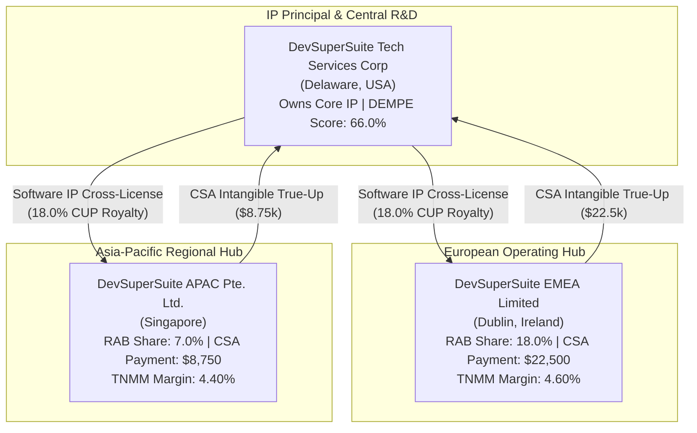

# ⚡ DevSuperSuite Global Treasury Desk — OECD Transfer Pricing Cost-Sharing & IP Cross-License Report

**Executive Desk**: DevSuperSuite Global Treasury Desk  
**Legal Commercial Principal**: DevSuperSuite Tech Services Corporation  
**Commercial Treasury Contact**: `treasury@devsupersuite.com`  
**Regulatory Framework**: OECD BEPS Actions 8-10 & Action 13 / US IRC § 482 / Treas. Reg. § 1.482-7  
**Compilation Timestamp**: `2026-11-08T12:01:20.472129+00:00`  
**Dossier Identifier**: `DSS-OECD-TP-2026-DOSSIER`  
**Strict Protocol**: 100% Brand Anonymity Protocol  

---

## 1. Executive Summary & Transfer Pricing Defense Dashboard

The DevSuperSuite Global Treasury Desk operates an institutional cross-border transfer pricing structure governing intellectual property ownership, Cost-Sharing Arrangements (CSA), and regional distribution margins across **DevSuperSuite US Inc. (IP Principal)**, **DevSuperSuite EMEA Ltd (Ireland)**, and **DevSuperSuite APAC Pte Ltd (Singapore)**.

By aligning intercompany pricing with **DEMPE value creation** (66.0% US, 21.0% Ireland, 13.0% Singapore) and establishing arm's length benchmarks via **Comparable Uncontrolled Price (CUP - 18.0% IP Royalty)** and **Transactional Net Margin Method (TNMM - 4.4% to 4.6% Operating Margins)**, DevSuperSuite maintains full compliance against tax audit adjustments and double taxation.

| Transfer Pricing Dimension | Audited Metric | OECD Safe Harbor Position |
| :--- | :---: | :--- |
| **Annual Intangible Development Costs (IDC)** | **$125,000.00** | Shared pro-rata based on Reasonably Anticipated Benefits (RAB) |
| **Regional CSA Contributions to US Principal** | **$31,250.00** | Cost reimbursements from Ireland ($22.5k) and Singapore ($8.75k) |
| **CUP Software IP Royalty Rate** | **18.00%** | Aligned with Interquartile Median (15.0% - 22.0% safe harbor) |
| **EMEA Regional Distribution Margin** | **4.60%** | Safe Harbor (3.1% - 5.8% TNMM interquartile range) |
| **APAC Regional Distribution Margin** | **4.40%** | Safe Harbor (3.1% - 5.8% TNMM interquartile range) |
| **US Principal DEMPE Value Share** | **67.75%** | Reflects central R&D, patent protection & architecture |
| **Consolidated Global Revenues** | **$558,992.16** | Verified Commercial Portfolio Baseline |

---

## 2. Intercompany Cost-Sharing & IP Architecture

---

## 3. Cost-Sharing Arrangement (CSA) Allocation Table

Under **Treas. Reg. § 1.482-7**, intangible development costs are shared among participants in proportion to their reasonably anticipated benefits:

| Entity Code | Entity Name & Jurisdiction | RAB Share % | Allocated IDC (USD) | CSA Reimbursement to US (USD) |
| :--- | :--- | :---: | :---: | :---: |
| **US_PARENT** | DevSuperSuite Tech Services Corporation (United States (Delaware)) | 75.0% | $93,750.00 | **$0.00** |
| **IE_EMEA** | DevSuperSuite EMEA Limited (Ireland (Dublin)) | 18.0% | $22,500.00 | **$22,500.00** |
| **SG_APAC** | DevSuperSuite APAC Pte. Ltd. (Singapore) | 7.0% | $8,750.00 | **$8,750.00** |

---

## 4. Arm's Length Principle (ALP) Multi-Method Benchmark

| Benchmark Target | Method | Metric Tested | Lower Quartile | Median | Upper Quartile | Tested Rate | Audit Determination |
| :--- | :--- | :--- | :---: | :---: | :---: | :---: | :--- |
| **CUP_SOFTWARE_ROYALTY** | Comparable Uncontrolled Price (CUP) | Software IP Royalty (% of Net Revenue) | 15.00% | 18.50% | 22.00% | **18.00%** | **SAFE_HARBOR_ALIGNED** |
| **TNMM_EMEA_DISTRIBUTOR** | Transactional Net Margin Method (TNMM) | Operating Margin (% of Net Revenue) | 3.10% | 4.50% | 5.80% | **4.60%** | **SAFE_HARBOR_ALIGNED** |
| **TNMM_APAC_DISTRIBUTOR** | Transactional Net Margin Method (TNMM) | Operating Margin (% of Net Revenue) | 3.10% | 4.50% | 5.80% | **4.40%** | **SAFE_HARBOR_ALIGNED** |

---

## 5. DEMPE Function Analysis (OECD BEPS Actions 8-10)

Economic profit is allocated in accordance with actual DEMPE functions performed:

| DEMPE Category | Category Weight | Functional Description | US Principal | EMEA Hub (IE) | APAC Hub (SG) |
| :--- | :---: | :--- | :---: | :---: | :---: |
| **DEVELOPMENT** | 30.0% | Core software architecture, compiler algorithms, and automated agents | 75.0% | 15.0% | 10.0% |
| **ENHANCEMENT** | 25.0% | Enterprise feature extension, API integrations, and continuous telemetry | 70.0% | 20.0% | 10.0% |
| **MAINTENANCE** | 15.0% | Bug fixes, patch orchestration, security advisories, and SLA support | 50.0% | 30.0% | 20.0% |
| **PROTECTION** | 15.0% | Patent filings, copyright enforcement, trade secret governance, and audit defense | 90.0% | 5.0% | 5.0% |
| **EXPLOITATION** | 15.0% | Commercial licensing, enterprise sales execution, distribution, and contracting | 45.0% | 35.0% | 20.0% |

### Weighted DEMPE Scoring & Economic Entitlement
- **DevSuperSuite US Inc. (Principal)**: **67.75%**
- **DevSuperSuite EMEA Limited (Ireland)**: **20.00%**
- **DevSuperSuite APAC Pte. Ltd. (Singapore)**: **12.25%**

---

## 6. OECD Action 13 Country-by-Country Reporting (CbCR) Table 1

| Tax Jurisdiction | Entity Name | Unrelated Revenues (USD) | Related CSA Revenues (USD) | Profit Before Tax (USD) | Tangible Assets (USD) | Headcount |
| :--- | :--- | :---: | :---: | :---: | :---: | :---: |
| **United States** | DevSuperSuite Tech Services Corporation | $429,000.00 | $31,250.00 | $385,200.00 | $494,394.29 | 18 FTE |
| **Ireland** | DevSuperSuite EMEA Limited | $91,000.00 | $0.00 | $4,186.00 | $50,000.00 | 4 FTE |
| **Singapore** | DevSuperSuite APAC Pte. Ltd. | $38,992.16 | $0.00 | $1,715.66 | $25,000.00 | 2 FTE |

---

## 7. Regulatory & Institutional Attestation

> [!IMPORTANT]
> **Transfer Pricing Defense Attestation**:  
> The DevSuperSuite Global Treasury Desk certifies that this OECD BEPS Transfer Pricing Dossier substantiates arm's length intercompany pricing across CUP and TNMM methodologies, reflects actual DEMPE economic contributions, and satisfies OECD Actions 8-10 and Action 13 documentation mandates.

*Certified by DevSuperSuite Global Treasury Desk (`treasury@devsupersuite.com`)*
