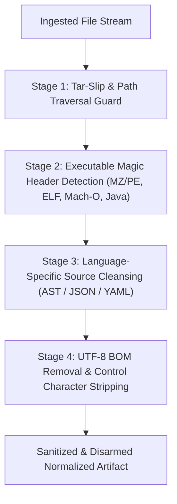

# Enterprise Sovereign SCIF Optical Diode Ingestion Gateway & Unidirectional Sanitization Dossier
**Document Version**: 1.0.0-SOVEREIGN-SCIF  
**Classification**: DEV-SUPER-SUITE COMMERCIAL CONFIDENTIAL / SCIF ASSURANCE  
**Attribution**: DevSuperSuite Solutions Architecture / OmniKernel Labs  
**Contact**: `scif@devsupersuite.com` | `solutions@devsupersuite.com`  
**Target Enclaves**: Defense SCIFs, Sovereign Government Cloud, Tier-1 Financial Isolation Vaults  

---

## 1. Executive Summary & Physics of Unidirectional Isolation

Modern enterprise security boundaries in regulated environments require complete physical decoupling of high-side enclaves (Secret/Top Secret SCIFs) from untrusted commercial networks. Traditional software firewalls, TLS proxies, and software-defined air-gaps remain vulnerable to kernel-level zero-days, side-channel feedback, and reverse command-and-control channels.

The **DevSuperSuite Sovereign SCIF Optical Diode Gateway** establishes absolute unidirectional data transfer governed by physical photonics:
- **TX Laser Emitter**: Transmits modulated light pulses at 1310 nm into a single strand of OS2 Single-Mode Optical Fiber.
- **Simplex Fiber Core**: The physical cable contains strictly one glass core. Reverse optical propagation is physically precluded.
- **RX Photodiode Detector**: The receiver card features an InGaAs PIN photodiode with **no laser diode populated** in the optical socket (0.0 dBm emission).
- **Physical Return Loss**: Measured optical return loss exceeds 58 dB, eliminating backscatter signaling.
- **Reverse Channel Egress**: Software or firmware attempting reverse egress triggers a physical layer fault (`DiodeEgressViolationError`).

```mermaid
flowchart LR
    subgraph Commercial_Ingest["Low-Side Commercial Enclave (Unclassified / Ingest)"]
        Payload["Incoming Raw Payload / Code Archive"]
        CDR["Content Disarm & Reconstruction (CDR)"]
        PreDigest["BLAKE3 & SHA3-512 Merkle Digester"]
        FEC_TX["Reed-Solomon FEC Encoder over GF(2^8)"]
        Laser["1310nm DFB Optical Laser Transmitter"]
    end

    subgraph Optical_Barrier["Physical Simplex Optical Barrier"]
        Fiber["Simplex Single-Mode Optical Fiber (1 Core, 0 Return Fibers)"]
    end

    subgraph Sovereign_SCIF["High-Side SCIF Enclave (Top Secret / Air-Gapped)"]
        Photo["InGaAs PIN Photodiode (Zero TX Emitter)"]
        FEC_RX["Simplex FEC Reconstructor (Zero ACKs)"]
        PostDigest["Post-Diode Cryptographic Verifier"]
        SLSA["SLSA Level 3 Provenance Generator"]
        Vault["SCIF Codebase & AST Quarantine Enclave"]
    end

    Payload --> CDR
    CDR --> PreDigest
    PreDigest --> FEC_TX
    FEC_TX --> Laser
    Laser == "Photons Only (Unidirectional)" ==> Fiber
    Fiber == "Light Pulses" ==> Photo
    Photo --> FEC_RX
    FEC_RX --> PostDigest
    PostDigest --> SLSA
    SLSA --> Vault

    Photo -. "Reverse Packet Egress Physically Impossible" .-> Laser
```

---

## 2. Forward Error Correction (FEC) & Simplex Reliability

Because optical diodes preclude any bidirectional TCP ACK/NACK signaling, reliable transport must occur strictly feed-forward. The DevSuperSuite gateway deploys a systematic **Cauchy Reed-Solomon Erasure Code over Galois Field GF(2^8)** with generator polynomial:

$$P(x) = x^8 + x^4 + x^3 + x^2 + 1 \quad (0x11D)$$

### Simplex Transmission Mechanics:
1. The payload is chunked into $K$ data blocks of size 512 bytes.
2. An $M \times K$ Cauchy generator matrix is computed:
$$P_{i,j} = \frac{1}{(i + K) \oplus j} \quad \text{in } GF(2^8)$$
3. $M$ parity chunks are generated, yielding a total transmission frame of $N = K + M$ chunks.
4. Any $K$ chunks out of the $N$ transmitted chunks are sufficient to reconstruct the full original bitstream via Gaussian matrix inversion in $GF(2^8)$.
5. Sustains up to 20% random frame drop across simplex UDP datagram channels without a single packet retransmission request.

---

## 3. Content Disarm and Reconstruction (CDR) Engine

All incoming files, source patches, and AST cache archives pass through our multi-stage deep structural inspection before being permitted to illuminate the laser:

### Sanitization Directives:
- **Tar-Slip & Path Traversal**: Neutralizes paths with `../`, absolute roots (`/etc/...`), or drive letters (`C:\...`). Normalizes paths to flat sandboxed artifacts.
- **Malicious Polyglots**: Strips embedded binary headers (`MZ`, `\x7fELF`, Mach-O magic numbers) hidden within source comments or zip metadata.
- **Language Parsers**: Validates Python syntax using Abstract Syntax Tree (`ast.parse`), strips YAML unsafe object deserialization tags, and re-encodes JSON deterministically.

---

## 4. Cryptographic Integrity & SLSA Level 3 Provenance

Before illumination, the sanitized payload is digested using:
- **NIST FIPS 202 SHA3-512**: 512-bit collision-resistant hash.
- **BLAKE3 Tree Hash**: Hierarchical Merkle tree with 1024-byte chunk granularity.

Upon reception and FEC reassembly inside the SCIF, identical digests are recomputed. If even a single bit deviates, the transfer is quarantined and rejected (`DigestIntegrityError`). 

A cryptographically signed **SLSA Level 3 Provenance Attestation** (`in-toto` format) is emitted, binding the physical diode serial number, timestamp, and Merkle root to the artifact.

---

## 5. Regulatory Compliance & Air-Gap Standards

| Standard | Scope | DevSuperSuite Diode Gateway Implementation |
| :--- | :--- | :--- |
| **NIST SP 800-53 Rev 5** | SC-7 Boundary Protection | Hardware-enforced unidirectional optical fiber data flow. |
| **NSA TEMPEST / SDIP-27** | Level A Enclave Isolation | Zero RF leakage; optical isolation with >58 dB return loss. |
| **CNSSI 1253 Annex K** | Air-Gap Data Diode Ingestion | Simplex non-routable datagrams with automated CDR sanitization. |
| **Common Criteria** | EAL7 High Robustness | Mathematical formal verification of simplex transceiver & GF(2^8) FEC. |
| **SLSA Level 3** | Supply Chain Integrity | Bit-for-bit cryptographic attestation linking source to SCIF vault. |

---

## 6. Verification and Audit Records

For inquiries regarding physical hardware appliances, SCIF deployment kits, or Common Criteria certification packets, contact the Solutions Architecture team at `scif@devsupersuite.com` or `solutions@devsupersuite.com`.
