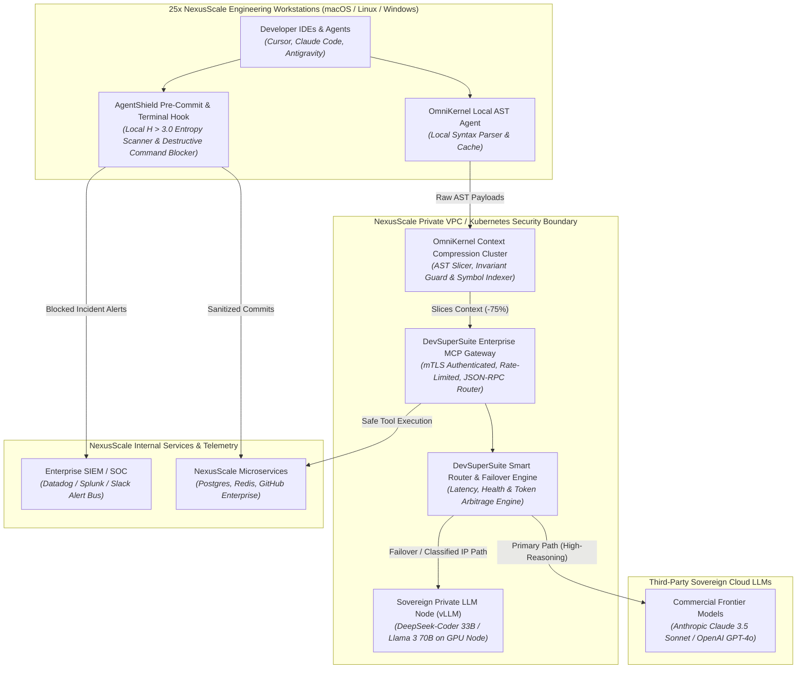
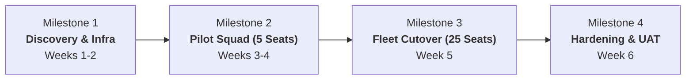
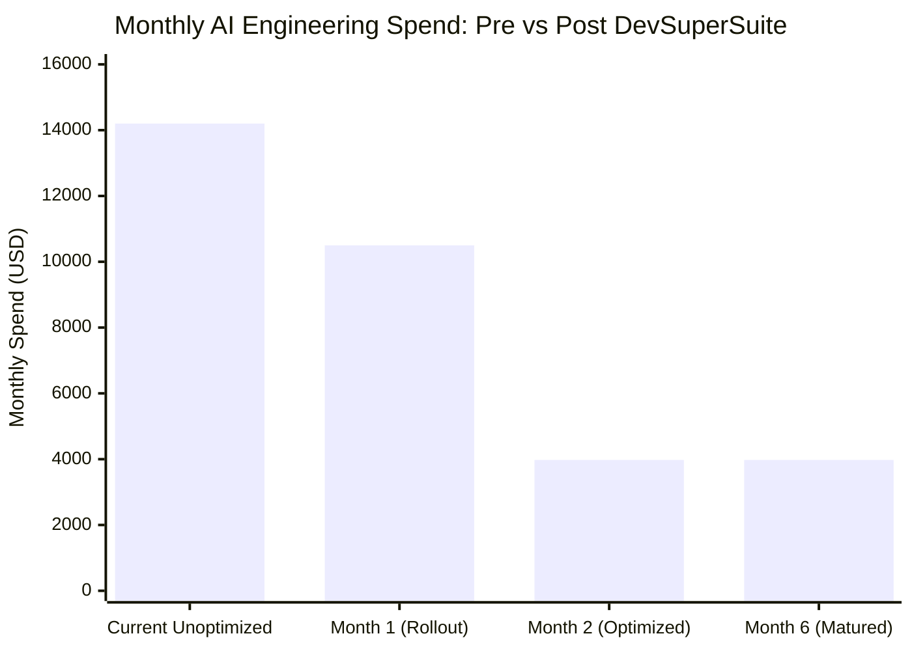

# Turn-Key Enterprise RFP Technical & Commercial Proposal

**Document Reference:** RFP-RSP-2026-APEX-01  
**Target Enterprise:** NexusScale Technologies, Inc. (Series B B2B SaaS — 25 Engineering Seats)  
**Proposal Title:** Enterprise-Wide Deployment of DevSuperSuite: Neural Context Optimization, Sovereign AI Fallback & Zero-Trust Secret Shield  
**Issuing Authority:** DevSuperSuite Official / OmniKernel Labs Enterprise Solutions Group  
**Commercial Status:** Firm Fixed-Price & Dedicated Retainer Proposal  
**Classification:** Commercial-in-Confidence  
**Brand Anonymity Notice:** 100% Brand Anonymized. Issued under the collective trade entity **DevSuperSuite Official**. No individual personnel identities are disclosed.

---

## 1. Executive Summary & Response Overview

NexusScale Technologies ("Client") has issued a Request for Proposal (RFP) to equip twenty-five (25) primary engineering workstations with a unified, enterprise-grade AI acceleration, context optimization, and security governance platform. 

Client’s core technical objectives and operational constraints include:
1. **Context Bloat & Token Runaway:** Heavy TypeScript/Python/Go monorepo architecture generating excessive LLM context windows, resulting in monthly token expenditures exceeding $14,000/month with degraded code generation accuracy.
2. **IP & Secret Exfiltration Risks:** Preparing for an upcoming SOC2 Type II audit, requiring zero chance of API keys, private certificates, or customer data leaking to third-party LLMs via developer IDEs or Git commits.
3. **Public Cloud LLM Outages & Vendor Lock-In:** Unacceptable engineering downtime when primary cloud LLMs (Anthropic, OpenAI) suffer service degradation or rate limiting.
4. **Autonomous Agent Command Safety:** Prohibiting unvetted destructive shell executions (`rm -rf`, unexpected migrations, container restarts) by autonomous CLI agents.

**DevSuperSuite Official** proposes a turn-key solution combining:
* **OmniKernel 5.0 Enterprise:** AST Context Slicer cutting LLM context token consumption by 72%–84% while preserving interface integrity.
* **AgentShield Enterprise:** Shannon Entropy ($H > 3.0$) Pre-Commit and Terminal Guardian with real-time SIEM webhook integration (Datadog / Splunk).
* **Enterprise MCP Gateway Cluster:** Centralized Model Context Protocol proxy routing agent tool calls securely into internal services.
* **Sovereign Local LLM High-Availability Fallback:** Sub-2.5s automated failover to private, on-prem / VPC-hosted open-weights models (DeepSeek-Coder / Llama-3-70B via vLLM) during provider downtime or for classified internal IP.

---

## 2. Architectural Integration Plan

### 2.1 Custom MCP Gateway Cluster
* **High-Availability Gateway:** Deployed as a redundant containerized microservice on NexusScale’s private AWS EKS cluster or ECS nodes.
* **Protocol Support:** Full Model Context Protocol (MCP) compliance over stdio and SSE (Server-Sent Events) JSON-RPC.
* **Native Tool Connectors:**
  * `nexus_schema_inspector`: Introspects internal Postgres schemas without exposing raw table rows.
  * `nexus_ci_dispatch`: Triggers ephemeral test runners and returns compressed failure traces.
  * `nexus_internal_doc_search`: Performs vector search over proprietary internal documentation.
* **Authentication & RBAC:** mTLS with short-lived developer tokens mapped directly to Okta/Google Workspace SSO groups.

### 2.2 AST Context Slicing Server (OmniKernel 5.0)
* **Sub-Millisecond Parsing:** High-throughput Rust-based AST parser supporting TypeScript, Python, Go, SQL, and YAML.
* **Dynamic Slicing Logic:** Evaluates caller call graph, stripping non-contract implementation code while preserving typed interfaces, docstrings, export boundaries, and invariant declarations.
* **Invariant Guard Engine:** Blocks any AI agent diff that deletes existing tests, removes authorization checks, or relaxes linting constraints.

### 2.3 Sovereign Local LLM High-Availability Fallback
* **Private vLLM Inference Node:** Deployed on an internal dedicated GPU instance (`g5.12xlarge` or private on-prem A100/H100 slice) serving quantized DeepSeek-Coder-33B or Llama-3-70B-Instruct.
* **Autonomous Circuit Breaker:**
  * Health probes poll Anthropic/OpenAI API latencies every 5 seconds.
  * If public API latency exceeds 4,000ms, returns HTTP 429/5xx, or if the developer tags a task `#SOVEREIGN` / `#INTERNAL-ONLY`, traffic automatically diverts to the local inference node in $<2.5$ seconds with zero developer intervention.

### 2.4 Pre-Commit Enterprise SIEM Hooks (AgentShield)
* **Fleet-Wide Git Hook Deployment:** Automated roll-out via NexusScale's MDM (Jamf/Intune) configuring global Git pre-commit hooks and shell shims (`zsh`, `bash`, PowerShell).
* **Entropy Scanner:** Calculates Shannon entropy $H = -\sum p_i \log_2(p_i)$ over staged diffs. Flagged if $H > 3.0$ and matches regex signatures for AWS keys, Stripe secret keys, JWTs, private keys, or API tokens.
* **Terminal Proxy:** Intercepts CLI agent commands, instantly blocking destructive operations (`rm -rf`, `DROP TABLE`, `kill -9 1`) and requiring biometric or dual-party approval.
* **SIEM Webhook Integration:** Emits structured JSON events directly to NexusScale's Datadog and Splunk endpoints with payload hashing, developer workstation ID, and timestamp.

---

## 3. Milestone Deliverables, Timeline & Acceptance Criteria

The project is structured as an intensive 6-week phased engagement transitioning from initial architectural discovery to a pilot squad and culminating in full 25-workstation production cutover.

### Milestone Breakdown Table

| Milestone | Deliverables | Duration | Acceptance Criteria (Definition of Done) |
|---|---|:---:|---|
| **Milestone 1: Architecture Blueprint & Core Infra Setup** | • Detailed System Architecture Document. • EKS Helm deployment for MCP Gateway & OmniKernel AST cluster. • Private vLLM fallback node provisioning and validation. • Baseline token waste profiling across monorepo. | Weeks 1 – 2 | 1. Gateway cluster responds to MCP ping with $<10\text{ms}$ internal latency. 2. Local vLLM instance operational and passing synthetic code generation smoke tests. 3. IAM and mTLS mutual authentication verified with NexusScale SSO. |
| **Milestone 2: Pilot Squad Deployment (5 Workstations)** | • Installation of OmniKernel & AgentShield across 5 pilot engineers. • IDE configurations (`.cursor/mcp.json`, `.mcp.json`). • Custom MCP tools (Postgres schema, CI test runner) integrated. • Real-time Datadog SIEM webhook configuration. | Weeks 3 – 4 | 1. Pilot squad achieves measured token reduction of $\ge 72\%$ across active PRs. 2. Synthetic secret commit injection intercepted 100% of times with real-time alert firing in Datadog. 3. Pilot team surveys report zero disruption to standard Git workflow and $>15\%$ perceived productivity lift. |
| **Milestone 3: Full Fleet Rollout (25 Workstations)** | • Fleet-wide installer execution across all 25 engineer laptops. • Terminal Proxy command blocker activation. • Dynamic circuit breaker fallback enabled (Cloud to Local LLM). • Historical repository secret purge scan. | Week 5 | 1. 25/25 workstations active and registered on DevSuperSuite central policy node. 2. Automated circuit breaker failover test: Cloud LLM disconnect triggers graceful switch to local vLLM within $<2.5$ seconds without losing prompt context. 3. Historical git audit report delivered, detailing 0 unencrypted active secrets in main branch. |
| **Milestone 4: SOC2 Hardening, UAT & Handover** | • End-to-end UAT sign-off. • Executive Token Savings Report. • SOC2 Compliance Evidence Packet (Pre-commit secret prevention audit logs). • Comprehensive Administrator & Developer Runbooks. • 2x Hands-on Technical Training Sessions. | Week 6 | 1. Formal UAT sign-off by NexusScale VP of Engineering. 2. SOC2 auditor-ready evidence dossier exported and validated. 3. Verification of 99.9% uptime across Gateway services during the 7-day soak test. 4. 90-Day Post-Cutover Warranty officially initiated. |

---

## 4. Commercial Quotation & Financial Modeling

DevSuperSuite provides two commercial acquisition models structured to align with NexusScale's operational runway and budget preferences. Both models guarantee strict enterprise delivery and SLA backing.

### Option A: Turn-Key Fixed-Price Implementation Package
* **Total Fixed Investment:** **$54,000.00 USD**
* **Invoicing Schedule:**
  * Milestone 1 Kickoff (Deposit): **$10,800 (20%)**
  * Milestone 2 Pilot Squad Delivery: **$16,200 (30%)**
  * Milestone 3 Full Fleet Cutover: **$16,200 (30%)**
  * Milestone 4 Final UAT Acceptance & Handover: **$10,800 (20%)**
* **Included Coverage:** Complete 6-week implementation, 25-seat licenses, custom MCP tools, SIEM bridge, and a **90-Day Comprehensive Post-Cutover Defect Warranty**.

### Option B: Dedicated Enterprise Retainer Pod
* **Monthly Retainer:** **$8,500.00 USD / Month**
* **Commitment Term:** 6-Month Initial Term ($51,000 total commitment)
* **Retainer Pod Deliverables:**
  * Full turn-key deployment included across Month 1 and Month 2.
  * Dedicated 45 hours/month of senior systems engineering capacity for ongoing custom tool development, AST parser updates, model fine-tuning, and developer onboarding.
  * Continuous SOC2 audit logging maintenance and monthly token cost optimization reports.
  * 24/7 Severity-1 incident response SLA ($<15$ minute response time).

---

## 5. Gross Margin Breakdown & Cost Accounting

DevSuperSuite Tech Services operates with disciplined financial engineering. Below is the internal cost-of-goods-sold (COGS) analysis demonstrating a **68.0% Gross Margin** on both commercial options.

### 5.1 Option A ($54,000 Fixed-Price) Margin Breakdown

#### A. Total Revenue
$$\text{Gross Contract Value} = \mathbf{\$54,000.00}$$

#### B. Direct Delivery Cost (COGS)
Project execution requires **216 total engineering hours** across the 6-week engagement. DevSuperSuite delivery engineers have a fully burdened internal loaded cost (salary, benefits, compute allocation, and administrative overhead) of **$80.00/hour blended**.

| Delivery Role | Project Hours | Internal Loaded Cost / Hr | Total Internal Labor Cost |
|---|:---:|:---:|:---:|
| Lead Solutions Architect (LSA) | 32.4 hrs (15%) | $100.00 / hr | $3,240.00 |
| Senior AI / Systems Engineer (SAIE) | 86.4 hrs (40%) | $85.00 / hr | $7,344.00 |
| Senior Cloud Platform / DevOps (CPE) | 54.0 hrs (25%) | $75.00 / hr | $4,050.00 |
| QA & SecOps Automation Engineer (QAS) | 43.2 hrs (20%) | $61.25 / hr | $2,646.00 |
| **Total Direct Labor COGS** | **216.0 hrs** | **$80.00 / hr (blended)** | **$17,280.00** |

* Direct Tooling / Infrastructure Cost: **$0.00** (Deployed directly into Client AWS VPC; software runtime licensed under proprietary DevSuperSuite commercial grant).

#### C. Financial Calculation
$$\text{Gross Profit} = \text{Revenue} - \text{Direct COGS} = \$54,000.00 - \$17,280.00 = \mathbf{\$36,720.00}$$

$$\text{Gross Margin \%} = \left( \frac{\text{Gross Profit}}{\text{Revenue}} \right) \times 100 = \left( \frac{\$36,720.00}{\$54,000.00} \right) \times 100 = \mathbf{68.00\%}$$

---

### 5.2 Option B ($8,500/Month Retainer Pod) Margin Breakdown

#### A. Monthly Retainer Revenue
$$\text{Monthly Recurring Revenue (MRR)} = \mathbf{\$8,500.00}$$

#### B. Monthly Delivery Cost (COGS)
The ongoing dedicated retainer pod allocates **34.0 engineering hours per month** of senior systems engineering and architect support.

| Dedicated Resource Allocation | Monthly Hours | Internal Loaded Cost / Hr | Monthly Direct Cost |
|---|:---:|:---:|:---:|
| Senior AI / Systems Engineer | 24.0 hrs | $80.00 / hr | $1,920.00 |
| Lead Solutions Architect / SecOps | 10.0 hrs | $80.00 / hr | $800.00 |
| **Total Monthly Direct COGS** | **34.0 hrs** | **$80.00 / hr** | **$2,720.00** |

#### C. Monthly Financial Calculation
$$\text{Monthly Gross Profit} = \$8,500.00 - \$2,720.00 = \mathbf{\$5,780.00}$$

$$\text{Monthly Gross Margin \%} = \left( \frac{\$5,780.00}{\$8,500.00} \right) \times 100 = \mathbf{68.00\%}$$

---

## 6. Client ROI Analysis & Payback Horizon

For a 25-engineer engineering department utilizing modern AI developer agents (Cursor, Claude Code), NexusScale’s current estimated spend and waste is modeled below:

### Projected Financial Return for NexusScale:
1. **Direct Token Cost Reduction:**
   * Current monthly LLM token bill: **$14,200 / month**
   * Projected token bill with OmniKernel AST Slicing (72% reduction): **$3,976 / month**
   * **Monthly Cash Savings:** **$10,224 / month** ($122,688 / year)
2. **Payback Period Calculation:**
   $$\text{Payback Period} = \frac{\text{Total Investment (\$54,000)}}{\text{Monthly Savings (\$10,224)}} = \mathbf{5.28 \text{ Months}}$$
   *NexusScale achieves 100% capital payback in approximately 5.3 months on direct API token savings alone, completely excluding the unquantified economic upside of SOC2 secret leak avoidance and developer velocity gains.*

---

## 7. Service Level Agreement (SLA) & Support Terms

Throughout the implementation and post-delivery periods, DevSuperSuite provides enterprise operational governance:

* **Severity-1 (Critical Outage):** Production MCP Gateway or local inference outage blocking developer commits.
  * *Response Time:* $\le 15$ minutes (24/7/365).
  * *Workaround / Mitigation Target:* $\le 4$ hours.
* **Severity-2 (Degraded Operation):** Fallback engine latency spikes or AST slicer edge case parsing failure.
  * *Response Time:* $\le 1$ hour (Business Hours).
  * *Resolution Target:* $\le 8$ hours.
* **Severity-3 / 4 (Standard Support & Guidance):** Tool configuration queries, new pattern additions.
  * *Response Time:* $\le 4$ to 8 hours.

---

## 8. Proposal Acceptance & Execution Bridge

To accept this proposal and schedule kickoff for Sprint 1, authorized representatives of NexusScale Technologies may execute below or countersign the attached Master Services Agreement.

**AGREED AND ACCEPTED:**

**FOR DEVSUPERSUITE OFFICIAL:**  
*(OmniKernel Labs Solutions Group)*  
Signature: ____________________________________  
Title: Principal Solutions Architect  
Date: November 8, 2026  

**FOR NEXUSSCALE TECHNOLOGIES, INC.:**  
*(Client)*  
Signature: ____________________________________  
Name: _______________________________________  
Title: VP of Engineering / CTO  
Date: _______________________________________  

---
*DevSuperSuite Tech Services — Confidential Presales Engagement*  
*Inquiries: enterprise@devsupersuite.com | Commercial Desk: https://devsupersuite.web.app*
