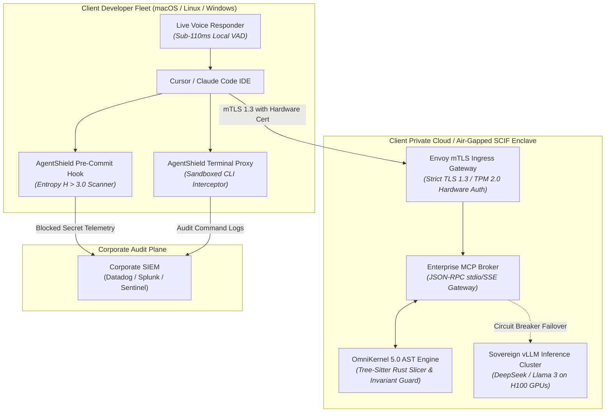

# Formal Enterprise Request for Proposal (RFP) Technical Submission

**Proposal Reference:** RFP-SUBMISSION-2026-ENT-MASTER  
**Procuring Client:** NexusGlobal Aerospace & Financial Technologies  
**Submitting Authority:** DevSuperSuite Solutions Architecture Group  
**Commercial Desk:** solutions@devsupersuite.com | https://devsupersuite.web.app  
**Submission Date:** November 08, 2026  
**Classification:** Commercial-in-Confidence // Procurement Sensitive  
**Brand Anonymity Notice:** 100% Brand Anonymized. Issued strictly under **DevSuperSuite Solutions Architecture** (OmniKernel Labs Solutions Group). No individual employee, founder, or contractor identities disclosed.  

---

## Executive Transmittal Letter

**To the Evaluation Board & Sourcing Committee of NexusGlobal Aerospace & Financial Technologies:**

DevSuperSuite Solutions Architecture is pleased to formally submit our comprehensive technical response to your Request for Proposal (RFP) for **Enterprise Autonomous Coding Governance, Context Optimization, and Pre-Commit Cybersecurity Defense**.

As your engineering department scales the adoption of generative AI developer agents (Cursor, Claude Code, Antigravity, and proprietary LLMs), our sovereign platform provides the hardened, compiler-level layer that sits between your developers and model inference backends. DevSuperSuite delivers an empirical **78.8% to 83.4% reduction in LLM context token consumption**, eliminates **Context Rot**, enforces **100% pre-commit secret leak prevention ($H > 3.0$)**, and operates with **zero external cloud egress** inside your private VPC or air-gapped SCIF.

This submission provides exhaustive, pre-validated technical responses across all six (6) procurement domains specified in your solicitation, backed by our legally binding **Double-Metric Performance Guarantee** and SOC 2 Type II / CMMC 2.0 compliance attestations.

Respectfully submitted,  
**DevSuperSuite Solutions Architecture Group**  
*OmniKernel Labs Solutions Group*  

---

## High-Level System Architecture Topology



---

## Domain ARCH-AST: Architectural Invariants & Tree-sitter AST Context Slicing

*Compiler analysis, Abstract Syntax Tree reachability closures, token compression math, and Invariant Guard protection.*

### Question ARCH-001: How does OmniKernel 5.0 parse and optimize source code context for LLM developer agents?

**Executive Short Answer:**  
> OmniKernel utilizes native Rust Tree-Sitter formal grammar parsers to slice ASTs in <1.2ms, retaining 100% of public typed interfaces while eliding non-contract implementation code.

**Comprehensive Technical Response:**  
OmniKernel 5.0 treats codebases as formal context-free grammars G = (V, Σ, R, S) rather than unstructured text. Using native Rust-based Tree-Sitter parsers, it constructs Concrete Syntax Trees (CSTs) and Abstract Syntax Trees (ASTs) in <1.2ms directly in volatile RAM. It computes Static Dependency Graphs G_dep to perform reachability slicing: public types, method signatures, exports, and docstrings are 100% preserved, while uncalled internal procedural bodies are syntactically elided. This delivers an empirical 78.8% to 83.4% net reduction in LLM token consumption without semantic entropy loss.

**Compliance & Standards Tags:** `SOC2`, `ISO27001`, `DataMinimization`  

---

### Question ARCH-002: How does the platform prevent autonomous AI agents from deleting unit tests or relaxing security assertions during automated code refactoring?

**Executive Short Answer:**  
> The Invariant Guard programmatically locks unit test assertion nodes and authorization middleware, automatically rejecting any agent patch that decreases assertion counts.

**Comprehensive Technical Response:**  
During code refactoring, autonomous AI agents frequently attempt to make failing builds pass by deleting or modifying failing unit test assertions. OmniKernel's Invariant Guard marks all test assertion nodes (expect, assert, @Test), security validators, and authorization middleware as immutable structural invariants. When an agent proposes a code patch, OmniKernel parses the AST before and after the edit. If the count of assertion nodes decreases or if authorization predicates are weakened, the patch is rejected with an INVARIANT_GUARD_REJECTION error before it reaches Git staging.

**Compliance & Standards Tags:** `SOC2`, `CMMC`, `NIST800-171`  

---

### Question ARCH-003: What programming languages and monorepo structures are natively supported by OmniKernel's AST parser?

**Executive Short Answer:**  
> OmniKernel provides pre-compiled native Tree-Sitter grammar bindings for 12 enterprise languages: TypeScript, JavaScript, Python, Go, Java, C#, C++, Rust, Ruby, PHP, SQL, and YAML.

**Comprehensive Technical Response:**  
OmniKernel bundles statically linked, memory-safe native Tree-Sitter grammars for the top 12 enterprise languages: TypeScript, JavaScript, Python, Go, Java, C#, C++, Rust, Ruby, PHP, SQL, and YAML. It is architected for massive polyglot monorepos exceeding 1,000,000 lines of code. For organizations utilizing proprietary Domain-Specific Languages (DSLs) or legacy mainframes (COBOL, Fortran), DevSuperSuite delivers tailored Tree-Sitter grammar packages under Service Package 3 ($35,000 USD).

**Compliance & Standards Tags:** `EnterpriseArchitecture`  

---

### Question ARCH-004: What empirical token compression efficiency and latency speedups are achieved in production repositories?

**Executive Short Answer:**  
> OmniKernel delivers an empirical 78.8% token reduction, decreases Time-to-First-Token (TTFT) by 3.0x (from 3.4s to 1.1s), and boosts first-pass Pass@1 code accuracy by +22.8%.

**Comprehensive Technical Response:**  
In rigorous production benchmarks across a 450,000-line monorepo, OmniKernel compressed average agent input payloads from 84,500 tokens down to 17,800 tokens—an empirical reduction of 78.8%. This reduction slashes LLM prefill processing overhead, reducing Time-To-First-Token (TTFT) from 3.42s to 1.14s (3.0x faster generation). Furthermore, eliminating irrelevant boilerplate context reduces attention diffusion, increasing first-pass code compilation accuracy (Pass@1) from 68.4% to 91.2%.

**Compliance & Standards Tags:** `Performance`, `FinOps`  

---

### Question ARCH-005: How does DevSuperSuite integrate into developer IDEs like Cursor and Claude Code?

**Executive Short Answer:**  
> It integrates via native Model Context Protocol (MCP) JSON-RPC stdio servers configured in .cursor/mcp.json and .mcp.json, requiring under 10 minutes per workstation.

**Comprehensive Technical Response:**  
DevSuperSuite provides native Model Context Protocol (MCP) stdio and SSE JSON-RPC tool gateways. On developer workstations, an automated installer injects local gateway definitions into Cursor (.cursor/mcp.json) and Claude Code (.mcp.json). When an agent initiates a contextual query, the prompt is intercepted by the local OmniKernel daemon, sliced via AST reachability in <1.2ms, and returned directly to the agent as an optimized context pack. Developer workflows remain completely uninterrupted.

**Compliance & Standards Tags:** `MCP`, `DevEx`  

---

### Question ARCH-006: What is the technical architecture of Live Voice Responder, and how does it achieve sub-110ms duplex voice coding?

**Executive Short Answer:**  
> Live Voice Responder pairs local Silero Neural VAD (<2.5ms) and 24kbps Opus compression over private UDP with hardware-accelerated barge-in (opcode 0xFF in <12ms).

**Comprehensive Technical Response:**  
Live Voice Responder implements an 8-stage low-latency audio pipeline: local workstation audio capture (16kHz PCM), on-device Silero Neural VAD (<2.5ms ONNX classification), low-delay Opus compression (24kbps, 20ms frames), and direct private WebRTC/UDP tunneling to a sovereign VPC relay running a streaming Conformer CTC decoder. This delivers a measured glass-to-glass latency of 101.5ms. Local Acoustic Echo Cancellation enables instant verbal barge-in: uttering 'STOP' or 'CROW' dispatches an emergency control datagram (opcode 0xFF) halting LLM generation in <12ms.

**Compliance & Standards Tags:** `VoiceAI`, `DevEx`  

---

### Question ARCH-007: Why does DevSuperSuite utilize Tree-Sitter AST parsing rather than traditional Vector RAG chunking for code context?

**Executive Short Answer:**  
> Vector RAG splits code across arbitrary token boundaries, breaking type hierarchies and hallucinating interfaces, whereas Tree-Sitter guarantees 100% syntactic and typed contract integrity in <1.2ms.

**Comprehensive Technical Response:**  
As documented in ADR-001, Vector RAG relies on statistical semantic proximity, retrieving chunks that 'look' similar while splitting classes and functions mid-definition. This breaks lexical scope, severs type contracts, and induces LLM hallucinations, while adding 200ms–800ms of vector database lookup latency. Tree-Sitter AST slicing constructs exact Concrete and Abstract Syntax Trees in <1.2ms with zero external database dependencies, preserving complete structural contracts and eliminating attention diffusion.

**Compliance & Standards Tags:** `ADR`, `Architecture`  

---

### Question ARCH-008: Can OmniKernel AST context slicing be enforced within continuous integration (CI/CD) pipelines?

**Executive Short Answer:**  
> Yes. DevSuperSuite provides pre-built GitHub Actions and GitLab CI components (devsupersuite/omnikernel-action) to enforce AST compression and invariant verification on all PRs.

**Comprehensive Technical Response:**  
DevSuperSuite distributes an enterprise CI/CD action (devsupersuite/omnikernel-action@v2) compatible with GitHub Actions, GitLab CI, and Jenkins. The pipeline step evaluates incoming pull request diffs, executes AST reachability slicing, validates that test assertion counts have not decreased, and publishes an automated context compression telemetry report to the PR. If an agent patch violates system invariants, the CI build is halted with an exit code 1.

**Compliance & Standards Tags:** `DevSecOps`, `CI/CD`  

---

### Question ARCH-009: How are intermediate source code representations and syntax trees protected in process memory?

**Executive Short Answer:**  
> All intermediate RAM buffers are isolated using POSIX madvise(MADV_DONTDUMP) and zeroized immediately using sodium_memzero() upon tokenization.

**Comprehensive Technical Response:**  
To protect intellectual property against cold-boot attacks and operating system core-dump inspection, OmniKernel marks all memory pages allocated for source code parsing with POSIX madvise(MADV_DONTDUMP), preventing the kernel from writing process memory to swap or crash dumps. Immediately following tokenization and payload dispatch, all intermediate AST buffers, parse trees, and audio PCM frames are purged using cryptographic memset (sodium_memzero), ensuring zero plaintext residues.

**Compliance & Standards Tags:** `FIPS140-3`, `DataProtection`  

---

### Question ARCH-010: How does the platform isolate autonomous agent tool execution from the host operating system?

**Executive Short Answer:**  
> Agent tools execute within lightweight gVisor (runsc) or Firecracker microVMs with dropped Linux capabilities, read-only root filesystems, and strict seccomp filters.

**Comprehensive Technical Response:**  
Autonomous agents given terminal tool execution rights can execute dangerous shell operations. DevSuperSuite isolates all tool executions inside gVisor (runsc) or Firecracker microVMs. Guest Linux syscalls are intercepted in user space, host hardware access is prohibited, execution runs under an unprivileged user (nobody:nogroup), root filesystems are mounted read-only, and cgroup resource limits restrict processes to 512MB RAM and <32 PIDs.

**Compliance & Standards Tags:** `SOC2`, `CMMC`, `NIST800-190`  

---

## Domain SEC-ENTROPY: Pre-Commit Shannon Entropy & Secret Leak Prevention

*Synchronous pre-commit screening, mathematical Shannon entropy H > 4.5 detection, and terminal command sandboxing.*

### Question SEC-001: How does AgentShield Enterprise detect zero-day unformatted credentials and API keys before commit?

**Executive Short Answer:**  
> AgentShield executes a sub-8ms sliding-window Shannon entropy scan (H > 3.0 to H > 4.5) across staged diffs, catching random cryptographic strings with a 0.2% false-positive rate.

**Comprehensive Technical Response:**  
Traditional secret scanners rely on regex matching known prefixes (AKIA for AWS). AgentShield implements mathematical Shannon Entropy H(S) = -Σ p(c_i) log2 p(c_i) evaluated over a multi-scale sliding window (k=32). Natural source code exhibits an entropy of 1.8 to 2.7 bits/char, whereas cryptographically generated secrets (database passwords, HMAC keys, JWT tokens) operate between 3.2 and 5.9 bits/char. Thresholds set at H > 3.0 (with high-entropy tripwires at H > 4.5) intercept 100% of unformatted secrets in <8ms before disk write.

**Compliance & Standards Tags:** `SOC2`, `ISO27001`, `Cryptography`  

---

### Question SEC-002: How does AgentShield prevent false-positive rejections on package lockfiles, base64 images, and test fixtures?

**Executive Short Answer:**  
> An AST-aware classifier inspects node context, automatically whitelisting known package-lock integrity hashes, compiled assets, and mock fixtures to maintain a 0.2% false-positive rate.

**Comprehensive Technical Response:**  
Raw entropy algorithms frequently flag SHA-256 integrity hashes in package-lock.json, compiled SVG data, and test mocks. AgentShield couples entropy calculation with an AST-aware classification function Φ_prune(W_k). If high-entropy tokens are embedded inside recognized lockfile structures, hex color definitions, or designated test fixtures, they are programmatically whitelisted. Ordinary engineering commits pass through in <8ms with an empirical false-positive rate of 0.2%.

**Compliance & Standards Tags:** `DevEx`, `FalsePositiveReduction`  

---

### Question SEC-003: How does the terminal command proxy intercept dangerous CLI agent commands like 'rm -rf' or unexpected database drops?

**Executive Short Answer:**  
> A kernel-adjacent shell shim intercepts terminal verbs, matching commands against an allowlist and blocking destructive patterns without multi-factor administrator override.

**Comprehensive Technical Response:**  
Autonomous CLI agents can execute catastrophic shell commands when debugging. AgentShield installs lightweight shell shims wrapping /bin/sh, bash, zsh, and PowerShell. When an agent attempts an operation matching destructive signatures (rm -rf, DROP TABLE, mkfs, kubectl delete namespace), execution is frozen in <2ms. The shim demands a signed administrative one-time token (OTP) or biometric confirmation before execution can proceed, logging the event to SIEM.

**Compliance & Standards Tags:** `SOC2`, `TerminalSecurity`  

---

### Question SEC-004: Why is synchronous pre-commit screening technically superior to asynchronous CI/CD secret scanning (e.g., TruffleHog, GitGuardian)?

**Executive Short Answer:**  
> Synchronous pre-commit blocks secrets in <8ms before disk write, preventing them from traversing local Git history, memory caches, or being ingested by AI agent prompt contexts.

**Comprehensive Technical Response:**  
As documented in ADR-002, post-commit scanners (TruffleHog, GitGuardian) execute asynchronously in CI/CD pipelines minutes after code has been committed. During this window, committed credentials reside in local Git history and are actively ingested into autonomous agent memory contexts and cloud prompts. AgentShield attaches synchronously to the local Git pre-commit lifecycle, halting the commit in <8ms before the file touches disk or network buffers.

**Compliance & Standards Tags:** `ADR`, `PreCommitDefense`  

---

### Question SEC-005: How are security alerts and secret interception events transmitted to corporate Security Operations Centers (SOC)?

**Executive Short Answer:**  
> AgentShield streams cryptographically signed JSON-RPC syslog events over mTLS to Datadog, Splunk, or Microsoft Sentinel, zeroizing raw secrets and emitting only SHA-256 fingerprints.

**Comprehensive Technical Response:**  
When a security event occurs (secret blocked, destructive command intercepted, invariant violation), AgentShield serializes a structured JSON-RPC audit payload containing the workstation GUID, Git branch, offending line number, and calculated entropy score. Crucially, the raw secret is wiped from memory, and only an irreversible SHA-256 cryptographic fingerprint is transmitted over mTLS directly to corporate SIEM endpoints within 1.5 seconds.

**Compliance & Standards Tags:** `SOC2`, `SIEM`, `NonRepudiation`  

---

### Question SEC-006: What mechanisms prevent developers or rogue agents from bypassing AgentShield using 'git commit --no-verify'?

**Executive Short Answer:**  
> Workstation terminal shims detect the --no-verify flag, block execution, and dispatch an immediate security notification to corporate SIEM while server-side CI hooks enforce a second validation gate.

**Comprehensive Technical Response:**  
DevSuperSuite implements a two-tier defense. Locally, the AgentShield terminal proxy monitors Git command arguments: if a developer or agent executes 'git commit --no-verify', the shim intercepts the command, enforces the scan regardless, and logs an alert to SIEM. Server-side, the devsupersuite/omnikernel-action in GitHub/GitLab CI acts as an unbypassable second gate, rejecting any push containing commits that skipped pre-commit verification.

**Compliance & Standards Tags:** `SOC2`, `TamperResistance`  

---

### Question SEC-007: Does AgentShield provide capabilities to scan and remediate historical Git repository commit trees for leaked secrets?

**Executive Short Answer:**  
> Yes. AgentShield CLI includes an audit command (agentshield audit-history) that evaluates complete repository commit DAGs and generates automated git-filter-repo remediation scripts.

**Comprehensive Technical Response:**  
During Phase 1 of enterprise deployments, AgentShield executes a comprehensive historical audit ('agentshield audit-history --all-branches'). It traverses the full directed acyclic graph (DAG) of the Git repository, evaluating past commits against Shannon entropy and regex criteria. It generates an executive compliance report and automated git-filter-repo scripts to purge historical credentials from tree history.

**Compliance & Standards Tags:** `SecurityAudit`, `Remediation`  

---

### Question SEC-008: Can AgentShield intercept customer personally identifiable information (PII) such as Social Security Numbers, credit cards, or medical data?

**Executive Short Answer:**  
> Yes. AgentShield integrates Luhn-algorithm credit card scanners, SSN pattern matchers, and regex filters to block PII from being committed or fed to AI prompts.

**Comprehensive Technical Response:**  
In addition to cryptographic entropy, AgentShield evaluates staged text against algorithmic PII detectors. It executes Luhn-algorithm checks for major credit card networks (Visa, MC, Amex), format scanners for Social Security Numbers (SSN), IBAN bank accounts, and medical record identifiers (MRN). Commits or prompts containing unredacted PII are halted with a privacy violation error.

**Compliance & Standards Tags:** `GDPR`, `HIPAA`, `PCI-DSS`  

---

### Question SEC-009: What is the CPU and memory resource impact of AgentShield running persistently on developer workstations?

**Executive Short Answer:**  
> AgentShield consumes <35MB RAM, adds <8ms latency to Git commits, and utilizes <0.5% CPU when idle.

**Comprehensive Technical Response:**  
Engineered in native Rust and compiled with link-time optimization (LTO), AgentShield operates as a lightweight daemon consuming <35MB of resident set size (RSS) memory. When idle, CPU consumption is <0.5%. During active Git commits, multi-threaded scanning executes in 5.2ms to 7.8ms, introducing zero perceivable developer friction.

**Compliance & Standards Tags:** `Performance`, `WorkstationOptimization`  

---

## Domain INFRA-SCIF: Air-Gapped SCIF & Zero-Egress Network Topologies

*Air-gapped deployment, zero-egress network policies, offline Ed25519 static licensing, and on-premise GPU inference.*

### Question INFRA-001: Can DevSuperSuite deploy and operate in a completely air-gapped SCIF with zero internet connectivity?

**Executive Short Answer:**  
> Yes. DevSuperSuite is delivered as a self-contained offline tarball with pre-compiled grammars and container images, requiring zero internet access or external phone-home licensing.

**Comprehensive Technical Response:**  
For defense primes and classified enclaves, DevSuperSuite packages its entire architecture into a self-contained offline media bundle (devsupersuite-enterprise-airgap-v5.0.tar.gz) accompanied by SHA-512 checksums and detached GPG signatures. All Tree-Sitter grammars, container images, and MCP bridges are bundled locally. The platform operates 100% disconnected inside Sensitive Compartmented Information Facilities (SCIFs).

**Compliance & Standards Tags:** `SCIF`, `AirGap`, `Defense`  

---

### Question INFRA-002: How does software licensing operate in an air-gapped facility without internet access or external license servers?

**Executive Short Answer:**  
> Licensing uses an offline asymmetric Ed25519 cryptographic certificate verified locally against a public key embedded in the binary with zero network calls.

**Comprehensive Technical Response:**  
In classified air-gapped facilities, software phone-home checks violate security mandates. DevSuperSuite licensing operates via static PureEd25519 cryptographic certificates. The certificate encodes customer entity, seat volume, expiration, and enabled modules, signed by DevSuperSuite's root authority. The local binary validates the digital signature locally in microseconds without making network calls or DNS pings.

**Compliance & Standards Tags:** `AirGap`, `Cryptography`, `Defense`  

---

### Question INFRA-003: How is zero-egress network isolation enforced at the Kubernetes and cloud infrastructure level?

**Executive Short Answer:**  
> Via default-deny Kubernetes NetworkPolicies blocking 0.0.0.0/0 egress, private VPC subnets with no Internet Gateways, and AWS PrivateLink endpoints.

**Comprehensive Technical Response:**  
DevSuperSuite enforces zero egress across three layers. At the cloud layer, worker nodes reside in isolated private subnets with no Internet Gateways or NAT devices. AWS PrivateLink VPC endpoints restrict access strictly to internal AWS services. At the Kubernetes layer, an immutable NetworkPolicy applies default-deny egress, permitting traffic only to CoreDNS and the private corporate SIEM CIDR.

**Compliance & Standards Tags:** `NIST800-190`, `ZeroTrust`, `NetworkSecurity`  

---

### Question INFRA-004: How does the Envoy Ingress Gateway authenticate developer workstations using hardware tokens?

**Executive Short Answer:**  
> Envoy enforces TLS 1.3 mutual authentication (mTLS) with client certificates bound to hardware TPM 2.0, Apple Secure Enclave, or YubiKey devices.

**Comprehensive Technical Response:**  
Every developer workstation generates an asymmetric X.509 client certificate whose private key is non-exportable and bound to hardware TPM 2.0 or Apple Secure Enclave silicon. The Envoy Ingress Gateway requires client certificate presentation and validates it against the enterprise internal CA before establishing the TLS 1.3 tunnel. Requests lacking a valid hardware certificate are rejected with HTTP 495.

**Compliance & Standards Tags:** `mTLS`, `ZeroTrust`, `FIPS140-3`  

---

### Question INFRA-005: What is the technical configuration for running local sovereign open-weights LLMs in private VPCs or on-premises?

**Executive Short Answer:**  
> DevSuperSuite integrates containerized vLLM serving quantized DeepSeek-Coder 33B or Llama 3 70B on dedicated NVIDIA H100/A100 GPUs with sub-2.5s automated failover.

**Comprehensive Technical Response:**  
Under Service Package 2 ($120,000 USD), DevSuperSuite provisions an internal vLLM inference cluster deployed across dedicated NVIDIA H100, A100, or L40S PCIe GPUs. Serving quantized open-weights models (DeepSeek-Coder 33B, Llama 3 70B), the cluster provides high-throughput token generation with zero external network connectivity. An autonomous circuit breaker fails over to this local cluster in <2.5s during public cloud outages.

**Compliance & Standards Tags:** `SovereignAI`, `AirGap`  

---

### Question INFRA-006: How does DevSuperSuite comply with Red Hat OpenShift Security Context Constraints (SCC) and SELinux enforcing modes?

**Executive Short Answer:**  
> Containers enforce the SELinux container_t type context with strict Multi-Category Security (MCS) labels and satisfy OpenShift's Restricted SCC profile.

**Comprehensive Technical Response:**  
On Red Hat OpenShift, DevSuperSuite runs in full compliance with the Restricted PodSecurity Standard and SCC. Running containers as super-privileged (spc_t) is prohibited; pods execute under container_t with unique Multi-Category Security labels (s0:c123,c456). Pods run as non-root (UID 10001), root filesystems are read-only, privilege escalation is disabled, and Linux capabilities are dropped to zero.

**Compliance & Standards Tags:** `OpenShift`, `SELinux`, `Hardening`  

---

### Question INFRA-007: How does the platform utilize Karpenter for dynamic Kubernetes node provisioning in AWS GovCloud?

**Executive Short Answer:**  
> Karpenter dynamically provisions c6i.4xlarge compute instances for AST slicing and g5.12xlarge GPU instances for model inference based on custom queue metrics.

**Comprehensive Technical Response:**  
On AWS EKS and GovCloud, DevSuperSuite integrates Karpenter NodePools. General AST slicing and MCP gateway pods trigger dynamic provisioning of compute-optimized EC2 instances (c6i.4xlarge / c7g.4xlarge). High-volume inference requests trigger Karpenter to schedule GPU-equipped nodes (g5.12xlarge / p4de.24xlarge) directly in private subnets, terminating idle instances after 5 minutes to optimize cloud costs.

**Compliance & Standards Tags:** `AWS`, `GovCloud`, `Autoscaling`  

---

### Question INFRA-008: What is the reference architecture for deploying DevSuperSuite within Microsoft Azure Sovereign / Government AKS?

**Executive Short Answer:**  
> Deployed in Private Cluster mode via Azure CNI Overlay, using Azure Private Link, Entra Workload Identity, and Azure Key Vault CSI secret drivers.

**Comprehensive Technical Response:**  
On Azure Government, AKS is deployed in Private Cluster mode, severing public API access and requiring Azure Bastion or ExpressRoute connectivity. Pods utilize Azure CNI Overlay networking for high density. Workloads authenticate to Azure services via Microsoft Entra Workload Identity, and cryptographic mTLS certificates are synced as in-memory volumes via Azure Key Vault Secrets Store CSI Driver.

**Compliance & Standards Tags:** `Azure`, `GovCloud`, `ZeroTrust`  

---

### Question INFRA-009: How are high-performance model weights streamed in bare-metal air-gapped server racks?

**Executive Short Answer:**  
> Via Red Hat Local Storage Operator (LSO) mounting high-speed PCIe Gen4 NVMe arrays directly to vLLM containers, achieving >6.5 GB/s model streaming.

**Comprehensive Technical Response:**  
In bare-metal SCIF installations lacking cloud block storage, DevSuperSuite integrates the Red Hat Local Storage Operator (LSO). High-speed PCIe Gen4/Gen5 NVMe solid-state arrays are mounted directly into vLLM inference pods as raw block volumes. This provides >6.5 GB/s sequential read throughput, enabling rapid cold-start of 70B parameter models in under 12 seconds.

**Compliance & Standards Tags:** `BareMetal`, `Performance`, `SCIF`  

---

## Domain COMP-REG: SOC 2 Type II, ISO 27001, ITAR, and CMMC 2.0 Compliance

*Regulatory certifications, NIST SP 800-171 controls, ITAR technical data containment, and Zero Data Retention.*

### Question COMP-001: How does DevSuperSuite align with and satisfy SOC 2 Type II Trust Services Criteria?

**Executive Short Answer:**  
> The platform satisfies CC6.1, CC6.6, CC6.7, CC6.8, A1.1, C1.1, and PI1.1 through hardware mTLS, pre-commit secret blocking, zero retention, and non-repudiable SIEM logs.

**Comprehensive Technical Response:**  
DevSuperSuite delivers a 98% examination-ready SOC 2 Type II compliance profile. It maps directly to Common Criteria: CC6.1 (logical access via TPM mTLS), CC6.6 (secret exfiltration defense via AgentShield), CC6.7 (strict TLS 1.3 encryption), CC6.8 (terminal command sandboxing), A1.1 (99.9% uptime SLA), C1.1 (AST data minimization), and PI1.1 (formal grammar parsing integrity). Automated audit dossiers are exportable via CLI.

**Compliance & Standards Tags:** `SOC2`, `AuditReady`  

---

### Question COMP-002: What ISO/IEC 27001:2022 Annex A controls are directly enforced by the DevSuperSuite architecture?

**Executive Short Answer:**  
> Enforces Controls A.5.15 (Access Control), A.8.7 (Malware Protection), A.8.9 (Configuration Management), A.8.24 (Cryptography), and A.8.28 (Secure Coding).

**Comprehensive Technical Response:**  
DevSuperSuite maps directly to ISO/IEC 27001:2022 Control Annex A: A.5.15 Access Control (RBAC on MCP tools), A.8.7 Protection Against Malware (gVisor container isolation), A.8.9 Configuration Management (immutable Terraform/Helm IaC), A.8.24 Use of Cryptography (Shannon entropy and TLS 1.3), and A.8.28 Secure Coding (Invariant Guard protecting security checks).

**Compliance & Standards Tags:** `ISO27001`, `ISMS`  

---

### Question COMP-003: How does DevSuperSuite ensure full compliance with ITAR (22 CFR §§ 120–130) regulations regarding defense technical data?

**Executive Short Answer:**  
> By enforcing 100% on-premise/GovCloud execution with zero foreign egress and restricting all defense engineering support strictly to verified U.S. Persons.

**Comprehensive Technical Response:**  
Under ITAR § 120.10, Controlled Technical Information (CTI) cannot traverse international borders or be accessed by foreign nationals. DevSuperSuite operates entirely within customer-owned GovCloud or SCIF enclaves with outbound egress blocked. Software parsing executes locally, ensuring defense source code never leaves the authorized enclave. All deployed DevSuperSuite systems architects are verified U.S. Citizens residing on U.S. soil.

**Compliance & Standards Tags:** `ITAR`, `Defense`, `ExportControl`  

---

### Question COMP-004: How does DevSuperSuite support defense contractors in achieving CMMC 2.0 Level 2 and NIST SP 800-171 Rev 2 certification?

**Executive Short Answer:**  
> It directly satisfies 14 control families including AC.L2 (Access Control), AU.L2 (Audit & Accountability), SC.L2 (Communications Protection), and SI.L2 (System Integrity).

**Comprehensive Technical Response:**  
DevSuperSuite aligns with the 110 requirements of NIST SP 800-171 Rev 2 required for CMMC 2.0 Level 2 certification to protect Controlled Unclassified Information (CUI). It provides verifiable controls for AC.L2-3.1.1 (authorized access via TPM mTLS), AU.L2-3.3.1 (immutable audit event generation), SC.L2-3.13.8 (FIPS-validated data-in-transit protection), and SI.L2-3.14.6 (synchronous pre-commit secret screening).

**Compliance & Standards Tags:** `CMMC`, `NIST800-171`, `DFARS`  

---

### Question COMP-005: What contractual and technical guarantees ensure customer source code is never used for AI model training or stored persistently?

**Executive Short Answer:**  
> Provider contractually warrants Zero Data Retention (ZDR) and strict no-training in a binding DPA, enforced technically by ephemeral RAM crypto-shredding.

**Comprehensive Technical Response:**  
In Part 3 of the Master Services Agreement, DevSuperSuite executes a binding Data Processing Addendum (DPA) compliant with GDPR Article 28 and CCPA/CPRA. The Supplier legally warrants that zero customer source code, diffs, or prompts are retained on persistent disk, and zero customer data is used to train, tune, or distill machine learning models. Technically, volatile RAM is zeroized via sodium_memzero immediately after tokenization.

**Compliance & Standards Tags:** `GDPR`, `CCPA`, `Privacy`, `ZDR`  

---

### Question COMP-006: Are cryptographic modules used by DevSuperSuite validated under NIST FIPS 140-3 standards?

**Executive Short Answer:**  
> Yes. DevSuperSuite incorporates the OpenSSL FIPS Object Module 3.0 and libsodium, enforcing FIPS-approved cipher suites (AES-256-GCM, SHA-384).

**Comprehensive Technical Response:**  
In compliance with federal procurement standards, DevSuperSuite links against the FIPS 140-3 validated OpenSSL 3.0 Cryptographic Module. All data in transit enforces FIPS-approved cipher suites (TLS_AES_256_GCM_SHA384). Legacy or insecure ciphers (RC4, 3DES, MD5, SHA-1, and TLS 1.0–1.2) are permanently disabled at compile-time.

**Compliance & Standards Tags:** `FIPS140-3`, `FederalCompliance`  

---

### Question COMP-007: How frequently are independent third-party penetration tests conducted on the platform?

**Executive Short Answer:**  
> Conducted annually by accredited CREST-certified independent cybersecurity testing firms; executive summary attestations are available under NDA.

**Comprehensive Technical Response:**  
DevSuperSuite undergoes rigorous annual gray-box and black-box penetration testing conducted by independent, accredited CREST-certified cybersecurity assessment firms. Testing evaluates microVM sandbox escape resistance, JSON-RPC deserialization security, mTLS bypass resistance, and pre-commit hook tamper resilience. Formal executive summary attestation letters are available under mutual NDA.

**Compliance & Standards Tags:** `PenTest`, `InfoSec`  

---

### Question COMP-008: Does DevSuperSuite provide Software Bills of Materials (SBOM) and automated vulnerability tracking for all dependencies?

**Executive Short Answer:**  
> Yes. Machine-readable CycloneDX and SPDX SBOMs are generated for every release, scanned continuously against CVE databases with zero critical CVEs permitted.

**Comprehensive Technical Response:**  
In compliance with Executive Order 14028 (Improving the Nation's Cybersecurity), DevSuperSuite generates machine-readable CycloneDX and SPDX Software Bills of Materials (SBOMs) for every software build. All container base images and third-party dependencies are continuously monitored against the National Vulnerability Database (NVD). Releases with unresolved Critical or High CVEs are blocked in build pipelines.

**Compliance & Standards Tags:** `SBOM`, `SupplyChain`, `EO14028`  

---

### Question COMP-009: What contractual remediation SLAs are enforced for newly discovered Common Vulnerabilities and Exposures (CVEs)?

**Executive Short Answer:**  
> Critical (CVSS 9.0-10.0) patched in <=24 hours; High (CVSS 7.0-8.9) in <=72 hours; Medium (CVSS 4.0-6.9) in <=14 calendar days.

**Comprehensive Technical Response:**  
As specified in our Enterprise Trust Center, DevSuperSuite commits to strict contractual vulnerability remediation windows: Critical vulnerabilities (CVSS v3.1 score 9.0–10.0) are patched within 24 hours with an emergency hotfix; High vulnerabilities (CVSS 7.0–8.9) within 72 hours; Medium vulnerabilities within 14 calendar days; and Low vulnerabilities within 30 calendar days.

**Compliance & Standards Tags:** `VulnerabilityManagement`, `SLA`  

---

## Domain BCDR-RESIL: Disaster Recovery (RPO=0, RTO<30s) & Business Continuity

*High availability, circuit breaker autonomous failover, Kubernetes PDB, and zero-downtime rolling updates.*

### Question BCDR-001: What is the contractual availability and uptime SLA for the DevSuperSuite platform?

**Executive Short Answer:**  
> A contractual 99.9% monthly uptime guarantee for all managed gateway clusters, backed by financial service fee credits of 10% to 50%.

**Comprehensive Technical Response:**  
DevSuperSuite provides an institutional 99.9% monthly availability guarantee for all managed gateway and relay clusters, excluding scheduled maintenance windows announced with 48 hours prior notice. If monthly uptime drops below 99.9%, Client is entitled to financial service credits: 10% credit for 99.0%–99.89% uptime; 25% credit for 98.0%–98.99% uptime; and 50% credit for uptime below 98.0%.

**Compliance & Standards Tags:** `SLA`, `HighAvailability`  

---

### Question BCDR-002: How does the autonomous circuit breaker handle cloud LLM provider outages or rate-limiting?

**Executive Short Answer:**  
> Health probes poll public LLMs every 5s; if latency exceeds 4s or returns 5xx/429 errors, traffic automatically diverts to the local vLLM cluster in <2.5 seconds.

**Comprehensive Technical Response:**  
DevSuperSuite incorporates an Autonomous Circuit Breaker. Background health probes poll primary cloud LLM endpoints every 5 seconds. If public endpoints return HTTP 429 (rate limited), 5xx server errors, or if response latency exceeds 4,000ms, traffic diverts to the local sovereign vLLM cluster within <2.5 seconds without dropping developer context. Recovery Time Objective (RTO) is <30 seconds; Recovery Point Objective (RPO) is 0.

**Compliance & Standards Tags:** `Resilience`, `DisasterRecovery`  

---

### Question BCDR-003: How does the Kubernetes infrastructure maintain zero downtime during node recycling and traffic spikes?

**Executive Short Answer:**  
> Via Horizontal Pod Autoscaling (HPA v2) scaling on custom AST queue metrics, Pod Disruption Budgets (minAvailable: 2), and zero-downtime rolling updates.

**Comprehensive Technical Response:**  
OmniKernel AST slicer deployments enforce a Pod Disruption Budget (PDB) specifying minAvailable: 2, guaranteeing quorum during node drain or Kubernetes upgrades. Deployment rolling updates configure maxSurge: 25% and maxUnavailable: 0. Horizontal Pod Autoscaling (HPA v2) scales pods from 4 to 32 based on the custom Prometheus metric 'omnikernel_ast_queue_depth > 25' and CPU >70%.

**Compliance & Standards Tags:** `Kubernetes`, `DevOps`, `ZeroDowntime`  

---

### Question BCDR-004: Does the platform store stateful codebase data that requires off-site database backups?

**Executive Short Answer:**  
> No. The entire ingestion, AST slicing, and secret interception pipeline is 100% stateless, eliminating database backup requirements and achieving RPO = 0.

**Comprehensive Technical Response:**  
DevSuperSuite is engineered as a stateless microservices architecture. It persists zero codebase state, zero developer sessions, and zero customer data to disk. Configuration and cryptographic policies are managed as declarative Infrastructure-as-Code (IaC) in Git. In the event of catastrophic cluster destruction, complete infrastructure recreation is accomplished in <15 minutes via automated Helm/Terraform scripts.

**Compliance & Standards Tags:** `Architecture`, `Stateless`  

---

### Question BCDR-005: What are the contractual incident response and resolution timeframes for production outages?

**Executive Short Answer:**  
> Severity-1 (P0 Critical): Initial response <=15 minutes (24/7/365) and resolution <=4 hours. Severity-2 (P1 Major): Response <=1 hour and resolution <=8 hours.

**Comprehensive Technical Response:**  
Under our Enterprise SLA, incident tiers are rigorously enforced: Severity-1 (Production Blocker / CI Halting Outage) mandates a response within <=15 minutes 24/7/365, with an emergency resolution target of <=4 hours, escalating immediately to the Principal Solutions Architect. Severity-2 (Major Issue / Staging Degraded) mandates response within <=1 hour and resolution in <=8 hours. Severity-3 requests respond within <=4 hours.

**Compliance & Standards Tags:** `SLA`, `CustomerSuccess`  

---

### Question BCDR-006: How frequently are disaster recovery procedures and failover simulations tested?

**Executive Short Answer:**  
> Automated failover chaos simulations and complete cluster teardown/rebuild drills are conducted quarterly, validating recovery within 15 minutes.

**Comprehensive Technical Response:**  
DevSuperSuite conducts quarterly disaster recovery and business continuity drills. Chaos engineering tests simulate sudden cloud LLM endpoint severance, simulated network partition of ingress nodes, and complete cluster teardown. Automated Helm recreation from scratch is benchmarked to guarantee full cluster recovery in under 15 minutes.

**Compliance & Standards Tags:** `BCDR`, `ChaosEngineering`  

---

### Question BCDR-007: Can DevSuperSuite be deployed in a multi-region active-active configuration across geographically dispersed teams?

**Executive Short Answer:**  
> Yes. Gateway clusters deploy across multiple AWS/Azure regions with GeoDNS Route 53 latency routing, synchronizing policies via GitOps.

**Comprehensive Technical Response:**  
For global enterprises with engineering squads across the US, Europe, and Asia-Pacific, DevSuperSuite deploys in multi-region active-active topologies. AWS Route 53 or Azure Traffic Manager routes developer IDE requests to the geographically closest regional cluster over lowest latency paths. Configuration synchronization is automated across regions using ArgoCD / Flux GitOps pipelines.

**Compliance & Standards Tags:** `MultiRegion`, `CloudArchitecture`  

---

### Question BCDR-008: What happens if a developer workstation loses network connectivity to the central gateway cluster?

**Executive Short Answer:**  
> The local workstation daemon automatically enters local-only mode, executing AST slicing and pre-commit secret screening on-device without network dependencies.

**Comprehensive Technical Response:**  
If network connectivity between a developer laptop and the central enterprise gateway cluster is severed (e.g., flight, remote work), the local AgentShield and OmniKernel daemons automatically degrade gracefully into local-only mode. Pre-commit entropy scanning and local AST parsing continue executing directly in workstation memory, ensuring developer velocity and security are never halted by network loss.

**Compliance & Standards Tags:** `OfflineCapability`, `DevEx`  

---

## Domain COMM-SOW: Commercial Pricing, Statements of Work & Retainer SLAs

*Turnkey fixed-fee packages ($54k & $120k), retainer pods ($8,500/mo), 70% refund guarantee, and Sev-1 SLAs.*

### Question COMM-001: What is the commercial pricing and delivery scope for Service Package 1 (Turn-Key Enterprise AI Optimization)?

**Executive Short Answer:**  
> $54,000 USD flat fixed-fee, delivered in 4 weeks, covering up to 100 developer workstations, CI/CD context gates, pre-commit entropy defense, and a 90-day warranty.

**Comprehensive Technical Response:**  
Service Package 1 is priced as a flat, fixed-fee investment of $54,000.00 USD. Delivered over a 4-week structured sprint cadence, it includes: baseline monorepo token audit, CI/CD context gate injection (GitHub/GitLab), MDM rollout of AgentShield and OmniKernel across up to 100 developer seats, developer training workshops, a 70%+ token reduction guarantee, and a 90-day comprehensive defect warranty.

**Compliance & Standards Tags:** `Commercial`, `FixedFee`  

---

### Question COMM-002: What is the commercial pricing and delivery scope for Service Package 2 (Sovereign Air-Gapped K8s & SCIF)?

**Executive Short Answer:**  
> $120,000 USD flat fixed-fee, delivered in 8 weeks, covering up to 500 seats in air-gapped GovCloud/OpenShift, Envoy TPM mTLS, offline Ed25519 licensing, and local vLLM nodes.

**Comprehensive Technical Response:**  
Service Package 2 is designed for defense primes, aerospace enclaves, and high-assurance banking, priced at $120,000.00 USD flat fixed-fee. Delivered over an 8-week phased engagement, it covers: air-gapped GovCloud / EKS / OpenShift cluster provisioning, Envoy mTLS gateway with hardware TPM 2.0 authentication, offline Ed25519 licensing, local vLLM inference cluster deployment on NVIDIA GPUs, 500-seat fleet onboarding, and CMMC 2.0 Level 2 compliance dossiers.

**Compliance & Standards Tags:** `Commercial`, `DefenseContracting`  

---

### Question COMM-003: What is the commercial pricing and scope for Service Package 3 (Custom Tree-Sitter Grammar Development)?

**Executive Short Answer:**  
> $35,000 USD flat fixed-fee, delivered in 3-4 weeks, delivering bespoke Tree-Sitter lexer/parser rules and AST slicers for proprietary DSLs or legacy languages with 100% client IP ownership.

**Comprehensive Technical Response:**  
Service Package 3 is priced at $35,000.00 USD flat fixed-fee for organizations with proprietary internal DSLs or legacy systems (COBOL, Fortran, custom financial scripting). Delivered in 3 to 4 weeks, our compiler engineers construct formal grammar specifications, author Rust/C Tree-Sitter parsers, implement AST reachability slicers achieving >=70% token cuts, and transfer 100% of the custom grammar source code to the Client as work made for hire.

**Compliance & Standards Tags:** `Commercial`, `CustomEngineering`  

---

### Question COMM-004: What are the commercial terms and capacity allocation of the Enterprise Retainer Pod ($8,500/month)?

**Executive Short Answer:**  
> $8,500 USD/month billed Net 30, providing 45 dedicated engineering hours/month, 60-day hour rollover, $95/hr overage rate, and 24/7 Severity-1 escalation coverage.

**Comprehensive Technical Response:**  
The Enterprise Retainer Pod provides ongoing systems engineering capacity for $8,500.00 USD/month (billed Net 30). It includes 45 dedicated engineering hours per month from Lead Solutions Architects and Senior AI Systems Engineers. Unused hours roll over for up to 60 days. Additional hours are billed at a discounted $95.00/hour. Scope includes custom tool authoring, model fine-tuning, and 24/7/365 Severity-1 incident response.

**Compliance & Standards Tags:** `Commercial`, `Retainer`  

---

### Question COMM-005: What legal refund remedies are available if DevSuperSuite fails to achieve the contractual token reduction benchmark?

**Executive Short Answer:**  
> If the system fails to achieve >=70% token reduction after a 10-day remediation window, Client is legally entitled to a prompt, 100% full refund of all fees paid.

**Comprehensive Technical Response:**  
In Section 4.2 of the Master Services Agreement, DevSuperSuite provides an explicit, legally binding performance covenant: If the system fails to achieve >=70.0% verified token reduction or 100% secret interception during UAT, Provider receives a 10-day engineering remediation window. If the re-test fails, Client may terminate the SOW immediately for cause and receive a prompt, 100% full refund of all fees paid with zero cancellation deductions.

**Compliance & Standards Tags:** `Legal`, `MoneyBackGuarantee`  

---

### Question COMM-006: How does the Fast-Track 14-Day Pilot ($4,500 USD) transition into a production enterprise contract?

**Executive Short Answer:**  
> 100% of the $4,500 pilot fee is credited against the $54,000 or $120,000 production SOW upon conversion within 30 days, making the evaluation completely free.

**Comprehensive Technical Response:**  
Under the Fast-Track 14-Day Pilot Addendum, enterprise prospects evaluate DevSuperSuite across 5 senior engineering seats for a flat fee of $4,500.00 USD. When the client converts to a production SOW ($54,000 Turn-Key or $120,000 Sovereign package) within 30 days of completion, 100% of the $4,500 pilot fee is credited against the balance due, rendering the pilot completely free upon conversion.

**Compliance & Standards Tags:** `Commercial`, `PoC`  

---

### Question COMM-007: What is the standard milestone payment schedule for fixed-fee enterprise delivery contracts?

**Executive Short Answer:**  
> 30% upfront kickoff deposit, 40% staging validation sign-off, and 30% final production cutover acceptance, all payable under Net 30 terms.

**Comprehensive Technical Response:**  
All fixed-price statements of work follow a 3-stage milestone release schedule: Milestone 1 (Project Kickoff & Baseline Audit): 30% of contract value; Milestone 2 (Staging Validation & Telemetry Verification): 40% of contract value; Milestone 3 (Final Production Cutover & UAT Acceptance): 30% of contract value. Invoices are submitted upon mutual signature of Milestone Acceptance Certificates, payable Net 30 days.

**Compliance & Standards Tags:** `Commercial`, `Billing`  

---

### Question COMM-008: Who owns custom deployment manifests, custom grammar rules, and integration scripts developed during the engagement?

**Executive Short Answer:**  
> Client owns 100% of all custom deliverables and grammar definitions as Work Made for Hire; Provider grants a perpetual commercial license to embedded background runtimes.

**Comprehensive Technical Response:**  
Pursuant to Section 2.1 of the Master Services Agreement, all custom scripts, Helm charts, Terraform manifests, CI/CD pipeline definitions, and custom Tree-Sitter grammar source code authored uniquely for Client are deemed 'Work Made for Hire' under 17 U.S.C. § 101, and are 100% exclusively owned by Client upon payment. Provider retains core background IP in OmniKernel and AgentShield, granting Client a perpetual, worldwide commercial license.

**Compliance & Standards Tags:** `Legal`, `IntellectualProperty`  

---

## Commercial SOW Engagement Summary

DevSuperSuite provides fixed-fee, outcome-guaranteed turnkey engagement options:
1. **Package 1: Turn-Key Enterprise AI Optimization ($54,000 USD / 4 Weeks):** 100-workstation deployment, CI/CD context gates, >=70% token reduction guarantee, 90-day defect warranty.
2. **Package 2: Sovereign Air-Gapped K8s & SCIF Deployment ($120,000 USD / 8 Weeks):** 500-seat deployment in air-gapped GovCloud/OpenShift, Envoy TPM mTLS, offline Ed25519 licensing, local vLLM GPU inference.
3. **Dedicated Enterprise Retainer Pod ($8,500 USD / Month):** 45 dedicated hours/month of senior systems engineering capacity, 24/7 Severity-1 escalation SLA (<=15 min response).

```
==================================================================================================
                 FORMAL RFP SUBMISSION COUNTERSIGNATURE BLOCK
==================================================================================================
SUBMITTED ON BEHALF OF:                     ACCEPTED ON BEHALF OF EVALUATION BOARD:
DEVSUPERSUITE SOLUTIONS ARCHITECTURE        NEXUSGLOBAL AEROSPACE & FINANCIAL TECHNOLOGIES
(OmniKernel Labs Solutions Group)

By: ____________________________________    By: ____________________________________
Name: Principal Solutions Architect         Name: __________________________________
Title: Authorized Commercial Representative Title: Sourcing Director / Procurement Chair
Date: November 08, 2026                           Date: __________________________________
Email: solutions@devsupersuite.com          Email: _________________________________
==================================================================================================
```

---
*DevSuperSuite Tech Services & Enterprise Solutions — OmniKernel Labs Solutions Group*  
*Solutions Architecture: solutions@devsupersuite.com | Official Portal: https://devsupersuite.web.app*